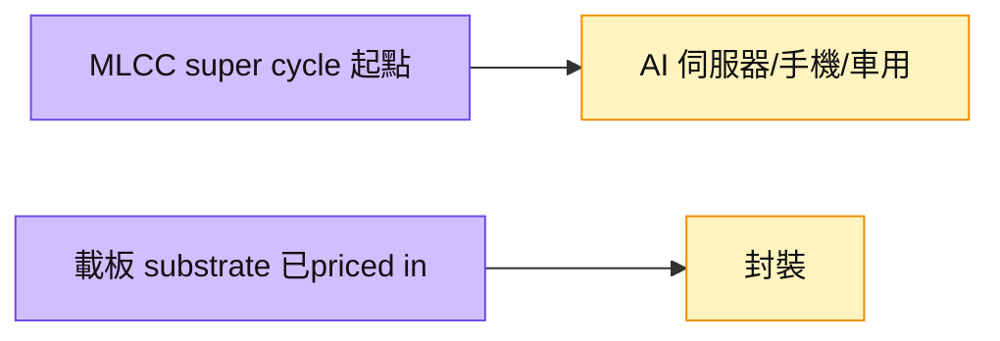

# 009150.KR(semco)

## 基本資料
SEMCO（Samsung Electro-Mechanics，三星電機）為 **MLCC 與載板（substrate）** 大廠。大和記憶體分析師 SK Kim 在 2026-07 電話會議中表示，其目前**最看好 SEMCO**——認為 MLCC 將進入超級循環，「現在的 MLCC 就像 3Q25 的記憶體剛開始」，而載板題材大致已 priced in。資料來源：[[大和 韓國記憶體產業電話會議摘要]]。

## 核心技術／競爭優勢
- **MLCC 超級循環題材**：分析師視 MLCC 為下一個 super cycle 起點，重點在 MLCC 而非已反映的載板。
- **產品組合**：MLCC + 半導體載板（substrate），跨 AI 伺服器、手機、車用。

## 產品與應用
| 產品 / 服務 | 應用 | 相關客戶 / 下游 |
|-------------|------|-----------------|
| MLCC | AI 伺服器、手機、車用 | 系統廠、模組廠 |
| 半導體載板 | 封裝基板 | 晶片／封裝客戶 |

## 圖片 / 架構圖

圖說：大和看好 SEMCO 的 MLCC 進入超級循環（重心在 MLCC，載板已反映），對應被動元件族群上行。

## 時間軸
| 時間 | 事件 | 類型 | 重要性 | 備註 |
|------|------|------|--------|------|
| 2026H2 | MLCC 超級循環起點（分析師觀點） | 規格升級 | ⭐⭐ | 類比 3Q25 記憶體起漲 |
| 2026-10-21 | NVIDIA 官方宣布 SEMCO 加入其封裝載板供應鏈（韓國既有產線先供貨，支持世宗、釜山新廠） | 客戶／產能 | ⭐⭐⭐ | [[research_產業合作技術發表_2026-10-22]]；fact |
| 2026-10-21 | SEMCO 自家新聞稿：與 NVIDIA 簽多年期 ABF 載板策略合作，共同出資世宗、釜山專用產線，2026 年開始供貨 | 客戶／產能 | ⭐⭐⭐ | [[research_產業合作技術發表_2026-10-23]]；fact |
| 2026–2028 | NVIDIA 載板供貨量預估每年雙位數成長 | 放量 | ⭐⭐ | SEMCO 新聞稿預估（estimate） |
| 2028 | NVIDIA 配額預計占 SEMCO 年度封裝載板產能「相當比例」 | 放量 | ⭐⭐⭐ | NVIDIA 與 SEMCO 新聞稿，未揭露比例與金額 |

→ 對照 [[時程_2026記憶體與AI催化劑]]

## 供應鏈位置
- 下游：AI 伺服器、手機、車用系統廠
- 所屬供應鏈：[[供應鏈_被動元件]]；相關技術（MLCC）
- 載板供應鏈：[[供應鏈_先進封裝載板]]；2026-10-21 起列入 [[NVDA.US(nvidia)]] 三家載板夥伴（另兩家為 [[4062.JP(ibiden)]]、[[3037_欣興（市）]]）
- 相關族群：被動元件（MLCC）與載板

## 相關公司
| 公司 | 關係 | 說明 |
|------|------|------|
| [[005930.KR(samsung)]] | 集團關聯 | 三星集團體系 |
| [[2327_國巨（市）]] | 同業 | MLCC 競爭／台系對照 |
| [[NVDA.US(nvidia)]] | 客戶 | 2026-10-21 官方宣布加入 NVIDIA 封裝載板供應鏈 |
| [[3037_欣興（市）]] | 同業 | 同列 NVIDIA 載板擴產夥伴，ABF 載板競爭 |
| [[4062.JP(ibiden)]] | 同業 | 同列 NVIDIA 載板擴產夥伴，NVIDIA 主力 ABF 供應商 |

> [!warning] 風險與注意事項
> - 觀點來源單一：MLCC 超級循環目前主要為賣方（大和 SK Kim）觀點，待更多需求數據佐證。
> - 載板已反映：substrate 上行空間可能有限。

## Goldman Sachs 2026-07-07 亞洲科技 2H26 策略

- GS 認為 SEMCO 三引擎同時受惠 AI：(1) AI 伺服器與車用 MLCC；(2) 新成長動能矽電容；(3) ABF 載板，受惠供需有利與 AI 客戶擴增（thesis／中）。
- MLCC：每台 AI 伺服器 MLCC 用量隨功耗提高而增加，能製造 AI 伺服器 MLCC 的廠商很少，產業稼動率已在 90% 以上。AI 伺服器 MLCC 單價是標準品的數十倍、毛利更高，產品組合提升推高 ASP 與毛利率。ABF：更大尺寸、更多層數使供給趨緊，產業稼動率已滿、近中期新增產能有限（estimate／中）。
- 07-07 Buy，TP KRW2,600,000（附表收盤價 KRW1,828,000，上檔 42.2%），FY27／FY28 P/E 40.8x／24.8x。這是第二個賣方來源（高盛），可部分緩解上方「觀點來源單一」的限制。框架見 [[分析_GS亞洲科技2H26投資策略_AI硬體循環與選股框架_20260707]]。

## NVIDIA 載板供應鏈（2026-10-21 加入）

- NVIDIA 於 GTC Berlin 發布供應鏈擴產新聞稿，宣布 SEMCO 加入其封裝載板供應鏈：先以韓國既有產線提供即時產能，並支持設施升級與世宗、釜山新廠；到 2028 年，NVIDIA 配額預計占 SEMCO 年度封裝載板產能的「相當比例」。新聞稿未揭露金額（fact／高）。
- 同稿 NVIDIA 稱三年內載板產能提升 2.5 倍，夥伴另有 [[4062.JP(ibiden)]]、[[3037_欣興（市）]]。這使 SEMCO 的載板題材由「已 priced in」轉為有具名 AI 客戶的產能綁定，與上方大和 2026-07 判斷時點不同，並列保留。
- 未證實線索（rumor）：韓媒 Maeil 2026-10-22 報導 Tesla 與 NVIDIA 合計投資 3.7 兆韓元於 SEMCO 世宗載板產線（NVIDIA 2.6 兆、Tesla 1.1 兆），截至彙整時未見公司公告或 DART 申報。
- 來源：[[research_產業合作技術發表_2026-10-22]]（NVIDIA 新聞稿 2026-10-21；Maeil 報導列於捨棄線索）。

### SEMCO 自家新聞稿補充（2026-10-21）

- **合作形式**：雙方簽訂策略合作，**共同出資**在世宗、釜山既有廠區設 NVIDIA 專用 ABF 載板產線；多年期合約，2026 年開始供貨（fact／高）。
- **供貨範圍**：NVIDIA 運算晶片用先進封裝載板，以及資料中心高速**網路交換器晶片**用載板；後者是 NVIDIA 新聞稿未寫的部分。
- **量能**：合約期間供貨量預估每年雙位數成長；2028 年 NVIDIA 配額占 SEMCO 年度封裝載板產能「相當比例」（estimate，公司預估）。
- **技術**：超微細線路降低訊號損耗；大尺寸、多內埋元件下的翹曲與平整度控制；計畫把 **MLCC 與矽電容直接內埋在載板**做電源管理與雜訊抑制，等於把 MLCC、矽電容與 ABF 三條業務綁在同一個客戶專案上，對應上方 GS「三引擎」框架。見 [[技術_矽電容]]、[[技術_MLCC]]。
- **未揭露**：金額、層數、線寬線距、是否含玻璃基板。上方 Maeil「NVIDIA 2.6 兆韓元」仍未獲公司證實，維持 rumor。
- 來源：[[research_產業合作技術發表_2026-10-23]]（SEMCO 新聞稿，PR Newswire，2026-10-21）。

## 來源
- [[research_產業合作技術發表_2026-10-23]] — SEMCO 自家新聞稿彙整，2026-10-21；NVIDIA ABF 載板策略合作、交換器載板、內埋 MLCC／矽電容。
- [[research_產業合作技術發表_2026-10-22]] — NVIDIA 官方新聞稿彙整，2026-10-21；SEMCO 加入 NVIDIA 載板供應鏈。
- [[260707_gs_asia-tech-2H26-strategy]] — Goldman Sachs，2026-07-07；亞洲科技 2H26 策略，AI MLCC／矽電容／ABF 三引擎與 Buy／TP KRW2,600,000。
- [[大和 韓國記憶體產業電話會議摘要]] — 大和，2026-07-02

- [[20260624_0819_TECHNOLOGY_20260623_1150]]（2026-06-23）
- [[20260626_0803_20260624__群益被動元件講座_定錨(給客戶版)]]（2026-06-24）
- [[Samsung Electro-Mechanics GS 260723]]（2026-07-23）

- [[報告_群益上海_玻璃材料_20261020]]（2026-10-20）

## 相關頁面

- [[AMKR.US(amkor)]]
- [[技術_ABF載板]]
- [[時程_2026-2028十月券商催化劑]]
- [[時程_2026Q3Q4_AI網通與硬體催化劑]]
- [[6981.JP(murata)]]
- [[技術_MLCC]]
- [[供應鏈_記憶體]]
- [[分析_記憶體超級循環2026]]

### 2026-08-23 載板與被動元件更新

- [[Samsung Electro-Mechanics GS 260723]]：Goldman Sachs 報告補充 SEMCO 的 MLCC／載板觀察，但 PDF 文字層未擷取到可可靠引用的數值，僅保留為方向性來源，不新增財務 claim。
