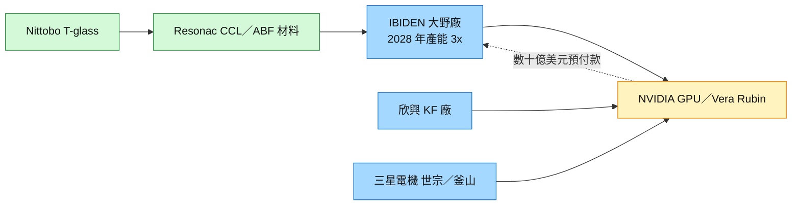

# 4062.JP(ibiden)

## 基本資料

IBIDEN（揖斐電，東證 4062）是日本 IC 封裝載板龍頭，主力為高階 ABF（FC-BGA）載板，應用於 AI GPU、伺服器 CPU 與 AI ASIC；另有陶瓷（汽車排氣 DPF 等）事業。AI 是近年成長主軸：既有 wiki 資料把 IBIDEN 列為 [[NVDA.US(nvidia)]] GB300／Rubin 世代 ABF 主供應商，並在大野（Ono）、河間廠大規模擴產。

2026-10-21 NVIDIA 官方供應鏈擴產新聞稿確認：NVIDIA 對 IBIDEN 提供數十億美元等級的產能預留預付款，支持大野廠擴至現有產能的 3 倍，新增產能 2028 年第一季開始爬坡（協議於 2026 年稍早簽訂；fact／高）。這是 NVIDIA 首度以官方文件公開 IBIDEN 的客戶出資擴產。

主要資料來源：[[research_產業合作技術發表_2026-10-22]]（NVIDIA 新聞稿，2026-10-21）；歷史份額與產能口徑見 [[供應鏈_先進封裝載板]]、[[技術_ABF載板]]、[[3037_欣興（市）]]（各自來源）。

## 核心技術／競爭優勢

- **大尺寸、高層數 ABF 良率**：AI GPU／ASIC 載板面積與層數持續增加，IBIDEN 長期是 NVIDIA 高階 GPU 載板的主力供應商，良率與交期經驗是主要門檻。
- **客戶出資綁定產能**：NVIDIA 以數十億美元預付款支持大野廠擴產，客戶綁定程度高於一般年度議價；既有資料也指日系載板多採年度 LTA 談判。
- **EMIB-T 等高複雜度載板**：既有資料將 IBIDEN 與 [[3037_欣興（市）]] 列為 Intel EMIB-T 高複雜度載板僅有的兩家供應商（券商／產業口徑，信心中）。
- **上游材料集中的受益者**：T-glass（Nittobo）→ Resonac CCL → 欣興／IBIDEN 的高階材料鏈集中，擁有長約的大廠較能取得材料。

## 產品與應用

| 產品 / 服務 | 應用 | 相關客戶 / 下游 |
|-------------|------|-----------------|
| 高階 ABF（FC-BGA）載板 | AI GPU、AI ASIC、伺服器 CPU | [[NVDA.US(nvidia)]]、[[AMD.US(amd)]]、[[INTC.US(intel)]] |
| EMIB-T 高複雜度載板 | Intel 先進封裝、Google TPU v9 路線 | [[INTC.US(intel)]]、[[GOOGL.US(alphabet)]] |
| 陶瓷產品 | 汽車排氣處理 | 車廠 |

## 圖片 / 架構圖

圖說：NVIDIA 2026-10-21 公布的載板三夥伴與 IBIDEN 上游材料鏈；虛線為 NVIDIA 對 IBIDEN 的產能預留預付款。

## 時間軸

| 時間 | 事件 | 類型 | 重要性 | 備註 |
|------|------|------|--------|------|
| 2026 年稍早 | 與 NVIDIA 簽訂大野廠產能預留協議 | 客戶／產能 | ⭐⭐⭐ | NVIDIA 新聞稿回溯說明 |
| 2026-10-21 | NVIDIA 官方公開：數十億美元預付款、大野廠擴至 3 倍 | 客戶／產能 | ⭐⭐⭐ | [[research_產業合作技術發表_2026-10-22]] |
| 1Q28 | 大野廠新增產能開始爬坡 | 放量 | ⭐⭐⭐ | NVIDIA 新聞稿 |
| 2026–2028 | NVIDIA 三年內載板產能提升 2.5 倍（IBIDEN、三星電機、欣興分擔） | 產業 | ⭐⭐⭐ | 同上 |

→ 跨公司時程見 [[時程_2026-2028十月券商催化劑]]

## 供應鏈位置

- **上游**：T-glass（Nittobo）、ABF 樹脂（Ajinomoto）、CCL（Resonac）。
- **下游**：[[2330_台積電（市）]] CoWoS 與 OSAT 封裝 → [[NVDA.US(nvidia)]]、[[AMD.US(amd)]]、[[INTC.US(intel)]]。
- **同業**：[[3037_欣興（市）]]、[[8046_南電（市）]]、[[3189_景碩（市）]]、[[009150.KR(semco)]]。
- **所屬供應鏈**：[[供應鏈_先進封裝載板]]；技術見 [[技術_ABF載板]]。

## 相關公司

| 公司 | 關係 | 說明 |
|------|------|------|
| [[NVDA.US(nvidia)]] | 主要客戶 | 2026-10-21 官方公開數十億美元產能預留預付款 |
| [[3037_欣興（市）]] | 同業 | 同列 NVIDIA 載板三夥伴；NVIDIA 份額口徑多方並存 |
| [[009150.KR(semco)]] | 同業 | 2026-10-21 新加入 NVIDIA 載板供應鏈 |
| [[8046_南電（市）]] | 同業 | 台系 ABF 廠；AMD 訂單移轉傳聞見南電頁 |
| [[3189_景碩（市）]] | 同業 | 台系 ABF 第三 |
| [[INTC.US(intel)]] | 客戶 | EMIB-T 高複雜度載板 |
| [[AMD.US(amd)]] | 客戶 | 伺服器 CPU ABF 載板 |

> [!warning] 風險與注意事項
> - **NVIDIA 份額口徑衝突**：既有資料中統一投顧（2026-03）估 GB300 IBIDEN 80–90%、VR200 90–95%；acecamptech memo（2026-05）則估 NVIDIA 伺服器 ABF IBIDEN 約 35%、欣興約 65%。三星電機加入後份額可能再分散，不自行裁定。
> - **客戶集中**：大野廠擴產由 NVIDIA 預付款支持，若 GPU 世代轉換或封裝路線改變（玻璃基板、CoPoS），新產能利用率有風險。
> - **材料瓶頸**：T-glass 等上游材料集中，擴產進度受材料取得影響。

## 來源

- [[research_產業合作技術發表_2026-10-22]] — NVIDIA 官方新聞稿彙整，2026-10-21；IBIDEN 大野廠 3 倍、1Q28 爬坡、數十億美元預付款。
- 歷史份額、產能與 EMIB-T 供應口徑：見 [[供應鏈_先進封裝載板]]、[[技術_ABF載板]]、[[3037_欣興（市）]] 各頁來源（統一投顧 2026-03、acecamptech 2026-05 等）。

## 相關頁面

- [[AMKR.US(amkor)]]
- [[供應鏈_先進封裝載板]]
- [[技術_ABF載板]]
- [[技術_玻璃基板]]
