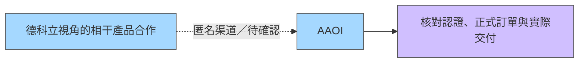

# AAOI.US — Applied Optoelectronics

## 基本資料

| 項目 | 內容 |
|------|------|
| 全名 | Applied Optoelectronics, Inc. |
| 代號 | AAOI（Nasdaq） |
| 成立 | 1997年 |
| 總部 | 美國德克薩斯州（Sugar Land, TX） |
| 市值 | ~US$6.7億（2025年11月） |
| 定位 | 光纖網路產品整合供應商；從磊晶到模組垂直整合 |

## 業務概況

- 提供有線電視（CATV/Cable TV）、光纖到府、網際網路資料中心從零組件到模組的整合方案
- **垂直整合**：InP磊晶 → CW雷射 → 光偵測器 → 光收發模組（全自製）
- 主要客戶：AWS（Amazon）為最大，另有Microsoft、Oracle等
- 核心優勢：**CW雷射自製**（3-4吋晶圓；全球多數競爭者仍用2吋）

### 光模組 PCB 供應鏈觀察（2026-09-30）

紅板科技相關匿名訪談把 AAOI 列為其光模組 PCB 前段客戶（新易盛之後，與 [[COHR.US(coherent)]] 並列），並稱 AAOI 與 Coherent 是目前主要要求 Cavity（開蓋）盲槽工藝的客戶；此設計成本較高、加工較難，新易盛與旭創多在設計初期避開。這是 PCB 供應商端渠道說法，不代表 AAOI 揭露的採購結構，信心低；製程細節見 [[技術_mSAP]]。

來源：[[memo_AceCamp_紅板科技光模組PCB與mSAP_20260930]]（2026-09-30）；辨識見 [[分析_20260929-30專家紀要受訪公司辨識與供給驗證]]。

## 圖片/架構圖

`[待補來源圖]` 需官方 IR 光收發模塊產品圖或 CPO 雷射元件示意圖佐證，現有研究筆記不足以支撐架構示意圖。

## 核心競爭優勢

### CW雷射垂直整合
- 800G採用**2×4架構**：僅需2顆CW雷射（vs EML架構需8顆）→ 成本更低、功耗更低
- Finisar（業界比較）：仍停留2吋製程，3吋認證都尚未通過
- AAOI：已進行4吋認證，計畫2年內導入6吋製程
- 全自動化生產：人力需求僅競爭對手的**五分之一**；美國生產成本可能低於競爭對手泰國廠

### 雷射供應瓶頸
- 雷射已成為全產業最關鍵瓶頸；設備交期18個月，需預付50-80%訂金
- 單台EBIN設備US$200-300萬；Stepper US$400萬
- 三大客戶2027年雷射需求合計>4,000萬顆

## 產品線與量產時程（Nov 2025 法說會）

| 產品 | Q4 2026預估 | 單價 | 毛利率目標 |
|------|------------|------|---------|
| 100G | ~NT$3,500-4,000萬/季 穩定 | — | — |
| 400G | 單季~US$1.8億 | ~US$200 | — |
| **800G** | 50-60萬顆 | ~US$400 | ~38% |
| **1.6T** | ~5萬顆 | ~US$800 | 40%+ |
| Cable TV | 全年US$3億+（Q4~US$8,000萬） | — | 2026Q4目標40% |

### 1.6T進度（Nov 2025）
- 2025年12月向4-5家客戶送樣
- 2026年6月量產；2026 Q4出貨~5萬顆
- 3.2T：最早2027年量產（技術尚未成熟）

## 2026年資本支出

- 2025年資本支出：US$1.2-1.5億（歷史新高）；主要用於雷射產能擴充
- 雷射月產能目標：2026年底250萬顆 → 2027年600萬顆
- 目標總營收規模（capex完成後）：US$12-15億

## 財務數據（Bloomberg分析師預估，2025年11月）

| 項目 | FY24A | FY25F | FY26F | FY27F |
|------|-------|-------|-------|-------|
| 營收（US$M） | 249 | 453 | 823 | 1,447 |
| YoY | +14.6% | +81.6% | +81.8% | +75.8% |
| 毛利率（%） | 51.9 | 30.5 | 32.6 | 34.3 |
| EPS（US$） | 3.96 | 0.38 | 0.50 | 1.05 |

*注意：FY24毛利率51.9%較高為一次性因素*

## CPO雷射需求展望

- CPO雷射功率需求：400-450mW（vs 1.6T 100mW，800G 75-80mW）
- CPO雷射芯片面積擴大超過**6倍**（長1mm→4mm，寬250→350微米）
- 考慮良率，CPO實際雷射產能需求是當前的**8倍以上**
- 公司：CPO對雷射需求影響被市場嚴重低估

## 融資與資本結構

- 2025年ATM增資US$1億；總現金約US$5.3億
- Microsoft可能2026 Q2前進行股權投資~US$3億
- 法律：已對Eoptolink Technology提起專利侵權訴訟；CIG USA對AAOI提起IPR

## 券商追蹤

| 券商 | 評等 | TP（US$） | 日期 |
|------|------|---------|------|
| 富邦投顧 | — | **33.74** | 2025-11-26 |
| Nomura | Buy | 41 | 2025-11-21 |
| Raymond James | Outperform | 30 | 2025-11-13 |

## 最新財務結果（W26 2026，光通訊三雄 beat & drop）

| 項目 | 結果 |
|------|------|
| 財報結果 | **beat 共識** |
| 股價反應 | **-13%**（三雄中跌幅最大：COHR -9%、LITE -8%、AAOI -13%）|

> **解讀**：AAOI beat 但股票反映最差，可能因相對估值最高（小市值高 beta 性質）。光通訊股 beat & drop 模式顯示市場認為 AI 採購溢價已充分計入，缺乏新催化劑。

資料來源：[[research_simpletechtrend_CPO矽光子ECTC2026_20260629]]

## 關聯頁面

- [[技術_光互連]]
- [[COHR.US(coherent)]]（光通訊三雄；競爭/比較）
- [[LITE.US(lumentum)]]（光通訊三雄；競爭）
- [[NVDA.US(nvidia)]]（AAOI CW Laser 供應客戶）
- [[2455_全新（市）]]（台灣競爭者；InP磊晶/CW Laser）
- [[3081_LandMark光電（市）]]（CW Laser競爭）

## 相關頁面
- [[供應鏈_AI光互聯]]（元大 2026-09-21 光通訊產業報告引用）
- [[分析_Lumentum_CPO_NPO_OCS與雷射產能_20260820]]

- [[分析_Coherent毛利率與1.6T良率爬坡]]
- [[CIEN.US(ciena)]]
- [[技術_光模塊]]
- [[技術_mSAP]]
- [[分析_20260929-30專家紀要受訪公司辨識與供給驗證]]
- [[6706_惠特（市）]]

## 2026-08-29 1.6T 相干業務渠道觀察

德科立視角紀要稱與 AAOI 有少量 1.6T 相干產品合作／訂單，且客戶希望 2026 年約 10 萬、2027 年約 50 萬的量。合作屬 rumor／中低信心；數量屬客戶目標 estimate／低信心，不能視為 AAOI 公司出貨指引或已簽訂訂單。

這類長距離相干產品的 US$1,200–1,300 訪談報價，與既有頁的短距資料中心 1.6T 產品口徑不同，不覆蓋既有 ASP。供應商稱量測設備及關鍵光學物料限制交付，也不能推成 AAOI 所有產線的產能瓶頸。

圖說：訪談關係與驗證路徑示意，非已確認量產架構。來源：[[memo_AceCamp_德科立DCI與物料瓶頸_20260829_70566441]]（2026-08-29）；辨識、不同產品 ASP 與反證見 [[分析_20260828-29專家紀要公司辨識與供給瓶頸]]。

## 2026-11-12 國泰 Call Memo

- 產能：台灣三廠（林口二、新莊一）全被第一大客戶 book、滿載；寧波四廠滿載、第五廠最快 4Q27；美國五廠運作中。800G＋1.6T 百萬級月產能預計 4Q27 達成（美國延遲）。美國擴產因電力延遲：當地供電僅一般辦公大樓水準，變壓器交期 6 個月–1 年，自購天然氣渦輪發電，供電多花 US$1 億多；美國設備已到七、八成、月產能約 20 幾萬，1Q27 開出、營收約 2027 年 3–4 月反映；12/10 開放投資人參觀美國產線。
- 營收：2026 年約 US$11 億出頭（原預期約 11 億，100G 需求下降）；1.6T 4Q26 量產，訂單逾 US$10 億；4Q26 data center 營收近 US$3 億，2027 年底／2028 年初月營收約 US$4 億。2027 年訂單 US$40 幾億，較有把握 US$30 幾億；2028 年 US$60 億以上（公司說法，estimate）。
- LTA：CSP 客戶 B 已簽約約 US$11–15 億（僅 1.6T）；CSP 客戶 A 第二份 LTA 已談完、待簽，含 transceiver 與雷射，2027 年約 US$10 億，未來一年 US$40–50 億，合約價值約 US$60–70 億。CSP 客戶 A 雷射自 2Q28 起每月 600 萬顆。
- 瓶頸：DSP 缺貨（連 800G DSP 都缺，源頭台積電產能），正與 Marvell、Broadcom 協商並認證第三家（Credo）；InP 基板吃緊，認證替代技術需至 2Q27–3Q27。
- 雷射：美國 MOCVD 由 3 台增至 5 台，2027 年 5 月 10 台、2027 年再加 4 台至 14 台；第二廠 2027 年 8–9 月進機，三年內 30 台以上。雷射毛利率 60% 以上（transceiver 30–35%）；BH 結構難外包，300mW 雷射功率效率約 25%（Lumentum 不到 20%）；能做高功率雷射者僅 AOI、Lumentum、Coherent。NPO 需 150–200mW、CPO 300–350mW。
- 獲利：2027 年稅後淨利率約 17–18%，4Q27 non-GAAP 逾 20%，長期目標 25%；毛利率 2027 年 35% 以上、之後 40%。
- 技術看法：scale out 不會被 NPO／CPO 取代；400G per lambda 卡在 DSP，未來仍走 200G per lambda；Marvell 併購 Lumentum 使 Marvell 成為競爭對手。
- 來源：[[活動_AppliedOptoelectronicsAAOI_國泰CallMemo_20261112]]。

## 來源

- [[活動_AppliedOptoelectronicsAAOI_國泰CallMemo_20261112]] — 國泰證期 call memo，2026-11-12。

- [[memo_AceCamp_紅板科技光模組PCB與mSAP_20260930]] — AceCamp Tech，2026-09-30，紅板科技相關匿名訪談；AAOI 為光模組 PCB 客戶、Cavity 工藝需求，低信心。
- [[memo_AceCamp_德科立DCI與物料瓶頸_20260829_70566441]] — AceCamp Tech，2026-08-29，匿名專家紀要。

- [[memo_Coherent毛利率_1.6T良率_OCS_DFAU專家觀點_日期不詳]]（日期不詳）
- [[research_simpletechtrend_CPO矽光子ECTC2026_20260629]]（2026-06-29）
- [[活動_Lumentum_Fubon_LITE_IR_20260820]]（2026-08-20）

- [[AAOI Con-Call memo_Fubon 20251126]]（2025-11-26）

- [[活動_惠特私訪_20260422]]（2026-04-22）
