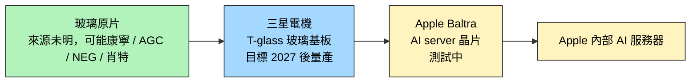

# AAPL.US(apple)

> [!note] 本頁範圍說明
> 本頁僅就本次 ingest 涵蓋的主題 — **Baltra AI server 晶片的玻璃基板路線** — 記錄 Apple 的角色。Apple A 系列、M 系列、iPhone、Vision Pro 等其他主題等之後 ingest 對應主題的來源時再補。
> 
> **內容單薄警告**：本次來源（[[報告_其他_玻璃基板_20260511]]）對 Apple 的描述僅一段，故本頁深度有限，不代表 Apple 業務全貌。

## 基本資料
Apple（蘋果），全球消費電子龍頭，本次主題範圍內的角色是**內部 AI server 晶片 Baltra 的玻璃基板路線採用者**。Apple 並未自製玻璃基板，而是與 **三星電機**（Samsung Electro-Mechanics）合作採用 T-glass 路徑。

主要資料來源：[[報告_其他_玻璃基板_20260511]]（國金證券，2026-05-11）。

## 核心技術／競爭優勢

- **Baltra AI server 晶片玻璃基板測試**：Apple 已啟動 Baltra AI 服務器晶片的玻璃基板測試
- **採用三星電機 T-glass**：玻璃基板供應商為三星電機（Samsung Electro-Mechanics）
- **量產時程（三星電機目標）**：三星電機目標 **2027 年後** 實現量產（claim 類型 thesis、信心中；注意：這是供應商目標，不等於 Apple 出貨時點）
- **路線差異**：相對於 [[INTC.US(intel)]] 自製、[[2330_台積電（市）]] 走 CoPoS 對外服務，Apple 走**品牌客戶 + 三星電機供應**路徑

## 產品與應用

| 產品 / 服務 | 應用 | 上游玻璃基板供應 |
|-------------|------|------------------|
| Baltra AI server 晶片 | Apple 內部 AI 加速器 | 三星電機（T-glass） |

## 圖片 / 架構圖

![[報告_MorganStanley_Apple產品路線與估值_20261001_p015.png]]

圖說：MS p15：Siri AI 收費敏感度，屬未納基準財測的情境。
![[報告_MorganStanley_Apple產品路線與估值_20261001_p017.png]]

圖說：MS p17：iPhone 記憶體及其他成本拆分，FY 與美元口徑依圖表。

![[報告_GFHK_Apple_20260915_001.png]]

圖說：GF Securities (Hong Kong) 對 iPhone 各世代季度 build plan 的預估；iPhone 18 的 2026 年配置與年增率均屬券商模型，應以實際供應鏈出貨驗證。（2026-09-15）

![[報告_UBS_全球智慧型手機8月銷售_20261005_004.png]]
> UBS／Counterpoint 2026 年 8 月各品牌價格帶結構：Apple 幾乎全在 US$600 以上，且約四成在 US$1,000 以上；小米、vivo、OPPO 集中 US$100–299。這說明記憶體成本上升時 Apple 受影響較小、中低階 Android 受衝擊最大。

`[待補來源圖]` 需 Apple 官方供應鏈揭露或第三方拆解報告佐證；上方為自製供應鏈示意圖。

## EPS 記錄
（本次來源未涉及）

| 季度 | EPS (USD) | YoY | 備註 |
|------|-----------|-----|------|
| — | — | — | 本次來源未揭露 |

## EPS 預估
（本次來源未涉及）

## 目標價與評等
（本次來源未涉及）

## 時間軸

| 時間             | 事件                          | 類型     | 重要性 | 備註                  |
| -------------- | --------------------------- | ------ | --- | ------------------- |
| 2026-05（報告日點到） | Baltra AI server 晶片啟動玻璃基板測試 | 路線確認   | ⭐⭐  | 國金引述                |
| 2027 後         | 三星電機目標量產 T-glass            | 上游量產目標 | ⭐⭐  | 三星電機目標，不等於 Apple 出貨 |
| 1Q27／3Q27 | 發表節奏改為兩波、各 3 款機型 | 產品節奏 | ⭐⭐⭐ | UBS 2026-10-05 引供應鏈；推動 2027E sell-in +4.7%（estimate） |

## 供應鏈位置
- **上游玻璃基板**：三星電機（Samsung Electro-Mechanics，T-glass，未建頁）
- **上游玻璃原片**：未明（可能康寧 / AGC / NEG / 肖特之一，本次來源未指明）
- **核心代工**：[[2330_台積電（市）]]（Apple 主要晶圓代工夥伴，本次範圍外但有上下游關係）
- **下游**：Apple 內部 AI 服務器（自家使用）
- **所屬供應鏈**：[[供應鏈_先進封裝載板]]

## 相關公司

| 公司 | 關係 | 說明 |
|------|------|------|
| [[2330_台積電（市）]] | 上游代工 | Apple 主要晶圓代工夥伴（本次範圍外） |
| [[INTC.US(intel)]] | 玻璃基板路線同儕 / 競爭 | 不同採購策略：Intel 自製、Apple 走三星電機 |
| [[005930.KR(samsung)]] | 手機競爭 | 全球兩大品牌；2026 年 8 月 YTD sell-through Apple +8.7%、三星 -4.1% |
| [[1810.HK(xiaomi)]] | 手機競爭 | 中低階為主，YTD -18.1%，受記憶體成本衝擊較大 |
| 三星電機（Samsung Electro-Mechanics） | 玻璃基板供應商 | T-glass 供應，本次未建頁 |
| [[3008_大立光（市）]] | 鏡頭供應商 | 多家券商視為 iPhone 主鏡頭可變光圈主要供應商；實際份額未經 Apple 確認 |
| [[2313_華通（市）]] | PCB 供應商 | Nomura Tech Tour（2026-08-20）轉述華通為 iPhone 主機板 mSAP 供應商之一，並與美系高階手機品牌協商成本轉嫁；份額未揭露 |

> [!warning] 風險與注意事項（本次範圍）
> - **量產時點 = 三星電機目標**：「2027 後」是三星電機的內部量產目標，不是 Apple Baltra 出貨時點。實際 Apple 產品上線時點可能更晚
> - **規格未公開**：T-glass 規格、Baltra 晶片規格、產量規劃均未在本次來源中揭露
> - **資料來源限制**：本份報告為國金證券二手引述，原始 Apple 對 Baltra / 玻璃基板的官方說法應另查蘋果官方與三星電機投資人關係

## 近期營運與研究更新

### 2026-09 iPhone 18 事件觀察

富邦投顧估算 iPhone 18 Pro Max／Fold 定價可能達 US$1,799／2,399，成本上升主因包括 2nm 晶圓、記憶體與快閃記憶體，以及鏡頭／軸承升規；這是券商模型，不是 Apple 定價或產品規格公告。報告並預期可變光圈鏡頭首度導入 iPhone 18，潛在受惠者為 [[3008_大立光（市）]]。

Nomura 2026-07-09 更早提出相同方向：2026 旗艦主鏡頭導入可變光圈後，2027 可能再有強化版可變光圈與潛望鏡內變焦、2028 主鏡頭解析度提升；同時指 Apple 終端漲價短期壓抑需求，為下修大立光 2026／2027F 淨利的原因之一。屬鏡頭供應商券商 estimate，不是 Apple 產品規劃公告（[[報告_Nomura_大立光CPO光纖陣列_20260709]]）。

### 2026-09-15 GFHK iPhone 18 更新

- GF Securities (Hong Kong) 維持 Hold／目標價 US$369（35x FY27E EPS）。該行以預購等待期偏短、規格升級有限與高容量機型加價，判斷 iPhone 18 Pro／Pro Max 初期需求偏溫和；此為券商通路觀察與估值判斷。
- 報告將 2026 年 iPhone Duo EMS 產量由 700 萬支降至 600 萬支，並將 iPhone 18 Pro／Pro Max build plan 降至 7,200 萬支，理由為轉軸與可變光圈鏡頭約束；DRAM／NAND 成本上升亦可能壓縮定價彈性。上述皆為券商 estimate，須以 Apple 財報、供應鏈營收與實際交期驗證。

來源：[[報告_GFHK_Apple_20260915]]（GF Securities (Hong Kong)，2026-09-15）。

### 2026-09-10 新品發表會（國泰 Memo）

- **iPhone 18 Pro／Pro Max：** A20 Pro 採 2nm、6 核 CPU（2 SuperCores＋4 效率核），GPU 7 核效能最高 +40%，新增第二組 Neural Engine 共 32 核、AI 運算 2 倍、記憶體頻寬 +50%；A20 Pro 改採類似 M 系列的封裝，Silicon Die 與 Memory 並排配置，使 Silicon 直接連接 Vapor Chamber，VC 面積為 iPhone 17 Pro 的 3 倍。主相機 48MP 首度導入可變光圈（6 片雷射切割葉片）。起價 1,199／1,299 美元，9 月 18 日上市。
- **iPhone Duo（首款摺疊）：** 7.6 吋內螢幕＋5.4 吋外螢幕，鈦金屬機身、超過 100 個精密零件的鉸鏈，搭載 A20 Pro 與 C2 Modem（上傳 +50%、功耗 −15%，美國支援 5G mmWave），全球僅 eSIM；起價 1,999 美元，10 月 16 日預購、10 月 23 日上市。
- **其他：** AirPods 5（ANC +50%）、Apple Watch Series 12／Ultra 4（新 Health Sensing System、S11 晶片）；Siri AI 可與逾 30 萬個 App 互動，Apple Intelligence 支援 16 種語言。
- **群組補充：** iPhone 內部代號 V62 Air 2、V63 18 Pro、V64 18 Pro Max、V67 18、V68 Ultra、V69 18e（I029，轉述）。
- 來源：[[活動_Apple_新品發表會Memo_20260910]]（國泰證期，2026-09-10）、[[memo_LINE投資人超商_產業消息與群友討論彙整_20260725-20261004]]。

### 2026-10-05 UBS 全球手機 sell-through

- **相對強勢延續：** 2026 年 1–8 月 iPhone sell-through 1.493 億支、年增 8.7%，是市占逾 10% 的大品牌中唯一正成長者（Counterpoint）。同期全球手機年減 8.9%。
- **2027 成長來源：** 主要 iPhone 供應商看好 2027 年出貨，理由為 (1) 發表節奏改為 1Q27、3Q27 各 3 款；(2) iPhone Duo 首 12 個月約 1,000 萬支。UBS 估 sell-in 2026E +8.5%、2027E +4.7%，評等 Neutral（2026-10-02 股價 US$333.69）。
- **與 GFHK 並列：** GFHK 2026-09-15 把 2026 年 iPhone Duo EMS 產量下修至 600 萬支（日曆年產量）；UBS 約 1,000 萬支是上市後 12 個月銷量，兩者期間與口徑不同，不視為衝突。
- 來源：[[報告_UBS_全球智慧型手機8月銷售_20261005]]（UBS，2026-10-05；Counterpoint 第三方統計為 fact／中，sell-in 預估為 estimate／中）。

## 本批來源更新（2026-10-11 入庫）

### 2026-10-01 Morgan Stanley：產品路線、代理服務與記憶體成本

Apple 的產品與服務包括 iPhone、Mac、iPad、穿戴裝置及 Services；本次新增產品營運與財測範圍，補足原頁的 Baltra 主題。

| MS 模型（美元，FY 截至 9 月） | FY26E | FY27E | FY28E |
|---|---:|---:|---:|
| EPS | 8.87 | 9.90 | 10.70 |
| 營收（十億美元） | 477.887 | 544.802 | 576.057 |
| 毛利率 | 48.7% | 46.9% | 47.8% |
| iPhone 出貨（百萬支，財務表口徑） | 259.021 | 264 | 270 |
| Services 營收（十億美元） | — | 136.951 | 151.161 |

MS 維持 Overweight，目標價 US$355（原 360），採 35x CY27 EPS US$10.15；FY27 EPS 9.90 與 CY27 10.15 的期間不同。牛／熊情境 US$453／194 不是基準目標價。上述為 estimate／中信心，與既有 UBS、GFHK 並列。

- FY27 iPhone Duo 約 US$43bn、占 iPhone 收入約 14%，首個完整週期產能約 2,000 萬支是 MS 模型。9／12 月季度出貨估 5,700／7,600 萬支；零件採購逾 9,000 萬套不等於完整手機生產或終端需求。
- Mac 供應與記憶體價格制約成長；MS 觀察漲價約 15%–25%，MacBook Neo 2026／27 出貨估 700／950 萬台，iPad 12 月季估 1,200 萬台。這些為渠道與券商估計。
- MS 基準財測未納 Siri AI 收費；FY28 10% 合格裝置採用、每月 US$7.92 可增加 Services US$9.1bn／EPS 約 4% 是敏感度情境，不是已公布方案。代理直接連商戶可能繞過部分 App Store／搜尋佣金；2.5bn 裝置、支付、權限與生物辨識有利平台留住交易，但不能把全部服務收入當作受威脅部分。
- 每支 iPhone DRAM＋NAND 成本由 FY26 US$72 升至 FY27 US$214，排除關稅 COGS 由 US$551→677；非記憶體成本反降 479→462。記憶體容量提升與價格上漲需拆開，退稅是一次性收益。

> [!warning] MS 內部口徑
> iPhone 出貨與換機週期在正文／圖表略有差異，採年度財務表出貨；產品／iPhone 毛利率在正文與財測表也不同，不合併為單一精確值。既有頁「本次未涉及 EPS」是初始來源範圍，本節補入後可查本次財測。

時間軸：2026Q4 追蹤財報、build plan 與需求調查；FY27 驗證 Duo 供給、產品調價及記憶體成本，FY28 觀察代理服務變現。同步 [[時程_2026-2028十月券商催化劑]]。

## 來源

- [[報告_Nomura_大立光CPO光纖陣列_20260709]]（Nomura，2026-07-09；iPhone 2027–2028 相機／鏡頭升規路徑與終端漲價影響，鏡頭供應商視角 estimate）
- [[Nomura tech tour]]（Nomura Asia Tech Tour，2026-08-20；華通稱 iPhone 主機板供應商擅長 mSAP，並與美系高階手機品牌協商調價）
- [[報告_MorganStanley_Apple產品路線與估值_20261001]] — Morgan Stanley，2026-10-01；原始研究／訪談全文，數字及時程依本批註記保留來源口徑。
- [[報告_UBS_全球智慧型手機8月銷售_20261005]]（UBS，2026-10-05；iPhone YTD sell-through、2027 發表節奏與 sell-in 預估）
- [[活動_Apple_新品發表會Memo_20260910]]（國泰證期新品發表會 Memo，2026-09-10）
- [[報告_其他_玻璃基板_20260511]]（國金證券「玻璃基板行業深度」，2026-05-11；分析師李陽 S1130524120003）
- [[事件分析_Apple iPhone 18 Preview_090826]]（富邦投顧，2026-09-08；iPhone 18 與 Fold 售價、鏡頭與 BOM 推估）

- [[報告_GFHK_Apple_20260915]]（2026-09-15）
- [[報告_MS_Apple發表會_20250909]]（2025-09-09）
- [[活動_JPM_頎邦訪談_20260527]]（2026-05-27）

- [[報告_UBS_智慧型手機記憶體成本_20260922]]（2026-09-22）

## 相關頁面

- [[分析_記憶體超級循環2026]]
- [[時程_2026Q3Q4_AI網通與硬體催化劑]]
- [[6147_頎邦（櫃）]]
- [[分析_頎邦矽光GoldBump與營運轉型2026]]
- [[2317_鴻海（市）]]
- [[技術_ABF載板]]
- [[技術_玻璃基板]]
