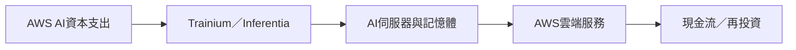

# AMZN.US(amazon)

## 基本資料
Amazon 是全球電子商務、雲端與廣告平台；AWS 為 AI 基礎設施與自研晶片需求的主要業務。富邦 2026-07-31 法說 memo 指出 2Q26 營收約 US$2,006 億、AWS 年增 37%，AI 業務與自研晶片是主要成長動能。

## 核心技術／競爭優勢
- AWS 雲端平台與既有企業客戶生態系。
- Trainium／Inferentia 自研晶片降低 AI 推論成本並增加供應鏈控制力。
- 電商、廣告與雲端現金流可支撐高資本支出。

## 產品與應用
| 產品 | 應用 | 相關下游 |
|---|---|---|
| AWS | AI 訓練、推論、企業雲端 | 企業與 AI 開發者 |
| Trainium／Inferentia | AI 加速器 | [[3443_創意電子（市）]]、伺服器供應鏈 |

## 圖片 / 架構圖

![[報告_Aletheia_創意電子首次覆蓋_20260922_p002.png]]
圖說：p2 將 AWS CPU 列為未納創意模型的選擇權；表格中的既有專案不證明 Graviton6 得標或供量。

> AWS 的 AI 資本支出透過自研晶片與伺服器供應鏈，回到雲端服務成長與再投資循環。

## 時間軸

| 時間／窗口 | 新增觀察 | 類型 | 重要性 | 來源與追蹤 |
|---|---|---|---|---|
| 2027H2／2028年中（情境） | Graviton6 規格／可能 general availability | 設計／供給驗證 | ⭐⭐ | Aletheia 2026-09-22／中低，[[報告_Aletheia_創意電子首次覆蓋_20260922]]；[[時程_2026-2028十月券商催化劑]] |

| 時間 | 事件 | 類型 | 重要性 | 備註 |
|---|---|---|---|---|
| 2026Q3 | 營收指引 US$1,970–2,020 億 | 財測 | ⭐⭐⭐ | 公司指引，來源為富邦 memo |
| 2026H2 | AWS AI 與自研晶片年化營收持續成長 | 放量 | ⭐⭐⭐ | 公司說法／券商整理 |
| 2026-10-19 | 與 3M 擴大策略商業關係，取得最多 3,162,015 股 3M 認股權證（依購買光連接等資料中心產品金額既得，累計 US$60 億全數既得） | 策略合作 | ⭐⭐ | 官方 fact（3M 8-K）；[[時程_2026Q3Q4_AI網通與硬體催化劑]] |

## 供應鏈位置
- 下游：AI 伺服器、記憶體、ASIC 設計服務；相關主題見 [[供應鏈_記憶體]]。
- 光互連採購：透過 [[MMM.US(3m)]] 擴大光連接產品採購，EBO ferrule 由 [[3406_玉晶光（市）]] 支援製造；見 [[供應鏈_AI光互聯]]。

## 相關公司
| 公司 | 關係 | 說明 |
|---|---|---|
| [[3443_創意電子（市）]] | ASIC 設計服務 | 報告提及自研 AI 晶片供應鏈 read-through，非已確認訂單 |
| [[MMM.US(3m)]] | 光連接供應商 | 2026-10-19 擴大策略商業關係，認股權證綁定光連接等產品累計購買額 |
| [[3406_玉晶光（市）]] | 間接上游 | 3M EBO ferrule 製造夥伴，非 Amazon 直接供應商 |

> [!warning] 風險與注意事項
> - AI 資本支出回收期、電力與晶片供給限制可能壓縮報酬。
> - AWS 成長若放緩或雲端競爭加劇，估值與投資循環可能反轉。

## Aletheia 2026-09-22：創意 COT／Turnkey 研究關聯

來源轉述 [[3443_創意電子（市）]] 與 AWS CPU 專案接洽；作者依產品週期推測 Graviton6 規格約2H27、general availability 約2028年中，並以 Trainium3 的1 CPU:4 XPU 作平台情境。Graviton6 身分、合作範圍、時點與配置皆未獲 AWS 本次正式確認，屬 thesis／中低信心；本次是 **CPU 線索**，不驗證本頁既有 Trainium 設計服務關係。

AWS 不在創意基準模型，100萬顆、TK3 毛利下約增加創意年 EPS40元只為有條件敏感度。原文稱 Graviton「62-bit」疑似誤植，本頁不採該字樣為CPU規格。

來源：[[報告_Aletheia_創意電子首次覆蓋_20260922]]（2026-09-22；券商 estimate／channel_check／thesis，信心依上段）。分析：[[分析_創意COT獲利與營運資金驗證_20260922]]。

## 2026-10-23 SemiAnalysis：Trainium3 轉向訓練（TorchNeuron）

SemiAnalysis 工程團隊實測 Trainium3 機櫃數週後的評估：Trainium 已在推論驗證（[[Anthropic（未）]] 以 Trainium2／3 跑正式推論與 RL rollouts），AWS 軟體策略轉向原生 PyTorch，目標補上研究型訓練的缺口；成熟度仍遠不及 CUDA，但方向正確（第三方實測，中信心）。

- **TorchNeuron**：取代 PyTorch/XLA，支援 eager mode、torch.compile、torch.distributed 與 DTensor／SimpleFSDP／DDP，程式碼只需把 `.to("cuda")` 改成 `.to("neuron")`；AWS 延攬 Google 原生 Torch on TPU 負責人。Day 0 先做好 BF16，暫不支援 TorchAO MXFP8。已支援 Hugging Face Accelerate、TorchTitan 等生態，並投入 vLLM／SGLang 社群。
- **TorchTitan 實測**：16 顆 Trainium2（64 個 LNC=2 邏輯核）訓練 Qwen3-32B，eager 11,099 tokens/s、MFU 23.89%；compiled 14,156 tokens/s、MFU 30.47%（1.28x）。gpt-oss 20B recipe 可直接跑；MoE 通訊尚未接上 PyTorch TokenSwitch API（AWS 承諾與 Meta PyTorch 團隊修改）。
- **編譯時間是主要痛點**：首步 eager 184.6 秒、compiled 255.7 秒（平均步長 30–55 倍），gpt-oss 編譯 27 分 17 秒；新編譯後端目標將 time-to-first-step 縮短最多兩個數量級。
- **MatMul／FlexAttention**：單一 Trainium3 邏輯核 MFU 在約 1 GFLOP 起高於 GB300，100 GFLOP 後 GB300／B200 較佳，1 TFLOP 以上 Trainium3 再領先；FlexAttention 96 項測試通過 89 項（93%），7 項失敗皆為大 batch／8,192 序列的編譯逾時。
- **品質控管**：最多 80,000 個實體核用於自動化 CI，測試 10 萬以上 Hugging Face 模型的數值與效能對齊；Neuron Explorer profiler 評價優於 NVIDIA 與 AMD 工具。

來源：[[memo_SemiAnalysis_Trainium3訓練與TorchNeuron_20261024]]（SemiAnalysis，2026-10-23；實測數字為第三方 fact，路線圖為公司目標）。相關：[[技術_AI推論與ASIC平台]]。

## 2026-10 AWS「Early Rack Receipt」與 Dark GPU（轉述）

FOMOSoc 引 Business Insider（10 月中）稱 AWS 內部「早期機櫃接收」流程：一個月內向 NVIDIA 提貨約 US$5bn GB300 機櫃，預計未來每月續拿約 US$3bn；部分機櫃放在中轉倉或電力未到位的機房（「暗 GPU」）。SemiAnalysis Podcast 的「GPU 過剩」原意是晶片拿得到、但土地、電力與廠房不足，並將 2027 年全球（不含中國）新增資料中心容量上調至近 50GW（已逾 24GW 進入後期施工）。屬媒體／電子報轉述，中低信心。來源：[[memo_FOMOSoc_KP思考筆記65_SpaceX特斯拉Nebius晶片過剩_20261024]]（2026-10-24）。

## 2026-10-19 3M 光連接認股權證

[[MMM.US(3m)]] 在 2026-10-19 的 Form 8-K 揭露：與 Amazon 全資子公司擴大策略商業關係，並發給 Amazon 另一子公司認股權證，最多可認購 3,162,015 股 3M 普通股，行使價 US$164.89、期間 7 年。85% 依 Amazon 購買光連接與其他資料中心產品的付款金額分批既得，累計付款達 US$60 億全數既得；其餘 15% 依未公開的事件里程碑既得。3M 同日宣布入股 [[3406_玉晶光（市）]] 約 4.7%，支援 EBO ferrule 與 CPO 光學件製造。60 億美元是既得門檻，不是採購承諾（官方 fact；需求規模為上限條件，信心中）。

## 來源

- [[research_產業合作技術發表_2026-10-24]] — 3M 新聞稿與 Form 8-K，2026-10-19；Amazon 認股權證條款、3M 入股玉晶光。
- [[memo_SemiAnalysis_Trainium3訓練與TorchNeuron_20261024]] — SemiAnalysis，2026-10-23；Trainium3 TorchNeuron／TorchTitan 實測、編譯時間、CI 與 profiler。
- [[memo_FOMOSoc_KP思考筆記65_SpaceX特斯拉Nebius晶片過剩_20261024]] — FOMO研究院 KP，2026-10-24；AWS Early Rack Receipt、SemiAnalysis「晶片過剩」原意與 2027 年 50GW。
- [[報告_Aletheia_創意電子首次覆蓋_20260922]] — Aletheia Capital，2026-09-22；創意專案、合作分工與未確認的上行情境。
- [[AMZN Q2 Earnings Call memo_Fubon 20260731]]（富邦證券，2026-07-31）

- [[20260721_歐洲半導體：全球科技網路直播—ASML管理層路演、儲存創新與蘋果AI_MS]]（2026-07-21）
- [[2480 敦陽科｜20260825｜富邦]]（2026-08-25）
- [[2Q財報驗證AI需求，資本回報成新焦點-CTBC20260805]]（2026-08-05）
- [[報告_MorganStanley_緯穎2Q26財報_20260809]]（2026-08-09）

- [[報告_UBS_ASIC_CPU驅動CoWoS擴產_20260922]]（2026-09-22）
- [[報告_統一_AmazonBedrock新聞評析_20260922]]（統一投顧，2026-09-22；Kimi K3 接入 Bedrock 與 EPS／目標價評析）
- [[memo_索爾思光電專家會議_日期不詳]]（使用者提供；來源稱 AWS 尚無送樣／出貨或明確採購需求，會議日期未提供）

- [[報告_Macquarie_世芯_20260918]]（2026-09-18）
- [[報告_UBS_智邦_20260918]]（2026-09-18）
- [[報告_UBS_緯穎_20260918]]（2026-09-18）

- [[memo_LINE_金像電定穎上游材料CCL_20261022]]（2026-10-22）

- [[報告_富邦_2027-2028半導體展望CoWoS模型_20261022]]（富邦投顧 2026-10-22 CoWoS 模型：Amazon capex 2026E／27E／28E US$220.0／346.7／448.9bn；Trainium 3 2027／2028 年 228.5 萬／104.3 萬顆、Trainium 3 Lite 51.7 萬／44.7 萬顆、Trainium 4 5.8 萬／88.1 萬顆（estimate，中））

## 相關頁面

- [[INTC.US(intel)]]
- [[2345_智邦（市）]]
- [[3661_世芯-KY（市）]]
- [[6669_緯穎（市）]]
- [[2480_敦陽科（市）]]

- [[分析_2026-08記憶體_AI需求與液冷ASIC更新]]
- [[時程_2026記憶體與AI催化劑]]
- [[時程_2026Q3Q4_AI網通與硬體催化劑]]
- [[供應鏈_AI光互聯]]
- [[索爾思光電（未）]]
- [[分析_索爾思光電800G與1.6T出貨追蹤]]

### 2026-09-22 Amazon Bedrock 生態更新

- 報告轉述 Kimi K3 接入 Amazon Bedrock；對 Amazon 的短期財務貢獻有限，但增加第三方模型供給與平台黏著度的可能性。
- Bedrock 若持續採用更多開放權重模型，可能提高 Token、推論、儲存、資料庫與 Agent 服務用量；這是平台商業模式推論，不是已確認收入。
- 統一投顧估 FY26／FY27 本業 EPS US$7.67／9.94、目標價 US$379，屬券商 estimate／valuation。
