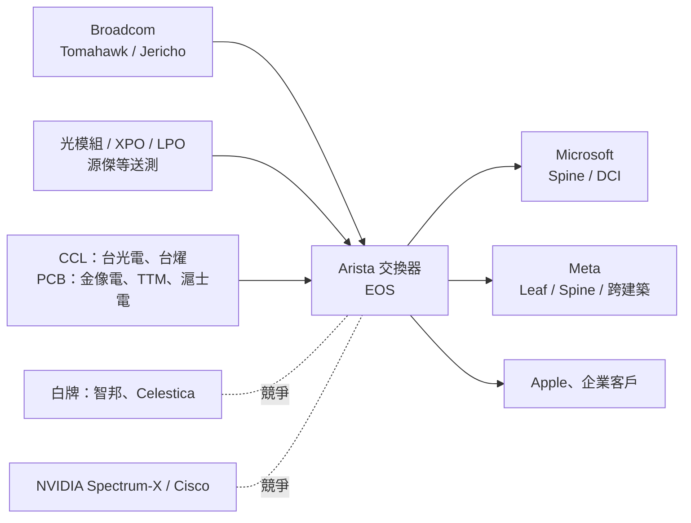

# ANET.US(arista)

## 基本資料

Arista Networks 是美國資料中心乙太網交換器與網路軟體公司，核心是自家網路作業系統 EOS，再搭配 [[AVGO.US(broadcom)]] 的交換器晶片（Tomahawk、Jericho 系列），組成品牌交換器賣給雲端業者與大型企業。Arista 不自己設計交換器晶片。

- **營收與成長**：2Q26 營收 30.36 億美元（年增 38%），non-GAAP 毛利率 63.4%、營益率 49.9%、EPS 1.03 美元；3Q26 財測營收 33 億美元（年增 43%）。2026 年營收目標第二次上修到 126 億美元（年增約 40%），其中 AI fabric 至少 35 億美元、企業 fabric 12.5 億美元（[[260805_ms_accton]]，2026-08-05，公司財測，信心高）。
- **AI 營收口徑**：MIC 估 2024 年總營收約 61 億美元，AI 相關交換器貢獻約 15–17 億美元（[[2025_01_07_MIC_AI資料中心網路產業發展趨勢觀察]]，研調 estimate）。
- **主要客戶**：大型雲端客戶以 [[MSFT.US(microsoft)]]、[[META.US(meta)]] 為主，[[AAPL.US(apple)]] 也大量使用；管理層預期 2026 年至少再有一家新客戶營收占比超過 10%。
- **供應鏈位置**：位於 AI 資料中心 scale-out 與 scale-across 網路的品牌交換器層，上游為交換器晶片、光模組、PCB／CCL 與 EMS 代工，下游為 CSP 與企業資料中心。

## 核心技術／競爭優勢

- **EOS 軟體與營運工具**：同一套 EOS 跑在不同世代與型號的交換器上，客戶可以統一管理大規模網路；MIC 指出客戶甚至可以把 EOS 搭配其他硬體使用，對追求快速部署的 CSP 吸引力高。申萬宏源認為交換器品牌商的門檻在超大規模網路的壅塞調度演算法，而非晶片。
- **與 Broadcom 的緊密關係**：能優先拿到最新世代交換器 ASIC，產品迭代速度快（MIC）。Meta Prometheus 的跨建築 Backend Aggregation 即採 Arista 7800 系列，搭配 Broadcom Jericho3 深緩衝晶片（[[research_產業合作技術發表_2026-10-26]]，官方 fact）。
- **主導 XPO MSA、推 LPO**：2026 年 3 月主導成立 XPO MSA，推出更大尺寸的可插拔光模組外型，每模組 12.8T（約 8 個傳統光模組整合），1U 交換器最多裝 16 個 XPO、面板總頻寬 204.8T，保留熱插拔，並可搭配液冷、LPO 省掉 DSP；目標與 Tomahawk 7（1,024 條 200G SerDes）同期上市（[[報告_SemiAnalysis_NPO光互連接棒_20260713]]、[[memo_光通信大厂调研_CPO出货量_FAU_MPC方案_acecamptech_20260529]]）。
- **大型叢集的 Spine／DCI 地位**：Spine 與 DCI 結構較複雜，CSP 多採品牌交換器；微軟的 Spine 與 DCI、Meta 的 Leaf／Spine 都以 Arista 為主要品牌（[[報告_福邦_PCB載板產業展望_20260401]]，引 650 Group）。

## 產品與應用

| 產品 / 服務 | 應用 | 相關客戶 / 下游 |
|-------------|------|-----------------|
| AI 資料中心乙太網交換器（800G 主流、1.6T 2H26 試量產） | AI 訓練／推論 scale-out 後端網路 | [[MSFT.US(microsoft)]]、[[META.US(meta)]] |
| 7800 系列模組化機箱（Jericho3 深緩衝） | 跨建築／跨園區 scale-across 網路（2 km 到逾 100 km） | [[META.US(meta)]]（Prometheus） |
| 企業資料中心與園區交換器 | 企業 fabric | 企業客戶，2026 年目標 12.5 億美元 |
| EOS 網路作業系統 | 網路自動化、遙測、資安 | 全產品線 |
| XPO 光模組外型（MSA） | Tomahawk 7 世代高密度前面板 | 光模組夥伴：InnoLight、新易盛等 |

## 圖片 / 架構圖

![[2026年網通產業展望_snapshot_c_112625_003.png]]

> 圖說：資料中心乙太網交換器營收依速率拆分（Arista 資料，2021–2027）。800G 從 2024 年起快速放大成為主流，≥1.6T 自 2026 年開始貢獻，整體市場由約 130 億美元成長到逾 200 億美元（[[2026年網通產業展望_snapshot_c_112625]]，2025-11-26）。

> 圖說：Arista 在 AI 網路供應鏈的位置。實線為供貨方向，虛線為競爭關係。

## EPS 記錄

| 季度 | non-GAAP EPS（美元） | YoY | 備註 |
|------|----------------------|-----|------|
| 2Q26 | 1.03 | +39% | 營收 30.36 億美元、OPM 49.9%，優於財測（[[260805_ms_accton]]） |
| 3Q26F | 1.07（公司財測） | +42% | 營收財測 33 億美元，GM 約 63%、OPM 48–49% |

## EPS 預估

| 年度 | 廣發證券（香港）EPS（報告日：2026-10-15） | 備註 |
|------|--------------------------------------------|------|
| 2026E | US$3.89 | P/E 50.3x |
| 2027E | US$4.81 | P/E 40.7x；ROE 24.4%／21.7% |

## 目標價與評等

| 券商 | 報告發布日 | 評等 | 目標價 | 評價基礎 | 來源 |
|------|------------|------|--------|----------|------|
| 廣發證券（香港） | 2026-10-15 | Buy | US$170 | 未揭露（表列 2026E P/E 50.3x） | [[報告_GF_科技產業10月版_20261015]] |

## 時間軸

| 時間 | 事件 | 類型 | 重要性 | 備註 |
|------|------|------|--------|------|
| 2026-03 | 主導成立 XPO MSA | 技術標準 | ⭐⭐ | OFC 2026 發表 12.8T XPO |
| 2026-08-05 | 2Q26 財報，2026 年營收目標上修到 126 億美元 | 財報 | ⭐⭐⭐ | AI fabric ≥35 億美元 |
| 2H26 | 1.6T 交換器試量產 | 放量 | ⭐⭐⭐ | 1.6T 客戶為個位數但都是大客戶 |
| 2026-10-19 | Meta 公開 Prometheus 跨建築網路採 Arista 7800 | 客戶驗證 | ⭐⭐ | Jericho3 深緩衝 |
| 2027 | 1.6T 量產；XPO 隨 Tomahawk 7 上市 | 放量／技術下線 | ⭐⭐⭐ | — |
| 2030 | scale-across 網路 TAM 達 150 億美元（含光模組 200 億美元） | 市場 | ⭐⭐ | 目前約 30–40 億美元，Arista 2026 年約取得 12 億美元 |

→ 跨公司節點詳見 [[時程_2026Q3Q4_AI網通與硬體催化劑]]

## 供應鏈位置

- 上游交換器晶片：[[AVGO.US(broadcom)]]（Tomahawk、Jericho3）。
- 上游光模組：XPO MSA 夥伴含 InnoLight、新易盛；[[7907_源傑科技（興）]] 的 1.6T LPO＋OEQ 與 NPO 送 Arista 驗證，且交換器端過機驗證是進入 CSP 的前提。
- 上游 PCB／CCL：400G 交換器 CCL 用 [[2383_台光電（市）]]、Doosan，PCB 用 TTM、滬士電、[[2368_金像電（市）]]、ISU；800G CCL 用 [[6274_台燿（市）]]、[[2383_台光電（市）]]（[[報告_福邦_PCB載板產業展望_20260401]]）。
- 下游：[[MSFT.US(microsoft)]]、[[META.US(meta)]]、[[AAPL.US(apple)]] 與企業資料中心。
- 所屬供應鏈：[[供應鏈_AI光互聯]]、[[供應鏈_CPO]]、[[供應鏈_AI伺服器PCB]]；相關技術：[[技術_CPO]]、[[技術_OCI]]、[[技術_光互連]]。

## 相關公司

| 公司 | 關係 | 說明 |
|------|------|------|
| [[AVGO.US(broadcom)]] | 上游晶片 | Tomahawk／Jericho 交換器 ASIC 主要來源 |
| [[META.US(meta)]] | 客戶 | Leaf／Spine 品牌交換器；Prometheus 跨建築 Backend Aggregation 採 7800 系列 |
| [[MSFT.US(microsoft)]] | 客戶 | Azure Spine 與 DCI 以 Arista 為主 |
| [[AAPL.US(apple)]] | 客戶 | Leaf／Spine 採 Arista |
| [[NVDA.US(nvidia)]] | 競爭 | Spectrum-X 乙太網與 InfiniBand 在 AI 網路直接競爭 |
| [[2345_智邦（市）]] | 競爭 / 同業參考 | 白牌交換器（Edgecore）在 Meta Leaf／Spine 並存；MS 以 Arista 財報作為智邦的 read-across |
| [[2383_台光電（市）]] | 上游材料 | 400G／800G 交換器 CCL |
| [[6274_台燿（市）]] | 上游材料 | 800G 交換器 CCL |
| [[2368_金像電（市）]] | 上游 PCB | 400G 交換器 PCB |
| [[7907_源傑科技（興）]] | 上游光模組（驗證中） | 1.6T LPO＋OEQ 送測；NPO 由 Arista 先導入 |

> [!warning] 風險與注意事項
> - 客戶集中：營收高度依賴 Microsoft、Meta 等少數 CSP，單一客戶資本支出調整影響大。
> - 白牌競爭：CSP 在 TOR／Leaf 層偏好白牌（智邦、Celestica），MIC 估 AI 資料中心白牌交換器 2025 年市占過半；Google、AWS 幾乎全用白牌。
> - 平台競爭：NVIDIA Spectrum-X 與 CPO 交換器綁定 GPU 平台銷售，Cisco 以自研 Silicon One 推液冷整機。
> - 光互連路線風險：若 CPO 快於預期普及，XPO／可插拔路線的優勢可能縮小；反之，XPO 也被視為延緩 CPO 全面替代的因素。
> - 評價偏高：廣發表列 2026E P/E 約 50 倍，財測不如預期時股價波動大。

## 來源

- [[260805_ms_accton]]（Morgan Stanley，2026-08-05）：Arista 2Q26 財報與 2026 年財測
- [[報告_GF_科技產業10月版_20261015]]（廣發證券香港，2026-10-15）：評等、目標價與 EPS 預估
- [[報告_SemiAnalysis_NPO光互連接棒_20260713]]（SemiAnalysis，2026-07-13）：XPO vs. NPO
- [[報告_福邦_PCB載板產業展望_20260401]]（福邦投顧，2026-04-01）：CSP 交換器品牌與 PCB／CCL 供應商
- [[2025_01_07_MIC_AI資料中心網路產業發展趨勢觀察]]（MIC）：Arista 公司介紹與 AI 營收口徑
- [[2026年網通產業展望_snapshot_c_112625]]（2025-11-26）：資料中心交換器速率營收圖
- [[報告_申万宏源_光通信光電集成深度_20260630]]（申萬宏源，2026-06-30）：XPO MSA 主導與交換器品牌商門檻
- [[memo_光通信大厂调研_CPO出货量_FAU_MPC方案_acecamptech_20260529]]（2026-05-29）：OFC 2026 XPO 規格
- [[活動_源傑科技_興櫃前法人說明會_20260727]]（2026-07-27）：源傑送測 Arista 與 NPO 導入順序
- [[research_產業合作技術發表_2026-10-26]]（Meta 官方技術部落格，2026-10-19）：Prometheus 採 Arista 7800＋Jericho3

- [[research_EBO技術細節_2026-10-28]]（網路彙整，擷取 2026-10-28）：2026-05 EBO 擴束光學連接器 MSA 創始成員，見 [[技術_EBO擴束連接器]]

## 相關頁面

- [[技術_光模塊]] — XPO 與 NVIDIA／Cisco USFP（2026-10-12）可插拔外型比較
