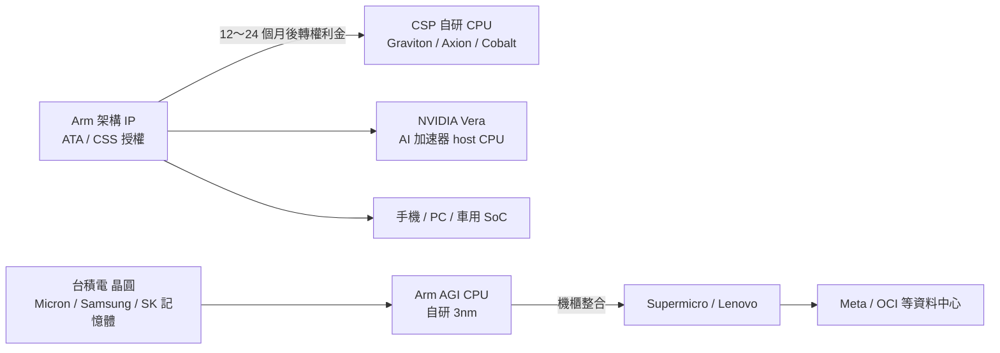

# ARM.US(arm)

## 基本資料

| 項目 | 內容 |
|------|------|
| 全名 | Arm Holdings plc |
| 代號 | ARM（Nasdaq） |
| 財年 | 財年於 3 月結束；FY2Q27 對應 2026 年 7～9 月 |
| 定位 | CPU／NPU／GPU 架構與實體 IP 授權，收取授權金與權利金；2026 年起自行銷售資料中心 AGI CPU |
| 主要股東 | SoftBank（FY2Q27 授權及其他營收中 SoftBank 貢獻 US$2.09 億） |

## 核心技術／競爭優勢

- 架構授權：Cortex-X／A／R／M CPU、Ethos NPU、Immortalis／Mali GPU，以及實體 IP、安全與子系統 IP；授權模式轉向 ATA（Arm Total Access）與 CSS（Compute Subsystems），Architecture License 已少見。
- 資料中心：主要 Hyperscaler 伺服器採 Arm 架構比重由 2024 年 15% 升至 2025 年逾 50%，公司預估 2026 年底逾 60%；動能為 AWS Graviton、Google Axion、Microsoft Cobalt、NVIDIA Vera 放量，以及 AI 加速器 host CPU 由 x86 轉向 Arm。
- AGI CPU：自研資料中心 CPU（3nm），OCP 第三方測試每機櫃效能約為 AMD EPYC 9755 的 2 倍（比較對象非 AMD 最新 Venice）；與 Supermicro、Lenovo 等合作建置機櫃並部署至 OCI。

## 產品與應用

| 業務 | 內容 | FY2Q27 狀態 |
|------|------|-------------|
| 授權及其他 | ATA、CSS 授權，12～24 個月後轉為權利金 | US$7.73 億，YoY +50%；新增 3 份 ATA、4 份 CSS，ATA 有效訂閱逾 60 份 |
| 權利金：資料中心 | Graviton／Axion／Cobalt／Vera 等 | YoY 翻倍，管理層預期未來數年維持三位數成長 |
| 權利金：Physical AI | 車用、機器人、工業 | YoY +50%；成長潛力 20%～30% |
| 權利金：Edge AI | 手機、PC、IoT | 大致持平，受記憶體漲價與中低階手機疲弱影響；Armv9 滲透率逾 50% |
| AGI CPU | 自研伺服器 CPU，主要客戶 Meta | FY4Q27 開始主要商業出貨 |

## 圖片 / 架構圖

圖說：Arm 營收由「授權 → 權利金」與「自研 AGI CPU 直接銷售」兩條路徑構成；AGI CPU 需向晶圓代工、記憶體、封裝基板與測試設備取得產能，記憶體成本是第一代產品毛利率壓力主因。本頁暫無來源圖，以 Mermaid 補位。

## EPS 記錄

| 季度 | non-GAAP EPS（US$） | YoY | 備註 |
|------|--------------------|-----|------|
| FY2Q27 | 0.52 | +33% | 營收 US$14.4 億（YoY +27%），營業利益率 44.2% |

## EPS 預估

| 季度 | 公司財測 | 來源 |
|------|----------|------|
| FY3Q27 | 營收 US$15.4 億（±US$5,000 萬，中位數 YoY +24%）；non-GAAP EPS US$0.56（±US$0.04）；營業費用 US$8.25 億 | [[報告_富邦_ArmARM財報CallMemo_20261105]] |

## 目標價與評等

富邦整理之近期投行評等（2026-07-29～11-04）：Morgan Stanley Equalwt、Evercore ISI outperform、Wells Fargo overweight、Susquehanna Positive、TD Cowen buy、Piper Sandler overweight、Bernstein outperform、Raymond James outperform、Daiwa outperform、Deutsche Bank hold、JP Morgan overweight、Jefferies buy、Citi buy、HSBC hold、Goldman Sachs sell、Barclays overweight；目標價原文未列。來源：[[報告_富邦_ArmARM財報CallMemo_20261105]]。

## 時間軸

| 時間 | 事件 | 類型 | 重要性 | 備註 |
|------|------|------|--------|------|
| 2026-03 | Arm Everywhere 發表 AGI CPU，當時預估 FY27～FY28 累計營收逾 US$10 億 | 產品 | ⭐⭐ | 富邦 call memo 轉述 |
| 2026-11-04 | FY2Q27 財報：AGI CPU FY27～FY28 累計營收目標上修至最高 US$20 億 | 財報 | ⭐⭐⭐ | 公司指引／信心中高 |
| FY3Q27（2026-10～12） | AGI CPU 可能少量出貨，貢獻有限 | 出貨 | ⭐ | 公司說法 |
| FY4Q27（2027-01～03） | AGI CPU 主要商業出貨開始 | 放量 | ⭐⭐⭐ | 公司指引；第一代毛利率 30%～40% |
| 2028 前後 | 第二代 AGI CPU（依 18～24 個月產品週期推估） | 產品 | ⭐⭐ | 公司未公布 tape-out 時程 |

→ 跨公司節點見 [[時程_2026Q3Q4_AI網通與硬體催化劑]]。

## 供應鏈位置

- 上游：晶圓代工 [[2330_台積電（市）]]；記憶體 [[MU.US(micron)]]、[[005930.KR(samsung)]]、[[000660.KR(sk_hynix)]]；另需封裝基板與測試設備（公司稱已簽供應協議）。
- 下游：CSP 自研 CPU（[[AMZN.US(amazon)]]、[[GOOGL.US(alphabet)]]、[[MSFT.US(microsoft)]]）、[[NVDA.US(nvidia)]] Vera、手機 SoC 廠；AGI CPU 客戶 [[META.US(meta)]]，機櫃夥伴 [[SMCI.US(supermicro)]]、Lenovo，部署至 [[ORCL.US(oracle)]] OCI。
- 所屬主題：[[供應鏈_先進封裝載板]]（AGI CPU 需 ABF 載板與先進封裝產能）。

## 相關公司

| 公司 | 關係 | 說明 |
|------|------|------|
| [[META.US(meta)]] | AGI CPU 主要客戶 | 已有多家客戶延續至 2027 年訂單，非僅依賴 Meta |
| [[AMZN.US(amazon)]]、[[GOOGL.US(alphabet)]]、[[MSFT.US(microsoft)]] | 資料中心權利金主要來源 | Graviton、Axion、Cobalt |
| [[NVDA.US(nvidia)]] | 權利金客戶 | Vera CPU 取代 AI 加速器旁 x86 host CPU |
| [[AMD.US(amd)]] | 競爭 | x86 伺服器 CPU；AGI CPU 測試對比 EPYC 9755 |
| [[2330_台積電（市）]] | 晶圓代工 | AGI CPU 3nm，加速布局 2nm |
| [[MU.US(micron)]]、[[005930.KR(samsung)]]、[[000660.KR(sk_hynix)]] | 記憶體供應 | 記憶體漲價為 AGI CPU 毛利率主要壓力 |
| [[SMCI.US(supermicro)]] | 機櫃夥伴 | 與 Lenovo 等共同建置 AGI CPU 機櫃 |
| [[ORCL.US(oracle)]] | 部署 | AGI CPU 部署至 OCI |
| [[QCOM.US(qualcomm)]] | 訴訟 | 公司新聞：Qualcomm 訴訟陪審團裁決對 Arm 有利 |

## 近期營運與研究更新

### 2026-11-05 富邦 FY2Q27 財報會議紀要

- FY2Q27 營收 US$14.4 億（YoY +27%，連續 5 季成長逾 20%）；授權及其他 US$7.73 億（YoY +50%，優於預期約 US$1 億，其中 SoftBank US$2.09 億）；權利金 US$6.70 億（YoY +8%：資料中心翻倍、Physical AI +50%、Edge AI 持平）。non-GAAP 營業費用 US$7.74 億（YoY +19%），營業利益 US$6.38 億（YoY +37%），營業利益率 44.2%（YoY +3ppt），EPS US$0.52（YoY +33%）；過去 12 個月自由現金流 US$11 億；QA 前未揭露毛利率（fact）。
- FY3Q27 財測：營收 US$15.4 億（±US$5,000 萬）；授權及其他 YoY 略高於 +50%；權利金 QoQ 低雙位數、YoY 低個位數成長；營業費用 US$8.25 億；EPS US$0.56（±US$0.04）。
- AGI CPU：FY27～FY28 累計營收目標由逾 US$10 億上修至最高 US$20 億；主要客戶 Meta，另有多家客戶延續至 2027 年訂單；主要商業出貨 FY4Q27 開始，FY3Q27 貢獻有限。Agentic AI 使每個 Agent 佔用 CPU 核心，核心數需求由 128 核升至 256 核甚至 500 核以上，帶動 ASP；第一代毛利率 30%～40%（初期偏低），後續世代目標 50% 以上；記憶體漲價為主要成本壓力，公司已展現調價能力。供應面與台積電、Micron、Samsung、SK 長期合作，已簽晶圓、封裝基板、測試設備、記憶體供應協議，但規模仍不及 AMD。
- 資料中心：權利金 YoY 翻倍，主要來自 Amazon、Google、Microsoft，NVIDIA 快速成長；Hyperscaler 伺服器 Arm 占比 2026 年底預估逾 60%；資料中心占權利金前一年度接近 20%，FY27 結束前是否達三分之一不確定（市場預估 FY27 30%～35%、FY28 45%，管理層未確認）。
- 其他：Arm 架構晶片單季出貨首次破 100 億顆；Arm PC 全球出貨占比 20%；手機明年 IDC 預估出貨 YoY 約 −1%，但 CSS 滲透與下一代 CSS 較高權利金率，管理層預期手機業務至少雙位數成長。2030 年 CPU 市場原估 US$1,000 億，Agentic AI 可能使規模再擴大。網通、高效能 I/O 與連接功能在研究範圍，尚未宣布產品。
- 來源：[[報告_富邦_ArmARM財報CallMemo_20261105]]（富邦證券法人業務處，2026-11-05；非研究報告）。

## 來源

- [[報告_富邦_ArmARM財報CallMemo_20261105]] — 富邦證券法人業務處，2026-11-05；FY2Q27 財報會議紀要

- [[報告_群益_台積電投資Anthropic與OpenAI_20261111]]（2026-11-11）

## 相關頁面

- [[AMD.US(amd)]]
- [[NVDA.US(nvidia)]]
- [[META.US(meta)]]
- [[時程_2026Q3Q4_AI網通與硬體催化劑]]
- [[供應鏈_先進封裝載板]]
