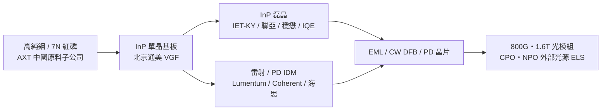

# AXTI.US(axt)

## 基本資料

AXT, Inc.（NasdaqGS: AXTI）是總部在美國加州 Fremont 的化合物半導體基板廠，主要產品是 InP（磷化銦）與 GaAs 單晶基板，製造幾乎全部由控股子公司**北京通美晶體技術（Tongmei）**在中國完成，另有中國原料子公司供應高純銦、紅磷等原料。AI 光模組帶動 EML、CW 雷射與 PD 的 InP 需求，使 AXT 成為全球 InP 基板三強之一（與住友電工、JX 金屬並列）。

- **成長驅動**：800G／1.6T 光模組的 EML 與 CW 雷射、200G PD，以及 CPO／NPO 外部光源（ELS）的高功率 CW 雷射，都需要 InP 基板；業界普遍描述 InP 基板供不應求。
- **核心客戶**：[[LITE.US(lumentum)]] 在 FY2026Q4 法說證實本季與 AXT 簽署額外基板協議；專家訪談稱受中國商務部出口審查影響，通美客戶已從北美轉向中國國內（華為海思、光迅科技、仕佳光子等）。
- **供應鏈位置**：InP 光通訊鏈最上游的「單晶基板」環節，下游為磊晶（IET-KY、聯亞、穩懋等）與雷射／PD IDM（Lumentum、Coherent）。
- **資料來源**：AXT 8-K 新聞稿（2026-10-28）、Lumentum 法說（2026-08-27）、專家訪談與券商產業報告，詳見「來源」。

## 核心技術／競爭優勢

- **VGF（垂直梯度凝固）長晶法**：與住友電工的 VB 法並列兩大主流工藝，產業報告稱 AXT 以 VGF 具成本優勢（[[技術_銦行業]] 引中郵證券 2026-05-25，信心中）。
- **上游原料垂直整合**：中國原料子公司掌握高純銦、紅磷等，6 吋 InP 需 7N 級電子級紅磷、硫雜質 <100ppb，原料自主是擴產門檻之一。
- **規模與擴產速度**：專家估通美年產能 20 萬片 → 2027 年底 40 萬片 → 2028Q3–Q4 60 萬片，未來產能可望高於日本兩家同業（[[memo_統一_IQE_InP專家會議_20260828]]，專家 estimate，信心低至中）。
- **6 吋 InP 先行者**：與住友並列少數能供 6 吋 InP 基板者，6 吋主要用於 400mW CW 與 200G EML（[[memo_OCS_NPO與InP供給調研_acecamptech_20260813]]）；但量產良率仍低，見風險段。

## 產品與應用

| 產品 / 服務 | 應用 | 相關客戶 / 下游 |
|-------------|------|-----------------|
| InP 單晶基板（2／3／4／6 吋） | EML、CW DFB 雷射、PD、InP PIC | [[LITE.US(lumentum)]]、華為海思、光迅科技、仕佳光子（專家轉述） |
| GaAs 基板 | VCSEL、射頻 PA、LED | GaAs 磊晶與元件廠（本 wiki 未有明確客戶紀錄） |
| 高純原料（銦、紅磷等，中國子公司） | InP／GaAs 長晶 | 集團內部與外部化合物半導體廠 |

## 圖片 / 架構圖

*圖：AXT 位於 InP 光通訊鏈最上游，基板供給決定 EML／CW 雷射與 PD 的有效產出。*

## 時間軸（催化劑）

| 時間 | 事件 | 類型 | 重要性 | 備註 |
|------|------|------|--------|------|
| 2026Q3（Lumentum FY26Q4） | Lumentum 與 AXT 簽署額外 InP 基板協議 | 供應協議 | ⭐⭐⭐ | Lumentum 法說官方 fact |
| 2026-10-28 | 通美獲 RMB 19.1～36.7 億元（約 2.85～5.45 億美元）私募股權投資，用於 InP 擴產 | 策略投資 | ⭐⭐⭐ | 8-K 官方 fact，尚待交割 |
| 2026-12 | 通美私募融資預計交割 | 融資 | ⭐⭐ | 需政府備案，不保證完成 |
| 2027 年底 | 通美 InP 年產能擴至約 40 萬片 | 擴產 | ⭐⭐ | 專家 estimate |
| 2028Q3–Q4 | 通美 InP 年產能擴至約 60 萬片 | 擴產 | ⭐⭐ | 專家 estimate |
| 未定 | 通美海外上市 | 資本市場 | ⭐ | 新聞稿未給時程 |

→ InP 擴產與供需時程詳見 [[技術_InP磷化銦]]；光互連催化劑見 [[時程_2026Q3Q4_AI網通與硬體催化劑]]

## 供應鏈位置

- **上游**：高純銦、紅磷等原料（集團自有中國原料子公司），長晶設備。
- **本身**：InP／GaAs 單晶基板（北京通美製造）。
- **下游**：InP 磊晶廠與雷射／PD IDM——[[LITE.US(lumentum)]]、[[COHR.US(coherent)]] 生態、台灣磊晶與代工廠 [[3105_穩懋（櫃）]]（既有頁列 AXT 為上游基板來源之一）。
- 所屬供應鏈：[[供應鏈_AI光互聯]]、[[供應鏈_CPO]]（ELS 高功率 CW 光源上游）。

## 相關公司

| 公司 | 關係 | 說明 |
|------|------|------|
| [[LITE.US(lumentum)]] | 客戶 / 下游 | FY2026Q4 法說證實本季與 AXT 簽額外基板協議，作為日本主供應商之外的補充 |
| [[COHR.US(coherent)]] | 同業 / 替代 | Coherent 自建 6 吋 InP 能力，同時是 InP 基板需求方；專家訪談並列住友／AXT／JX 為主要基板來源 |
| [[3105_穩懋（櫃）]] | 下游 | 穩懋頁列 Sumitomo Electric、AXT 為 InP／GaAs 磊晶晶圓上游 |

> 住友電工、JX 金屬、雲南鍺業為主要同業，華為海思、光迅科技、仕佳光子為專家轉述的中國客戶；本 wiki 目前無公司頁，不列入 `related_companies`。

> [!warning] 風險與注意事項
> - **地緣政治與出口管制**：製造集中在中國，InP 基板出口須經中國商務部逐案審查（需附終端訂單證明），北美客戶取得受限，客戶結構已轉向中國國內（[[memo_統一_IQE_InP專家會議_20260828]]，專家轉述）。
> - **6 吋量產良率**：專家稱中國 6 吋 InP（通美、雲南鍺業）良率低於 5%、目標 15–20%，尚未大量出貨；與部分產業報告「6 吋量產」的描述不一致，見下方衝突。
> - **融資與上市不確定**：通美私募需政府備案，新聞稿明言不保證完成；先前 STAR 板 IPO 已撤回，海外上市沒有時程。
> - **股權稀釋**：以融資上限計算，AXT 對通美持股降至約 73.40%。

> [!warning] 資訊衝突：通美 6 吋 InP 是否已量產
> - [[技術_銦行業]]（中郵證券，2026-05-25）：表列 AXT／北京通美「VGF 法，6 吋量產」。
> - [[memo_統一_IQE_InP專家會議_20260828]]（2026-08-28）：中國唯二有 6 吋能力的通美與雲南鍺業良率 <5%，因良率與價格尚無實際大量出貨。
> - [[memo_OCS_NPO與InP供給調研_acecamptech_20260813]]（2026-08-13）：6 吋剛起步，能做者主要是住友與 AXT。
> - 狀態：「具 6 吋能力」與「6 吋大量出貨」口徑不同，並列保留，以 AXT 財報與法說揭露為準。

## 來源

- [[research_產業合作技術發表_2026-10-30]] — AXT 8-K Exhibit 99.1 新聞稿，2026-10-28（通美私募股權融資；官方 fact）
- [[活動_Lumentum_FY2026Q4法說_20260827]] — Lumentum FY2026Q4 法說，2026-08-27（與 AXTI 簽額外基板協議；官方 fact）
- [[活動_Lumentum_法說與投資論壇彙整_202608]] — Lumentum 法說與投資論壇彙整，2026-08-12（基板供給轉緊、緊急簽 AXT；群組轉述）
- [[memo_統一_IQE_InP專家會議_20260828]] — 統一 × IQE 中國區負責人，2026-08-28（通美產能、客戶與 6 吋良率；專家 estimate）
- [[memo_OCS_NPO與InP供給調研_acecamptech_20260813]] — AceCamp 專家調研，2026-08-13（6 吋供應商格局）
- [[memo_光电芯片调研_200G_PD_InP_Driver_TIA_acecamptech_20260522]] — AceCamp 專家調研，2026-05-22（PD 廠主採住友、同時導入通美；基板漲價 20–30%）
- [[技術_銦行業]] — 中郵證券銦行業專題，2026-05-25（InP 基板市占與擴產計畫）
