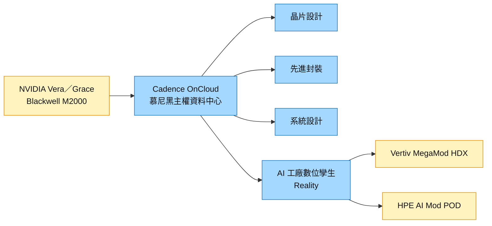

# CDNS.US(cadence)

## 基本資料

Cadence Design Systems（NASDAQ：CDNS）是全球兩大 EDA（電子設計自動化）廠之一，產品涵蓋晶片設計、驗證、先進封裝與 3D-IC 設計、系統模擬（電熱、流體）與 IP，並提供硬體加速模擬平台。近年延伸到 AI 工廠與資料中心的數位孿生模擬（Cadence Reality），讓供電、冷卻、氣流與機櫃配置在建置前先驗證。

2026-10-21 Cadence 與 [[NVDA.US(nvidia)]] 合作推出歐洲首個主權 AI 設計平台：Cadence OnCloud 在德國慕尼黑主權資料中心上線，資料留在歐洲司法管轄區內，涵蓋晶片、先進封裝、系統與 AI 工廠設計；規劃加入 NVIDIA Vera／Grace CPU 系統與 Blackwell 架構的 Millennium M2000 AI 超級電腦（未給時程；fact／高）。

主要資料來源：[[research_產業合作技術發表_2026-10-22]]（Cadence Business Wire 新聞稿，2026-10-21）。

## 核心技術／競爭優勢

- **EDA 雙寡占地位**：與 Synopsys 共同主導先進製程晶片設計工具，客戶轉換成本高（設計流程、PDK 認證與工程師訓練）。
- **先進封裝與系統設計**：工具涵蓋 chiplet、先進封裝與系統層級電熱模擬，對應 AI 晶片多晶粒趨勢。
- **AI 工廠數位孿生**：Reality Digital Twin Platform 模擬資料中心供電、冷卻、氣流與熱表現，[[VRT.US(vertiv)]]（MegaMod HDX）、HPE（AI Mod POD）、Nation Data Center 已採用，並與 NVIDIA Omniverse DSX Blueprint 合作。
- **主權雲部署**：2026-10 在慕尼黑提供符合 ISO 27001／27017、SOC 2 Type II 的主權雲，切入歐洲資料在地化需求。

## 產品與應用

| 產品 / 服務 | 應用 | 相關客戶 / 下游 |
|-------------|------|-----------------|
| EDA（晶片設計／驗證） | 先進製程 SoC、AI ASIC | 晶片設計公司、IDM |
| 先進封裝／系統設計工具 | chiplet、2.5D／3D 封裝 | 晶片與系統公司 |
| Cadence Reality Digital Twin | AI 工廠電熱與氣流模擬 | [[VRT.US(vertiv)]]、HPE、Nation Data Center |
| Millennium M2000 | 硬體加速模擬（Blackwell 架構） | 設計與模擬客戶 |
| Cadence OnCloud（慕尼黑主權雲） | 歐洲資料在地化設計環境 | 歐洲客戶、EuroCDP 新創 |

## 圖片 / 架構圖

圖說：2026-10-21 Cadence 歐洲主權 AI 設計平台的服務範圍與硬體來源。

## 時間軸

| 時間 | 事件 | 類型 | 重要性 | 備註 |
|------|------|------|--------|------|
| 2026-10-21 | 與 NVIDIA 推出歐洲主權 AI 設計平台（慕尼黑） | 合作 | ⭐⭐ | [[research_產業合作技術發表_2026-10-22]] |
| 未定 | 慕尼黑擴建加入 Vera／Grace、M2000、Reality 執行個體 | 產能 | ⭐ | 新聞稿未給時程 |

→ 跨公司時程見 [[時程_2026-2027高速互連與分散式算力]]

## 供應鏈位置

- **上游**：運算硬體（[[NVDA.US(nvidia)]] CPU／GPU）、雲端與資料中心基礎設施。
- **下游**：晶片設計公司、系統廠、資料中心營運商與基礎設施廠（[[VRT.US(vertiv)]]、HPE）。
- **所屬主題**：AI 晶片設計工具與 AI 工廠模擬；供電與冷卻驗證連到 [[技術_800VDC供電架構]]、[[供應鏈_AI伺服器散熱]]。

## 相關公司

| 公司 | 關係 | 說明 |
|------|------|------|
| [[NVDA.US(nvidia)]] | 合作夥伴／硬體供應 | 主權 AI 設計平台硬體、Omniverse DSX Blueprint 合作 |
| [[VRT.US(vertiv)]] | 客戶 | 以 Cadence Reality 設計與驗證 MegaMod HDX 模組化 AI 資料中心 |

> [!warning] 風險與注意事項
> - **對台灣供應鏈影響間接**：本次合作屬歐洲主權雲與設計服務，與台廠硬體訂單沒有直接關係。
> - **擴建時程未揭露**：Vera／Grace、M2000 與 Reality 執行個體只說「規劃中」，無時程。
> - **競爭**：Synopsys 在 EDA 與系統模擬同樣積極，主權雲也有其他雲端業者競爭。

## 來源

- [[research_產業合作技術發表_2026-10-22]] — Cadence Business Wire 新聞稿，2026-10-21；歐洲主權 AI 設計平台、Reality 客戶、慕尼黑擴建規劃。

## 相關頁面

- [[NVDA.US(nvidia)]]
- [[技術_800VDC供電架構]]
