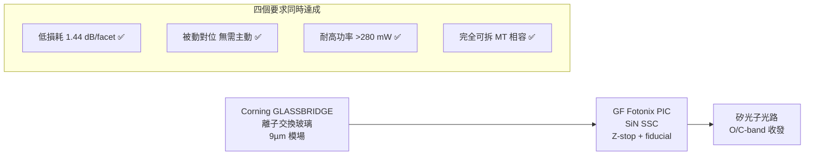

# GFS.US(globalfoundries)

## 基本資料

GlobalFoundries（GF）是全球第三大晶圓代工廠，以特殊製程（RF、汽車、SiPh）見長。**GF Fotonix** 是 GF 的 300mm 矽光子平台，在 CPO 可拆卸連接器領域取得重要突破——2026 年 ECTC 76th 與 Corning 合作，首次同時達成「低損耗 × 被動對位 × 耐高功率 × 可拆」四個可拆光 I/O 要求。

資料來源：[[research_simpletechtrend_CPO矽光子ECTC2026_20260629]]（2026-06-29）

## 核心技術／競爭優勢

### GF Fotonix × Corning GLASSBRIDGE 可拆連接器（ECTC 2026）

GF 與 Corning 合作把 GLASSBRIDGE 離子交換玻璃連接器整合到 Fotonix 300mm 矽光子 PIC：

| 指標 | 值 |
|------|----|
| TE 插入損耗 | **1.44 dB/facet** |
| TM 插入損耗 | 1.75 dB/facet |
| PDL | ~0.3 dB（預期真正光 I/O <0.1 dB）|
| 功率承受 | **>280 mW** |
| 對位方式 | 純被動（Z-stop + 微影 fiducial）|
| 可拆性 | MT 相容、可重工 |

**為何同時達成四個要求的關鍵**：
- **SiN SSC**（氮化矽斑點尺寸轉換器）同時解決「9 µm 模場匹配」與「高功率非線性吸收抑制」——純矽邊緣耦合在 >280 mW 下有非線性吸收，SiN 沒有
- **對位全靠晶片製程結構**：Z-stop 定垂直、微影 fiducial 定 X-Y，組裝時不需要主動光學回授

### GF Fotonix 平台特色

- 300mm 單片矽光子，支援 O-band 與 C-band
- V-groove 微影蝕刻（與 SSC 共製）
- 含機械 Z-stop 定義連接器放置高度

## 圖片 / 架構圖

![[活動_國泰_美國參訪訪談紀要_20260914-18_p069.png]]

圖說：國泰 p69：GaN 應用架構；與 Navitas 代工合作的 HVM 仍需獨立認證。

`[待補來源圖]` 需官方 ECTC 2026 投影片或 GF Fotonix × Corning GLASSBRIDGE 論文截圖佐證；上方為自製技術合作示意圖。
## 產品與應用

| 產品 / 服務 | 應用 | 相關客戶 / 下游 |
|-------------|------|-----------------|
| GF Fotonix 矽光子代工 | CPO、光模組 PIC 代工 | Coherent、其他 PIC 設計廠 |
| 可拆光 I/O 方案 | CPO 可維修光連接器 | 系統整合商 |
| RF / 特殊製程 | 汽車、工業 | — |

## 供應鏈位置

- 合作夥伴：[[GLW.US(corning)]]（GLASSBRIDGE 玻璃連接器）
- 競爭對手：[[2330_台積電（市）]]（COUPE 平台）、Tower Semiconductor
- 所屬供應鏈：[[技術_矽光子（SiPh）]]

## 相關公司

| 公司 | 關係 | 說明 |
|------|------|------|
| [[GLW.US(corning)]] | 技術合作夥伴 | GLASSBRIDGE 連接器，CPO 可拆光 I/O |
| [[COHR.US(coherent)]] | 客戶 | Coherent 使用 GF Fotonix 代工 PIC |
| [[2330_台積電（市）]] | 競爭對手 | COUPE 平台 |

## 本批來源更新（2026-10-11 入庫）

### 2026-09 國泰 Navitas 訪談：200mm GaN 合作

Navitas CEO 稱美國 200mm Gen5 GaN 首批晶圓已於 9 月完成、10 月送樣、年底客戶測試、FY27 HVM，並以此銜接原 TSMC 代工來源。這是客戶端轉述／中信心，未由 GF 官方獨立驗證；GaN 與原頁 Fotonix 矽光子是不同平台，不混成同一訂單。

供應鏈關係：[[NVTS.US(navitas)]] 為 GaN 合作／客戶端說法。時間軸：2026Q4 送樣與 qualification、FY27 量產驗證；同步 [[時程_2026-2028十月券商催化劑]]。

## 量子晶圓代工（PhotonCap，2026-10-24）

- 政府資金：美國商務部 2026-05-21 與 9 家量子公司簽 US$2.013bn 意向書，GF 獲 US$375mn、IBM 獲 US$1bn，兩家合計 68%，用途是量子晶圓的製造技術開發。2026-09-08 CHIPS 獎助最高 US$375mn 定案；GF 同意以每股 US$37.85 對商務部發行 990 萬股新股，約占流通股 1.8%（PhotonCap 計算）。
- 業務：2026-05 成立 Quantum Technology Solutions，正式列為「新量子業務」。光量子：PsiQuantum 自 2019 年合作，GF 300mm 量產線已接受其 NbN 單光子偵測層，雙方 2021 年在紐約（光子晶片）與德勒斯登（控制晶片）兩座 300mm 廠裝設專屬機台；Xanadu 2026-10-06 宣布多年期合作，把偵測器與氮化矽放上 Malta 300mm 線。矽自旋：Quantum Motion 在 22FDX 上做出逾 1,000 個量子點，另有 Equal1、Diraq。離子阱：Quantinuum 2026-09-08 列 GF 為下一代 300mm 離子阱製造廠之一。
- 超導：GF 稱開發中，技術頁目前只列低溫讀取／控制晶片與超導互連，未揭露外部超導 qubit 代工實績。
- 股價脈絡：截至 2026-10-23 收盤 GF 一年約漲 30%，PhotonCap 認為主要來自矽光子與美國本土製造預期，量子影響幾乎看不出來；GF 2025 年出貨超過 234 萬片 300mm 約當晶圓，量子晶片年需求僅數十到數百片（QCR）。
- 詳見 [[技術_量子晶圓代工]]；同頁比較 [[TSEM.US(tower semiconductor)]] 量子曝險（僅 Xanadu）。

## 來源

- [[memo_PhotonCap_量子晶圓代工與隔離產線_20261024]] — PhotonCap（Substack），2026-10-24；量子代工、商務部入股、PsiQuantum／Xanadu／Quantinuum 合作。

- [[活動_國泰_美國參訪訪談紀要_20260914-18]] — 國泰證期研究部，2026-09-18；原始研究／訪談全文，數字及時程依本批註記保留來源口徑。

- [[research_simpletechtrend_CPO矽光子ECTC2026_20260629]]（GF×Corning 可拆連接器 ECTC 2026，2026-06-29）

- [[memo_OCPAPAC_CPO_NPO_XPO專家會議_20260820]]（2026-08-20）
- [[報告_開源證券_Tower半導體矽光代工_20260818]]（2026-08-18）

## 相關頁面

- [[分析_國泰美國參訪_電力測試記憶體與太空驗證_20260914-18]]

- [[分析_CPO_NPO_XPO與409.6T光互連轉折]]
- [[TSEM.US(tower semiconductor)]]
- [[INTC.US(intel)]]
- [[技術_玻璃基板]]
- [[技術_量子晶圓代工]]
