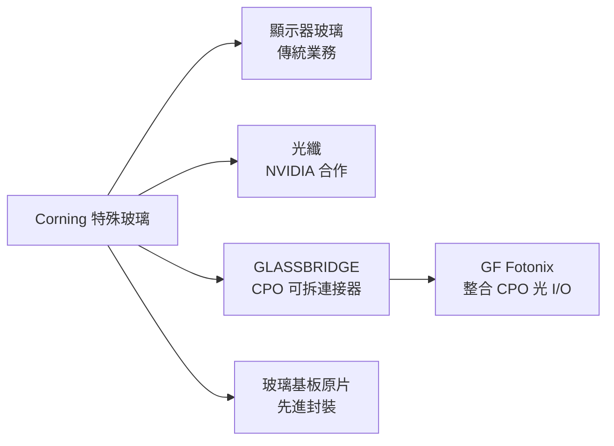

# GLW.US(corning)

## 基本資料

Corning（康寧，NYSE: GLW）是全球最大的特殊玻璃製造商，業務涵蓋光纖、玻璃基板（顯示器、先進封裝）、特殊玻璃等。在 AI 時代，Corning 的策略是把玻璃應用從顯示器擴展到光互連基礎設施：

1. **光纖**：NVIDIA×Corning 戰略合作（2026-05-06），光纖取代銅纜，「光進銅退」方向確認
2. **CPO 可拆光連接器**：GLASSBRIDGE 離子交換玻璃連接器，與 GF Fotonix 合作，ECTC 2026 首次同時達成四個 CPO 可拆光 I/O 要求
3. **玻璃基板原片**：先進封裝（Intel 3DGS、TSMC CoPoS）的核心原材料之一

資料來源：[[research_simpletechtrend_CPO矽光子ECTC2026_20260629]]（2026-06-29）；[[技術_玻璃基板]]

## 核心技術／競爭優勢

### GLASSBRIDGE 可拆光連接器（ECTC 2026）

Corning 的 GLASSBRIDGE 是離子交換（ion-exchange）製程製造的玻璃波導連接器，配合 GF Fotonix 的 SiN SSC 做 CPO 可拆光 I/O：
- 離子交換玻璃：9 µm 模場，匹配 SiN SSC
- MT 相容 ferrule，相容 solder reflow 條件
- 可多次拆裝（可重工）
- 整合後插入損耗：TE 1.44 dB/facet、TM 1.75 dB/facet
- 耐功率：>280 mW（靠 SiN SSC 抑制 Si 非線性吸收）

詳見 [[GFS.US(globalfoundries)]]

### 光纖業務（NVIDIA 戰略合作）

- 2026-05-06 NVIDIA×Corning 宣布戰略合作
- Corning 是高芯數多模光纖的全球領導廠商
- AI 叢集光纖佈線大幅增加（光纖取代銅纜）

## 圖片 / 架構圖

![[報告_招商證券_FAU與MPO在ScaleUp時代的價值通脹_20261013_p29.png]]
*圖（招商證券，2026-10，右下引自康寧官網）：高通道 FAU 的四種演進方向。右下是 Corning GlassBridge 連接器，以被動對準把光纖直接接到 PIC 邊緣；其餘三格是台積電 COUPE 的 2D FAU 與垂直耦合、SENKO 的可拆卸 MPC。Corning 在 CPO 端同時有 GlassBridge（邊緣耦合）與客製 FAU（邊緣與垂直耦合）兩條產品線。*
## 產品與應用

| 產品 / 服務 | 應用 | 相關客戶 / 下游 |
|-------------|------|-----------------|
| GLASSBRIDGE 連接器 | CPO 可拆光 I/O | [[GFS.US(globalfoundries)]] Fotonix PIC |
| 光纖 | AI 叢集光纖佈線 | [[NVDA.US(nvidia)]] + 雲端大廠 |
| 保偏光纖（PMF）| 外置 ELS 至 CPO／NPO 光引擎的偏振維持光路 | 匿名專家列 Corning 與長飛為主要玩家；需以公司揭露驗證 |
| 玻璃基板原片 | 先進封裝 | [[INTC.US(intel)]] 3DGS、[[2330_台積電（市）]] CoPoS |
| 玻璃基板光波導檢測合作 | 玻璃基板內光波導與 TGV 孔的非破壞檢測 | [[3055_蔚華科（市）]]；國泰證期 Call Memo 稱雙方合作，未揭露合作範圍與商業條件 |
| 顯示器玻璃 | 電視 / 行動裝置面板 | 三星、LG、BOE |

## 供應鏈位置

- 技術合作：[[GFS.US(globalfoundries)]]（GLASSBRIDGE + Fotonix）
- 戰略合作：[[NVDA.US(nvidia)]]（光纖）
- 玻璃基板原片客戶：[[INTC.US(intel)]]、[[2330_台積電（市）]]
- 技術合作：[[3055_蔚華科（市）]]；玻璃基板光波導檢測合作為券商 memo 轉述，非 Corning 公告。

## 相關公司

| 公司 | 關係 | 說明 |
|------|------|------|
| [[GFS.US(globalfoundries)]] | 技術合作 | GLASSBRIDGE + Fotonix CPO 連接器 |
| [[NVDA.US(nvidia)]] | 戰略合作 | 光纖供應，光進銅退 |
| [[INTC.US(intel)]] | 玻璃客戶 | 3DGS 玻璃基板 |
| [[3055_蔚華科（市）]] | 技術合作 | 國泰證期 2026-09-10 稱雙方合作玻璃基板光波導檢測；細節未公開 |
| [[3008_大立光（市）]] | 替代路線 | Nomura 2026-07-09 轉述大立光聚焦光柵耦合（GC）FA，認為不受 GlassBridge 邊緣耦合（EC）方案影響；屬路線分工判斷，非份額數據 |
| [[COHR.US(coherent)]] | DFAU 同業 | 2026-10-30 收錄訪談：兩家各自建立 DFAU 代工鏈，分工模式不同；低信心 |
| [[3363_上詮（櫃）]] | Shuffle Box 競爭者 | 2026-10-30 收錄訪談：Corning 約 70% 份額，上詮、波若威為其他供應商；低信心 |
| [[2317_鴻海（市）]] | DFAU 代工（集團子公司工業富聯） | 2026-10-30 收錄訪談：工業富聯在 Corning 鏈負責整個 DFAU；低信心 |
| [[5803.JP(fujikura)]] | PMF 同業；布線競爭 | 2026-10-30 收錄訪談：保偏光纖供應商含 Corning、長飛、藤倉、Nufern；招商稱藤倉子公司 AFL 為布線第二大 |
| [[APH.US(amphenol)]] | 布線競爭 | 旗下康普（CommScope）為北美第三大布線方案商（招商 2026-10-13） |
| [[META.US(meta)]] | 布線客戶 | 招商稱 Corning 擴大北卡羅來納州產能以應對 Meta 訂單 |

## 2026-10-30 CPO 被動件專家訪談：PMF、Shuffle Box 與 DFAU

[[memo_CPO無源器件_ELS_FAU_Shuffle專家觀點_日期不詳]]（匿名，日期不詳；channel estimate，信心低至中低）：

- **PMF（保偏光纖）**：嚴重缺貨，「有產能就有訂單」；售價約 US$4／m 以上，預期擴產期間先漲、擴產完成後再降。Corning 產能約 1 萬芯公里，2027 年需求被估為其十倍以上；Corning 訂單飽和，已接洽長盈通、烽火與長飛等中國代工，人選未定。天孚的保偏 FAU 向 Corning 與長飛採購 PMF。
- **Shuffle Box**：每台 US$3,000–3,500，未來約 US$2,500；Corning 約 70% 份額，主因內部大量使用自家光纖；全數交太辰光（T&S）代工，與 [[供應鏈_CPO]] 既有說法一致。其他供應商為波若威、[[3363_上詮（櫃）]]，天孚計畫切入。
- **DFAU**：Corning 外購 PMLA 後交蘅東光、仕佳、工業富聯組成完整 DFAU；仕佳為來料加工（Corning 提供光纖、MMC 與 V-Groove）。Corning 與 [[COHR.US(coherent)]]、天孚、Senko 同列 DFAU 主要參與者，但天孚的保偏處理能力被評為較強。

判讀見 [[分析_CPO無源器件ELS_FAU與Shuffle專家訪談_20261030]]。

## 2026-10-13 招商證券：布線龍頭與 CPO FAU 官方夥伴

[[報告_招商證券_FAU與MPO在ScaleUp時代的價值通脹_20261013]]（招商證券，2026-10；券商整理，信心中）：

- **布線營收**：2025 年資料中心布線收入 US$31.9 億、年增 61%，為全球第一（AFL US$24.2 億、康普 US$14.4 億）。產能在美國北卡羅來納州、中國上海、墨西哥與德國、波蘭。
- **擴產**：計畫擴大整個北卡羅來納州產能應對 [[META.US(meta)]] 訂單，帶動當地就業增 15%–20%；2026 年上海嘉定廠員工計畫增加 50%；與 [[NVDA.US(nvidia)]] 合作後，美國光連接產能增 10 倍、光纖增 50%（券商轉述，未見本頁既有官方數字佐證）。
- **生態壁壘**：Corning 是 US Conec（MT 插芯與 MMC 主要授權方，Corning、藤倉、NTT 合資）的最大股東；招商把「參股 MT 插芯與連接器核心廠商」列為布線龍頭的壁壘之一。代工夥伴太辰光、仕佳光子。
- **CPO FAU**：Corning 是 NVIDIA CPO 矽光生態官方 FAU 夥伴之一，FAU 可客製 V 槽、芯間距、通道數與端接方式，提供邊緣與垂直耦合兩種架構；Ultra Compact FAU 單位寬度光纖密度提高 35%，90° FAU 高度低於 4 mm。招商認為 Corning 傾向把 FAU 製造外包給中國廠，與上段專家訪談的 Corning DFAU 代工鏈一致。

| 日期 | 事件 | 類型 | 重要性 | 備註 |
|---|---|---|---|---|
| 2026 | 上海嘉定廠員工增 50%、北卡擴產應對 Meta 訂單 | 擴產 | ⭐⭐ | 招商轉述／中 |
| 2028（預估） | scale-up 光互連起量，CPO 配套 FAU 市場 51 億元人民幣 | 放量 | ⭐⭐⭐ | 招商 estimate／中低；見 [[時程_2026-2027高速互連與分散式算力]] |

相關判讀：[[分析_FAU與MPO在ScaleUp時代的價值通脹_招商證券_20261030]]。

## 相關技術

- [[技術_玻璃基板]]（Corning 是先進封裝玻璃原片主要供應商之一）
- [[技術_矽光子（SiPh）]]（GLASSBRIDGE 連接矽光子 PIC 與光纖）
- [[分析_CPO_NPO_XPO與409.6T光互連轉折]]（內／外置光源、PMF 與 FAU 價值量分流）
- [[技術_FAU]]（GlassBridge 屬邊緣耦合可拆方案，與光柵耦合 FA 路線比較）
- [[供應鏈_CPO]]（CPO 光纖、連接器與光學元件供應鏈）

## 來源

- [[報告_招商證券_FAU與MPO在ScaleUp時代的價值通脹_20261013]] — 招商證券，2026-10-13（2025 布線收入、擴產計畫、US Conec 持股、CPO FAU 產品；券商整理，信心中）
- [[memo_CPO無源器件_ELS_FAU_Shuffle專家觀點_日期不詳]] — 匿名專家訪談，日期不詳（2026-10-30 收錄；PMF 產能與代工、Shuffle Box 份額、DFAU 代工鏈，低至中低信心）
- [[報告_Nomura_大立光CPO光纖陣列_20260709]]（Nomura，2026-07-09）：大立光稱 GC 為主流設計路線、其 FA 不受 Corning GlassBridge（EC）影響；為競爭對手觀點，信心中低。
- [[報告_MorganStanley_貿聯_20261006]]（Morgan Stanley，2026-10-06）：MS 指 [[3665_貿聯-KY（市）]] 與 Corning 合作 shuffle box（光纖重排盒），屬貿聯光互連布局之一；合作規模未揭露。
- [[research_simpletechtrend_CPO矽光子ECTC2026_20260629]]（GF×Corning ECTC 2026，2026-06-29）
- [[技術_光互連]]（NVIDIA×Corning 戰略合作 2026-05-06）
- [[技術_玻璃基板]]（玻璃基板原片供應）
- [[memo_EML_InP_CW_ELS_NPO_CPO專家觀點_日期不詳]]（匿名專家將 Corning 列為保偏光纖主要玩家；日期不詳，2026-08-30 收錄，信心低）
- [[memo_國泰證期_蔚華科CallMemo_20260910]]（國泰證期研究部，2026-09-10；蔚華科與 Corning 的玻璃基板光波導檢測合作，待公司公告佐證）

- [[報告_呂紹旭_玻璃載板FOPLP_20260508]]（2026-05-08）

- [[報告_群益上海_玻璃材料_20261020]]（2026-10-20）

## 相關頁面

- [[分析_2026Q3先進封裝與光互連供給瓶頸]]

## 相關頁面

- [[MMM.US(3m)]]
- [[技術_EBO擴束連接器]] — 擴束非接觸式光纖連接器（3M EBO），與 MPO／MMC 同一連接位置的替代方案
