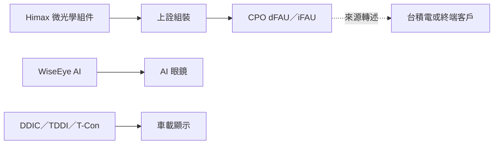

# HIMX.US(himax)

## 基本資料

奇景光電（Himax，NASDAQ: HIMX）為無晶圓廠半導體公司，產品涵蓋顯示驅動 IC、觸控與時序控制 IC，以及非驅動類產品。[[memo_KGI_HimaxCallMemo_20260916]] 指車用顯示 IC 為現階段主要現金流，並將 CPO 微光學與智慧眼鏡列為 2027 年後的成長選項；所有客戶、份額與時程均為券商 memo 轉述。

## 核心技術／競爭優勢

- **車用 DDIC／TDDI／T-Con**：來源稱車用產品在 3Q26 季增雙位數，為近期成長主軸。
- **CPO 微光學整組**：提供 Lens／Prism／玻璃 V-groove／Base，支援 Gen1、Gen2（6.4T）並啟動 Gen3 study；不拆售單一元件。
- **低功耗 WiseEye AI**：用於無顯示 AI 眼鏡，在前端辨識後僅傳輸結構化資料，應用價值與客戶採用仍待驗證。
- **LCoS AR 顯示**：針對含顯示 AR 眼鏡，量產時程被來源推估為 2028–2029 年。

## 產品與應用

| 產品／服務 | 應用 | 相關客戶／下游 |
|---|---|---|
| DDIC／TDDI／T-Con | 車載顯示系統 | 車廠與 Tier-1；來源未具名 |
| CPO 微光學組件 | dFAU／iFAU、CPO 光耦合 | [[3363_上詮（櫃）]] 組裝；後續客戶與流程待查證 |
| WiseEye AI | 無顯示 AI 眼鏡 | 北美客戶；未具名 |
| LCoS 模組 | AR 眼鏡 | 國際品牌；未具名 |

## 圖片 / 架構圖

> CPO 的組裝與下游流程為 KGI Call Memo 轉述，未見公司公告佐證；不可視為已確認的台積電供應資格。來源：[[memo_KGI_HimaxCallMemo_20260916]]。

## 時間軸（催化劑）

| 時間 | 事件 | 類型 | 重要性 | 備註 |
|---|---|---|---|---|
| 3Q26 | 車用 DDIC／TDDI／T-Con 預期雙位數季增 | 營運 | ⭐⭐⭐ | 券商轉述，待財報驗證 |
| 2027 | 無顯示 AI 眼鏡預期開始導入北美客戶 | 新產品／驗證 | ⭐⭐ | 公司時程，客戶與出貨未公開 |
| 2027 | Non-Driver 營收占比目標約 30% | 產品組合 | ⭐⭐ | 目標非財測 |
| 2028–2029（預估） | LCoS AR 眼鏡可能量產 | 技術下線 | ⭐⭐ | 券商推估，仍受產品與生態成熟度限制 |

## 供應鏈位置

- CPO 角色為微透鏡、稜鏡、玻璃 V-groove 與底座的整組光學元件供應，對應 [[技術_CPO]] 與 [[供應鏈_CPO]]。
- [[3363_上詮（櫃）]]：來源稱其負責組裝；[[2330_台積電（市）]] 或終端客戶為後段去向，均待公開資料驗證。

## 相關公司

| 公司 | 關係 | 說明 |
|---|---|---|
| [[3363_上詮（櫃）]] | CPO 組裝 | KGI memo 轉述由上詮組裝 Himax 的整組微光學元件 |
| [[2330_台積電（市）]] | 潛在後段去向 | KGI memo 提到後續交付「台積或終端客戶」，非已確認直接供應關係 |

## 風險與注意事項

> [!warning]
> - 車用市占、CPO 營收與 Non-Driver 占比均屬券商／公司口徑，需以財報及公開客戶資料驗證。
> - CPO Gen3、智慧眼鏡與 AR 量產時程長，研發進度不等同營收。
> - 來源未揭露 CPO 客戶、台積電供應資格、價格或驗收狀態。

## 2026-11-20 Morgan Stanley：Android 疲弱壓抑驅動 IC 議價力（EW，TP US$17.4→US$9.2）

- **產業前提（MS AlphaWise 2026 手機調查）**：MS 美國硬體團隊將 2027 年智慧型手機出貨由 +4% 下修為 −5%（bear case −11%）；base case Android 約 −9% 至 768mn 台、iPhone +7% 至 270mn 台。美、中、英、德「極可能 12 個月內換機」比例降 2ppt 至 41%，隱含 2027 年換機週期 4.4 年（原 4.2 年）。中國 2027 年出貨 −7%（2026 年估 −12%）；中國受訪者選機理由中「內建 AI」由 22% 降至 17%、「整體品質」由 32% 升至 35%；中國品牌淨轉換意向 Apple +28%，小米、OPPO、vivo、榮耀為 −21% 至 −31%（estimate／中）。
- **驅動 IC 觀點**：記憶體成本上升壓縮手機品牌在顯示器、觸控 IC 與感測器的預算；Android 出貨疲弱使 DDIC 業者難轉嫁晶圓與封裝成本，即使新 OLED 專案提高單機含量（thesis／中）。
- **Himax**：3Q26 OLED 主流機型持續出貨與新高階手機備貨，推升 LCD＋OLED 手機 IC 合計營收；管理層預期 4Q26 手機驅動 IC 營收季減。LCD 觸控顯示整合驅動 IC 服務入門與中階機種，降本壓力最大。2027 年 OLED DDIC、OLED T-con 與 WiseEye 貢獻增加有助營收與毛利率；MS 視 Himax 為 FOCI FAU 唯一供應商，估 CPO 用 WLO 占 2027 年營收 11%，但 2028 年 CPO 存在不確定性。
- MS 2026／27／28 EPS 下修 17%／17%／33% 至 US$0.33／0.60／0.98；bull／bear 價值 US$13.7／4.6（estimate／中）。
- 同報告：[[報告_MorganStanley_驅動IC_20261120]] 另將神盾（6462 TT）由 EW 降至 UW、TP NT$105→NT$66（2027 EPS −25%）；匯頂（603160 CH）維持 UW、TP Rmb58→Rmb40，指出整合 OLED TDDI 普及會取代獨立觸控 IC，匯頂自有 OLED TDDI 10 月仍在內部測試。兩家公司 wiki 尚無頁面。

## 2026-09～10 CPO 透鏡層與競爭觀點補充

- **智璞專家分享會（2026-09-21，產業整理／中）**：[[報告_永豐_智璞專家分享會_矽光子與CPO趨勢_20260921]]（p43–44）將「奇景＋[[3363_上詮（櫃）]]」列為台灣切入 CPO 透鏡層／超穎透鏡 FAU（FAU 側透鏡與非台積電平台）的代表組合之一，目標 2026 年就緒，與合聖（7928）、采鈺（6789）＋光程研創並列。
- **珩石 Jason 負面觀點（2026-10-09，thesis／低信心）**：[[研究_大立光3008_上詮3363_FAU觀點_珩石Jason_20261009]] 在討論台積電 FAU 供應商轉向 [[3008_大立光（市）]] 時，將原台積電扶持的兩家廠商（指上詮與奇景體系）視為量產進度受阻；此屬單一買方觀點，與 [[報告_MorganStanley_驅動IC_20261120]]（稱 Himax 為 FOCI FAU 唯一供應商、估 CPO 用 WLO 占 2027 年營收 11%，但 2028 年具不確定性）並列保留。

## 來源

- [[報告_永豐_智璞專家分享會_矽光子與CPO趨勢_20260921]] — 永豐證券／智璞產業趨勢研究所，2026-09-21（CPO 透鏡層與奇景＋上詮超穎透鏡 FAU 路線）
- [[研究_大立光3008_上詮3363_FAU觀點_珩石Jason_20261009]] — 珩石資本 Jason，2026-10-09（台積陣營 FAU 競爭觀點，低信心）
- [[報告_MorganStanley_驅動IC_20261120]] — Morgan Stanley，2026-11-20；Android 疲弱限制驅動 IC 議價力，Himax EW、TP US$9.2（原 17.4）。
- [[memo_KGI_HimaxCallMemo_20260916]] — KGI，2026-09-16。
- [Himax 投資人關係頁](https://www.himax.com.tw/en/investors/) — NASDAQ: HIMX 掛牌資訊，2026-09-22 查閱。

## 相關頁面

- [[分析_Himax車用顯示_CPO微光學與AI眼鏡_20260916]]
- [[時程_2026Q3Q4_AI網通與硬體催化劑]]
- [[時程_2026-2027高速互連與分散式算力]]
- [[技術_FAU]]
