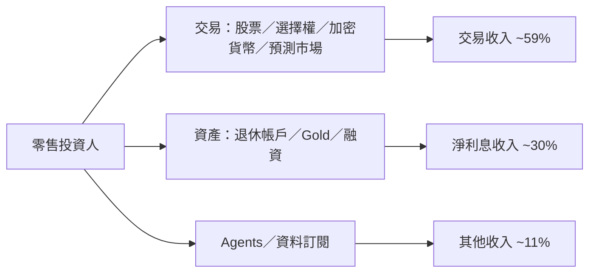

# HOOD.US(robinhood)

## 基本資料

Robinhood 是美國數位金融平台，提供股票、選擇權、加密貨幣與預測市場交易，並延伸到退休帳戶、信用卡與資產管理，以低門檻介面與持續擴充的產品吸引零售投資人。加密貨幣交易所 Bitstamp 為旗下業務。

**營收結構（2Q26）**：營收 US$1.31bn，交易收入 59.33%、淨利息收入 29.74%、其他收入 10.93%；選擇權為最大交易收入來源，預測市場與 Gold 訂閱占比逐步提升。2Q26 淨存入資金 US$22bn、Gold 訂戶 4.8mn。來源：[[報告_凱基_美國軟體3Q26預覽_20261015]]。

## 核心技術／競爭優勢

- **活躍交易者工具**：Legend 桌面平台、指數選擇權延長交易時段（2026-04）、多腳選擇權委託路由與 Agentic Options Trading（2026-06）。
- **AI Agent 交易**：2026-05 推出 Agentic Trading，支援透過 AI Agent 交易股票、選擇權與加密貨幣；Agent 帳戶由 2Q26 近 10 萬個增至 9 月逾 15 萬個。
- **加密貨幣降費**：2026-07 新增 Maker 訂單，依成交量費率最低 0%，吸引專業與高交易量客群。
- **產品擴張深化客戶資產**：退休帳戶、Gold、融資服務提高留存資產與交叉銷售。

## 產品與應用

| 產品 | 說明 |
|---|---|
| 選擇權交易 | 最大交易收入來源；市占由 2Q26 8.57% 升至 3Q26 約 10.12%（凱基估） |
| 加密貨幣 | Robinhood App 與 Bitstamp；2026-09 Summit 宣布美國加密貨幣永續期貨 |
| 預測市場 | 營收占比上升；市場交易規模持續擴大 |
| Gold 訂閱／退休帳戶／信用卡 | 提高客戶資產與黏著度 |
| Robinhood Agents／Agent Apps | App 內建 Agent；第三方資料訂閱分潤機會 |

## 圖片 / 架構圖

圖：Robinhood 由交易入口延伸至完整金融平台的收入結構（2Q26 比重，凱基整理）。

## 營運數據（凱基 3Q26 預覽，2026-10-15）

- **選擇權**：7、8 月成交 324.2mn、292.5mn 口（年增 66%、50%）；依 9 月至 9/24 外推，3Q26 總成交約 906mn 口、ADV 約 14.2mn 口（季增 13%），同期全市場 ADV 季減 4%。若每口收入維持 2Q26 水準，3Q26 選擇權收入約 US$400mn，比市場預估 US$387.63mn 高約 3%。
- **加密貨幣**：8 月成交額 US$17.5bn（月增 61%），App US$7.4bn、Bitstamp US$10.1bn；截至 9/24，App 加密貨幣日均交易量月增 22%，高於全球交易所 20%。
- **資金**：7、8 月淨存入 US$5.6bn、US$4.0bn；8 月底平台資產 US$383.7bn（+26% YoY），融資餘額 US$21.5bn。

## 目標價與評等

| 券商 | 日期 | 評等 | 目標價 | 評價 | 來源 |
|---|---|---|---|---|---|
| 凱基投顧 | 2026-10-15 | 正向（+ve，未給目標價） | — | 未來 12 個月調整後 P/E 約 35.0x，低於 2024 年以來均值 48.6x，介於均值與 -1σ（28.4x）之間 | [[報告_凱基_美國軟體3Q26預覽_20261015]] |

## 時間軸

| 時間 | 事件 | 類型 | 重要性 | 備註 |
|---|---|---|---|---|
| 2026-04 | 擴大指數選擇權交易時段 | 產品 | ⭐ | |
| 2026-05 | 推出 Agentic Trading | 產品 | ⭐⭐ | |
| 2026-06 | 多腳選擇權委託路由、Agentic Options Trading | 產品 | ⭐ | |
| 2026-07 | 加密貨幣 Maker 訂單、費率最低 0% | 價格策略 | ⭐⭐ | 量增能否抵銷單位收入稀釋待觀察 |
| 2026-09 底 | Summit：美國加密貨幣永續期貨、App 內建 Robinhood Agents、延長選擇權交易時段 | 產品 | ⭐⭐ | 上線時程待財報說明 |
| 3Q26 財報 | 觀察選擇權市占、加密貨幣有效費率、永續期貨上線時程 | 財報 | ⭐⭐⭐ | 凱基預覽重點 |

## 供應鏈位置

- 所屬產業鏈：[[供應鏈_金融服務]]（零售券商與加密貨幣交易平台）。
- 收入來源受交易熱度、利率與監管（訂單流付款、預測市場）影響。

## 相關公司

本次來源未揭露可連結的上下游或競爭公司頁。

> [!warning] 風險與注意事項
> - 交易熱度與單位收入下滑：選擇權、加密貨幣成交量降溫或交易組合變化會壓低每口收入；7–9 月 ADV 逐月回落。
> - 降息壓抑淨利息收益率。
> - 訂單流付款與預測市場監管變化。
> - 本頁數據來自凱基投影片，原檔疑為草稿版本，信心中。

## 來源

- [[報告_凱基_美國軟體3Q26預覽_20261015]] — 凱基投顧，2026-10-15；3Q26 預覽（FinTech & Payment：Robinhood）。
