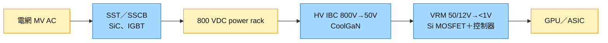

# IFX.DE(infineon)

## 基本資料

Infineon（英飛凌，法蘭克福 Xetra：IFX，美國 ADR：IFNNY）是全球最大功率半導體廠之一，產品涵蓋 Si MOSFET／IGBT、SiC（CoolSiC）、GaN（CoolGaN）與電源控制 IC，應用橫跨車用、工業、再生能源與 AI 資料中心電源。AI 資料中心是近年新增的成長軸：既有 wiki 資料（JPM 2026-06-24 架構）將 Infineon 列為 AI 伺服器供電四段中 Stage 1（800V→48V/12V 中間匯流排轉換）與 Stage 2（VRM）最大供應商，Si／SiC／GaN 全覆蓋。

2026-10-21 Infineon 宣布與 [[NVDA.US(nvidia)]] 合作開發 800 VDC AI 資料中心的 GaN 電源轉換系統，聚焦高壓中間匯流排轉換器（HV IBC），稱 GaN 正成為此級首選技術（fact／高；新聞稿全文未完整擷取）。延續雙方 2025-05 首度宣布、2025-10 深化的 800 VDC 合作；2026-03 已發表 CoolGaN HV IBC 參考設計（800 VDC→50 V，滿載效率逾 98%）。

主要資料來源：[[research_產業合作技術發表_2026-10-22]]（Infineon 新聞稿，2026-10-21）；供電架構與份額口徑見 [[技術_800VDC供電架構]]。

## 核心技術／競爭優勢

- **Si／SiC／GaN 全材料覆蓋**：從電網端 SST／SSCB（SiC、IGBT）、前端 PSU、800V 中間轉換（GaN）到 GPU 端 VRM（Si MOSFET＋多相控制器），可提供整條供電鏈元件。
- **與 NVIDIA 800 VDC 架構共同開發**：2025 年起參與 NVIDIA 800 VDC 架構，2026-10 進一步聚焦 GaN HV IBC，具參考設計先行優勢。
- **VRM 主要供應商**：既有資料指 Infineon 與 MPS 並列 NVIDIA 主要 VRM 供應商（JPM 口徑）。
- **半導體含量指引**：既有資料記錄 Infineon 指引 AI 資料中心半導體含量約 US$175/kW，區間 US$100–250/kW，隨垂直供電與 WBG 採用趨向上緣。

## 產品與應用

| 產品 / 服務 | 應用 | 相關客戶 / 下游 |
|-------------|------|-----------------|
| CoolGaN HV IBC（800V→50V） | AI 機櫃中間匯流排轉換 | [[NVDA.US(nvidia)]] 800 VDC 生態、電源廠 |
| CoolSiC MOSFET | PSU 前端、SST／SSCB | 電源廠、電力設備廠 |
| 多相控制器＋智慧功率級 | GPU／ASIC VRM | AI 伺服器板卡 |
| 27 kW 三相 PSU 方案 | AI 伺服器電源 | [[2308_台達電（市）]]、[[2301_光寶科（市）]] 等電源廠（採購關係未揭露） |

## 圖片 / 架構圖

圖說：800 VDC 供電鏈中 Infineon 元件所在位置；2026-10-21 合作聚焦藍色的 HV IBC 一級。

## 時間軸

| 時間 | 事件 | 類型 | 重要性 | 備註 |
|------|------|------|--------|------|
| 2025-05 | 首度宣布與 NVIDIA 合作 800 VDC 架構 | 合作 | ⭐⭐ | Infineon 新聞稿回溯 |
| 2026-03 | 發表 CoolGaN HV IBC 參考設計（800 VDC→50 V，效率逾 98%） | 產品 | ⭐⭐ | 同上 |
| 2026-10-21 | 與 NVIDIA 合作 GaN HV IBC，配合 GTC Berlin 發布 | 合作 | ⭐⭐⭐ | [[research_產業合作技術發表_2026-10-22]] |
| 2026 年底–2027 | 800V／±400V power rack 開始導入（券商口徑） | 產業 | ⭐⭐⭐ | 見 [[技術_800VDC供電架構]] |

→ 跨公司時程見 [[時程_2026能源與AI電力設備]]

## 供應鏈位置

- **上游**：自有晶圓廠（Si、SiC、GaN）與代工。
- **下游**：AI 伺服器電源廠（[[2308_台達電（市）]]、[[2301_光寶科（市）]] 等）、系統廠與 [[NVDA.US(nvidia)]] 參考設計生態。
- **同業／競爭**：[[NVTS.US(navitas)]]（GaN）、MPS（VRM）、onsemi、Wolfspeed、TI。
- **所屬主題**：[[技術_800VDC供電架構]]；AI 散熱與電力整合見 [[供應鏈_AI伺服器散熱]]。

## 相關公司

| 公司 | 關係 | 說明 |
|------|------|------|
| [[NVDA.US(nvidia)]] | 合作夥伴 | 800 VDC 架構共同開發，2026-10-21 聚焦 GaN HV IBC |
| [[2308_台達電（市）]] | 下游電源廠（潛在客戶） | 800 VDC power rack 與 PSU；採購關係未揭露 |
| [[2301_光寶科（市）]] | 下游電源廠（潛在客戶） | 同上 |
| [[NVTS.US(navitas)]] | 競爭 | GaN 中間匯流排轉換主要對手 |

> [!warning] 風險與注意事項
> - **新聞稿細節不足**：2026-10-21 新聞稿全文未能完整擷取，產品規格、功率等級與量產時程未確認，本頁僅記錄標題、日期與主軸。
> - **800V 導入節奏不確定**：既有券商與專家口徑對 800V 滲透率與時點差異大（2026 年底小量到 2028 年擴大），GaN 營收貢獻時點需追蹤。
> - **競爭**：GaN IBC 有 Navitas、Innoscience、Vicor 等競爭者，NVIDIA 參考設計通常多供應商並存。

## 量子：離子阱晶片製造（PhotonCap，2026-10-24）

Infineon 與 Innsbruck 研究人員的論文指出，Villach 廠製作的一片 200mm 熔融石英晶圓可容納近 500 顆離子阱晶片。離子阱路線轉向以晶片上電子元件取代雷射控制 qubit 後，阱晶片已變成電極與配線晶圓問題；但耐數百伏 RF 電壓的電極與紫外到可見光波導仍不在標準 PDK 內。來源未提及商業代工合約。詳見 [[技術_量子晶圓代工]]。

## 來源

- [[memo_PhotonCap_量子晶圓代工與隔離產線_20261024]] — PhotonCap（Substack），2026-10-24；Villach 200mm 熔融石英離子阱晶片。

- [[research_產業合作技術發表_2026-10-22]] — Infineon 新聞稿，2026-10-21；與 NVIDIA 合作 800 VDC GaN HV IBC。
- [[memo_AceCamp_Infineon_AI電源與800V_20260930]] — AceCamp Tech，2026-09-30；Infineon 視角的漲價與 800V 滲透率（低信心），詳見 [[技術_800VDC供電架構]]。

## 相關頁面

- [[技術_800VDC供電架構]]
- [[技術_功率MOSFET]]
- [[技術_量子晶圓代工]]
