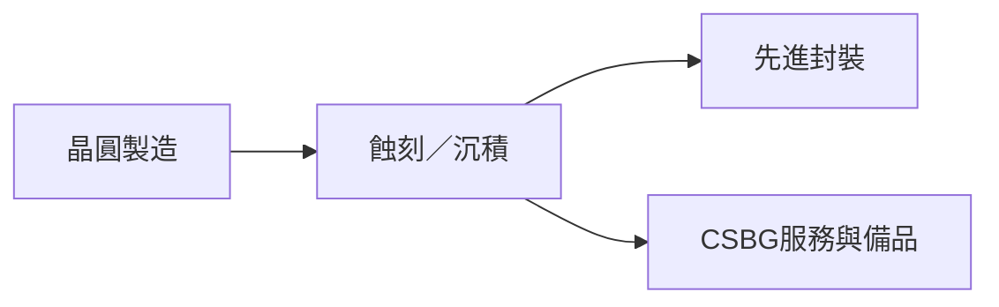

# LRCX.US(lam_research)

## 基本資料

Lam Research 是半導體製程設備商，覆蓋蝕刻、沉積與相關服務。中信投顧指出，公司 FY4Q26 財報與 FY1Q27 指引偏強，受 NAND、客戶支援業務及先進封裝設備需求帶動。

## 核心技術／競爭優勢

- 蝕刻與沉積設備服務先進邏輯、記憶體與先進封裝。
- CSBG 服務與備品業務受稼動率及先進封裝需求支持。
- 報告提及公司已交付 510×515mm² 面板系統，並規劃 310×310mm² 系統；為券商轉述。

## 產品與應用

| 產品／服務 | 應用 |
|---|---|
| 製程設備 | 邏輯、NAND、DRAM 製造 |
| 先進封裝設備 | 面板級與 2.5D 封裝製程 |
| CSBG | 設備服務與備品 |

## 圖片 / 架構圖

![[報告_BofA_AgenticAI半導體市場_20260929_p03.png]]
圖說：BofA 的 AI 系統與記憶體需求模型，為 NAND 設備投資 thesis 的需求背景；表格不是 Lam 設備收入或已獲訂單，且市場分類存在重疊。

圖：Lam Research 的製程設備與服務橫跨晶圓廠和先進封裝資本支出。

## EPS 預估

| 年度 | 中信投顧 EPS（報告日：2026-07-30） |
|---|---:|
| FY2027E | US$9.25 |

## 目標價與評等

| 券商 | 報告日 | 評等 | 目標價 | 來源 |
|---|---|---|---:|---|
| 中信投顧 | 2026-07-30 | 買進（調升） | US$355 | [[報告_CTBC_LamResearch_20260730]] |
| 富邦 memo 彙整 | 2026-10-22 | — | US$379.10（12 個月） | [[報告_富邦_LamResearch1QFY27法說_20261022]] |

## 時間軸

| 時間 | 事件 | 類型 | 重要性 | 備註 |
|---|---|---|---|---|
| FY1Q27 | 營收指引 US$7.7–8.5bn | 公司指引 | ⭐⭐⭐ | 報告轉述 |
| 2026E | WFE 市場約 US$150bn | 市場預估 | ⭐⭐ | 公司／券商展望 |
| FY1Q27（CY3Q26）實績 | 營收 US$8.22bn（+22% QoQ、+54% YoY），GM 52.4%、OPM 40.2%、EPS US$2.20，連五季新高 | 財報 | ⭐⭐⭐ | [[報告_富邦_LamResearch1QFY27法說_20261022]] |
| FY2Q27（CY4Q26） | 營收指引 US$8.6bn±0.4bn、GM 52.5%±1ppt、OPM 40.5%±1ppt、EPS US$2.33±0.15 | 公司指引 | ⭐⭐⭐ | 供應鏈瓶頸遞延部分出貨至 CY1Q27 |
| CY2026E | WFE 約 US$155bn（年初 US$135bn 逐季上修）；先進封裝營收約 +70% | 公司展望 | ⭐⭐⭐ | 2026-10-21 法說 |
| CY2027E | WFE 逾 US$200bn（約 +30%），成長排序 DRAM > Foundry Logic > NAND；約 10 座 Tier-1 新廠投產；CSBG 年增逾 15% | 公司展望 | ⭐⭐⭐ | 初步預測，下季法說更新 |

## 供應鏈位置

- 所屬供應鏈：半導體資本支出與先進封裝設備。

## 相關公司

尚無本批可確認之公司級交易關係。

> [!warning] 風險與注意事項
> - 晶圓廠無塵室擴充與 WFE 資本支出可能低於預期。
> - 成熟製程、中國市場與車用／工控需求仍影響服務業務節奏。

## 2026-10-21 FY1Q27 法說（富邦 memo）

**財報與指引**：FY1Q27（CY3Q26）營收 US$8.22bn，GM 52.4%、OPM 40.2% 皆創新高；NAND 設備營收季增約 40%，CSBG 接近 US$2.5bn。中國營收占比由 26% 升至 35%，管理層預期 CY4Q26 明顯下降（主要是中國本土客戶）。FY2Q27 指引營收 US$8.6bn，部分零組件瓶頸使出貨遞延到 CY1Q27，屬時程遞延而非訂單流失；管理層未證實市場估計的 US$300–400mn 遞延金額。

**WFE 展望**：2026 年 WFE 由年初 US$135bn 上修到約 US$155bn，主因客戶提高既有無塵室裝機密度並提前擴產；2027 年初步估逾 US$200bn，且已計入無塵室與供應鏈限制，若無限制實際需求會更高。設備需求能見度延伸到 2028 年。公司沿用「每 US$100bn AI capex 約帶動 US$10bn WFE」概念，並認為 2027 年同樣 WFE 下的可服務市場高於 2026 年。

**技術驅動**：
- **NAND**：128→200 層轉換延續到 2027 年，之後 300–400 層再帶動升級；AI 儲存走向 QLC／TLC／SLC 分層與 HBF。NAND 位元組合每有 1 個百分點轉向 SLC，約需增加 2% 晶圓產能（公司估算）。2027 年 SLC 滲透率是否達 5%，公司不評論。
- **DRAM**：不論延用 6F²／4F² 或直接轉 3D DRAM，都提高蝕刻與沉積強度，帶動 Akara Conductor Etch 與 Aether Dry Resist。
- **Foundry Logic**：每片晶圓 SAM 翻倍目標約完成一半，驅動力包含先進圖案化、背面供電、GAA（ALD、表面處理）與先進封裝。
- **先進封裝**：2026 年約 +70%，2027 年續成長但未給數字；面板級封裝設備已出貨逾 20 家客戶，仍屬產業早期。Hybrid Bonding 雖不提供鍵合機，但可透過介電／金屬薄膜與蝕刻受惠。
- **Aether Dry Resist**：至 2030 年底累計營收預測上修 US$1bn 到約 US$2.5bn，主要受 HBM 擴產與新客戶導入帶動。

**獲利與資本配置**：短期 GM 約 52–53%，中長期朝 mid-50s，靠新產品組合、Close-to-Customer 製造與定價。存貨 US$4.6bn（季增約 US$274mn），週轉率由 3.0 次升到 3.4 次（近七年最高）。ASR 加速回購延續到 CY4Q26，剩餘授權約 US$3bn，目標返還約 85% FCF；季配息調升 27%。

**富邦彙整預估**：FY27F／28F／29F 營收 US$35.1bn／41.9bn／48.1bn，non-GAAP EPS US$9.51／11.93／14.35；12 個月目標價 US$379.10（收盤 US$260.81）。

> [!warning] 口徑提醒
> 富邦 memo 寫「FY1Q27 營收 8,219、毛利率 52.30」（表格）與正文 GM 52.4% 有小差；中信 7 月 FY2027E EPS US$9.25 與富邦彙整 US$9.51 為不同時點預估，並列保留。

來源：[[報告_富邦_LamResearch1QFY27法說_20261022]]（富邦證券法人業務處，2026-10-22；法說轉述，信心：高；目標價為彙整預估）。

## 2026-09-29 Agentic AI 研究更新

| 券商／日期 | 評等 | 目標價 | 評價基礎 | 來源／信心 |
|---|---|---:|---|---|
| BofA，2026-09-29 | Buy | US$385 | 29× CY2028E P/E | [[報告_BofA_AgenticAI半導體市場_20260929]]，estimate／中 |

BofA 將 Lam Research 列為 4Q26 top picks，看好 NAND greenfield 擴產與升級支出；風險包括記憶體 capex 延後、蝕刻／清洗市占變動、設備商整併與中國曝險。AI 市場模型不是 Lam 已獲設備訂單。 上述均為 BofA estimate／thesis、信心中；與既有不同報告日期、年度、SBC 及產品範圍並列。

跨模型與驗證框架：[[分析_AgenticAI需求到供電與材料獲利的驗證_20260929]]。

## 來源
- [[報告_富邦_LamResearch1QFY27法說_20261022]] — 富邦證券法人業務處，2026-10-22；FY1Q27 法說 memo、WFE 2026／2027 展望
- [[報告_BofA_AgenticAI半導體市場_20260929]] — BofA，2026-09-29；Agentic AI 產業模型、個股估值與風險

- [[報告_CTBC_LamResearch_20260730]]（2026-07-30）

- [[LRCX Q4 Earnings Call memo_Fubon 20260730]]（2026-07-30）

## 相關頁面

- [[6829_千附精密（市）]]
