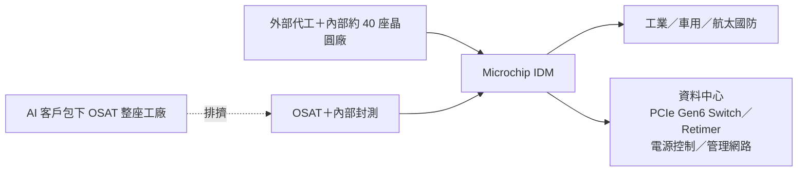

# MCHP.US(microchip)

## 基本資料

| 項目 | 內容 |
|------|------|
| 全名 | Microchip Technology Inc. |
| 代號 | MCHP（Nasdaq） |
| 財年 | 財年於 3 月結束；FY2Q27 對應 2026 年 7～9 月 |
| 定位 | IDM：MCU、類比與電源、網路與連接、高效能運算（FPGA）、邊緣 AI 五大支柱；資料中心解決方案事業部（DCS）直接向 CEO 匯報 |
| 近期併購 | 邊緣 AI 的 Hailo、航太國防的 Vorago |

## 核心技術／競爭優勢

- 廣泛型產品：MCU、類比、電源、乙太網路 Switch、USB Hub、安全、時序；工業、車用、航太國防、通訊、消費廣泛曝險。
- 資料中心：數位電源控制器（伺服器電源到電池備援）、系統管理、管理網路 Gigabit Ethernet Switch；PCIe Gen5 Switch 上市太晚失去業務，Gen6 Switch／Retimer 奪回市占。
- 航太國防：抗輻射安全 FPGA、衛星通訊、雷射終端、無人系統；安全方案支援抗量子加密。
- IDM 產能：近 40 座內部晶圓廠與外部代工並用；FPGA 與 DCS 有部分硬體 AI 加速，自有 MCU／MPU 無硬體 AI 加速，Hailo roadmap 取代原 MPU 兩款開發中產品。

## 產品與應用

FY2Q27 營收結構（排除授權收入）：工業 34.6%（YoY +50.3%）、資料中心 16.7%（+55.7%）、航太國防 16.1%（+41%）、車用 14.2%（+19.3%）、通訊 8.2%（+43.5%）、消費及家電 7.3%（+26.7%）、運算 2.9%（−1.6%）。

## 圖片 / 架構圖

圖說：Microchip 同時使用外部代工與 OSAT；2026 年下半年 AI 客戶包下部分 OSAT 產能、成熟製程與基板吃緊，使標準品交期由 4～8 週拉長至 6～32 週。本頁暫無來源圖，以 Mermaid 補位。

## EPS 記錄

| 季度 | non-GAAP EPS（US$） | 備註 |
|------|--------------------|------|
| FY2Q27 | 0.97 | 營收 US$16.22 億（QoQ +9.2%、YoY +42.2%）；毛利率 66.5%；營益率 39.5%；GAAP EPS 0.68 |

## EPS 預估

| 季度 | 公司財測 | 來源 |
|------|----------|------|
| FY3Q27 | 營收 QoQ −3%～+1%（中值 −1%、YoY +35.4%）；毛利率 64%～65%；營益率 37%～38.5%；EPS US$0.87～0.95 | [[活動_MicrochipMCHP_國泰CallMemo_20261105]] |

## 時間軸

| 時間 | 事件 | 類型 | 重要性 | 備註 |
|------|------|------|--------|------|
| FY3Q27（2026-10～12） | 季節性最弱一季，部分高毛利訂單受產能限制遞延 | 財測 | ⭐⭐ | 公司指引 |
| FY4Q27（2027-01～03） | backlog 遠優於前季同期，期望為更強一季；部分新 OSAT 季中量產 | 營運 | ⭐⭐ | 公司說法 |
| CY27 | PCIe Gen6 Switch／Retimer 24 件設計案陸續量產，2028 年初幾乎全數量產 | 放量 | ⭐⭐⭐ | 公司說法／中高 |
| 2027-01 起 | 主要代工廠新一輪漲價；公司計畫暫不漲價自行吸收 | 成本 | ⭐⭐ | 公司說法 |

## 供應鏈位置

- 上游：外部晶圓代工、OSAT（部分 OSAT 產能被 AI 客戶包下，移回內部或轉其他國家 OSAT）、封裝基板。
- 下游：工業、車用、航太國防主承包商、資料中心（伺服器電源、管理網路、PCIe Gen6 交換）。
- 競爭：MCU／類比廠（原文提及 STMicro）；PCIe Switch／Retimer 領域原文未點名。

## 相關公司

原文未點名具體客戶或供應商（僅以「主要代工廠」「主要 OSAT」描述），暫不填 `related_companies`。

## 近期營運與研究更新

### 2026-11-05 國泰證期 call memo（FY2Q27 財報會議）

- FY2Q27 營收 US$16.22 億（QoQ +9.2%、YoY +42.2%，高於財測上緣），含約 US$5,300 萬不會在 FY3Q27 重複的 100% 毛利率項目（調價對庫存與通路影響約 US$2,100 萬、專利授權多出 US$2,200 萬、客戶長約效益 US$1,000 萬）。non-GAAP 毛利率 66.5%（含產能閒置費用 US$2,660 萬），營業費用率 27%，營益率 39.5%，淨利 US$5.592 億，EPS US$0.97（高於財測中值 US$0.04）。
- 庫存 US$11.17 億、184 天（QoQ +9 天，收入高價值代工晶圓並建立成品庫存；其中 12 天為停產製程的長生命週期產品）；通路庫存 25 天。淨負債對調整後 EBITDA 2.36 倍，股利暫不變，持續降槓桿。
- 資料中心：FY2Q27 營收逾 US$2.5 億，CY26 可望達 US$10 億，一半標準產品、一半 DCS；PCIe Gen6 Switch 與 Retimer 設計案由 FY1Q27 底 12 件增至 FY2Q27 底 19 件、目前累計 24 件，CY27 起貢獻營收，2028 年初幾乎全數量產，幾乎每週新增一件。
- 供需轉折：FY2Q27 由客戶去庫存轉為部分領域缺貨；標準產品交期由 4～8 週拉長至 6～32 週，原因為晶粒庫存降低、代工與 OSAT 產能受限；部分主要 OSAT 被 AI 公司包下整座工廠，公司首度因 AI 排擠考慮將封裝移回內部，移轉需時約 6 個月；已認證其他國家 OSAT，部分 FY4Q27 季中量產。
- 毛利率：長期模型 65%；主要代工廠約 1 月起新一輪漲價，8 月中已調價一次，目前計畫暫不再漲價、自行吸收。
- 對 AI 的看法：管理層認為資料中心處於泡沫、二階導數必須大幅下降；資料中心占營收 16.7%，若 AI 減速釋出 OSAT 與成熟製程產能，對 Microchip 反而有利；保守估 FY28 EPS 仍逾 US$4。
- 來源：[[活動_MicrochipMCHP_國泰CallMemo_20261105]]。

## 來源

- [[活動_MicrochipMCHP_國泰CallMemo_20261105]] — 國泰證期研究部 call memo，2026-11-05；FY2Q27 財報會議

## 相關頁面

- [[時程_2026Q3Q4_AI網通與硬體催化劑]]
