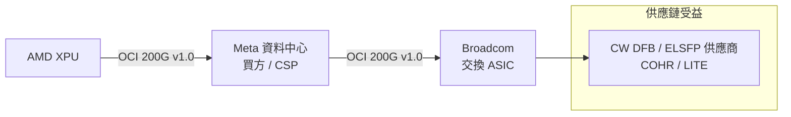

# META.US(meta)

## 基本資料

Meta Platforms 是 Facebook、Instagram、WhatsApp 的母公司，全球前五大雲端廠商之一（CSP）。在 AI 基礎建設戰略上，Meta 是 **OCI 200G MSA 的三家共同編輯之一**（買方角色），代表 CSP（資料中心買方）定義開放的 scale-up 光互連標準，與 Broadcom（交換/光）、AMD（XPU）結成對抗 NVIDIA 垂直整合的技術聯盟。

資料來源：[[research_simpletechtrend_CPO矽光子ECTC2026_20260629]]（2026-06-29）

## 核心技術／競爭優勢

### OCI 200G MSA 三巨頭共編（買方角色）

OCI 200G v1.0（2026-03-11）由 Meta（Amiralizadeh、Alduino、Peng）+ Broadcom + AMD 共同編輯。Meta 以 CSP 買方身份進入規範制定，等於把 scale-up 光互連需求「白紙黑字寫進規格」——供應鏈必須跟進。

詳見 [[技術_OCI]]

### 戰略意涵

- **買方（Meta）+ 交換/光（Broadcom）+ XPU（AMD）三角結盟**：需求端與供應端共同定義介面，推動開放 MSA 成為事實標準
- **外接雷射（ELSFP）強制化**：OCI 規範讓 CW DFB 雷射與 ELSFP 從「可選」變成「規格明確的供應環節」，直接拉動 Coherent、Lumentum 等供應商
- 對手：NVIDIA 的 NVLink 垂直整合路線

## 圖片 / 架構圖

`[待補來源圖]` 需官方 OCI 200G MSA 規格文件截圖或 Meta AI 基礎建設架構圖佐證；上方為自製三角聯盟示意圖。

![[meta-msl-1yr_original_007.png]]
*Meta Hyperion（路易斯安那）數據中心衛星圖：400MW 單棟 ×3 + 100MW ×3，世界最大規模在建數據中心之一。（SemiAnalysis Datacenter Model, 2026-07-09）*

![[meta-msl-1yr_original_002.png]]
*SemiAnalysis Tokenomics Model：Meta AI 算力預測（2026-07-09）——2026 年底 Meta AI 算力將超越 OpenAI + Anthropic 總和。*

## 供應鏈位置

- OCI 共編夥伴：[[AMD.US(amd)]]（XPU）、[[AVGO.US(broadcom)]]（交換/光）
- 光源供應鏈：[[COHR.US(coherent)]]、[[LITE.US(lumentum)]]（ELSFP 受益）
- 競爭對手（架構）：[[NVDA.US(nvidia)]] NVLink 垂直整合

## 相關公司

| 公司 | 關係 | 說明 |
|------|------|------|
| [[AVGO.US(broadcom)]] | OCI 共編夥伴 | 交換 ASIC + 光 IP |
| [[AMD.US(amd)]] | OCI 共編夥伴 | XPU |
| [[NVDA.US(nvidia)]] | 架構競爭對手 | NVLink 垂直整合 |
| [[COHR.US(coherent)]] | 光源供應商 | OCI ELSFP 規格受益 |
| [[LITE.US(lumentum)]] | 光源供應商 | OCI ELSFP 規格受益 |
| [[2382_廣達（市）]] | AI 伺服器／ASIC ODM | UBS 指 Meta 等 ASIC 專案自 2026Q2 開始貢獻廣達營收 |
| [[ANET.US(arista)]] | 交換器供應商 | Leaf／Spine 品牌交換器；Prometheus 跨建築 Backend Aggregation 採 Arista 7800（Broadcom Jericho3），連接 2 km 到逾 100 km（[[research_產業合作技術發表_2026-10-26]]，Meta 官方技術部落格 2026-10-19） |

## Meta Superintelligence Labs（MSL）

MSL 成立於 2025 年中，Zuck 在 Llama 4 災難性發布後全面重建 AI 研究組織。關鍵事件：
- **Scale AI 收購**（$14.3B）：從 Alexandr Wang 的 SEAL 安全評估團隊撈人
- **明星研究員高薪招聘**：Shengjia Zhao、Trapit Bansal、Jack Rae（ex-OpenAI）、Jason Wei、Hyung Won Chung（ex-OpenAI）、Andrew Tulloch（Thinking Machines 聯創）等 14+ 人。部分年薪包 >$1B
- **Muse Spark（2026-04 首作）**：落後 DeepSeek v4 Pro / Kimi K2.6，但 SemiAnalysis 強調「斜率比截距重要」

### 三支柱分析（SemiAnalysis 2026-07-09 評估）

| 支柱 | Meta 優勢 |
|------|---------|
| **資料** | 3,000 名工程師轉型做 RL 任務建立；員工螢幕/鍵盤/滑鼠錄製；70k 員工後備池 |
| **算力** | 5 座 1GW「Titan」巨型算力基地（Prometheus/Hyperion/El Paso/Iowa/Indiana）；2026 年底超過 OpenAI 和 Anthropic 的 AI 算力 |
| **人才** | 重金挖角 ex-OpenAI/Anthropic；Dina Powell McCormick 擔任 VP 建設算力關係 |

SemiAnalysis 結論：**Meta 是唯一在三個維度都有機會達到世界頂級的超大算力企業，有最大概率追上 Anthropic/OpenAI**（estimate，信心中）

> [!warning] 衝突：MSL 進度 vs Muse Spark 發布
> Muse Spark 落後 DeepSeek v4 Pro，但 SemiAnalysis 認為這是「重建負債」而非長期落後；SemiAnalysis 估計 2026 年底前仍難趕上 Anthropic/OpenAI

**風險警示**：若 Meta 簽署無提前取消條款的長期算力出售合約、解散 RL 任務創建組、頂尖研究員大量出走，則 MSL 視為失敗。

來源：報告_SemiAnalysis_Meta超級智慧實驗室一年進展_20260709

## 算力策略（2026 年）

### 5 座「Titan」算力基地

| 名稱 | 地點 | 規模 | 特色 |
|------|------|------|------|
| Prometheus | 俄亥俄州 | 1GW（目標 3GW）| 27 個數據中心散佈 6 個園區，距離最遠 75-80km；已部分上線 |
| Hyperion | 路易斯安那州 | 1.5GW 在建（400MW 單棟 ×3 + 100MW ×3）| 世界最大單棟建築（400MW）|
| Iowa | 愛荷華州 | 1GW（租賃）| 從 0 到 1GW 僅花一年（2025-05 → 2026-05）|
| El Paso | 德克薩斯州 | — | 在建中 |
| Indiana | 印第安納州 | — | 在建中 |

H1 2026 已簽約 >5GW（Cloud + Colo），不含自建加速中的部分。

### AIBackbone（AIBB）scale-across 架構

Prometheus 的 cluster 連接方案：多個 L3 Superspine（BAG）連接最多 5 個 DSF 或 7 個 NSF scale-out 區域 → L4 InterBAG hub，提供 22 Petabits/s 雙向頻寬。L3/L4 層使用 LR 光學 + DWDM ZR 光學跨園區互連（< 100km LR；> 100km 引入 500µs 延遲，需異步訓練策略）。其他 Titan 計畫跨 campus 最遠達 2,000km。

詳見 [[技術_AIBackbone]]

### Neocloud 化：四大變現選項

SemiAnalysis（2026-07-02）評估 Meta 在 MSL 之外的算力變現路徑：

| 選項 | 說明 |
|------|------|
| **SpaceX 式大宗算力交易** | 200MW → $10B/yr（$50B/GW 年收入）；90 天雙邊取消條款保留彈性 |
| **Bedrock 式 TaaS** | 私有 Claude 實例（SemiAnalysis 稱 Meta 正與 Anthropic 洽談）；對外銷售 Claude token |
| **RecSys 擴展 10x** | GEM（HSTU）廣告推薦系統每增加 1GW 直接換算更好的廣告預測 |
| **MSL 研究算力** | 隨時從上述選項調回給研究使用（90 天條款） |

> [!note] SemiAnalysis 獨家（2026-07-02）
> Meta 正處於與 Anthropic 私有 Claude 實例洽談最終階段（如 AWS Bedrock 模式）。若成真，Meta 可成為 Claude 第三方分銷渠道。（claim 類型 exclusive/rumor，信心低→中）

來源：報告_SemiAnalysis_Meta算力Neocloud策略_20260702

## RecSys / GEM 廣告基礎模型

**GEM**（Generative Recommendation Model）是 Meta 廣告推薦系統的 AI 基礎：
- 採用 **HSTU**（Hierarchical Sequential Transduction Units）技術，將廣告排名重新定義為序列預測問題，使其與 LLM 一樣能隨算力 scale
- 勝過前系統（DLRM）66% 排名指標，已量產為 GEM 廣告基礎模型
- 訓練 GPU 翻倍後：Instagram 廣告轉換率提升 5%、Facebook 廣告轉換率提升 3%
- Q1 2026：廣告曝光 YoY +19%，平均每次廣告單價 YoY +12%
- Meta Advantage+ Shopping ROAS +32%，cost/action -17%

SemiAnalysis 估計 Meta 可盈利吸收 **10x 廣告推薦算力增加**，每增加 1GW 直接對應更高廣告精準度（estimate，信心中）。

## 時間軸

| 時間／窗口 | 新增觀察 | 類型 | 重要性 | 來源與追蹤 |
|---|---|---|---|---|
| 2028 起（情境） | MTIA600 Phoebe 開發與創意 TK3 接洽 | 開發／選擇權 | ⭐⭐ | Aletheia 2026-09-22／中低，[[報告_Aletheia_創意電子首次覆蓋_20260922]]；[[時程_2026-2028十月券商催化劑]] |

| 日期 | 事件 |
|------|------|
| 2025-06 | MSL 正式成立；Zuck 開始億元挖角 |
| 2025 Q3 | Scale AI $14.3B 戰略投資（Alexandr Wang 加入） |
| 2026-01 | Dina Powell McCormick 加入擔任 VP |
| 2026-04 | Muse Spark 公開發布（落後 DeepSeek v4 Pro） |
| 2026-05 | 3,000 名工程師轉型 RL 任務建立；Meta 宣布員工螢幕錄製計畫 |
| 2026-H1 | 簽約 >5GW 算力（Cloud + Colo） |
| 2026-07-02 | SemiAnalysis 揭露 Meta 洽談 Anthropic 私有 Claude 實例 |
| 2026-07-09 | SemiAnalysis 評估 MSL 一年進展（看多，但謹慎） |
| 2028（估計） | 導入 Coherent OCS（Coherent OCS 台數增至約 10,500 台）；Coherent 專家訪談 estimate，低信心 |
| 2026-10-21 | FY3Q26 財報：營收 US$646.01 億、認列 US$98.90 億訴訟和解；2026 capex 下緣上修至 US$1,350 億 |
| 2026 Q4 | 4Q26 營收指引 US$730–760 億 |
| 2027 | 無投票權 C 類股生效（1:1 配發，實質 1 拆 2） |

## 2026-10-22 FY3Q26 財報（中信投顧海外重訊）

| 項目 | 3Q26 實績 | 比較 |
|---|---|---|
| 營收 | US$646.01 億（QoQ +6.25%、YoY +26%） | 優於市場預期 US$633.40 億 |
| 營業費用 | US$516.13 億（YoY +68%） | 含 US$98.90 億青少年心理健康訴訟和解費用 |
| 營業利益／營益率 | US$129.88 億（YoY -37%）／20% | 剔除訴訟費用為 US$228.78 億（YoY +11%） |
| 稀釋 EPS | US$3.83 | 優於預期 US$3.57；剔除訴訟費用調整後 US$7.40 |
| 資本支出 | 單季 US$349 億（YoY +80%） | 自由現金流轉負 US$21 億 |

- **廣告**：廣告收入 US$630.60 億（YoY +26%），廣告展示數 YoY +10%、平均單價 YoY +14%；DAP 36.4 億人（YoY +3%）。Reality Labs 因新世代 AI 眼鏡帶來新動能，虧損窄於預期。
- **指引**：4Q26 營收 US$730–760 億（中位數 US$745 億，優於市場預期 US$737.3 億）；2026 全年總支出上調至 US$1,750–1,790 億；**2026 資本支出由 US$1,300–1,450 億上修下緣為 US$1,350–1,450 億**。
- **Muse AI 代理**：Muse 與 Muse Wonder 推出約 6 週，美加帳戶設置數突破 1,000 萬、約 25% 下載用戶每日使用；因極度消耗算力，先在美加開放。變現規劃包含廣告轉換率、商業服務費、訂閱、企業 API 與付費商業代理人，並與 Walmart、Stripe、Shopify、Sierra 推出開源「個人代理人協定（Personal Agent Protocol）」。
- **C 類股**：董事會批准無投票權 C 類普通股，2027 年生效，按 1:1 向 A／B 類股東配發，實質為 1 拆 2，保留投票權結構。
- **供應鏈 read-across**：資本支出持續上修與 Muse 算力吃緊，支撐 MTIA、AI 伺服器與 PCB／光通訊需求（read-across，非 Meta 直接揭露供應商）。
- 來源：[[memo_中信海外重訊_META_FY3Q26財報_20261022]]（中信投顧，2026-10-22；財報數字為 fact，信心高；市場預期數字依中信引用）。

### FOMOSoc 財報解剖補充（2026-10-22）

- **量價拆解**：廣告曝光年增率由今年前三季的 19% 逐步降到 14%、3Q26 為 10%；平均價格年增率由 6% 加速到 14%。區域上，美加曝光 +8%、價格 +23%；亞太曝光 +14%、價格 +1%。財務長 Susan Li 提醒價格上升部分來自總經回暖，不全是 AI。
- **AI 廣告成效（法說揭露）**：Generative Recommender 導入 Facebook Feed 部分受眾後轉換率提升近 2%；GEM 擴大應用後站外轉換型廣告轉換率 +1.7%、App 安裝廣告 +9.6%；Andromeda 升級使 Facebook 廣告轉換率 +1.4%（不同系統與受眾，不可加總）。採用 Meta AI Business Assistant 建議的廣告主，在相同 CPA 下多拿約 5% 轉換、多投約 9% 預算。
- **其他產品線**：Threads MAU 已超越 X，人均使用時間年增逾 20%；Instagram 人均使用時間創新高；FoA 其他收入（WhatsApp 帶動）約 US$11 億、年增 59%；Creator Partnership Ads 年化收入逾 US$150 億、年增逾 97%（已含在廣告營收內）。Muse 最熱門用途為購物，平均交易金額逾 US$200。
- **利潤與現金**：營收較去年同期多 US$133.59 億，正常化營業利益僅增約 US$23.43 億（增量利潤率 17.5%）；正常化營益率由約 40% 降至 35.4%；正常化 EPS 由約 US$7.25 增至 US$7.40（+2.1%）。營收成本 +45%、研發 +32%、折舊攤銷 +44%，皆快於營收 +26%；3Q26 自由現金流 -US$21 億（去年同期 +US$106 億）。Meta 同時自建資料中心與向外部雲端租短期算力，短期費用率偏高。
- 來源：[[memo_FOMOSoc_Meta3Q26財報解剖_20261022]]（FOMOSoc，2026-10-22；作者整理法說數據，信心中；信件版截斷，Muse 變現與後續章節未收錄）。

### C 類股的 SEC 文件背景（FOMOSoc KP 2026-10-24）

- 法說會上 CFO Susan Li 稱 C 類無投票權股（2027 年 1 月發行）是為未來募資／併購彈性，目前「沒有具體融資計畫」；同日 SEC 文件揭露起因是 Zuckerberg 為因應加州 Proposition 40（2026-01-01 居住加州且身家逾 US$1bn 者一次課 5% 財富稅；其身家約 US$2,460 億）。若賣 B 類股繳稅，投票權將由約 60% 降至 53%（持股約 13%）。
- 談判過程：8-03 律師信暗示搬離加州；8-04 開價每股配 20 股 C 類，特別委員會回覆「excessive」但紀錄寫留住他是 imperative；8-27 Moelis 提出無條件配股方案並加入「公司融資需求」理由；9-09 表示將出售 Palo Alto 住宅；9-14 簽最終條件：1:1 配股、其中 20% 可自由出售，80% 須與等量投票股綁售；承諾未來八年留在加州（或總部所在地）並撤回績效薪酬要求。
- 委員會提出的日落條款（過世／離職／賣逾半數後 B 類一年內轉普通股）與「公投通過才配股」皆未保留。交易由持 56% 投票權的 Chan Zuckerberg 實體書面同意通過；委員 Tony Xu（DoorDash CEO）揭露與 Zuckerberg 私交。可自由出售的 20% C 類約當公司 2.7% 股權；另約定股價每翻倍且年化報酬達 10% 可再配一次 1:1 C 類；無 Google 2014 年 C 類案的折價補償條款。
- 來源：[[memo_FOMOSoc_KP思考筆記65_SpaceX特斯拉Nebius晶片過剩_20261024]]（作者整理 SEC 文件，fact／中高信心；評論為電子報觀點）。另 [[memo_CathayWatch_AI科技股重挫與美債避險_20261023]] 記 Meta 未來支出承諾 US$8,250 億、五年期 CDS 升至 119.3 基點歷史高位，10-22 股價 -6.98%。

### 野村：Meta 鼓勵員工改用自家程式工具（2026-10-21）

- 野村報告提到 Meta 據報鼓勵員工由 Claude Code 改用自家 Muse Code 與 MetaCode，對 Anthropic 是真實客戶流失；Meta 也列入野村「7 家資料中心業者淨負債由 1Q26 約 -US$2,500 億擴大到 2028E 約 -US$3,500 億」的計算。來源：[[memo_大叔美股筆記_野村GlobalMemory_AI營收與記憶體_20261021]]。

## Aletheia 2026-09-22：創意 COT／Turnkey 研究關聯

Aletheia 估 MTIA400 Iris+、450 Arke、500 Astrid 各世代整體年量約30–60萬顆級；2028 起 MTIA600 Phoebe **開始開發**、可能採 N2P／N3／N3E、SoIC＋CoWoS-L，並研判 [[3443_創意電子（市）]] 以 TK3 接洽。這是開發窗口與渠道 thesis／中低信心，不能改寫成 2028 已量產或已授予設計案。來源再提出創意可能承接含 Rivos compute 的 TK1 全案為情境。

Meta 未納創意的基準模型：30萬顆、TK3 毛利假設下約增創意年EPS25元是敏感度，不是 Meta EPS，也不能直接加到創意年度預估。與既有 UBS「最快2028年中ASIC」及早期 Apollo／Rivos 規劃按來源／里程碑分開。

來源：[[報告_Aletheia_創意電子首次覆蓋_20260922]]（2026-09-22；券商 estimate／channel_check／thesis，信心依上段）。分析：[[分析_創意COT獲利與營運資金驗證_20260922]]。

## 來源

- [[memo_FOMOSoc_KP思考筆記65_SpaceX特斯拉Nebius晶片過剩_20261024]] — FOMO研究院 KP，2026-10-24；C 類股 SEC 文件背景與談判過程。
- [[memo_CathayWatch_AI科技股重挫與美債避險_20261023]] — 國泰 Cathay Watch，2026-10-23；支出承諾、CDS 與股價反應。
- [[報告_Aletheia_創意電子首次覆蓋_20260922]] — Aletheia Capital，2026-09-22；創意專案、合作分工與未確認的上行情境。

- [[memo_Coherent專家訪談_光模組量價_NPO_OCS_EML與獲利目標_日期不詳]]（使用者提供，日期不詳，2026-10-05 收錄；Meta 2028 年導入 Coherent OCS，低信心）
- [[報告_UBS_廣達_20260720]]（UBS，2026-07-20；Meta 等 ASIC 專案開始貢獻廣達營收）
- [[research_simpletechtrend_CPO矽光子ECTC2026_20260629]]（OCI 200G MSA，2026-06-29）
- 報告_SemiAnalysis_Meta算力Neocloud策略_20260702（SemiAnalysis，2026-07-02）
- 報告_SemiAnalysis_Meta超級智慧實驗室一年進展_20260709（SemiAnalysis，2026-07-09）

- [[260521_2360致茂_aletheia_ATE]]（2026-05-21）
- [[AI_Vendor_Race_Cons_854892_ndx]]（2026-05-27）
- [[META Q2 Earnings Call memo_Fubon 20260730]]（2026-07-30）
- [[Market_Share_Analysi_854123_ndx]]（2026-05-20）
- [[meta-compute-neocloud]]（2026-07-02）
- [[meta-msl-1yr]]（2026-07-09）
- [[nvidia-gpu-backstop]]（2026-07-06）
- [[token-budgeting]]（2026-06-30）
- [[報告_Broadcom_Bailly_51.2T_CPO_20240314]]（2024-03-14）
- [[報告_Jefferies_中國AI_Token支出與模型效率_20260810]]（2026-08-10）
- [[報告_MorganStanley_緯穎2Q26財報_20260809]]（2026-08-09）
- [[報告_SemiAnalysis_NPO光互連接棒_20260713]]（2026-07-13）
- [[報告_摩根士丹利_美國Hyperscalers_2026Q2_20260802]]（2026-08-02）

- [[報告_UBS_創意電子CPU專案與CSP成長_20260922]]（2026-09-22）

- [[報告_統一_英特爾Arm與MetaMuse新聞評析_20260922]]（統一投顧，2026-09-22；Muse AI 代理與資料中心需求評析）
- [[memo_索爾思光電專家會議_日期不詳]]（使用者提供；Source Photonics 對 Meta 1.6T 專案與 2027 800G 需求的匿名渠道說法，會議日期未提供）

- [[報告_UBS_緯穎_20260918]]（2026-09-18）
- [[memo_中信海外重訊_META_FY3Q26財報_20261022]]（中信投顧，2026-10-22；FY3Q26 財報、4Q26 指引、capex 上修、Muse 與 C 類股）
- [[memo_FOMOSoc_Meta3Q26財報解剖_20261022]]（FOMOSoc 電子報，2026-10-22；量價拆解、AI 廣告成效、自由現金流，信件版截斷）
- [[memo_FOMOSoc_CoreWeave與AI基建_20261020]]（FOMOSoc，2026-10-20；Meta 為 CoreWeave 客戶與無追索權貸款綁定對象）
- [[memo_大叔美股筆記_野村GlobalMemory_AI營收與記憶體_20261021]]（轉述 Nomura 2026-10-19；Muse Code 取代 Claude Code）

- [[報告_富邦_2027-2028半導體展望CoWoS模型_20261022]]（富邦投顧 2026-10-22 CoWoS 模型：Meta capex 2026E／27E／28E US$137.5／216.7／280.6bn；MTIA v3 2027／2028 年 46.4 萬／143.9 萬顆（estimate，中））

- [[memo_緯創緯穎_AWS客戶結構與ODM訂單機制專家觀點_日期不詳]]（ODM 端匿名專家紀要，日期不詳，2026-10-28 入庫；Meta 約占該 ODM 通用伺服器出貨兩成多，M 客戶對應屬推定）

## 相關頁面

- [[MU.US(micron)]]
- [[時程_2026-2027高速互連與分散式算力]]
- [[3443_創意電子（市）]]
- [[6533_晶心科（市）]]
- [[分析_Coherent專家訪談_光模組量價NPO與OCS_20261005]]
- [[分析_生成式AI商業化與TokenFinOps_20260906]]

- [[MSFT.US(microsoft)]]
- [[3605_宏致（市）]]
- [[6669_緯穎（市）]]
- [[技術_GPU_Backstop]]
- [[GOOGL.US(alphabet)]]
- [[Anthropic（未）]]
- [[技術_CPO]]
- [[技術_光互連]]
- [[技術_AIBackbone]]
- [[2360_致茂（市）]]（Aletheia 點名為 Meta 等 AI/HPC 客戶的高功耗 SLT 供應商，屬券商觀點）
- [[索爾思光電（未）]]
- [[分析_索爾思光電800G與1.6T出貨追蹤]]

### 2026-08-23 2Q26 法說更新

- [[META Q2 Earnings Call memo_Fubon 20260730]]：Meta 持續擴大 AI 資本支出與資料中心部署，重點在算力供給、模型訓練／推論效率與 AI 產品變現；具體財務與部署數字以原始 memo 為準。
- 供應鏈受惠判斷仍屬 read-across；需追蹤 AI capex 對折舊、自由現金流與廣告／生成式 AI 產品收入的轉化。

### 2026-09-22 Muse AI 代理新聞評析

- 統一投顧轉述 Meta 個人自主 AI 代理 Muse 上線初期下載量快速成長，並將其視為 CPU 與資料中心背景運算需求的市場催化劑；下載量不等同活躍用戶或收入。
- Muse 可能提高雲端 VM、API 呼叫、資料處理與工作排程需求，對 Meta 的直接財務影響仍不明，主要價值在 AI 產品使用與基礎設施需求的觀察窗口。

來源：[[報告_統一_英特爾Arm與MetaMuse新聞評析_20260922]]（統一投顧，2026-09-22）。
- [[CRWV.US(coreweave)]]
