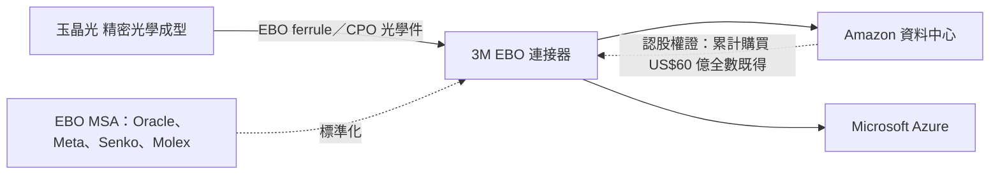

# MMM.US(3m)

## 基本資料

3M 是美國多角化工業公司（總部明尼蘇達州聖保羅），產品橫跨工業材料、安全防護、電子與交通材料、消費品（一般公司資訊）。本 wiki 追蹤的是它在 AI 資料中心的新業務：**擴束光學（Expanded Beam Optical, EBO）光纖連接器**。EBO 已部署於 [[MSFT.US(microsoft)]] Azure（UBS 2026-10-15 轉述），2026 年 5 月成立 EBO MSA，由 Oracle 共同主持、成員含 Meta、Senko、Molex。

2026-10-19 3M 同日宣布兩件事：
- 預計透過私募取得 [[3406_玉晶光（市）]] 約 4.7% 股權（2026Q4 交割），玉晶光的精密光學製造支援 EBO ferrule、CPO 方案與相關光互連應用的量產準備。
- 與 [[AMZN.US(amazon)]] 擴大策略商業關係，發給 Amazon 子公司最多 3,162,015 股認股權證，依 Amazon 購買光連接等資料中心產品的累計付款金額既得（US$60 億全數既得）。

在供應鏈中，3M 是連接器品牌與方案商，上游精密光學件由玉晶光代工，下游是超大規模雲端業者。資料來源：[[research_產業合作技術發表_2026-10-24]]（3M 新聞稿與 Form 8-K，2026-10-19）、[[261015_ubs_genius]]（UBS，2026-10-15）。

## 核心技術／競爭優勢

- **EBO 擴束光學**：以透鏡把光束放大後再耦合，降低端面污染與對準精度要求，目標是減少資料中心光纖清潔與維運成本（一般技術原理；3M 新聞稿未揭露插入損耗等規格）。SemiAnalysis（2026-10-23）附圖顯示 ferrule 以全內反射鏡把光準直成擴束光、介面加 AR 鍍膜，並認為 EBO 最大價值在維運（維修快、停機短），低插拔力也有利提高密度；原理、參數與 MMC 比較見 [[技術_EBO擴束連接器]]。
- **超大規模業者綁定**：已有 Azure 部署，再以認股權證把 Amazon 的採購金額與股權誘因綁在一起，形成兩家 CSP 的具名需求。
- **標準化路徑**：主導 EBO MSA，拉進 Oracle、Meta 與連接器廠 Senko、Molex，降低單一供應商疑慮。
- **製造外包到精密光學廠**：入股玉晶光取得塑膠精密光學的量產能力，不必自建微透鏡產線。

## 產品與應用

| 產品 / 服務 | 應用 | 相關客戶 / 下游 |
|---|---|---|
| EBO 擴束光纖連接器與 ferrule | 資料中心機櫃間、交換器光纖連接 | [[MSFT.US(microsoft)]]（Azure 已部署）、[[AMZN.US(amazon)]] |
| CPO 相關光學方案 | 共同封裝光學的光纖介面 | 新聞稿列為與玉晶光合作範圍，客戶未揭露 |
| 其他資料中心產品 | 認股權證計入的其他資料中心產品，類別未揭露 | [[AMZN.US(amazon)]] |

## 圖片 / 架構圖

> 3M EBO 的上下游：玉晶光代工精密光學件，Amazon 與 Microsoft 為已知超大規模使用者；虛線為財務與標準化關係。

## 時間軸

| 時間 | 事件 | 類型 | 重要性 | 備註 |
|---|---|---|---|---|
| 2026-05 | EBO MSA 成立（Oracle 共同主持，Meta、Senko、Molex 加入） | 標準 | ⭐⭐ | UBS 2026-10-15 轉述 |
| 2026-10-15 | 玉晶光董事會通過私募 3M UK（NT$48 億、持股 4.68%） | 策略投資 | ⭐⭐⭐ | 玉晶光公告，見 [[3406_玉晶光（市）]] |
| 2026-10-19 | 3M 宣布入股玉晶光約 4.7%；與 Amazon 擴大合作並發行認股權證（最多 3,162,015 股、行使價 US$164.89、7 年） | 策略合作 | ⭐⭐⭐ | 官方 fact |
| 2026Q4 | 玉晶光私募交割 | 策略投資 | ⭐⭐ | 3M 新聞稿 |
| 2027 | EBO ferrule 可能開始貢獻玉晶光營收 | 放量 | ⭐⭐ | UBS thesis／中 |

→ 跨公司比較詳見 [[時程_2026Q3Q4_AI網通與硬體催化劑]]

## 供應鏈位置

- 上游：[[3406_玉晶光（市）]]（EBO ferrule 與 CPO 光學件製造夥伴、3M 持股約 4.7%）。
- 下游：[[AMZN.US(amazon)]]、[[MSFT.US(microsoft)]] 等超大規模雲端業者。
- 同類／替代方案：[[GLW.US(corning)]] GlassBridge 等 fiber-to-PIC 連接方案。
- 所屬供應鏈：[[供應鏈_AI光互聯]]、[[供應鏈_CPO]]；技術背景見 [[技術_EBO擴束連接器]]、[[技術_光互連]]、[[技術_MPO]]（EBO vs MMC）。

## 相關公司

| 公司 | 關係 | 說明 |
|---|---|---|
| [[3406_玉晶光（市）]] | 製造夥伴／被投資公司 | EBO ferrule、CPO 光學件量產準備；3M 持股約 4.7% |
| [[AMZN.US(amazon)]] | 客戶 | 擴大策略商業關係；認股權證綁定光連接等產品購買額 |
| [[MSFT.US(microsoft)]] | 客戶 | Azure 已部署 EBO（UBS 轉述） |
| [[GLW.US(corning)]] | 同業／替代 | 資料中心光纖連接與 fiber-to-PIC 方案 |

> [!warning] 風險與注意事項
> - US$60 億是認股權證全數既得的累計購買門檻，不是採購承諾；且涵蓋「光連接與其他資料中心產品」，不能全數視為 EBO 營收。
> - 3M 新聞稿未揭露 EBO 規格、產能與量產時程，EBO 對 3M 整體營收占比仍小，股價主要受工業本業與訴訟等因素影響。
> - EBO 是否成為主流取決於 MSA 普及與 CPO 架構演進，與 FAU、GlassBridge 等方案存在替代競爭。
> - SemiAnalysis（2026-10-23）指出 EBO 插入損耗高於 MMC、目前單價也較高，預期兩者依密度、可維修性與光預算並存，而非全面替代；佈線省工也不一定讓 CSP 提早產生營收（thesis／中）。
> - 認股權證若全數既得，對 3M 既有股東有稀釋。

## 來源

- [[research_產業合作技術發表_2026-10-24]] — 3M PR Newswire 新聞稿與 Form 8-K，2026-10-19；入股玉晶光、Amazon 認股權證條款（官方 fact）。
- [[261015_ubs_genius]] — UBS，2026-10-15；EBO 部署於 Azure、EBO MSA 成員、EBO TAM 估算（券商 estimate）。
- [[memo_SemiAnalysis_EBO擴束連接器_20261024]] — SemiAnalysis X 串文，2026-10-23；EBO 光路圖、EBO vs MMC 取捨、Senko XBO 光背板（分析機構觀點；未點名 3M）。
