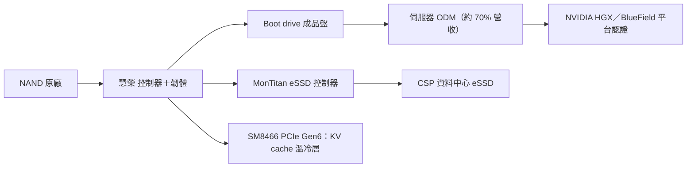

# SIMO.US(silicon_motion)

## 基本資料

慧榮科技（Silicon Motion）是 NAND 快閃記憶體控制器設計公司，營運總部在台灣新竹，以 ADR 在美國 NASDAQ 掛牌（一般公司資訊）。產品涵蓋手機、PC、邊緣 AI 用 SSD／UFS 控制器，以及企業級 SSD 控制器 MonTitan 與 AI 伺服器 boot drive 方案。

AI 相關成長來自兩條線：
- **Boot drive**：MS（2026-07-02）指 SIMO 占 BlueField-3 boot drive 控制器 100%，並由 DPU 延伸到下一代 AI GPU／CPU 平台、乙太網路與 NVLink 交換器；Vera Rubin 標準化後 BlueField-4 另加入 [[8299_群聯（櫃）]]、[[2379_瑞昱（市）]]。專家訪談稱 2026 年 boot drive 營收 3–4 億美元的市場預估「基本準確」，約 70% 營收來自頭部伺服器 ODM（渠道觀察，低至中信心）。
- **企業級 SSD（MonTitan）**：MS 稱已對兩家客戶量產，公司目標 2026 年底再增加 5 家 Tier 1 CSP；MS 估 eSSD 占營收 2026／27／28E 為 5%／13%／19%。

2026-10-23 深圳 GMIF2026 展出 PCIe Gen6 企業級控制器 SM8466（台積電 4nm、循序讀取 28 GB/s、隨機讀取 700 萬 IOPS）。供應鏈位置是 NAND 原廠與 SSD 模組之間的控制器／方案層，見 [[供應鏈_記憶體]]、[[技術_NAND快閃記憶體]]。

資料來源：[[260702_ms_nand-industry]]（MS，2026-07-02）、[[memo_AceCamp_SiliconMotion_KVCache與PCIe6SSD_20260901]]（匿名專家，2026-09-01）、[[research_產業合作技術發表_2026-10-24]]（GMIF2026 新聞稿，2026-10-23）。

## 核心技術／競爭優勢

- **控制器＋韌體自研**：自行開發控制器、韌體與 BIOS 之上的軟體層；PCIe 6.0 世代針對 KV cache 的大量小封包隨機讀寫優化，在韌體層壓縮 P99／P99.9 尾延遲（專家訪談）。
- **NVIDIA 平台認證門檻**：boot drive 以成品盤賣給 ODM，須通過 NVIDIA HGX 平台相容性認證；客戶即使自購 NAND 也要重跑數月認證，形成轉換成本（專家訪談）。
- **「底座增強」路線**：SM8366／SM8466 定位為 AI 負載增強型標準企業級控制器，不在控制器內整合 NPU；同路線競品為 Marvell，另一條「存內計算 ASIC」路線（控制器整合 NPU）多停在樣品階段（專家訪談）。
- **成品盤模式受惠 NAND 漲價**：由賣控制器轉向賣搭載 NAND 的完整方案，可分享 NAND 漲價（專家訪談）。

## 產品與應用

| 產品 / 服務 | 應用 | 相關客戶 / 下游 |
|---|---|---|
| Boot drive 方案 | AI 伺服器、DPU（BlueField）開機碟 | 伺服器 ODM，平台為 [[NVDA.US(nvidia)]] HGX |
| MonTitan 企業級 SSD 控制器 | 資料中心 eSSD | 已量產 2 家客戶，目標再增 5 家 Tier 1 CSP |
| SM8466 PCIe Gen6 控制器 | 下一代 eSSD、KV cache 卸載 | 閃存原廠與雲端業者意向訂單（專家訪談） |
| 消費級 SSD／UFS 控制器 | 手機、PC、邊緣 AI | 品牌與模組廠 |

## 圖片 / 架構圖

> 慧榮在 AI 儲存的兩條成長線：boot drive 經 ODM 進入 NVIDIA 平台，MonTitan／PCIe Gen6 控制器進入 CSP eSSD 與 KV cache 卸載。

## 目標價與評等

| 券商 | 報告發布日 | 評等 | 目標價 | 評價基礎 | 來源 |
|---|---|---|---|---|---|
| Morgan Stanley | 2026-07-02 | 報告未明列 | US$400（原 US$155）；Bull US$580／Bear US$175 | 23x 2027E EPS（2019 年以來平均 20x） | [[260702_ms_nand-industry]] |

## 時間軸

| 時間 | 事件 | 類型 | 重要性 | 備註 |
|---|---|---|---|---|
| 2026 | 公司預期營收創新高、逐季成長；boot drive 營收約 3–4 億美元 | 放量 | ⭐⭐⭐ | MS 轉述公司／專家訪談，中 |
| 2026 年底 | MonTitan 目標再增 5 家 Tier 1 CSP，年底 run-rate 占營收 5–10% | 客戶導入 | ⭐⭐ | 公司目標（MS 轉述） |
| 2026-10-23 | GMIF2026 展出 SM8466 PCIe Gen6 控制器（台積電 4nm、28 GB/s、700 萬 IOPS） | 新產品 | ⭐⭐ | 官方展會新聞稿 |
| 2027H2 | PCIe 6.0 控制器小規模放量（不順則延至 2028） | 技術下線 | ⭐⭐ | 專家訪談，低至中 |
| 2027–2028 | KV cache 存入 SSD 趨於成熟；eSSD 占營收升至 13%／19% | 放量 | ⭐⭐ | 專家訪談／MS estimate |

→ 跨公司比較詳見 [[時程_2026記憶體與AI催化劑]]

## 供應鏈位置

- 上游：NAND 原廠（[[MU.US(micron)]] 等）、晶圓代工（台積電 4nm）。
- 下游：伺服器 ODM、CSP、手機與 PC 品牌。
- 平台：[[NVDA.US(nvidia)]] HGX／BlueField 認證生態。
- 所屬供應鏈：[[供應鏈_記憶體]]；技術背景見 [[技術_NAND快閃記憶體]]。

## 相關公司

| 公司 | 關係 | 說明 |
|---|---|---|
| [[NVDA.US(nvidia)]] | 平台 | Boot drive 須通過 HGX 認證；不直接銷售給 NVIDIA |
| [[8299_群聯（櫃）]] | 競爭 | BlueField-4 boot drive 加入的另一家控制器廠 |
| [[2379_瑞昱（市）]] | 競爭 | BlueField-4 boot drive 加入的控制器廠 |
| [[MU.US(micron)]] | 上游／競爭 | NAND 供應來源；原廠成品盤與慧榮方案競爭 boot drive |

> [!warning] 風險與注意事項
> - Boot drive 營收高度集中在頭部 ODM（約 70%，專家訪談），NAND 若再翻倍，ODM 可能自購顆粒自做 BGA 方案。
> - BlueField-4 加入群聯、瑞昱，boot drive 100% 市占不會延續。
> - PCIe 6.0 控制器量產時程（2027H2 或延至 2028）與意向訂單皆未經公司確認。
> - 消費級需求仍溫和，NAND 漲價可能抑制終端需求。

## 來源

- [[research_產業合作技術發表_2026-10-24]] — GMIF2026 展覽回顧新聞稿，2026-10-23；SM8466 規格（官方展會，廠商自述）。
- [[memo_AceCamp_SiliconMotion_KVCache與PCIe6SSD_20260901]] — AceCamp 匿名專家，2026-09-01；KV cache、PCIe 6.0 時程、boot drive 模式與客戶結構（渠道觀察，低至中）。
- [[260702_ms_nand-industry]] — Morgan Stanley，2026-07-02；boot drive、MonTitan、目標價 US$400（券商 estimate）。

## 相關頁面

- [[分析_20260901專家紀要受訪公司辨識與驗證框架]]
- [[分析_記憶體超級循環2026]]
- [[時程_2026Q3Q4_AI網通與硬體催化劑]]
