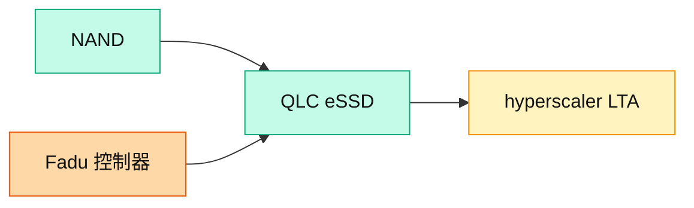

# SNDK.US(sandisk)

## 基本資料
SanDisk 為由 Western Digital 分拆的 **NAND / SSD 大廠**，摩根士丹利維持 OW，看好 NAND/DRAM 供需與資料中心儲存轉型。積極擴張 datacenter 儲存業務並取得 hyperscaler LTA；公司表示 datacenter 占營收 > 20%，未來將提升至 35–40%。業界普遍看好其 QLC eSSD。資料來源：[[260702_ms_nand-industry]]、[[大和 韓國記憶體產業電話會議摘要]]。

## 核心技術／競爭優勢
- **DC 儲存轉型**：datacenter 營收占比由 >20% 拉升目標 35–40%，QLC eSSD 為主力產品。
- **供需能見度**：LTA 支撐定價能見度，市場可望維持緊俏 2–3 年；<10x P/E，2027 有意義庫藏股。
- **控制器夥伴**：eSSD 控制器由 Fadu（韓廠，eSSD 控制器） 供應（key eSSD controller supplier to SanDisk）。

## 產品與應用
| 產品 / 服務 | 應用 | 相關客戶 / 下游 |
|-------------|------|-----------------|
| QLC eSSD | 資料中心大容量儲存 | hyperscaler |
| Client SSD / NAND | PC、消費 | 品牌、通路 |

## 圖片 / 架構圖

![[報告_Aletheia_創意電子首次覆蓋_20260922_p009.png]]
圖說：p9 圖11／12 三種HBF配置及HBF4 GPU對HBM8 GPU的公司示意；工作負載限制未完整披露。

![[活動_國泰_美國參訪訪談紀要_20260914-18_p088.png]]

圖說：國泰 p88：Western Digital 訪談的儲存階層；用於對照 HDD／NAND／DRAM 分工，不是 SanDisk 效能證明。

圖說：SanDisk 以 QLC eSSD 切入 hyperscaler 資料中心儲存，控制器由 Fadu 供應，datacenter 營收占比目標拉升至 35–40%。

## 目標價與評等

| 券商 | 報告日 | 評等 | 目標價 | 評價基礎 | 來源 |
|------|--------|------|--------|----------|------|
| Bernstein | 2026-06-30 | Outperform | $3,000（↑from $1,700） | 11x FY28E EPS $272 或 14x through-cycle（FY26-30）avg EPS $213 | [[報告_Bernstein_SanDisk_20260630]] |

## EPS 預估

| 年度 | EPS（USD） | 備註 | 券商 |
|------|-----------|------|------|
| 2025A | $2.99 | 實際值 | Bernstein |
| 2026E | $65.43 | — | Bernstein |
| 2027E（base） | $243.73 | — | Bernstein |
| 2027E（bull） | $350 | 漲價超預期 | Bernstein |
| 2028E（base） | $272 | — | Bernstein |
| 2028E（bull） | $400 | — | Bernstein |

## New Memory LTA（長期協議）關鍵數據（Bernstein 2026-06-30）

| 指標 | SNDK | MU |
|------|------|----|
| LTA 協議數 | 5 筆（3 筆 FQ3 + 2 筆 FQ4） | 16 筆 SCA |
| RPO（剩餘履約義務）| $41.6B（3 筆 Q3 協議）→ 全部 5 筆估 ~$69B | ~$100B |
| 財務擔保 | >$11B（多為第三方帳戶條件性擔保） | $22B 現金 + $4B 信用狀 |
| 合約期限 | 1/2/3/5 年混合；多數 3-5 年（平均估~4 年） | 多數 5 年（2026-2030） |
| NAND 地板價 | **$0.29/GB**（≈ CQ2'26 現貨 ASP） | 估 CQ2 的 ~50% 以下（高毛利但更保守） |
| NAND 上限價 | 未揭露（後期有上行分潤） | CQ2'26 市場價（固定上限） |
| 未來 12 月可認列 | ~15% of RPO | ~$1.8B（Q3 RPO 部份） |
| FY27 供量已鎖定 | 超過 1/3 | ~20% DRAM + ~33% NAND |

**核心論點**：舊式 LTA 對供應商毫無保護；新式 LTA 有三大差異：①價格固定或設區間；②客戶預付財務承諾（動態覆蓋率越到後期越高）；③合約期長達 3-5 年。即使最壞情境（ASP 腰斬 72% 至 $0.11/GB），SNDK FY30 EPS 仍有 $214（vs 無 LTA 僅 $81）。

## 時間軸

| 時間／窗口 | 新增觀察 | 類型 | 重要性 | 來源與追蹤 |
|---|---|---|---|---|
| 2027／2028（情境） | HBF tape-out／樣品及可能量產；與國泰已tape-out說法並列 | 驗證／選擇權 | ⭐⭐ | Aletheia 2026-09-22／中低，[[報告_Aletheia_創意電子首次覆蓋_20260922]]；[[時程_2026-2028十月券商催化劑]] |

| 時間 | 事件 | 類型 | 重要性 | 備註 |
|------|------|------|--------|------|
| 2026-06-30 | Bernstein TP $3,000（↑from $1,700）；LTA 地板價 $0.29/GB；FY27E EPS $243 | 評等升幅 | ⭐⭐⭐ | 新記憶體 LTA 典範轉移 |
| 2026 | datacenter 占比 >20% → 35–40% | 放量 | ⭐⭐⭐ | QLC eSSD 帶動 |
| 2027 | 有意義庫藏股 | 事件 | ⭐⭐ | 資本回饋 |

→ 對照 [[時程_2026記憶體與AI催化劑]]

## 供應鏈位置
- 上游：NAND 設備、eSSD 控制器（Fadu（韓廠，eSSD 控制器））
- 下游：hyperscaler、PC 品牌
- 所屬供應鏈：[[供應鏈_記憶體]]；相關技術 [[技術_NAND快閃記憶體]]

## 相關公司
| 公司 | 關係 | 說明 |
|------|------|------|
| [[285A.JP(kioxia)]] | 合資背景 / 同業 | 共同 NAND 廠背景，DC 儲存競合 |
| [[MU.US(micron)]] | 同業 | NAND/DRAM 競爭者 |
| [[005930.KR(samsung)]] | 同業 | NAND 競爭者 |

> [!warning] 風險與注意事項
> - 產品定位：業界推測其 datacenter 用低規 NAND 晶片，但仍具溢價；QLC eSSD 品質評價為觀察點。
> - 循環風險：NAND ASP 若因中國廠擴產反轉，DC 儲存溢價收斂。

## 本批來源更新（2026-10-11 入庫）

### 2026-09 國泰參訪：NBM 長約與 HBF

公司轉述 FY26Q4 營收 US$8.965bn、non-GAAP 毛利率 84.6%、營益率 79%、EPS US$39.25；屬訪談重述，信心中，未獨立核對申報。

NBM 最低採購承諾 US$93.8bn，期末 RPO 59.8bn、含季後合約 91.1bn，財務擔保 16.5bn；8 客戶、FY27 約一半 bits／FY28 約三分之二鎖定、平均 4 年以上。RPO／承諾／擔保均不等於當期認列收入，與原頁 6 月 Bernstein 5 合約／較早 RPO 保留日期比較。FY28–30 毛利率約 80%、OPM 75%、FCF margin 50% 是公司目標；FY27／28 EPS 212／255 是來源中的 Bloomberg 共識，不是國泰個股模型。

Kioxia JV 49.9%／50.1% 股權及約半產出，部分固定成本按約負擔；NAND wafer、後段封裝與 eSSD 控制器並非同一業務。HBF 基於 BiCS8 客製 die，稱已 tape-out、2027 送樣，容量為 HBM 8–16 倍是公司目標；基準收入未納 HBF。NAND 的隨機寫入／延遲限制仍在，HBF 不能直接取代 hot HBM／DRAM；TLC 支援效能型 KV Cache、QLC 支援容量需求。

時間軸：2027 HBF 送樣、FY27–28 長約供量與現金收取、FY28–30 獲利率目標驗證；同步 [[時程_2026-2028十月券商催化劑]]。技術 [[技術_NAND快閃記憶體]]，活動分析 [[分析_國泰美國參訪_電力測試記憶體與太空驗證_20260914-18]]。

## Aletheia 2026-09-22：創意 COT／Turnkey 研究關聯

Aletheia p8–9渠道研判 [[3443_創意電子（市）]] 以 GLink3D／die-to-die IP、APR參與 SanDisk 與 SK hynix 記憶體堆疊；[[000660.KR(sk_hynix)]] 為同領域研究參照，未由兩家記憶體公司正式確認合約／份額。該文轉述8月投資人日 **2027 tape-out／樣品、2028可能生產**；與9月國泰參訪「已tape-out、2027送樣」依不同日期並列，不當同一來源的確定進度。

來源展示4TB HBF支援、4 GPU對192GB HBM-only、8 GPU有相近token輸出，是特定公司場景示意（benchmark／中低），未完整提供模型、precision、context／batch、cache與軟體條件，不外推為所有推論GPU減半或採購腰斬。HBF與HBM可分層／混合配置，相關架構見 [[技術_NAND快閃記憶體]]；HBF未納本報告創意基準獲利。

來源：[[報告_Aletheia_創意電子首次覆蓋_20260922]]（2026-09-22；券商 estimate／channel_check／thesis，信心依上段）。分析：[[分析_創意COT獲利與營運資金驗證_20260922]]。

## 來源

- [[報告_Aletheia_創意電子首次覆蓋_20260922]] — Aletheia Capital，2026-09-22；創意專案、合作分工與未確認的上行情境。

- [[活動_國泰_美國參訪訪談紀要_20260914-18]] — 國泰證期研究部，2026-09-18；原始研究／訪談全文，數字及時程依本批註記保留來源口徑。
- [[報告_Bernstein_SanDisk_20260630]]（Bernstein，2026-06-30；TP $3,000↑；LTA 地板價 $0.29/GB；FY27E EPS $243.73、FY28E $272）
- [[260702_ms_nand-industry]] — 摩根士丹利，2026-07-02
- [[大和 韓國記憶體產業電話會議摘要]] — 大和，2026-07-02

- [[報告_摩根士丹利_韓國記憶體小幅波動_20260806]]（2026-08-06）

## 相關頁面

- [[分析_FMS2026_CXL記憶體池與光互連受惠邏輯]]
- [[分析_記憶體超級循環2026]]
