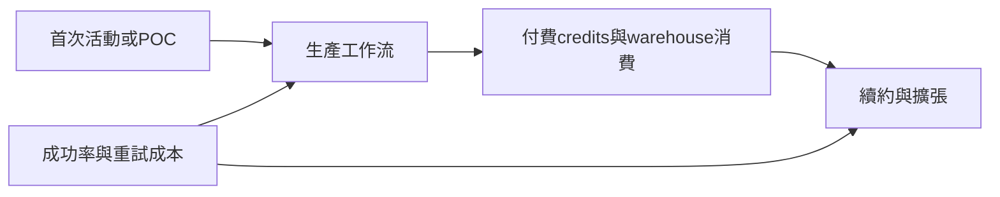

# SNOW.US(snowflake)

## 基本資料

Snowflake（SNOW.US）是全球領先的資料雲端平台，以消費型計費（Consumption-based）模式提供資料倉儲、資料工程、資料共享與 AI 應用服務。公司定位從「資料倉儲」轉型為「企業 Agentic AI 控制層」（Enterprise Agentic AI Control Plane），核心戰略在結合資料治理、安全與跨系統整合能力，而非依賴單一模型。

**FY 結束月份**：1 月（FY1Q27 = 2026 年 2-4 月）

---

## 核心技術／競爭優勢

- **Cortex Code（CoCo）**：general-purpose coding agent，可直接建立 applications、pipelines、agents 與 workflows；支援 Amazon Glue、Airflow、DBT Cloud、Databricks；7,100+ 帳戶（F1Q27），為公司史上導入最快新產品
- **Snowflake Intelligence**：AI 賦能 BI 產品，使用帳戶 QoQ 翻倍（F1Q27）
- **統一 AI 基礎設施**：AI products、Snowflake Intelligence、CoCo 底層共用同一套 model garden + runtime + memory + agent harness infrastructure
- **企業治理護城河**：RBAC、row-level security、replication、identity/governance infrastructure；非 AI labs 短期可複製
- **Natoma 收購**：將 enterprise MCP（Model Context Protocol）導入 Snowflake，讓 agent actions 在 governed environment 下執行跨 SaaS 操作（email、calendar、Slack、JIRA）

---

## EPS 記錄

### 近期季報

| 期間 | 產品營收（$M）| YoY | NRR | OP Margin |
|------|--------------|-----|-----|-----------|
| F1Q27（2026-02~04）| 1,334 | **+34%**（加速 4ppts）| 126% | 11.9% |
| F4Q26（2025-11~26-01）| 1,226 | +30% | 125% | — |

### FY27 展望（公司上修）

| 項目 | 新指引 | 舊指引 | YoY |
|------|--------|--------|-----|
| 產品營收 | $5,840M | $5,660M | **+31%**（原 27%）|
| OP Margin | 13.5% | 12.5% | +3.0ppts |

### 關鍵 KPI（F1Q27）

| 指標 | 數值 | QoQ | YoY |
|------|------|-----|-----|
| 總客戶數 | 13,912 | — | +38% |
| TTM >$1M 客戶 | 779 | +46 家 | +29% |
| RPO | $9.21bn | -6% | +37% |
| cRPO | $4.61bn | +2% | +37% |
| AI 功能使用帳戶 | 13,600 | 上季 9,100 | — |
| CoCo 帳戶 | 7,100+ | 上季 4,400 | — |

---

## 目標價與評等

| 來源 | 日期 | 評等 | 目標價 | 備註 |
|------|------|------|--------|------|
| 凱基投顧 | 2026-06-11 | 正向看待（未給 TP）| — | 資料治理 + AI 賦能 BI；Agentic AI 控制層定位 |

---

## 時間軸

| 時間 | 事件 | 重要性 | 備註 |
|------|------|--------|------|
| 2026-04 | F1Q27 財報：產品營收 YoY +34%（加速 4ppts），創單季淨增紀錄 | ⭐⭐⭐⭐ | FY27 指引上修至 31% |
| 2026-04 | CoCo 帳戶 7,100+ 家，為公司史上最快導入新產品 | ⭐⭐⭐⭐ | FY27 指引上修最大驅動因子 |
| 2026-04 | AWS 未來五年 $6bn 合作協議（規模較 FY23 倍增）| ⭐⭐⭐ | 加大 GTM 與 AI collaboration |
| 2026-04 | 收購 Natoma（enterprise MCP）| ⭐⭐⭐ | AI governance 控制能力延伸 |
| 進行中 | Snowflake Summit：展示 out-of-box AI 結果領先其他 agent 平台 | ⭐⭐ | — |

---

## 主要風險

> [!warning]
> - **Observe 收購整合**：FY27 operating margin 與 FCF margin 各帶來約 150bps 逆風
> - **消費型計費波動**：AI workloads 費用不可預測，需推出 token cap 等 cost governance 機制
> - **競爭**：Databricks（私有化）、Redshift（AWS）、BigQuery（GCP）持續競爭核心資料平台

---

## 2026-09-30 CoCo活動、RPO與付費消費

[[memo_Notion_AceCamp_Snowflake_CoCo使用到付費轉換_70567677_20260930]]指出首次activity帳戶可能仍在測試，舊POC轉production未必算首次活動；RPO又受capacity簽約與on-demand模式影響。因此需結合產品收入、付費consumption、production轉換及續約擴張，不能單憑活動數或RPO增速推估需求。

來源稱自然語言查詢可能因追問／重試增加query及warehouse消耗，屬expert thesis／中低信心，沒有新增收入量化。每成功任務成本與客戶留存仍重要；不將低效率重試視為永續收入。文章CoCo／Cowork／MCT名稱與7月底GA說法需核對版本，與既有F1Q27帳戶資訊分開保留；ETL／Analytics比例不是官方分部披露。詳見[[分析_Snowflake活動到消費收入的轉換驗證_20260930]]。

## 供應鏈位置與相關公司

| 公司 | 關係 | 來源及邊界 |
|---|---|---|
| [[AMZN.US(amazon)]] | 雲端部署平台，同時以Redshift競爭 | 9-30匿名紀要描述AWS部署客群；未提供實際份額 |
| [[GOOGL.US(alphabet)]] | GCP部署平台與BigQuery競品 | 同紀要未能量化BigQuery搶占Snowflake份額；Google Cloud成長不等於BigQuery收入 |

## 圖片 / 架構圖

*圖：依9-30匿名紀要整理的商業驗證順序，非公司公布的實測轉換率。*

## 來源

- [[memo_Notion_AceCamp_Snowflake_CoCo使用到付費轉換_70567677_20260930]] — 2026-09-30日期欄，匿名專家，產品與內部使用說法未外部查證。

- [[報告_凱基投顧_美國軟體產業_ORCL_SNOW_MDB_20260611]]（凱基，2026-06-11；F1Q27 財報 + FY27 展望）
