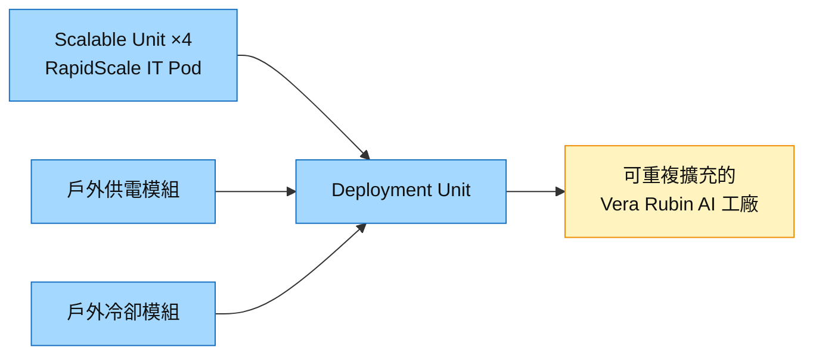

# SU.FR(schneider_electric)

## 基本資料

Schneider Electric（施耐德電機，Euronext Paris：SU）是全球電力管理與自動化大廠，資料中心產品涵蓋中低壓配電、UPS、prefab 模組化資料中心（RapidScale／EcoStruxure Modular Data Center）、液冷（Motivair）與監控軟體。AI 資料中心使其由 grey-space 電氣設備延伸到 white space 的機櫃供電與液冷整合。

2026-10-21 Schneider 在 NVIDIA GTC Berlin 期間發表 RapidScale Modular Data Center Reference Design 115，針對 [[NVDA.US(nvidia)]] Vera Rubin 平台：4 個 scalable unit 組成一個 deployment unit，搭配戶外供電與冷卻模組，可重複擴充；RapidScale IT Pod 部署速度較傳統現場施工快 80%，與 Compass Datacenters 合作的工時研究顯示預製白空間模組減少 80% 現場安裝時間（fact；新聞稿全文未直接擷取，細節取自官方部落格與摘要）。同日 Schneider 也列入 NVIDIA DSX POD 合作夥伴。

主要資料來源：[[research_產業合作技術發表_2026-10-22]]（Schneider 新聞稿與官方部落格、NVIDIA 新聞稿，2026-10-20～21）。

### 2026-10-21 Goldman Sachs 800VDC 入門（Not Rated）

- Data Centers & Networks 約占營收 30%：secure power 32%、electrical distribution 24%、transactional & edge 16%、cooling 7%、BMS 5%；每 MW 內容價值 US$1.3–3.3mn，高密度 AI 資料中心趨向上緣。
- 與 NVIDIA 合作推出 Power Rack sidecar（單櫃最高 1.2MW、每排 4.8MW），為混合架構過渡方案；SST 兩方案：800VDC Power Center（2027，LV 轉換器＋TRU＋SST，約 4.8MW／feed）、800VDC Power Block（2028–29，34.5kV AC 直轉 800VDC，5–10MW／feed）；首批 SST 商用 2H27、2028–30 年加速。液冷經併購 Motivair 取得。
- 來源：[[報告_GoldmanSachs_800VDC電氣設備入門_20261021]]（Goldman Sachs，2026-10-21），信心中高。

## 核心技術／競爭優勢

- **電網到機櫃的完整電力組合**：中壓、低壓配電、UPS、母線與機櫃供電，800 VDC 架構延後時反而延長傳統低壓設備需求（既有 wiki 券商口徑）。
- **預製模組化**：RapidScale 參考設計把白空間、供電與冷卻做成可重複的預製單元，定位 10–20 MW、液冷、Tier III。
- **液冷**：透過 Motivair 提供 CDU 與液冷方案，與 [[VRT.US(vertiv)]] 同為美歐系 CDU 主要廠商。
- **NVIDIA 參考設計夥伴**：Vera Rubin 供電與冷卻參考架構已與 AVEVA、ETAP 共同驗證，並列 DSX POD 夥伴。

## 產品與應用

| 產品 / 服務 | 應用 | 相關客戶 / 下游 |
|-------------|------|-----------------|
| RapidScale Reference Design 115 | Vera Rubin 模組化 AI 工廠 | AI 資料中心營運商 |
| 中低壓配電、UPS、母線 | 資料中心 grey space | CSP、託管業者 |
| Motivair 液冷／CDU | 液冷 AI 機櫃 | AI 資料中心 |
| EcoStruxure 監控軟體、數位孿生 | 營運與設計驗證 | 資料中心營運商 |

## 圖片 / 架構圖

圖說：依 Schneider 2026-10-20 官方部落格描述的 RapidScale 模組化 AI 工廠架構。

## 時間軸

| 時間 | 事件 | 類型 | 重要性 | 備註 |
|------|------|------|--------|------|
| 2026-10-20 | 官方部落格說明模組化 AI 工廠架構（4 scalable unit＝1 deployment unit） | 產品 | ⭐⭐ | [[research_產業合作技術發表_2026-10-22]] |
| 2026-10-21 | 發表 RapidScale Reference Design 115（Vera Rubin）；列 NVIDIA DSX POD 夥伴 | 產品／合作 | ⭐⭐⭐ | 同上 |
| 2027 初 | DSX POD 夥伴開始全球交付 | 放量 | ⭐⭐ | NVIDIA 新聞稿 |

→ 跨公司時程見 [[時程_2026能源與AI電力設備]]

## 供應鏈位置

- **上游**：電力電子與功率元件、冷卻零組件。
- **下游**：CSP、AI 資料中心營運商、託管業者。
- **同業／競爭**：[[VRT.US(vertiv)]]、[[2308_台達電（市）]]、Eaton、ABB、Legrand。
- **所屬供應鏈**：[[供應鏈_AI伺服器散熱]]；供電見 [[技術_800VDC供電架構]]。

## 相關公司

| 公司 | 關係 | 說明 |
|------|------|------|
| [[NVDA.US(nvidia)]] | 參考設計夥伴 | Vera Rubin 供電／冷卻參考架構、DSX POD 夥伴 |
| [[VRT.US(vertiv)]] | 競爭 | CDU、電力與預製模組化方案直接競爭，同列 DSX POD |
| [[2308_台達電（市）]] | 競爭 | 同列 DSX POD；電源、CDU 與預製整合方案重疊 |

> [!warning] 風險與注意事項
> - **新聞稿細節不足**：Reference Design 115 新聞稿全文未直接擷取，功率等級與上市時程以官方部落格與產品頁描述為準。
> - **800V 架構轉換**：若 800 VDC 快速普及，部分傳統 AC 配電與 UPS 需求可能被 power rack／SST 取代；反之延後則有利既有產品。
> - **競爭激烈**：Vertiv、台達、Eaton 都在推預製與液冷整合，NVIDIA 參考設計多供應商並存。

## 來源

- [[research_產業合作技術發表_2026-10-22]] — Schneider 新聞稿與官方部落格、NVIDIA DSX POD 新聞稿，2026-10-20～21。
- 既有 grey-space 與 CDU 定位：見 [[技術_800VDC供電架構]]、[[供應鏈_AI伺服器散熱]] 各自來源。
- [[報告_GoldmanSachs_800VDC電氣設備入門_20261021]] — Goldman Sachs 800VDC primer，2026-10-21

## 相關頁面

- [[時程_2026-2028十月券商催化劑]]
- [[供應鏈_AI伺服器散熱]]
- [[技術_800VDC供電架構]]
