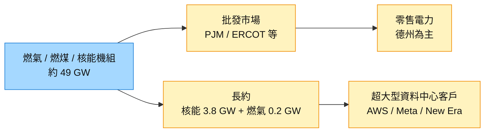

# VST.US(vistra)

## 基本資料

Vistra Corp. 為美國發電商（Independent Power Producer），同時經營零售電力服務。業務分五個部門：東部、西部、德州、零售與資產關閉；前三者為發電，零售部門向終端銷售電力、天然氣與其他服務（最大市場為德州），資產關閉部門負責電廠與礦場除役整治。對 AI 資料中心的角色是以既有核能與燃氣機組簽訂長約，直接供電給超大型雲端客戶。

## 主要產品與應用

| 項目 | 內容（2026-10 底，兆豐整理） |
|------|------------------------------|
| 總發電容量 | 約 49 GW（49,105 MW） |
| 容量結構 | 燃氣 65.0%、燃煤 17.8%、核能 13.1%、太陽能與儲能 3.7%、燃料油 0.4% |
| 3Q26 發電量 | 65,594 GWh：燃氣 58.3%、燃煤／褐煤 20.1%、核能 20.7%、太陽能 0.9% |
| 地區 | 德州約 45%、東部約 52%（東部以 PJM 為主，約占東部淨容量 68%；ISO-NE 19%；MISO＋NYISO 13%）、西部 2.3% |
| 零售 | 3Q26 德州零售售電量約占該區發電量 78.2%、東部 44.1%，西部無零售 |

## 圖片 / 架構圖

圖說：Vistra 發電量一部分經零售部門售出、一部分於批發市場或雙邊合約售出，資料中心長約為長期成長來源（兆豐 2026-11-18 整理）。

## 資料中心長約

| 對象 | 電廠 | 簽約時間 | 類型 | 容量 (MW) | 時程 |
|------|------|----------|------|-----------|------|
| [[AMZN.US(amazon)]]（AWS） | Comanche Peak | 2025-09 | 核能現有 | 1,200 | 4Q27 開始，2032 年滿載；20 年期，最多延長 20 年 |
| [[META.US(meta)]] | Perry | 2026-01 | 核能現有 | 1,268 | 2026 年底起，20 年期 |
| Meta | Davis-Besse | 2026-01 | 核能現有 | 908 | 2027 年底起，20 年期 |
| Meta | Perry／Davis-Besse／Beaver Valley | 2026-01 | 核能增容 | 213／80／140 | 2031 年部分供電、2034 年底全數上線，20 年期 |
| New Era Energy & Digital | Odessa CCGT | 2026-09 | 燃氣現有 | 207 | 3Q27 開始，20 年期 |

- 合計約 4,016 MW，核能 3.8 GW、燃氣 0.2 GW；另有太陽能長約 855 MW（655 MW 已商轉、200 MW 預計 2027 年完工）。尚未簽約容量：核能約 3.1 GW、燃氣複循環約 25 GW（fact，公司揭露；兆豐整理）。
- 客戶仍偏好核能長約，Vistra 主體為燃氣，燃氣長約進度為觀察重點；簽約進度亦受負載併網速度限制。

## 近期營運與研究更新

### 2026-11-18 兆豐：初次報告，區間操作，TP US$141

- 3Q26（fact）：營收 US$6.347bn（QoQ +58%、YoY +27.7%）、營業利益 US$1.706bn（YoY +64.5%）、稅後淨利 US$1.092bn（YoY +80.8%）；夏季高溫使 PJM 與 ERCOT 尖峰負載創新高，發電量 65.6 TWh（YoY +12.9%），扣除 Lotus 電廠併入與 Martin Lake 1 復運後實際增長約 4.8%；營業利益增幅主要來自避險部位評價由虧轉盈。
- Cogentrix 收購 10 月底完成交割，新增約 5,500 MW 燃氣機組，收購價約 US$4bn（約每 kW US$729、約 2027E 調整後 EBITDA 6.8 倍）。
- 財測：2027 年調整後 EBITDA US$7.7–8.5bn；2026 年收斂至 US$7.1–7.5bn（原 US$6.8–7.6bn）；董事會新增 US$1.5bn 庫藏股、總額 US$2.5bn，至 2028 年底。
- 避險：2027 年避險比例約 98%、2028 年約 78%（德州避險比例較低）；同業 Talen 2027／2028 約 70%／35%，NRG ERCOT 約 75%／50%、PJM 約 90%／35%。電價上漲 10%（約 US$5/MWh）對 2027 EBITDA 增幅約 2%。
- 需求：公司預估至 2030 年用電量年成長 ERCOT 4–6%、PJM 2–3%。2026 年期中選舉後德州、俄亥俄州州長轉為民主黨，政策不確定性提升。
- 評等：區間操作，TP US$141（9x 2027E EV/EBITDA US$8.012bn；過去五年 forward 平均 8.6x）；燃氣長約加速或更大規模增容／新建計畫為上調條件。
- 來源：[[報告_兆豐_VistraVST_20261118]]（兆豐投顧，2026-11-18；公司揭露為 fact，評價為 estimate／中）。

## 目標價與評等

| 券商 | 報告日 | 評等 | 目標價 | 評價基礎 | 來源 |
|------|--------|------|--------|----------|------|
| 兆豐投顧 | 2026-11-18 | 區間操作（初次） | US$141 | 9x 2027E EV/EBITDA | [[報告_兆豐_VistraVST_20261118]] |

## 時間軸

| 時間 | 事件 | 類型 | 重要性 |
|------|------|------|--------|
| 2026 年底 | Meta Perry 核能長約開始供電 | 放量 | ⭐⭐ |
| 3Q27 | New Era Odessa 燃氣長約開始 | 放量 | ⭐ |
| 4Q27 | AWS Comanche Peak 核能長約開始（2032 年滿載） | 放量 | ⭐⭐⭐ |
| 2027 年底 | Meta Davis-Besse 長約開始 | 放量 | ⭐⭐ |

## 相關公司

- [[AMZN.US(amazon)]]：AWS 為 Comanche Peak 核能長約客戶。
- [[META.US(meta)]]：Perry、Davis-Besse 與三座電廠增容長約客戶。
- 同業：Talen（TLN）、NRG（wiki 尚無公司頁）；IPP 角色另見 [[分析_美國電網BTM資料中心]]。

## 來源

- [[報告_兆豐_VistraVST_20261118]]（2026-11-18，兆豐投顧；初次報告，區間操作 TP US$141）

## 相關頁面

- [[分析_美國電網BTM資料中心]]
- [[分析_AI資料中心供電與電熱整合]]
