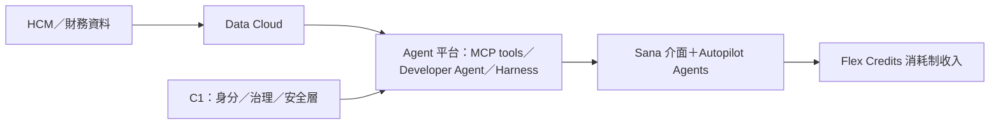

# WDAY.US(workday)

## 基本資料

Workday（NASDAQ: WDAY）核心業務為人力資源（HCM）與財務（Financials）SaaS 系統，執行長 Aneel Bhusri 回任，FY3Q27 為其回任後第四次法說。近年將 AI Agent、Data Cloud 與 Agent 平台疊加於既有 HCM／財務客戶基礎，並以 Flex Credits 消耗制收費。

- FY3Q27（fact）：訂閱收入 US$2.532bn（YoY +13%），專業服務 US$173mn，總營收 US$2.705bn（YoY +11%）；美國 US$2.0bn（YoY +10%）、國際 US$701mn（YoY +15%）。cRPO US$9.216bn（YoY +12.3%，高於財測 11–12%，主要來自提前續約）；總訂閱積壓 US$27.5bn（YoY +6%）。GRR 97%，既有客戶淨擴張貢獻約 65% 訂閱收入成長。
- 獲利：Non-GAAP 營業利益 US$850mn、營益率 31.4%；營業現金流 US$735mn（YoY +25%），自由現金流 US$691mn（YoY +26%）；本季回購 US$750mn，剩餘授權 US$3.25bn；季末現金及有價證券 US$5.6bn（含新發行 US$2.5bn 債券），員工 20,941 人。

資料來源：[[活動_WorkdayWDAY_國泰CallMemo_20261125]]（國泰證期 call memo，2026-11-25）。

## 核心技術／競爭優勢

- AI 產品：New ACV 近 US$150mn（YoY 逾 3 倍），逾一半來自自研 AI 產品與 Flex Credits；AI 產品 ARR 逾 US$750mn（YoY 逾 130%、QoQ 近 25%）。購買至少一項 AI 產品的核心客戶逾 2,200 家，約 30% 客戶已授權一項以上 AI 產品（一年前 12%）；Flex Credits 客戶逾 525 家（逾 250 家本季簽約）；自研 AI Agent 占新增 AI 訂單逾 50%。
- Sana：已成為所有客戶預設首頁與操作介面，自助服務 Agent 正式環境逾 200 萬名使用者；HR 與 IT 服務 Agent Sana Concierge 為 EA、預計明年 Q1 GA；可於 Teams、Slack、Gemini 使用，與 Claude 及 Microsoft Copilot 整合皆進入 EA。
- Autopilot Agent：首款招募用 Talent Acquisition Agent，職缺填補時間由數週縮短至數天（EA，明年初 GA）；薪資、會計與部署 Autopilot Agent 預計明年初進入 EA。市場上共 17 個 Agent；Decision Intelligence 自 7 月 GA 以來活躍客戶採用成長逾 600%。
- Agent 平台已 GA：整合 Data Cloud、MCP 架構 Agent-ready tools、Developer Agent、自訂 Agent 與 Agent Harness。Developer Agent 6 月推出後逾 4,000 名開發者建立逾 10,000 個自訂應用；Extend AI ARR YoY 近 90%、客戶數 YoY 近 75%；Data Cloud GA 兩個月 ARR 近 US$15mn、活躍客戶逾 50 家。
- C1 併購上週完成，定位為人員、資金與自主 Agent 的身分、治理與安全層；HCM 為身分管理上游系統。

## 產品與應用

| 產品 | 應用 | 進度 |
|------|------|------|
| HCM／Financials | 人資、財務核心系統 | 既有客戶基礎；Workforce Planning New ACV YoY 逾 70% |
| Sana／Sana Concierge | AI 操作介面、HR／IT 服務 Agent | Concierge EA，明年 Q1 GA |
| Autopilot Agents | 招募、薪資、會計、部署自動化 | 招募 EA；其他明年初 EA |
| Agent 平台、Data Cloud、Extend AI | 自訂 Agent 與應用 | GA |
| Workday Go for Financials | 美國中型企業 | 上週推出，Q4 開始貢獻，FY2028 更明顯 |
| 原生薪資系統 | 未來一年新增 7 國（含荷蘭、西班牙、新加坡、紐西蘭） | 代管薪資已涵蓋 35 國 |

## 圖片 / 架構圖

## 營運展望

- FY4Q27（公司指引）：訂閱收入約 US$2.6bn（YoY +10%；排除去年 Q4 DIA 專案第一階段約 0.5ppt 逆風為 +11%），cRPO 成長約 10–11%（C1 貢獻略高於 US$5mn），專業服務 US$155mn，Non-GAAP 營益率 31.7%（GAAP 低約 18–19ppt）；Q4 不預期同等規模提前續約。
- FY2027：訂閱收入上修至 US$9.958bn（YoY +13%），專業服務 US$694mn，Non-GAAP 營益率上修至 31.5%，稅率 19%；營業現金流 US$3.45bn、資本支出約 US$270mn、自由現金流 US$3.18bn（YoY +15%）。
- FY2028：訂閱收入成長約 11%，Non-GAAP 營益率目標至少 33%，正式財測下季公布；新 AI 產品帶來上行空間。
- 營益率提升不以組織重整為前提，人數盡量持平、業務人力重新配置至 AI；轉向公有雲與投入 AI 使毛利率略有壓力，AI 產品毛利率與其他業務大致相同；採多模型路由、依任務選最低成本模型，未感受前沿模型成本壓力。
- 客戶 AI 預算與 HR／財務預算分開，以共享服務中心、HR 案件處理等支出評估，將較高營運支出轉為較低軟體支出。FDE（Forward Deployed Engineer）約 50 人協助大型客戶導入 AI Agent，並與 Accenture 推出 FDE 計畫。
- 國泰研究部觀點（晨會摘要，未收錄 Raw）：企業 AI 任務多可用前幾代模型滿足，發展重心轉向成本效率，CSP 更有誘因以客製化 ASIC 降低單位推論成本，AI Agent 普及亦有利 Snowflake、Okta 等業者。

## 時間軸

| 日期 | 事件 | 來源 |
|------|------|------|
| 2026-11 | C1 併購完成；Workday Go for Financials 推出 | [[活動_WorkdayWDAY_國泰CallMemo_20261125]] |
| 2026-11-25 | FY3Q27 法說：AI ARR 逾 US$750mn，FY27 財測上修 | [[活動_WorkdayWDAY_國泰CallMemo_20261125]] |
| 2027 初 | Sana Concierge、Talent Acquisition Agent GA；薪資／會計／部署 Autopilot Agent EA | [[活動_WorkdayWDAY_國泰CallMemo_20261125]] |

## 供應鏈位置

AI 應用層的企業 SaaS 平台，位於 CSP 與模型供應商之下游、企業 HR／財務流程之上；AI Agent 消耗制收入（Flex Credits）為觀察 Agentic AI 企業採用的指標之一。

## 相關公司

| 公司 | 關係 | 來源 |
|------|------|------|
| [[MSFT.US(microsoft)]] | Sana 可於 Teams 使用；與 Microsoft Copilot 整合 EA | [[活動_WorkdayWDAY_國泰CallMemo_20261125]] |
| [[GOOGL.US(alphabet)]] | Sana 可於 Gemini 使用 | [[活動_WorkdayWDAY_國泰CallMemo_20261125]] |
| Anthropic（Claude） | Sana 與 Claude 整合 EA | [[活動_WorkdayWDAY_國泰CallMemo_20261125]] |
| Accenture（ACN US，無公司頁） | FDE 合作計畫 | [[活動_WorkdayWDAY_國泰CallMemo_20261125]] |
| [[SNOW.US(snowflake)]]、[[OKTA.US(okta)]] | 國泰認為 AI Agent 普及同樣受惠 | 國泰晨會摘要 2026-11-25（未收錄 Raw） |

## 來源

- [[活動_WorkdayWDAY_國泰CallMemo_20261125]]（國泰證期 call memo，2026-11-25）

## 相關頁面

- [[DELL.US(dell)]]（同日法說：Agentic AI 帶動 CPU 與儲存需求）
