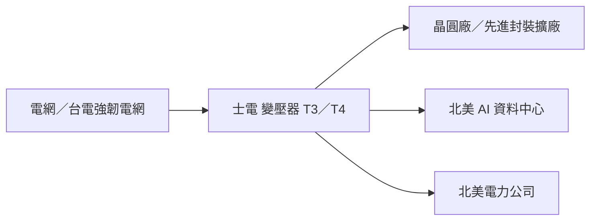

# 1503_士電（市）

## 基本資料

士林電機為台灣重電與配電設備廠，三大事業群為電力配電（電力變壓器、配電變壓器、模鑄式變壓器、配電盤、比流器／比壓器、電廠與公共工程統包、太陽能／儲能）、電機裝備（汽機車電裝品、EV 控制器與馬達、充電樁）與自動化（變頻器、伺服、PLC、儲能變流器 PCS、PV Inverter）。成長來自 AI 資料中心與半導體擴廠、北美外銷與台電強韌電網，重電在手訂單約 600 億元（[[報告_華南_士電1503_20261030]]，2026-10-30 訪談）。

- 主要產品：中大型電力變壓器（含 500kV 超高壓）、配電設備、工程統包。
- 成長驅動：國內半導體電力設備市占約 70%；北美電力公司與 AI 資料中心訂單；台電強韌電網。
- 供應鏈位置：AI 資料中心與晶圓廠的電力輸配電設備供應商。

## 核心技術／競爭優勢

- 國內半導體電力設備市占約 70%，晶圓廠、CoWoS、記憶體、ABF、PCB 擴廠帶動客製化電力級變壓器需求。
- 500kV 超高壓變壓器量產（新豐 T3 廠全產能）。
- 已打入美國大型 CSP 與 AI 資料中心供應鏈，北美新接單約 30% 來自 AI 資料中心；海外毛利率近年每年提升逾 5%。

## 產品與應用

| 產品 | 應用 | 客戶／下游 |
|---|---|---|
| 電力／配電變壓器 | 晶圓廠、AI 資料中心、電網 | 台電、半導體廠、北美電力公司與 CSP |
| 配電盤、比流器／比壓器 | 廠務與資料中心配電 | 南科案、龍潭案（各 20 餘億元） |
| PCS、PV Inverter | 儲能與太陽能 | 綠能案場 |

## 圖片 / 架構圖

圖說：依華南 2026-10-30 訪談整理（Mermaid 補位）。

## 目標價與評等

| 券商 | 日期 | 評等 | 目標價 | 評價基礎 | 來源 |
|---|---|---|---|---|---|
| 華南投顧 | 2026-10-30 | 買進 | NT$225 | 14–19x PER 區間 | [[報告_華南_士電1503_20261030]] |

## 時間軸

| 時間 | 事件 | 類型 | 重要性 | 備註 |
|---|---|---|---|---|
| 2026 年底 | 海外營收占比達 25% | 外銷 | ⭐⭐ | 華南 2026-10-30 |
| 2027Q3 | 變壓器產能再增 30% | 產能 | ⭐⭐ | 待 T3 飽和後啟動 |
| 2027-09 | T4 第一期投產（230／345kV） | 產能 | ⭐⭐⭐ | 見 [[時程_2026能源與AI電力設備]] |
| 2028 | T4 全面量產，整體產能再增三分之一 | 產能 | ⭐⭐⭐ | 華南 2026-10-30 |

## 供應鏈位置

- 上游：矽鋼片、銅、絕緣材料。
- 下游：台電、半導體與 PCB 廠、北美電力公司與 AI 資料中心。
- 供應鏈頁：wiki 尚無重電專屬供應鏈頁，相關時程見 [[時程_2026能源與AI電力設備]]、技術見 [[技術_800VDC供電架構]]。

## 相關公司

| 公司 | 關係 | 說明 |
|---|---|---|
| 華城、中興電、亞力、東元 | 同業 | 華南第四季展望重電受惠名單（[[報告_華南投顧_第四季總經股市產業展望_20261102]]） |

## 近期營運與研究更新

### 2026-10-30 華南投顧訪談

- 外銷占比 2024 年約 15%、2025 年 15–20%，2H26 北美電力公司高毛利出貨增加，年底海外占比 25%。
- 產能：2026 年總產能 +50%、2027Q3 再 +30%；T4 生產 230／345kV 中大型變壓器，2027-09 投產、2028 全面量產。
- 來源：[[報告_華南_士電1503_20261030]]。

## 風險與注意事項

> [!warning]
> - 美國資料中心許可凍結與選舉政策（德州 TCEQ、奧勒岡）可能延後北美 AI 資料中心建置，見 [[memo_SemiAnalysis_資料中心反彈與2028建置_20261101]]。
> - 銅與矽鋼片等原料價格波動影響毛利率；大型工程案認列時程不確定。

## 2026-11-12 中信 10 月營收

- 10 月營收 30.84 億元（年增 16.5%）；在手訂單逾 600 億元，北美訂單 7–8 成來自 AIDC；T4 廠 230kV／345kV 變壓器 2028 年全面量產，產能再增 3 成。買進，TP 330 元。（[[報告_中信_重電10月營收_20261112]]）

## 來源

- [[報告_華南_士電1503_20261030]]（華南投顧，2026-10-30）
- [[報告_華南投顧_第四季總經股市產業展望_20261102]]（華南投顧，報告未標日期）

- [[報告_中信_重電10月營收_20261112]]（2026-11-12）

## 相關頁面

- [[時程_2026能源與AI電力設備]]
- [[技術_800VDC供電架構]]
- [[時程_2026-2028十月券商催化劑]]（2026-11-02 批次新增引用）

