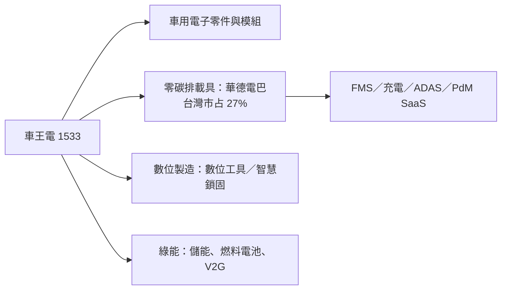

# 1533_車王電（市）

## 基本資料

車王電集團聚焦四大領域：車用電子零件與模組、零碳排載具（華德電動巴士）、AI 及產業設備數位製造解決方案（數位工具、智慧鎖固）、綠色能源解決方案，並規劃朝類控股公司架構發展。

- 營運：9M26 集團營收 38.51 億元，其中電動車相關 25.29 億元、占 66%（2025 年 52%、2024 年 38%）。1H26 營收 27.06 億元、毛利 7.50 億元（毛利率 28%，低於 2025 年 30%，因電動車占比上升）、營業利益 2.03 億元（8%）、稅後淨利 2.47 億元、歸屬母公司 1.48 億元，EPS 1.50 元。
- 零碳排載具：截至 9M26 台灣累計生產 1,052 輛，電動巴士市占 27%，營運涵蓋 12 縣市、建置 30 座智慧充電場站。
- 資料來源：[[活動_車王電1533_國泰CallMemo_20261022]]（國泰證期 Call Memo，2026-10-22）。

## 核心技術／競爭優勢

- 垂直整合：液冷鋰電池 Pack、CMU、BMS、BTMS、ECU、智能 PDU、VCU、防夾門、IoT Gateway、120–240kW 充電機等核心控制系統自主設計製造。
- 軟體服務：FMS 車隊管理、SCS／EMS 智慧充電、ADAS、APTS、DRTS 需求反應運輸、PdM 故障預測，形成 SaaS 架構；成立南華電動車技術服務公司培育維修與海外售服人才。
- 數位製造：數位工具與智慧鎖固用於汽車產線、軌道、工業機器人、能源、液冷系統、AI 伺服器機櫃、風電與太陽能。
- 綠能：創能、儲能、用能，結合 e-fuels、生質能、製氫模組、燃料電池、V2G、定置型儲能，延伸 EaaS、VPP、綠色金融。

## 產品與應用

| 產品 / 服務 | 應用 | 相關客戶 / 下游 |
|---|---|---|
| 電動巴士（市區、國道、中巴）與物流商用車 | 公共運輸、物流 | 台灣客運業者、日本（九州、東京、神戶、岡山）、北美 |
| 車用電子模組（BMS、VCU、充電機等） | 電動車、商用車 | 集團與外部車廠 |
| 車隊與充電 SaaS | 營運管理 | 客運業者 |
| 數位工具、智慧鎖固 | 產線、AI 伺服器機櫃、液冷 | 工業客戶 |
| 綠能與儲能 | V2G、VPP | 能源客戶 |

## 圖片 / 架構圖

圖說：車王電由車電零件延伸至電動巴士整車與營運軟體，並以數位工具與綠能構成四大事業。

## 時間軸

| 時間 | 事件 | 類型 | 重要性 | 備註 |
|---|---|---|---|---|
| 短期 | 國內電巴受政府預算執行時程影響，部分交車遞延 | 營運 | ⭐⭐ | 已取得部分明年國內外訂單 |
| 2027 | 海外（日本、北美）與國道車、中巴、物流車為主要成長 | 放量 | ⭐⭐ | — |

→ 跨公司時程詳見 [[時程_2026-2028十月券商催化劑]]

## 供應鏈位置

- 上游：電池芯、功率元件、車體材料。
- 本體：車用電子模組、電動巴士整車與營運軟體。
- 下游：台灣客運業者、日本與北美商用車市場、工業與能源客戶。

## 相關公司

目前來源未揭露可直接確認的上市公司關係。

> [!warning] 風險與注意事項
> - 國內電巴依賴政府補助與預算，交車時點可能遞延。
> - 電動車占比提高使毛利率下滑（1H26 28% vs 2025 年 30%）。
> - 北美在地化要求高、歐洲競爭激烈，海外擴張進度不確定；氫能載具持保守態度。

## 來源

- [[活動_車王電1533_國泰CallMemo_20261022]] — 國泰證期 Call Memo，2026-10-22
