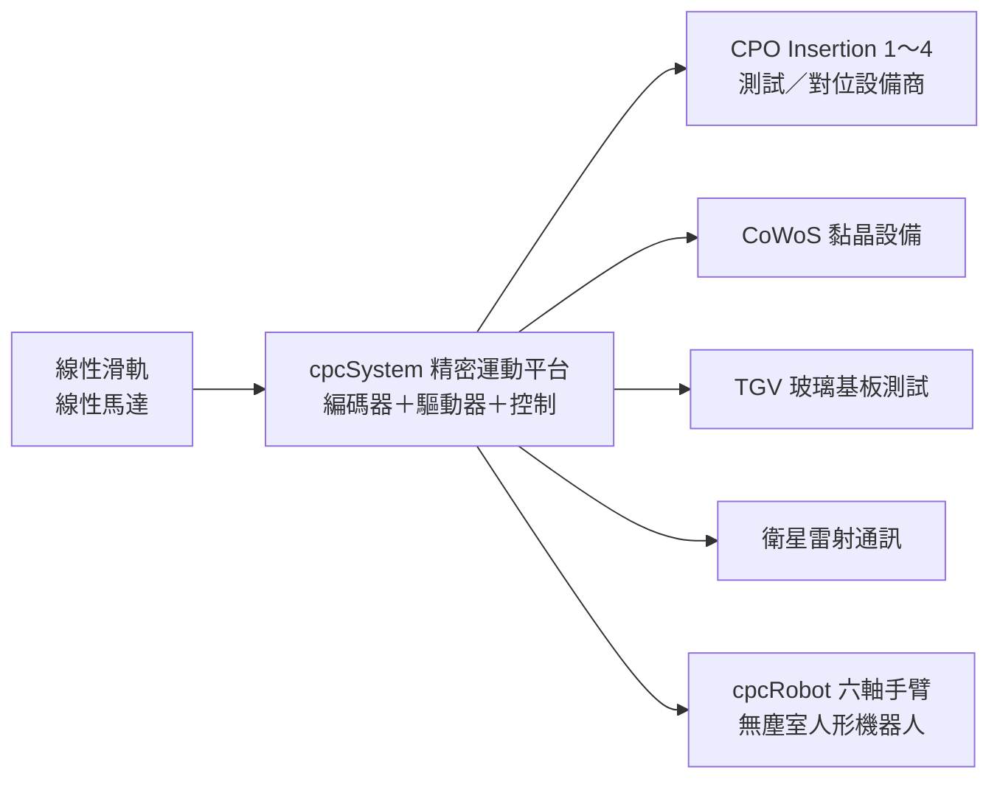

# 1597_直得（櫃）

## 基本資料

| 項目 | 內容 |
|------|------|
| 全名 | 直得科技股份有限公司（CHIEFTEK PRECISION，品牌 cpc） |
| 代號 | 1597（TPEX 上櫃） |
| 定位 | 微型／大型線性滑軌、線性馬達、精密運動平台（cpcSystem）、微型六軸機械手臂（cpcRobot）與運動控制軟體 |
| 3Q26 財務 | 營收 4.25 億元（YoY +51.9%）；毛利率 40.11%；營益率 16.77%；EPS 0.57 元 |
| 1～3Q26 | 營收 11.83 億元（YoY +47%，已超過 2025 全年 11.38 億元）；毛利率 41.33%；營益率 16.25%；EPS 1.87 元 |
| 外銷 | 營收近九成外銷、自有品牌；1～3Q26 歐洲 25%、美國 18%、中國 17%、台灣 29% |

資料來源：[[活動_直得1597_國泰CallMemo_20261105]]（國泰證期 call memo，2026-11-05；fact）。

## 核心技術／競爭優勢

- 微型線性滑軌：應用於半導體、光電、醫療設備與高精度自動化機構。
- 精密運動平台：微型化、精密定位與多軸對位，適合半導體設備在有限空間整合多項功能；已出貨至 TGV 玻璃基板測試、CoWoS 黏晶設備、光通訊晶片測試與衛星雷射通訊。
- CPO／NPO：CPO 四個測試階段皆已有合作設備商——Insertion 1 PIC 晶圓級篩選、Insertion 2 EIC／PIC 晶圓整合驗證、Insertion 3 光引擎對位與驗證、Insertion 4 封裝後系統驗證；主動式光學對位需多軸精密運動平台。
- 機器人：cpcRobot 微型六軸手臂、精密關節模組、AI 視覺與 cpcStudio 軟體 PLC／IDE；半導體無塵室人形機器人規劃 2026 年底出貨。

## 產品與應用

| 產品 | 1～3Q26 營收 | 2025 全年 | 說明 |
|------|-------------|-----------|------|
| 微型線性滑軌 | 6.46 億元 | 6.77 億元 | 半導體、光電、醫療、高精度自動化 |
| 大型線性滑軌 | 3.90 億元 | 3.78 億元 | 已超過 2025 全年 |
| 線性馬達相關 | 1.47 億元 | 0.84 億元 | 成長最快；切入光通訊／矽光子製造與封裝設備 |

## 圖片 / 架構圖

圖說：直得由線性滑軌與線性馬達零組件，整合為精密運動平台後供應半導體與光通訊設備商；CPO／NPO 的主動式光學對位需多軸精密運動，是公司線性馬達營收成長主因。本頁暫無來源圖，以 Mermaid 補位。

## EPS 記錄

| 季度 | EPS（元） | 備註 |
|------|-----------|------|
| 3Q26 | 0.57 | 3Q25 為 0.34 元 |
| 1～3Q26 | 1.87 | 去年同期 0.50 元 |

## 時間軸

| 時間 | 事件 | 類型 | 重要性 | 備註 |
|------|------|------|--------|------|
| 2026 | 啟動歐洲建廠計畫 | 擴產 | ⭐⭐ | 公司說法 |
| 2026 年底 | 半導體無塵室人形機器人出貨 | 新產品 | ⭐⭐ | 公司規劃／中 |
| 2027 | NPO／CPO 量產擴大精密運動平台應用 | 放量 | ⭐⭐ | 公司展望 |

## 供應鏈位置

- 環節：半導體／光通訊設備的精密運動零組件與平台供應商（設備商的上游）。
- 下游：CPO 測試與光學對位設備商、CoWoS 黏晶設備商、TGV 測試設備商；原文未點名具體客戶。
- 相關主題：[[技術_CPO]]（CPO 四階段測試與主動對位）。

## 相關公司

原文未點名具體客戶或供應商，暫不填 `related_companies`。

## 近期營運與研究更新

### 2026-11-05 國泰證期 call memo（3Q26 法說）

- 3Q26 營收 4.25 億元（YoY +51.9%），毛利率 40.11%（YoY +0.74ppt），營益率 16.77%（YoY +9.26ppt），EPS 0.57 元；營收擴大帶動營業獲利改善。
- 1～3Q26 營收 11.83 億元（YoY +47%），毛利率 41.33%（YoY −0.55ppt），營益率 16.25%（YoY +6.94ppt），EPS 1.87 元。
- 高速光通訊與矽光子製造、封裝設備已對 2026 年營收帶來重要貢獻；CPO 四個測試階段皆有合作設備商。
- 微型精密平台已轉為實際出貨（TGV、CoWoS 黏晶、光通訊晶片測試、衛星雷射通訊）；機器人事業取得再生醫療、產線自動化與國防訂單。
- 外銷結構：中國與台灣占比上升（2025 年歐洲 34%、美國 21%、中國 10%、台灣 24%）。
- 來源：[[活動_直得1597_國泰CallMemo_20261105]]。

## 來源

- [[活動_直得1597_國泰CallMemo_20261105]] — 國泰證期研究部 call memo，2026-11-05；3Q26 法說

## 相關頁面

- [[技術_CPO]]
- [[時程_2026Q3Q4_AI網通與硬體催化劑]]
