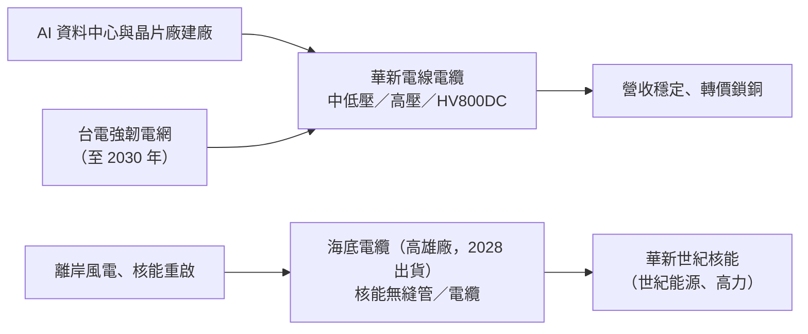

# 1605_華新（市）

## 基本資料

華新麗華（1605 TT）為台灣電線電纜與不銹鋼集團，事業包含不銹鋼（台灣、歐洲、中國大陸）、電線電纜（高壓、中低壓、海底電纜）、資源事業（印尼鎳生鐵、冰鎳）及電子業轉投資（以權益法認列，含 [[2344_華邦電子（市）]] 可轉債轉換相關權益）。本 wiki 依每日 ingest 範圍只追蹤與電力基建相關的段落：台電強韌電網、科技廠與 AI 資料中心建廠用線、HV800DC 高壓電纜、海纜與核能合資，不銹鋼與鎳資源僅作背景。

- **3Q26（fact）：** 合併營收 462 億元（較 2Q26 減 34 億元），稅後淨利 79 億元、EPS 1.78 元；前三季稅後淨利 205 億元、EPS 4.63 元。營收下滑主因不銹鋼歐洲暑修與鎳價下跌。
- **電線電纜：** 3Q26 營收與 2Q26 持平，受銅價基期影響較去年同期增加 21 億元；營收、毛利與稅後淨利皆與 2Q26 持平，4Q26 延續穩健。
- **轉投資：** 電子業權益法利益 79 億元（較前季增加），上市櫃股權評價不利影響約 84 億元。
- 範圍待確認：本頁屬每日 ingest 的「電力基建」邊界案例，主業不銹鋼不在三類範圍內。

資料來源：[[活動_華新1605_統一CallMemo_20261106]]（統一投顧，2026-11-06）。

## 核心技術／競爭優勢

- **高壓電纜產能與規格：** 高壓電纜（69kV～161kV）產能全滿，正進行 345kV 認證；楊梅高效能新廠（中低壓）利用率 70%～80%；高壓線已投資新產線擴充。
- **轉價機制：** 電纜接單即鎖定銅價、報價隨銅價連動，毛利率不受銅價波動影響。
- **規模：** 具規模優勢可滿足晶片廠與 AI 資料中心等大型建廠需求。
- **海纜與核能布局：** 高雄海底電纜廠建置中；歐洲 SMR、德國與中國大陸無縫鋼管廠已供應核電無縫管，電線電纜可支援核能重啟。
- **電爐煉鋼：** 台灣與歐洲廠採電爐煉鋼，碳排與碳稅較低，歐洲 CBAM 與 SG 防衛措施 2027 年顯效時具優勢（不銹鋼段，背景）。

## 產品與應用

| 產品／事業 | 應用 | 相關客戶／下游 |
|------------|------|----------------|
| 高壓電纜（69kV～161kV，345kV 認證中） | 台電強韌電網、變電與輸電 | 台電（原文未列客戶名稱） |
| 中低壓電纜（楊梅新廠） | 晶片廠、AI 資料中心、一般建築與建廠用線 | 科技廠建廠（原文未具名） |
| HV800DC 高壓電纜 | AI 資料中心 800V 直流供電 | 原文未具名；技術見 [[技術_800VDC供電架構]] |
| 海底電纜（高雄廠） | 離岸風電併網（每 1～1.5 GW 約需 300 公里海纜） | 2027 年認證、2028 年出貨 |
| 核能材料（無縫管、電纜）＋華新世紀核能 | SMR、核能重啟 | 世紀能源、高力為合資夥伴（原文未具名公司代號） |
| 不銹鋼、鎳生鐵（背景） | AI 液冷系統用鋼、一般工業 | 台灣、歐洲、中國大陸 |

## 圖片 / 架構圖

圖說：依統一投顧 2026-11-06 call memo 整理，AI 用電帶動電網、建廠用線與發電端（離岸風電、核能）需求，華新以電纜與核能材料切入；本次來源無圖，以 Mermaid 補位。

## EPS 記錄

| 季度 | EPS（元） | 備註 |
|------|----------|------|
| 3Q26 | 1.78 | 稅後淨利 79 億元；統一 call memo |
| 1～3Q26 | 4.63 | 稅後淨利 205 億元 |

## EPS 預估

| 年度 | 統一投顧（2026-11-06） |
|------|------------------------|
| 2026E | 6.94 元（YoY +867.8%） |
| 2027E | 11.06 元（YoY +59.3%） |

## 目標價與評等

| 券商 | 報告日 | 評等 | 目標價 | 評價基礎 | 來源 |
|------|--------|------|--------|----------|------|
| 統一投顧 | 2026-11-06 | 買進 | 44 元（原 50 元） | 2027 年底每股淨值 56.05 元 × 0.8 倍 PBR | [[活動_華新1605_統一CallMemo_20261106]] |

## 時間軸

| 時間 | 事件 | 類型 | 重要性 | 備註 |
|------|------|------|--------|------|
| 2026-11-06 | 3Q26 法說：EPS 1.78 元；電纜營運持平穩健 | 法說 | ⭐⭐ | [[活動_華新1605_統一CallMemo_20261106]] |
| 4Q26 | 電纜延續 3Q26 穩健；台灣不銹鋼去庫存近尾聲、4Q26 優於 3Q26 | 營運 | ⭐⭐ | 公司說法 |
| 2027 | 歐洲 CBAM／SG 效益顯現（原估 4Q26 延後） | 政策 | ⭐ | 統一投顧 |
| 2027-06～09 | 海底電纜取得認證（最快 6 月） | 認證 | ⭐⭐⭐ | 公司說法 |
| 2028 | 海纜出貨（原估 2H27 延後），配合工程進度與海象 | 出貨 | ⭐⭐⭐ | 公司說法 |
| 至 2030 | 強韌電網帶動電網需求持續成長，2030 年需求量顯著高於現階段 | 需求 | ⭐⭐ | 公司說法 |

→ 跨公司催化劑見 [[時程_2026Q3Q4_AI網通與硬體催化劑]]。

## 供應鏈位置

- 上游：銅（轉價機制）、鎳礦（印尼、菲律賓礦源）。
- 下游：台電電網、晶片廠與 AI 資料中心建廠、離岸風電、核電。
- 主題關聯：AI 資料中心供電見 [[技術_800VDC供電架構]]；wiki 尚無電力設備／電網供應鏈頁（見 log「待你決定」）。

## 相關公司

| 公司 | 關係 | 說明 |
|------|------|------|
| [[2344_華邦電子（市）]] | 轉投資 | 3Q26 華邦可轉債持有人轉換為普通股，華新權益調增約 32 億元；電子業轉投資權益法利益為獲利主要支撐 |

> [!warning] 風險與注意事項
> - 本業復甦慢於預期：歐洲政策效益由 4Q26 延至 2027 年、海纜貢獻由 2H27 延至 2028 年，統一因此下調目標價。
> - 獲利仍由業外（電子轉投資）支撐，上市櫃持股評價波動大（3Q26 不利影響約 84 億元）。
> - 中國不銹鋼需求疲弱、印尼鎳礦配額政策影響資源事業成本與鎳價。
> - 海纜認證與核能合資營收貢獻時程不確定。

## 來源

- [[活動_華新1605_統一CallMemo_20261106]] — 統一投顧 call memo，2026-11-06；3Q26 法說、電纜與海纜、核能合資、EPS 與目標價。

## 相關頁面

- [[時程_2026Q3Q4_AI網通與硬體催化劑]]
- [[技術_800VDC供電架構]]
