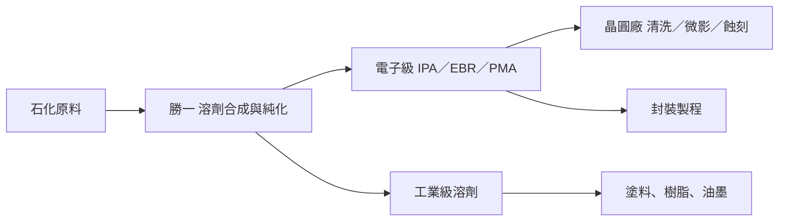

# 1773_勝一（市）

## 基本資料

勝一化工生產電子級與工業級溶劑。電子級產品用於晶圓清洗、微影、蝕刻與封裝製程；工業級產品供應塗料、油脂、樹脂與油墨產業。電子級溶劑占個體營收比重由 2025 年 72.30% 升至 3Q26 累計 73.60%（3Q26 單季 74.30%）。

- **3Q26（fact）**：營收 40.21 億元（季增 11.45%、年增 37.78%），毛利率 34.46%，營業利益 8.95 億元（年增 41.05%），EPS 2.44 元；前九月 EPS 6.82 元。
- **銷量（fact）**：前三季製成品總銷量 112.20 仟公噸（年增 12.98%），其中半導體應用電子級溶劑 54.40 仟公噸（年增 20.89%）。

資料來源：[[報告_群益_勝一1773_20261123]]（群益投顧產業速報，2026-11-23）。

## 核心技術／競爭優勢

- 台積電供應鏈中，異丙醇（IPA）供應量居第二（僅次於李長榮化工）；邊緣光阻去除劑（EBR）與東京應化（TOK）合作供應（群益說法）。
- 客戶驗證需 6–10 個月，同業降價 10% 也難取代既有供應商。
- 毛利率互補：電子級採合約定價，原料跌時毛利率上升；工業級售價隨原料波動，原料漲時可調價。
- AI 晶片推進至 3 奈米與 2 奈米，晶圓製程步驟與光罩層數增加，帶動電子級化學品用量與單價提升。

## 產品與應用

| 產品 | 應用 | 觀察 |
|------|------|------|
| 電子級 IPA（異丙醇） | 晶圓清洗、乾燥 | 彰濱二廠一期 2026 年 9 月完工、認證中 |
| EBR（邊緣光阻去除劑） | 微影製程 | 與 TOK 合作供應 |
| PM／PMA（丙二醇甲醚／醋酸酯） | 光阻溶劑、電子與工業用 | 2027 年 12 月擴建完工，原料自製 |
| 工業級溶劑 | 塗料、油脂、樹脂、油墨 | 售價隨原料波動 |

## 圖片 / 架構圖

## EPS 預估

| 來源 | 日期 | 2026F | 2027F | 評等 |
|------|------|-------|-------|------|
| 群益投顧 | 2026-11-23 | 9.31 元 | 10.38 元 | Neutral |

## 時間軸

| 日期 | 事件 | 來源 |
|------|------|------|
| 2026-09 | 彰濱二廠電子級 IPA 一期（投資 23 億元）完工，進入客戶認證；目標 2027 年稼動率 60% | [[報告_群益_勝一1773_20261123]] |
| 3Q26 | 董事會追加 12.30 億元興建 IPA 二期，預計 2H27 完工 | [[報告_群益_勝一1773_20261123]] |
| 2026-10 | 董事會通過 28.24 億元擴建 PM／PMA，預計 2027-12 完工，PM 年產能 5 萬噸→17 萬噸 | [[報告_群益_勝一1773_20261123]] |
| 4Q26 起 | 投資 7.58 億元增購 346 台槽車，槽車總數 269→615 台 | [[報告_群益_勝一1773_20261123]] |
| 2029 | 2024 年起逾 90 億元投資計畫預計完工 | [[報告_群益_勝一1773_20261123]] |

## 供應鏈位置

半導體材料（濕製程化學品）供應商，位於晶圓廠上游；主要客戶為台積電供應鏈。折舊費用將由約 8 億元於 2027 年增加、2028 年達 11–12 億元，公司以提高原料自製率與電子級出貨比重抵銷，並設定自 2024 年起每年營收與獲利創紀錄目標。赴美設廠：除非客戶吸收增加成本，現階段不前往（公司說法）。

## 相關公司

| 公司 | 關係 | 來源 |
|------|------|------|
| [[2330_台積電（市）]] | 客戶（IPA 供應量居第二） | [[報告_群益_勝一1773_20261123]] |
| 李長榮化工 | 台積電 IPA 主要供應商（競爭） | [[報告_群益_勝一1773_20261123]] |
| 東京應化（TOK） | EBR 合作供應夥伴 | [[報告_群益_勝一1773_20261123]] |

## 來源

- [[報告_群益_勝一1773_20261123]]（群益投顧，2026-11-23；法說會展望正面，Neutral）

## 相關頁面

- [[2330_台積電（市）]]
