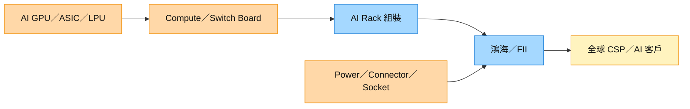

# 2317_鴻海（市）

## 基本資料

鴻海精密工業（2317.TW，Hon Hai Precision / Foxconn）是全球最大電子製造服務（EMS）商，主要業務為代工組裝 iPhone（Apple 最大代工廠）、AI 伺服器、PC 等。在 AI 伺服器浪潮中，鴻海積極承接 NVIDIA GB200/GB300 NVL72 rack 生產，是三大主力 ODM 之一。

**業務多元化方向**：除 EMS 代工外，鴻海積極進軍 EV（電動車）、AI 伺服器設計製造、以及 NVIDIA Blackwell 生態圈。

---

## 核心技術／競爭優勢

- **全球最大 EMS 規模**：生產基地遍布台灣、中國大陸、印度、越南等，供應鏈彈性高
- **GB200/Groq 3 LPX 生產**：2025Q2 起 GB200 rack 良率持續改善（MS/JPM 確認）；Computex 2026 展示 Groq 3 LPX compute tray，預計 3Q26 量產（MS 渠道確認）
- **Apple iPhone 核心代工**：iPhone 是最大單一業務，提供穩定現金流
- **EV 布局（Model C、Model B）**：透過 MIH 聯盟切入 EV 設計製造，長期多元化

---

## AI 伺服器出貨預估

| 時間 | GB200/300 NVL72 rack 預估 | 備註 |
|------|--------------------------|------|
| 2025Q2 May | ~1,000 rack（MS）/ 600–800 rack-eq（JPM） | MS 2025-06-09 |
| 2025Q2 全季 | 3,000–4,000 rack | MS 預期 |
| 2025H2 | GB200 → GB300 轉換 | 4Q25 GB300 量產 |
| **2026Q2 Jun** | **~3.3K rack（flattish MoM）** | MS 2026-07-08；6月營收 NT$821.8B（-4% MoM, +52% YoY）；iPhone 拉貨放緩，AI 伺服器持續 |
| **2026Q2 全季** | **~10.3K rack（+21% QoQ）** | 略高於預估 ~10K；3Q 預計 AI rack 維持成長（暗示前估 7.5K 有上修空間） |
| **2026-07** | **~3.6K rack（MoM +9%）** | MS 2026-08-07；三大 ODM 中單月最高 |
| **CY26 全年鴻海** | **~31.7K rack** | MS 2026-08-07 estimate、信心中 |
| **CY26 全年行業** | **80-85K rack（YoY +100%+）** | MS 2026-08-07 上修後區間；偏好排序：緯創 > 鴻海 > 廣達 |

## 圖片 / 架構圖

![[報告_GoldmanSachs_鴻海_20261005_月營收.png]]
> 高盛 2026-10-05 的月營收與年增率圖；9 月為實績，10–11 月淡色柱為券商預估。

![[報告_GoldmanSachs_鴻海_20261005_002.png]]
> 高盛歷史評等與目標價變動圖，右軸為成交量；不代表公司未來營運指引。

圖說：鴻海的 AI rack 價值不只來自整機組裝，亦延伸至 switch board、connector、power component 與 socket；本次瑞銀報告未抽出可用來源圖，故以 Mermaid 補位。

![[CLSA-2317 20260812_002.png]]

圖說：CLSA／SinoPac 的股價與相對大盤走勢圖，搭配 2026-08-12 的 NT$375 目標價，用於追蹤 AI rack 獲利上修能否轉化為估值重評。

---

## 目標價與評等

| 來源 | 日期 | 評等 | 目標價與方法 |
|------|------|------|-------------|
| Goldman Sachs | 2026-10-05 | Buy（Conviction List） | NT$400 不變，17.9x 2027E EPS；estimate／中，[[報告_GoldmanSachs_鴻海_20261005]] |
| Goldman Sachs | 2026-09-07 | Buy（Conviction List） | NT$400 不變，18.9x 2027E P/E；報告時股價 NT$256；[[報告_GoldmanSachs_鴻海2317_20260907]] |

| 來源 | 日期 | 評等 | 備註 |
|------|------|------|------|
| 摩根士丹利 | 2025-06-01 | OW（第二順位） | 偏好順序：技嘉 > 鴻海 > 廣達 > 緯創 > 緯穎 |
| 摩根大通 | 2025-06-11 | OW | 偏好順序：廣達 > 鴻海 > 緯創 |
| 瑞銀 | 2026-07-20 | Buy | 目標價 NT$320（原 NT$310）；15x 2027E EPS；[[報告_瑞銀_鴻海_20260720]] |
| CLSA／SinoPac | 2026-08-12 | Outperform | 目標價 NT$375（原 NT$320）；14x 2027E SOTP（AI 18x／非 AI 9x）；[[報告_CLSA_鴻海2Q26財報_20260812]] |
| Nomura | 2026-08-20 | Buy（重申） | 目標價 NT$435；17x 2027F EPS NT$25.57；[[Nomura tech tour]] |

## EPS 預估

| 年度 | Goldman Sachs（2026-10-05）EPS（元） | 營收（兆元） | 分類／信心 |
|------|-----------------------------------|--------------|-----------|
| 2026E | 19.56 | 11.2394 | estimate／中 |
| 2027E | 22.37 | 14.0537 | estimate／中 |
| 2028E | 25.20 | 18.1492 | estimate／中 |

高盛因 9 月營收優於預估，上調 2026 年淨利約 2%；3Q26／4Q26 EPS 預估為 5.55／6.25 元。下方歷史券商模型保留，不將預估寫入實績。

> 高盛前一版（報告日：2026-09-07）EPS 為 2026E 19.13／2027E 22.35／2028E 25.13（營收 NT$11.05／14.03／18.12 兆元），3Q26E／4Q26E EPS 5.34／6.05 元；10-05 版本因 9 月營收優於預估再上修。

| 年度 | 瑞銀（2026-07-20） | CLSA／SinoPac（2026-08-12） | 備註 |
|------|----------------------|-------------------------------|------|
| 2026E | 18.00 | 17.90 | CLSA 估 AI rack 與費用控制推升獲利 |
| 2027E | 22.00 | 27.13 | Rubin 與新 ASIC 平台市占提升假設 |
| 2028E | 26.00 | 31.75 | estimate；信心中 |

## 時間軸

| 時間 | 新增催化劑 | 分類／信心 | 追蹤 |
|------|-----------|-----------|------|
| 4Q26 | 新 AI rack、新手機／摺疊手機與 CPO 交換器推動營收；高盛估季增 18%、年增 37% | estimate／中；非已實現出貨量 | [[時程_2026Q3Q4_AI網通與硬體催化劑]] |

| 時間 | 事件 | 類型 | 重要性 | 備註 |
|------|------|------|--------|------|
| 2026Q3 | iPhone 18 拉貨與 foldable NPI | 放量 | ⭐⭐ | Cloud & Networking 仍是主要動能 |
| 2026–2027 | LPU rack、Vera Rubin、ASIC server 放量 | 放量 | ⭐⭐⭐ | 瑞銀估 Cloud & Networking 2026 年增 74% |
| 2027 | AI rack 估 29.0k | 放量 | ⭐⭐⭐ | 2026E 27.2k；estimate |
| 2027–2028 | Rubin Ultra NVL rack 估 100k／130k | 放量 | ⭐⭐⭐ | CLSA／SinoPac estimate；ODM volume play 假設 |
| 2026 年底–2027 | 大型 neocloud 專案貢獻浮現並於 2027 擴大 | 新客戶 | ⭐⭐⭐ | Nomura Tech Tour 2026-08-20 轉述；客戶未具名 |
| 2026-10-21 | NVIDIA DSX POD 貨櫃式 AI 工廠參考設計發布，Foxconn（鴻佰 Ingrasys）列合作夥伴 | 新平台 | ⭐⭐⭐ | [[research_產業合作技術發表_2026-10-22]]；fact |
| 2027 初 | DSX POD 夥伴開始全球交付 | 放量 | ⭐⭐ | NVIDIA 新聞稿；鴻海個別份額未揭露 |

→ 跨公司時程詳見 [[時程_2026記憶體與AI催化劑]]。

---

## 供應鏈位置

- 上游：[[NVDA.US(nvidia)]]（GPU）、[[AAPL.US(apple)]]（iPhone SoC）、[[5274_信驊（市）]]（BMC）
- 下游：AWS、Azure、GCP 等 CSP；全球 Apple 零售
- 同業：[[2382_廣達（市）]]、[[3231_緯創（市）]]、[[6669_緯穎（市）]]
- 所屬主題鏈：[[供應鏈_AI伺服器PCB]]、[[供應鏈_AI伺服器散熱]]

---

## 相關公司

| 公司 | 關係 | 說明 |
|------|------|------|
| [[AAPL.US(apple)]] | 最大客戶 | iPhone 主力代工；佔鴻海最大業務比重 |
| [[NVDA.US(nvidia)]] | AI 伺服器客戶/上游 | GB200/GB300 rack 生產 |
| [[5274_信驊（市）]] | 上游 BMC | 信驊 BMC 供應鴻海伺服器主板 |
| [[COHR.US(coherent)]] | CPO FAU 客戶（子公司工業富聯） | 2026-10-30 收錄匿名訪談：工業富聯與光庫、蘅東光同為 Coherent 的 FAU 供應商；低信心 |
| [[GLW.US(corning)]] | CPO DFAU 客戶（子公司工業富聯） | 同訪談：工業富聯在 Corning 鏈負責組裝完整 DFAU；低信心 |

- **CPO 被動件（2026-10-30 收錄）**：[[memo_CPO無源器件_ELS_FAU_Shuffle專家觀點_日期不詳]]（匿名，日期不詳；channel estimate，信心低）稱子公司工業富聯同時位於兩條 CPO FAU 代工鏈：在 Coherent 鏈提供 FAU（份額排序次於光庫），在 Corning 鏈組裝整個 DFAU（含 PMLA）；V-Groove 由炬光科技供應。未見公司揭露，規模不明。判讀見 [[分析_CPO無源器件ELS_FAU與Shuffle專家訪談_20261030]]。
- **EBO 與布線（2026-10-13 招商證券，券商整理／中）**：[[報告_招商證券_FAU與MPO在ScaleUp時代的價值通脹_20261013]] 在 EBO MSA 產業鏈表中把鴻騰精密（FIT）、富士康與立訊精密列為「EMS／連接器製造」參與者；中國跳線廠致尚科技被描述為富士康零部件核心供應商，並綁定 SENKO 切入光纖連接器與 MPC。招商的 MSA 名單與官方 16 家創始成員不同（見 [[技術_EBO擴束連接器]]），不能據此認定鴻海體系已是 MSA 正式成員。

---

## 近期營運與研究更新

### 2026-10-28 Goldman Sachs 3 個月營收預覽：新 AI 機櫃與 CPO 交換器

- GS 維持 Buy（Conviction List）、TP NT$400（17.9x 2027E P/E）。估 4Q26 營收 QoQ +39%、YoY +61% 至 NT$4.2 兆；10 月估 YoY +40%、MoM +8%。3Q26 營收 YoY +47%，高 GS／共識 5%／7%；9 月營收 YoY +38%、MoM +26%（fact）。
- 動能：新一代 AI 伺服器機櫃與 CPO 交換器以更高 ASP 提前交付，GS 認為鴻海將領先同業約 2–3 個月首家交付；GPU 機櫃之後，LPU 機櫃 12 月起貢獻並支撐 1Q27 年增。GS 估 AI 伺服器機櫃價值 TAM 2025–28E CAGR 163% 至 US$1tn（2028E 占伺服器 63%）。手機：全球 2026–28E 1.1bn／1.2bn／1.2bn 支（−10%／+2%／+2%），看好摺疊機與高階機。（estimate）
- 國泰晨會：Alphabet TPU 系統放量與 Microsoft capex 加速，鴻海列為受惠者（[[memo_國泰證期_晨會聯電台光電台燿穩懋鴻勁_20261029]]）。

來源：[[報告_GoldmanSachs_台灣ODM品牌營收預覽_20261028]]。

### 2026-10-05 Goldman Sachs：9 月營收優於預估

- 9 月營收 NT$1.1586 兆元，YoY +38%、MoM +26%，較高盛／市場共識高 15%／21%；3Q26 營收 NT$3.0269 兆元，YoY +47%、QoQ +20%，較兩者高 5%／7%。屬券商轉述公司營收實績（fact／中高，未另查公司公告）。
- 4Q26 營收預估 NT$3.5671 兆元，QoQ +18%、YoY +37%；10／11／12 月預估為 NT$1.1644／1.1819／1.2208 兆元。原報告 Exhibit 2 標題寫「+18% MoM」，但正文與表格顯示季度 QoQ，採正文與季度表口徑。
- 高盛稱鴻海為 CPO switch 主要供應商，將其與新 AI rack／手機列為成長來源；屬券商供應商判斷（thesis／中），未揭露可核對的特定平台訂單或 CPO 營收占比，不延伸成特定客戶獨家地位。
- Foxtron 子公司 9 月營收約 NT$11 億元；此處保留子公司名稱與來源，不另建未有公司頁的 wikilink。

來源：[[報告_GoldmanSachs_鴻海_20261005]]。

### 2026-09-07 Goldman Sachs：8 月營收與 3Q26 能見度

- 8 月營收 NT$9,218 億元，YoY +52%、MoM −3%，低於高盛預估 12%，高盛歸因 7 月需求提前拉貨。MoM 看，Cloud & Networking 因 AI 產品拉貨顯著成長，Consumer Electronics 與 Computing 月減（主力消費性產品進入新舊交替）；YoY 看，Computing 受產品動能與出貨單價帶動成長最多，其餘三大產品線亦強勁成長。（fact，中高；券商轉述公司月報）
- 管理層稱 3Q26 能見度較先前改善，支撐為 AI 伺服器 rack 強勁爬坡與消費性電子旺季。高盛當時估 3Q26 營收 NT$3.1 兆元（YoY +47%、QoQ +20%），9 月 NT$1.15 兆元（YoY +37%、MoM +25%）；10 月後實際 9 月營收 NT$1.1586 兆元，與此預估相近（見上方 2026-10-05 更新）。
- Foxtron（2258.TW）8 月營收 NT$9.14 億元（7 月 NT$5.98 億元、去年同期 NT$1.11 億元），已推出首款自有品牌車「Foxtron Bria」，並與三菱汽車在乘用車及零排放巴士合作；高盛視為鴻海 EV 業務的增量機會（thesis，中）。
- 高盛依 8 月營收下修 2026E 獲利 1%（EPS 19.26→19.13），2027E／2028E 不變；維持 Buy（Conviction List）、TP NT$400（18.9x 2027E P/E，依同業 P/E 對獲利成長與營益率之比推導）。下行風險：AI 伺服器爬坡放緩、EV 總體方案表現不如預期、全球產能擴充放緩、消費電子 EMS 競爭加劇。

![[報告_GoldmanSachs_鴻海2317_20260907_001.png]]

圖說：高盛 2026-09-07 的鴻海月營收模型，5–8 月為實績、9–11 月為預估；8 月實績低於預估 12%，但 9 月被估為季底拉升（+25% MoM），可與 10-05 更新中的 9 月實績對照驗證高盛模型準確度。（來源：Goldman Sachs，2026-09-07）

來源：[[報告_GoldmanSachs_鴻海2317_20260907]]（Goldman Sachs，2026-09-07）。

### 2026-10-05 UBS 全球手機：手機供應鏈 Buy

- UBS 在手機需求疲弱（2026 年 8 月全球 sell-through 年減 12.3%，2026E／2027E sell-in 年減 10.0%／3.0%）下，仍把鴻海列入偏好的 Buy 名單（2026-10-02 股價 NT$251）。主要支撐為 Apple 相對強勢：iPhone 1–8 月 sell-through 年增 8.7%，UBS 估 Apple sell-in 2026E +8.5%、2027E +4.7%，且 2027 年發表節奏改為 1Q27、3Q27 各 3 款，加上 iPhone Duo 首 12 個月約 1,000 萬支。
- 這與高盛同日「摺疊機與新機型推動 4Q26」的判斷方向一致；但 UBS 報告未揭露鴻海 iPhone 組裝份額或 EPS，對鴻海的影響屬推論（thesis／中）。
- 來源：[[報告_UBS_全球智慧型手機8月銷售_20261005]]（UBS，2026-10-05）。

### 2026-09-08 GFHK 散熱產業更新

- GFHK 將鴻海列為 Rubin 平台 ODM／OEM 受惠者之一，並與 Supermicro 一起列為 AI 伺服器整合觀察標的；此為產業鏈觀察，未等同鴻海已取得特定 Rubin 訂單。來源：[[報告_GHHK_AI伺服器散熱_20260901]]。

### 2026-08-18～19 Nomura Asia Tech Tour

- **Neocloud**：除 CSP 客戶外，已開始與較大型 neocloud 合作，2026 年底可見貢獻、2027 年更顯著。neocloud 專案產品較標準化、放量較容易；CSP 專案需更多 rack 級客製與工程、附加價值較高。neocloud 毛利取決於商業模式：HGX 產品可能採寄售（consignment），rack 級方案則較依賴鴻海資產負債表。
- **AI ASIC L6／L10**：將在客戶正式接洽前於美國、台灣、墨西哥或歐洲先準備產能；終極目標是以垂直整合與設計能力取得 **AI ASIC 專案 40% 份額**（公司目標，非已取得份額）。
- **資本支出與瓶頸**：2026E capex 年增 >30%，用於 AI 伺服器組裝產能（尤其美國、墨西哥、越南）；測試機台是瓶頸之一，出貨前至少需 1 週 rack 級測試，因此投資更多系統組裝與測試產能。
- 評等：Nomura 重申 Buy、TP NT$435（17x 2027F EPS NT$25.57），報告時約 10x 2027F EPS。
- 來源：[[Nomura tech tour]]（Nomura，2026-08-20；公司說法轉述與券商 estimate，信心中）。

### 2026-07-07 Goldman Sachs 亞洲科技 2H26 策略

- GS 看好鴻海／FII 在美系雲端的地位：研發強、產品線完整（GPU 模組、基板、AI 伺服器、CPU 伺服器、CPO 交換器、液冷等）、生產基地遍布全球，有利在快速技術轉換中取得市占（thesis／中）。
- 07-07 Buy（on CL），TP NT$400（附表收盤價 NT$242，上檔 65.3%），FY27／FY28 P/E 10.8x／9.6x。產業假設：AI 伺服器機櫃 55k／105k／163k（2026–28E）、ASIC 占 AI 晶片 50%／52%／55%、美系主要 CSP capex 2026E 年增 76%（estimate／中）。
- 框架見 [[分析_GS亞洲科技2H26投資策略_AI硬體循環與選股框架_20260707]]。

### 2026-10-26 GFHK VR200 展望（Buy）

- GFHK 預估 2026E／2027E NVL72 機櫃 TAM 73k／96k（2026E：GB200／GB300 67k＋VR200 6k；2027E 年增 31.5%，VR200 與初期 VR300 合計 86k）；Vera Rubin 機櫃首通率 85% 以上，1Q27 進一步加速。
- SpaceX 部分轉向 ODM 直供：鴻海在 SpaceX Rubin 平台份額最高可達 50%（GFHK 受產能限制模型 40%–45%），和碩份額 <5%；CSP 端鴻海將自廣達取得 Google（100%）與 Meta（>50%）份額。
- 來源：[[報告_GFHK_VR200展望_20261026]]（廣發證券香港，2026-10-26），券商估計，信心中。

## NVIDIA DSX POD 合作夥伴（2026-10-21）

- NVIDIA 於 GTC Berlin 發布 DSX POD：完整 Vera Rubin AI 工廠的參考設計，由夥伴在模組化貨櫃內預先整合運算、網路、佈線、機櫃級供電與液冷，出廠前完成機櫃間佈線、管路與功能測試；部署到已備妥場址的時間由約 6 個月縮短到最快 14 天，夥伴預計 2027 年初起全球交付（fact／高）。
- 鴻海以子公司 Foxconn（Ingrasys，鴻佰）列名；同列台系夥伴有 [[2382_廣達（市）]]（QCT）、[[3231_緯創（市）]]、[[4938_和碩（市）]]、[[2376_技嘉（市）]]、[[2308_台達電（市）]]。新聞稿未揭露各家角色、份額或貨櫃規格。
- 意義：ODM 交付範圍由機櫃延伸到含供電與液冷的貨櫃級系統，L11 以上整合能力與機電整合是差異點（推論）。
- 來源：[[research_產業合作技術發表_2026-10-22]]（NVIDIA 新聞稿，2026-10-21）。

## 來源

- [[memo_CPO無源器件_ELS_FAU_Shuffle專家觀點_日期不詳]] — 匿名專家訪談，日期不詳（2026-10-30 收錄；工業富聯 CPO FAU／DFAU 角色，低信心）。
- [[報告_招商證券_FAU與MPO在ScaleUp時代的價值通脹_20261013]] — 招商證券，2026-10-13（EBO MSA 產業鏈中的 FIT／富士康、致尚科技供應關係；券商整理，信心中）。
- [[research_產業合作技術發表_2026-10-22]] — NVIDIA 官方新聞稿彙整，2026-10-21；DSX POD 合作夥伴。
- [[260707_gs_asia-tech-2H26-strategy]] — Goldman Sachs，2026-07-07；亞洲科技 2H26 策略，Buy（CL）／TP NT$400、AI 機櫃與 CSP capex 假設。

- [[Nomura tech tour]]（Nomura Asia Tech Tour，2026-08-20；neocloud、AI ASIC 40% 份額目標、capex 與測試瓶頸、Buy TP NT$435）
- [[報告_UBS_全球智慧型手機8月銷售_20261005]]（UBS，2026-10-05；全球手機 sell-through、Apple 2027 發表節奏與鴻海 Buy 名單）
- [[報告_GoldmanSachs_鴻海_20261005]]（Goldman Sachs，2026-10-05；9 月／3Q26 營收、4Q26 預估、CPO switch 供應定位、EPS、Buy／TP NT$400）

- [[20260709_0823_260708_ms_nvl72-racks]]（MS，2026-07-08；鴻海 2Q26 rack ~10.3K，6月 NT$821.8B +52% YoY；偏好排序 緯創>鴻海>廣達）
- [[報告_摩根士丹利_大中華科技硬體_20250601]]（MS，2025-06-01；GB200 新 CSP 訂單，鴻海偏好排序第二）
- [[報告_摩根大通_台灣ODM_20250611]]（JP Morgan，2025-06-11；GB200 rack 鴻海 May 出貨量 600-800 rack-eq）
- [[報告_MS_GB200機櫃出貨_20250609]]（MS，2025-06-09；5 月鴻海 GB200 ~1,000 rack，2Q25 預估 3,000–4,000 rack）
- 報告_MS_Computex2026_20260607（MS，2026-06-07；鴻海展示 Groq 3 LPX compute tray，3Q26 量產）
- [[報告_瑞銀_鴻海_20260720]]（瑞銀，2026-07-20；AI rack、EPS 與目標價上修）
- [[報告_CLSA_鴻海2Q26財報_20260812]]（CLSA／SinoPac，2026-08-12；2Q26、Rubin／ASIC 市占、EPS 與目標價上修）
- [[報告_MorganStanley_NVL72機櫃出貨_20260807]]（Morgan Stanley，2026-08-07；7 月約 3.6K rack、2026 全年約 31.7K）

- [[260607_ms_computex]]（2026-06-07）
- [[260807_ms_nvl72-racks]]（2026-08-07）
- [[260827_citi_nvda-implication]]（2026-08-27）
- [[260827_ms_NVDA-implication]]（2026-08-27）
- [[Servers JPM 260723]]（2026-07-23）
- [[memo_AI供應鏈_JeffPu更新_20260617]]（2026-06-17）
- [[memo_廣發海外電子通信月度電話會議_20260814]]（2026-08-14）
- [[凱基-電子硬體產業-20260616]]（2026-06-16）
- [[報告_GFHK_Dell_20260828]]（2026-08-28）
- [[報告_GHHK_AI伺服器散熱_20260901]]（2026-09-08）
- [[報告_GoldmanSachs_鴻海2317_20260907]]（2026-09-07）
- [[報告_JPMorgan_Google2Q26伺服器供應鏈_20260723]]（2026-07-23）
- [[報告_MS_伺服器市場_20250616]]（2025-06-16）
- [[報告_MorganStanley_SEMICON台灣_20260902]]（2026-09-02）
- [[報告_凱基投顧_美國軟體產業_ORCL_SNOW_MDB_20260611]]（2026-06-11）
- [[富鼎(8261,Note)-CTBC260730]]（2026-07-30）

- [[報告_Citi_US市場回饋_AI硬體_20260920]]（2026-09-20）

- [[報告_UBS_智慧型手機記憶體成本_20260922]]（2026-09-22）

- [[261018_gs_global-server]]（2026-10-18）

- [[261019_gs_iphone-duo]]（2026-10-19）
- [[261019_ms_OCP-MGX]]（2026-10-19）
- [[報告_GFHK_VR200展望_20261026]] — GFHK VR200 展望，2026-10-26（Buy）

- [[memo_緯創緯穎_AWS客戶結構與ODM訂單機制專家觀點_日期不詳]]（ODM 端匿名專家紀要，日期不詳，2026-10-28 入庫）

- [[memo_國泰證期_晨會聯電台光電台燿穩懋鴻勁_20261029]]（2026-10-29）
- [[報告_GoldmanSachs_台灣ODM品牌營收預覽_20261028]]（2026-10-28）

## 相關頁面

- [[分析_FAU與MPO在ScaleUp時代的價值通脹_招商證券_20261030]]
- [[分析_緯創緯穎專家紀要_AWS集中度與ODM訂單機制_20261028]]
- [[時程_2026-2028十月券商催化劑]]
- [[分析_2026-10-19_OCP後AI硬體與PCB設備券商更新]]
- [[DELL.US(dell)]]
- [[分析_20260827_NVIDIA供應鏈與AI伺服器]]
- [[時程_2026Q3Q4_AI網通與硬體催化劑]]
- [[GOOGL.US(alphabet)]]
- [[時程_2026記憶體與AI催化劑]]
- [[2059_川湖（市）]]
- [[8261_富鼎（市）]]
- [[ORCL.US(oracle)]]

## Citi 2026-09-20 更新

- Citi 認為鴻海可受惠 Vera Rubin rack 的較高 ASP，即使 rack 數量增速放緩，只要毛利率大致穩定，營收與獲利仍可能上升；鴻海亦在布局客製 ASIC／hyperscaler 的 CPU、TPU 相關系統，較有意義的貢獻可能落在明年後段，屬券商展望。
- 800VDC 對 Rubin 並非所有部署的必要條件；新建 AI 資料中心與 neocloud 的導入誘因較強，既有機房仍可採替代架構，因此高壓供電採用應按部署條件分階段追蹤。

來源：[[報告_Citi_US市場回饋_AI硬體_20260920]]（Citi，2026-09-20；券商觀點／信心中）。

### 2026-10-18 Goldman Sachs 全球伺服器 TAM 更新

- GS 上修全球伺服器價值 TAM（2027E／2028E +31%／+45%），預期鴻海／工業富聯維持 ODM 龍頭並持續擴大市占；GS 估鴻海 ODM direct 機櫃出貨 2026E／2027E／2028E 為 25k／59k／101k 櫃（全球 63k／110k／164k），8-GPU 伺服器約 211k／200k／200k 台（estimate）。
- 2026E 營收曝險（GS）：NVIDIA 30–35%、AMD 5–10%、Google TPU 5–10%、中國 GPU／ASIC <5%、Oracle <10%。GS 對鴻海維持 Buy。

來源：[[261018_gs_global-server]]（Goldman Sachs，2026-10-18；estimate，信心：中）。

### 2026-10-19 OCP：Maia 300 ODM 與次世代連接器

- MS 認為鴻海與 [[6669_緯穎（市）]] 可能是 [[MSFT.US(microsoft)]] Maia 300 機櫃的 ODM 夥伴（每 GW 約 5–5.5k 櫃，2027 年量產部署；thesis／中）。
- NVIDIA 在 OCP 展示次世代「Ultra Dense Interconnect」，供應商名單含 Foxconn；MS 調查指鴻海體系的 FIT（鴻騰精密）為 Kyber 規劃中板對板連接器（Voronoi）的關鍵設計夥伴，量產約兩年後（channel_check／中）。
- GS（2026-10-19）把鴻海列入 iPhone Duo 摺疊機供應鏈 Buy 名單，Apple 占鴻海營收 30–35%、營業利益 35–40%（EMS／ODM、金屬中框）。

來源：[[261019_ms_OCP-MGX]]（Morgan Stanley，2026-10-19）；[[261019_gs_iphone-duo]]（Goldman Sachs，2026-10-19）。
