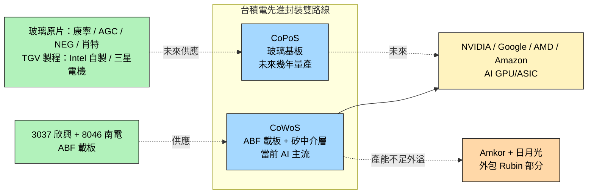

# 2330_台積電（市）

> [!note] 本頁範圍說明
> 本頁僅就本次 ingest 涵蓋的主題 — **先進封裝載板（ABF 與玻璃基板世代交替）** — 記錄台積電的角色。其他主題（2nm 製程細節、晶圓代工財務、地緣政治、Apple A 系列等）等之後 ingest 對應主題的來源時再補。

## 基本資料
台灣積體電路製造（TSMC），全球最大晶圓代工廠，AI 晶片時代的關鍵製造夥伴。在本次主題「先進封裝載板世代交替」中，台積電同時扮演**兩個角色**：

1. **CoWoS 主導者 + ABF 載板大客戶**：CoWoS 是當前 AI GPU 主流先進封裝方案，需要大量 ABF 載板（來自 [[3037_欣興（市）]]、[[8046_南電（市）]] 等）
2. **CoPoS / 玻璃基板推動者**：2026Q1 法說會提及玻璃基板 CoPoS 技術，「預計未來幾年內量產」（[[報告_其他_玻璃基板_20260511]]）

主要資料來源：[[報告_其他_玻璃基板_20260511]]（國金證券，2026-05-11）；[[報告_MS_ABF產業_260508]] 間接（從載板供應端反推）。

## 核心技術／競爭優勢

### Goldman Sachs 2026-10-05：需求擴散與擴產模型

高盛認為 AI 需求由 GPU／ASIC 延伸至 CPU 與網路晶片，上調 2026／2027 年美元營收成長預估至 42.0%／36.9%。其 N3／N2 年底產能模型為 2027 年 200／140 kwpm、2028 年 220／200 kwpm，均為券商 estimate（信心中），不是公司產能指引。

2027／2028 年資本支出由 US$78／82bn 上調至 US$85／98bn；增額同時反映設備成本通膨與可能的 Texas 建廠初期支出，不能直接按金額同比推算新增晶圓產能。Texas 量產在 2032 年以後是高盛情境推估，尚非公司正式承諾。來源：[[報告_GoldmanSachs_台積電_20261005]]。

### Morgan Stanley 2026-10-05：3Q26 法說前瞻與 Foundry Floorplan

- **法說預期：** MS 預期公司把全年美元營收成長指引由「逾 40%」上調至 low-to-mid 40%，隱含 4Q26 營收季增 10%–15%（3nm 需求強）；3Q26 毛利率落在 65%–67% 指引上緣約 67.5%。屬券商 estimate，信心中。
- **晶圓報價：** 產業調查顯示 ASML 依歷史需求與長期合作分配 EUV，台積電仍是最大 EUV 客戶，因此 2027 年先進製程（7nm 以下）報價可漲 5%–10%、成熟製程 0%–3%，毛利率可能逼近 70%（MS 2027E 69.0%）。漲價幅度為 MS 推估，非公司公告。
- **製程產能：** 公司表示 N2 2026–2028 年產能 CAGR 逾 70%，5nm 自 2027 年起下降（Blackwell 轉 Rubin 3nm）。MS 估 2nm／1.6nm 2026 年底近 100 kwpm、2027 年 150–170 kwpm、2028 年逾 200 kwpm；1.4nm 2027 年拉機台、2028 年放量，2029 年台南導入初期 1.0nm（A10）產能。Texas 擴產仍在討論，未納入模型。
- **資本支出：** 若 Intel 轉向自建產能，MS 認為台積電仍維持 2nm 擴產節奏，2026 年 capex US$54bn、2027 年 US$75–80bn。
- **先進封裝：** MS 估 CoWoS 年底月產能 2026／2027／2028 年為 130／200／260 kwpm（2028 年擴產集中 Arizona AP9／10，可能含 AP7），非台積電陣營（Amkor／日月光／聯電）2027／2028 年底 80／110 kwpm；SoIC 2027 年約 40 kwpm。CoPoS 正於桃園試產，若順利 2028／2029 年約 5–10／10–20 kwpm，取決於試產結果。
- **Intel 競爭：** 部分台積電客戶正以測試載具評估 Intel EMIB-T（大晶片、低成本、第二供應源）；MS 認為台積電 2028 年後可能以 300mm／500mm 方形面板 CoPoS、SoIC 3.5D 堆疊（Meta MTIA 評估中）、玻璃核心基板（解決大於 9.7 倍光罩晶片翹曲）回應。此為 MS 推測，信心中低。
- 來源：[[報告_MorganStanley_台積電3Q26預覽與聯電2027_20261005]]（Morgan Stanley，2026-10-05；OW、TP NT$3,088）。

> [!warning] 2026-10-05 兩家券商資本支出與 CoWoS 口徑不同
> - **資本支出：** MS 2027 年 US$75–80bn；GS 2027／2028 年 US$85／98bn（[[報告_GoldmanSachs_台積電_20261005]]）。兩者同日發布，差距約 US$5–10bn，GS 含設備通膨與 Texas 初期支出假設。
> - **CoWoS：** MS 為台積電自有產能 130／200／260 kwpm；GS 含 WMCM 為 135／280／310 kwpm；UBS 2026-09-22 為產業總量 2026 年底約 16 萬片。統計範圍不同，不可直接比較高低。

- **CoWoS 產能擴張曲線**：月產能 2024 ~3.5 萬片 → 2026 年底 11.5–14 萬片 → 2027 ~17 萬片（claim 類型 estimate，信心中；國金引述）
- **AI GPU/ASIC + HBM 主力外包**：[[NVDA.US(nvidia)]]、Google、AMD、Amazon 共占 CoWoS / HBM **90% / 92%** 產能（國金引 Epoch AI 數據，2025）
- **CoWoS 外溢訊號**：[[NVDA.US(nvidia)]] **Rubin** 部分 CoWoS 外包給 [[AMKR.US(amkor)]] 與日月光（首次公開承認 CoWoS 產能不足）
- **CoPoS 玻璃基板路線**：26Q1 法說明確提及，「未來幾年內量產」（claim 類型 thesis，信心中）
- **COUPE 光子整合路線**：BofA 轉述 TSMC 於 SEMICON Taiwan 2026 的說法，COUPE 以 200→400Gbps/lane、128+ lanes 與 1→16+ wavelengths 的兩條路徑縮小運算與 I/O 擴展差距；屬公司技術路線轉述，信心中高（[[報告_BofA_台積電_20260831]]）。

## 產品與應用

| 產品 / 服務 | 應用 | 相關客戶 / 下游 |
|-------------|------|-----------------|
| CoWoS 先進封裝 | AI GPU / AI ASIC + HBM 整合 | [[NVDA.US(nvidia)]]、Google、AMD、Amazon |
| CoPoS（玻璃基板封裝） | 下一世代 AI 封裝 | 客戶名單未公開 |
| COUPE 矽光子平台 | AI／HPC 光學 I/O、CPO | [[NVDA.US(nvidia)]] 等平台合作方；詳見 [[技術_矽光子（SiPh）]] |

## 圖片 / 架構圖

![[報告_JPM_台積電擴產與財測_20260930_p009.png]]

圖說：JPM p9：資本支出、先進製程與封裝產能估計；年底月產能不是全年出貨。
![[報告_JPM_台積電擴產與財測_20260930_p010.png]]

圖說：JPM p10：CoWoS 類供給與需求模型；TSMC／非 TSMC 及各券商口徑分開。

![[報告_GoldmanSachs_台積電_20261005_資本支出.png]]
> 高盛 2026-10-05 資本支出模型，2027／2028 年上修至 US$85／98bn；這是券商估計，設備價格及海外廠成本會影響支出與產能的換算。

![[報告_GoldmanSachs_台積電_20261005_CoWoS.png]]
> 高盛預估年底 CoWoS 月產能（含 WMCM）2026／2027／2028 年為 135／280／310 kwpm。與其他來源比較時需先確認 WMCM、台積電自有產能及產業總產能的口徑。

![[報告_MorganStanley_台積電3Q26預覽與聯電2027_20261005_002.png]]
> MS 晶圓報價趨勢（12 吋約當、美元）：3nm 與 2／1.6nm 報價於 2026–2027E 再上一階，支撐 MS「2027 年先進製程漲價 5%–10%」的判斷；e 為 MS 估計。

![[報告_MorganStanley_台積電3Q26預覽與聯電2027_20261005_004.png]]
> MS 估計的台積電各節點廠區產能路線（不含 Texas）：N2／A16 由 2026 年 90–100k 增至 2028 年 210k，A14 系列 2029 年達 120k，A10 於 2029 年台南起步。
![[報告_其他_玻璃基板_20260511_001.png]]
> 台積電製程迭代歷程（來源：國金證券「玻璃基板行業深度」）

![[報告_其他_玻璃基板_20260511_004.png]]
> 台積電不同先進封裝工藝示意（來源：國金證券，原引「AI 芯天下」）

## EPS 記錄

| 季度 | EPS (元) | YoY | 備註 |
|------|----------|-----|------|
| 2025Q2 | 15.36 | +60.69% | 5/3nm 比重 60%，毛利率 58.62%，優於預期（宏遠，2025-07-18） |
| 2Q26 | 27.25 | — | 法說彙整；毛利率 67.7%，業外收益優於部分券商預期（2026-07-16） |

## EPS 預估

### Goldman Sachs 2026-10-05 更新

| 年度 | EPS（元） | 毛利率 | 相對前估 | 分類／信心 |
|------|-----------|--------|----------|-----------|
| 2026E | 110.77 | 67.2% | EPS +1.4%（原 109.21） | estimate／中 |
| 2027E | 150.00 | 67.5% | EPS +6.5%（原 140.91） | estimate／中 |
| 2028E | 195.67 | 67.8% | EPS +8.2%（原 180.83） | estimate／中 |

3Q26／4Q26 EPS 預估 29.07／32.38 元，美元營收季增 15.3%／11.0%；3Q 台幣營收季增 16.7% 屬另一幣別口徑。來源：[[報告_GoldmanSachs_台積電_20261005]]；下方各券商歷史模型保留供比較。

### Morgan Stanley 2026-10-05 更新

| 期間 | MS EPS（元） | 相對前估 | 毛利率 | 市場共識 EPS | 分類／信心 |
|------|--------------|----------|--------|--------------|-----------|
| 3Q26E | 30.74 | — | 67.5% | 28.28（GM 66.5%） | estimate／中 |
| 4Q26E | 35.25 | — | 68.6% | 31.23（GM 66.4%） | estimate／中 |
| 2026E | 115.32 | +4%（原 111.08） | 67.6% | — | estimate／中 |
| 2027E | 152.74 | +5%（原 144.93） | 69.0% | — | estimate／中 |
| 2028E | 189.91 | +3%（原 183.55） | 68.7% | — | estimate／中 |

3Q26／4Q26 營收估 NT$1,499bn／1,686bn（季增 18.0%／12.5%）；上修理由為 Blackwell 出貨延續與 2027 年漲價。MS AlphaSignals 判斷 3Q 毛利率與 4Q 營收指引「可能優於預期」。來源：[[報告_MorganStanley_台積電3Q26預覽與聯電2027_20261005]]。

| 年度 | EPS（元） | 毛利率 | 來源 |
|------|-----------|--------|------|
| 2025A | 66.25 | — | MS 2026-07-13 |
| 2026E | 107.56 | ~67-68% | MS base case（3Q26 GM 67-68%）|
| 2027E | 143.01 | — | MS 2026-07-13 |
| 2028E | 177.30 | — | MS 2026-07-13 |
| 2026E | 108.80–110.73 | 66.9%–67.0% | 富邦／Citi，2026-07-16，estimate |
| 2027E | 134.687–159.70 | 67.0%–67.5% | Daiwa／Macquarie，2026-07-16，estimate |
| 2025Q3F | 14.95 | 56.51% | 宏遠（2025-07-18）；台幣升值 -2.6% |
| 2025F | 59.18 | 57.65% | 宏遠 2025-07-18，全年 YoY+25.51% |

### BofA SEMICON 更新（報告日：2026-08-31）

| 年度 | BofA EPS（元） | YoY | 屬性／信心 |
|------|----------------|-----|-------------|
| 2026E | 110.20 | +66.4% | estimate／中 |
| 2027E | 153.17 | +39.0% | estimate／中 |
| 2028E | 181.96 | +18.8% | estimate／中 |

### MS 2Q26 法說情境分析（2026-07-13，法說日期 2026-07-16）

| 情境 | 3Q26 收入 | 全年 YoY | 3Q26 GM | Capex 2026F | 5yr AI CAGR | 股價影響 |
|------|-----------|----------|---------|-------------|-------------|---------|
| Scenario 1（樂觀）| +15% Q/Q | ~40% YoY | ~70% | US$60bn | 80% | +3-5% |
| Scenario 2（基準）| +10-15% Q/Q | 高30s% / ~40% | ~67-68% | US$56bn | ~70% | +1-3% |
| Scenario 3（保守）| +5-10% Q/Q | ~35% YoY | ~66-67% | US$54-56bn（不變）| 不變 | -3-5% |

> MS 建議在法說前累積部位，主要上行催化劑為全年收入指引上調至接近 40% YoY。

## 目標價與評等

| 來源 | 日期 | 評等 | 目標價 | 評價方法 |
|------|------|------|--------|---------|
| Goldman Sachs | 2026-10-05 | Buy | NT$3,300（原 3,100）；ADR US$660 | 22x 2027E EPS，匯率 30、ADR 溢價 20%；[[報告_GoldmanSachs_台積電_20261005]]，estimate／中 |
| Morgan Stanley | 2026-10-05 | OW | NT$3,088（原 2,988）；bull 3,720／bear 1,700 | 剩餘收益模型，隱含 20x 2027E EPS（現約 17x）；股價 NT$2,575；[[報告_MorganStanley_台積電3Q26預覽與聯電2027_20261005]]，estimate／中 |

**3Q26 法說後（2026-10-15／16）券商評等、目標價與 EPS 預估**（收盤價 NT$2,440）

| 來源 | 日期 | 評等 | 目標價 | 2026E／2027E／2028E EPS | 評價基礎 |
|------|------|------|--------|------------------------|---------|
| Aletheia Capital | 2026-10-15 | Buy | NT$5,000／ADR US$1,000 | 未列 | 估 2026–28 營收與獲利翻倍；[[261015_tag_TSMC]] |
| Citi | 2026-10-15 | Buy | NT$4,000（不變） | 111.81／158.83／216.64 | 25x 2027E；[[261015_citi_TSMC]] |
| UBS | 2026-10-15 | Buy | NT$3,650（不變） | 112.05／152.23／205.81 | 20x 2027–28E PE、長期 EPS CAGR 26%；[[261015_ubs_TSMC]] |
| 凱基投顧 | 2026-10-15 | 增加持股 | NT$3,650（原 3,200） | 112.24／145.29／181.25 | 景氣上行週期平均 20x，評價年度遞延至 2028；[[報告_凱基_台積電2330_20261015]] |
| 富邦投顧 | 2026-10-15 | 買進 | NT$3,500（不變） | 112.67／166.14／215.62 | 21x FY27F；[[報告_富邦_台積電2330_20261015]] |
| 中信投顧 | 2026-10-16 | 買進 | NT$3,330（原 3,000） | 112.03／150.73／193.83 | 22x 2027E；[[報告_中信_台積電2330_20261016]] |
| Goldman Sachs | 2026-10-15 | Buy | NT$3,300（不變）；ADR US$660 | 112.35／150.01／196.90 | 22x 2027E；[[261015_gs_TSMC]] |
| J.P. Morgan | 2026-10-16 | OW | NT$3,300 | 111.93／149.65／191.31 | 富邦彙整轉述，無獨立 Raw；[[報告_富邦_台積電3Q26外資報告彙整_20261015]] |
| BofA Securities | 2026-10-15 | Buy | NT$3,260（不變）；ADR US$620 | 112.46／161.36／203.48 | 20x 2027E；[[261015_ml_TSMC]] |
| Daiwa | 2026-10-15 | Buy (1) | NT$3,200（原 3,000） | 112.56／146.69／164.88 | ROE 調整 PBR 7.5x 一年後 BVPS；2028E 低於共識 11%；[[261015_daiwa_TSMC]] |
| Morgan Stanley | 2026-10-15 | OW | NT$3,088（不變） | 112.10／148.64／189.81（下修 3%） | 剩餘收益、隱含 20x 2027E；[[261015_ms_TSMC]] |
| GF Securities (HK) | 2026-10-07（法說前） | Hold | NT$2,960 | 110.9／148.7（2026／27E） | 20x 2027E；[[報告_GF_科技產業10月版_20261015]] |

| 來源 | 日期 | 評等 | 目標價 | 評價方法 |
|------|------|------|--------|---------|
| 宏遠投顧 | 2025-07-18 | 買進 | NT$1,302 | 22x 2025F EPS 59.18 |
| Nomura | 2026-06-30 | Buy | NT$3,425（舊 NT$2,820） | — |
| Goldman Sachs | 2026-07-02 | Buy | NT$3,000（舊 NT$2,750） | 22x 2027E EPS |
| **J.P. Morgan** | **2026-07-09** | **OW** | **NT$3,100** | 2026-07 升版 |
| Morgan Stanley | 2026-07-13 | OW | NT$2,888 | — |
| 富邦投顧 | 2026-07-16 | Buy | NT$3,500 | 2026E EPS NT$108.80；estimate |
| Citi | 2026-07-16 | Buy | NT$3,800 | 2026E EPS NT$110.73；estimate |
| Macquarie | 2026-07-16 | Outperform | NT$4,200 | 2027E EPS NT$159.70；estimate |
| BofA Securities | 2026-08-31 | Buy | NT$3,100 | 20x 2027E EPS；[[報告_BofA_台積電_20260831]] |

> [!warning] 目標價分歧（2026-07）
> GS NT$3,000（2026-07-02）vs MS NT$2,888（2026-07-13）；兩者評等均為 Buy/OW，差距 4%，主要來自 EPS 假設：MS 2026E EPS NT$107.56 / 2027E NT$143.01 / 2028E NT$177.30。

## 時間軸

| 時間／窗口 | 新增觀察 | 類型 | 重要性 | 來源與追蹤 |
|---|---|---|---|---|
| 2027（來源預估） | 創意 N3／N5 年度配置 18／5 萬片的投片與良品驗證 | 配置／交付 | ⭐⭐⭐ | Aletheia 2026-09-22／中低，[[報告_Aletheia_創意電子首次覆蓋_20260922]]；[[時程_2026-2028十月券商催化劑]] |
| 2027 年底（GS 預估） | N3 產能加速擴充至 200kwpm；N3 被視為 AI／HPC 關鍵瓶頸 | 擴產 | ⭐⭐⭐ | GS 2026-07-07 estimate／中，[[260707_gs_asia-tech-2H26-strategy]]；[[時程_2026Q3Q4_AI網通與硬體催化劑]] |
| 2026Q4 | 指引營收 US$52.3–54.3bn（中值季增 14%、年增 58%）、毛利率 65–67%、營益率 56.5–58.5%（匯率 31.8） | 財測 | ⭐⭐⭐ | 公司指引（2026-10-15 法說）／高，見下方「3Q26 法說」段；[[時程_2026Q3Q4_AI網通與硬體催化劑]] |
| 1H27／1H28 | 台南 N3 新廠 1H27 量產；台南再加一座 N3 廠 1H28 量產 | 擴產 | ⭐⭐⭐ | 公司說法（法說）／高；凱基估 N3 月產能由 2026 年底 15–16 萬片兩年內再增約 8 萬片 |
| 3Q27 | 亞利桑那二廠 N3 量產（略早於原計畫） | 擴產 | ⭐⭐ | 公司說法／高 |
| 2027／2028 | N2 產能 2027 年增逾一倍；A14 2027 年風險試產、2028 年量產；熊本二廠 N3 2028 年量產 | 技術下線／擴產 | ⭐⭐⭐ | 公司說法／高；JPM 估 A14 2028 年底 45k wpm、營收約 US$70 億（富邦彙整轉述，estimate／中） |
| 2028 年底／2029 後 | CoPoS 可支援更大尺寸封裝；美國先進封裝廠擴建後，富邦預期 2029 年後 CoWoS 不再是瓶頸、EMIB 客戶可能回流 | 技術路線／擴產 | ⭐⭐⭐ | 富邦 2026-10-22 estimate／中，[[報告_富邦_2027-2028半導體展望CoWoS模型_20261022]]；[[時程_2026-2028十月券商催化劑]] |
| 1H28 | 與 GlobalFoundries 矽中介層合作量產，緩解後段瓶頸 | 產能／合作 | ⭐⭐ | 富邦轉述公司說法／中；中介層不能取代完整 CoWoS 產能 |
| 約 2030 | 導入 High-NA EUV；2031 年具備 12 吋光罩能力 | 技術路線 | ⭐⭐ | 公司說法（Citi 轉述）／中 |

| 時間 | 新增觀察 | 分類／信心 | 追蹤頁 |
|------|----------|-----------|--------|
| 2026-10-15 | 高盛報告列示法說日期；觀察 4Q 指引及擴產說明 | 報告列示／中，日期未另行外部查證 | [[時程_2026Q3Q4_AI網通與硬體催化劑]] |
| 2027–2028 | 高盛資本支出 US$85／98bn；驗證 N3／N2 與先進封裝需求及成本假設 | estimate／中 | [[時程_2026Q3Q4_AI網通與硬體催化劑]] |
| 2026-10-15 | MS 列三大法說焦點：是否與 TereFab 合作／在 Texas 建新廠、Intel 若加碼 capex 是否減少外包（調查顯示 Intel 3nm／2nm 委外略有下修）、14 倍光罩級大晶片（聯發科 TPU v10 IceFish）封裝方案 | 券商議題／中 | [[時程_2026Q3Q4_AI網通與硬體催化劑]] |
| 2027 | MS 預期先進製程漲價 5%–10%、成熟製程 0%–3%；毛利率可能逼近 70% | estimate／中 | [[時程_2026Q3Q4_AI網通與硬體催化劑]] |
| 2028–2029 | CoPoS 若試產順利，月產能 5–10k（2028）→10–20k（2029）；A10 於 2029 年台南導入 | estimate／中低 | [[技術_CoWoS與先進封裝]] |

| 時間 | 事件 | 類型 | 重要性 | 備註 |
|------|------|------|--------|------|
| 2024 | CoWoS 月產能 ~3.5 萬片 | 產能基準 | ⭐⭐ | 國金引述 |
| 2026Q1 | 法說提及玻璃基板 CoPoS，「未來幾年內量產」 | 技術路線訊號 | ⭐⭐⭐ | 改寫 [[3037_欣興（市）]]、[[8046_南電（市）]] 中期論點 |
| 2026 底 | CoWoS 月產能目標 11.5–14 萬片 | 產能擴張 | ⭐⭐⭐ | 國金引述 |
| 2026 | NVIDIA Rubin 部分 CoWoS 外包給 [[AMKR.US(amkor)]] 與日月光 | 供應鏈外溢 | ⭐⭐⭐ | CoWoS 產能不足公開信號 |
| 2027 | CoWoS 月產能目標 ~17 萬片 | 產能擴張 | ⭐⭐ | 國金引述 |
| 2026H2 | N2 快速爬坡、CoWoS 仍供不應求 | 技術下線／擴產 | ⭐⭐⭐ | 法說與券商彙整；2nm 初期稀釋毛利率 3–4%（公司／estimate） |
| 2027–2028 | N2／N3 與先進封裝大規模擴產 | 擴產 | ⭐⭐⭐ | 2026–2028 Capex 約 US$62–90bn／年，依券商口徑不同 |
| 2026-08-31 | SEMICON Taiwan 揭示 COUPE 光學 I/O、SoIC 與超大 CoWoS 路線 | 技術驗證 | ⭐⭐⭐ | BofA 轉述：SoIC 至 4Q26 有 11 個 GPU／CPU tape-out，CoWoS 於 2029 朝逾 14× reticle size；屬技術路線，非量產承諾 |

## 供應鏈位置
- **上游 ABF 載板**：[[3037_欣興（市）]]、[[8046_南電（市）]]、Ibiden（日）、Shinko（日）
- **上游矽中介層**：自製為主
- **下游 OSAT 外溢**：[[AMKR.US(amkor)]]、日月光（Rubin CoWoS 外包）
- **終端客戶**：[[NVDA.US(nvidia)]]、AMD、Google、Amazon
- **未來玻璃基板上游**：康寧、AGC、NEG、肖特、中國 A 股供應鏈（凱盛 / 旗濱 / 戈碧迦 / 沃格光電 / 天承 / 江化微 / 德邦）
- **所屬供應鏈**：[[供應鏈_先進封裝載板]]

## 相關公司

| 公司 | 關係 | 說明 |
|------|------|------|
| [[3037_欣興（市）]] | 上游 ABF 載板 | CoWoS 載板來源 |
| [[8046_南電（市）]] | 上游 ABF 載板 | CoWoS 載板來源 |
| [[NVDA.US(nvidia)]] | 終端客戶 | CoWoS/HBM 90% 包攬之一；Rubin 部分 CoWoS 外包 |
| [[AAPL.US(apple)]] | 終端客戶 | 玻璃基板路線潛在客戶（Baltra AI server 經三星電機）|
| [[AMKR.US(amkor)]] | OSAT / CoWoS 外包夥伴 | 承接 NVIDIA Rubin 部分 CoWoS |
| [[INTC.US(intel)]] | 玻璃基板路線同儕 / 競爭 | Intel 自有玻璃基板量產（3DGS） |
| [[ASML.NL(asml)]] | 上游設備 | EUV 微影設備供應商，支持先進邏輯製程擴產 |
| [[603005.CN(crystal_optech)]] | 中國封裝同業／技術參照 | 匿名訪談將台積電視為可完成 CPO 生產與封裝的標竿，非雙方合作關係 |

> [!warning] 風險與注意事項（本次範圍）
> - **CoWoS 產能擴張節奏**：2024 → 2027 從 3.5 萬增至 ~17 萬月產能（國金 estimate，信心中），低於此預期會壓縮 ABF 載板需求
> - **玻璃基板量產時點不明**：26Q1 法說只說「未來幾年內」，與 Intel 2026-2030、Apple 2027 後並列（見 [[技術_玻璃基板]] 時程比較）
> - **CoWoS 外溢的雙面性**：Rubin 外包給 OSAT 是 TSMC 產能不足的訊號，後續更多 SKU 是否外包待觀察

| 公司 | 關係 | 說明 |
|------|------|------|
| [[AVGO.US(broadcom)]] | 客戶 | Broadcom ~90% 晶圓由 TSMC 製造；AI ASIC 與網路晶片主要代工夥伴 |
## COUPE 平台確認（ECTC 2026）

TSMC COUPE（Compact Universal Photonic Engine）在 ECTC 2026 與 [[NVDA.US(nvidia)]] 及 [[LITE.US(lumentum)]] 共同發表 **DWDM CW-DFB 雷射陣列**論文，確認：
- COUPE 支援多波長 MRR DWDM 外部雷射共封裝
- PIC（N65）+ EIC（N7）SoIC 混合鍵合路線進入 CPO 實際驗證階段
- TSMC COUPE 客戶包含 NVIDIA（DWDM CW-DFB 論文掛名）
- SEMICON Taiwan 2026 補充兩條 I/O 擴展路徑：提高單 lane 速率至 400Gbps、lane 數至 128+，以及以 WDM 將波長數由 1 擴至 16+；同時強調晶圓級測試對降低封裝報廢成本的重要性（[[報告_BofA_台積電_20260831]]）。

詳見 [[技術_CPO]]、[[技術_矽光子（SiPh）]]。

資料來源：[[research_simpletechtrend_CPO矽光子ECTC2026_20260629]]

### 沿革

高盛 [[260702_gs_TSMC]]（2026-07-02）在 2Q26 法說（2026-07-16）前重申 Buy、TP 由 NT$2,750 上調至 **NT$3,000**（ADR US$600），核心為 AI/HPC 需求續強、產能與 GM 同步上修：

| 項目 | 高盛新估（2026-07-02） | 備註 |
|------|------------------------|------|
| EPS（2026/27/28E） | 102.99 / 136.34 / 175.24 元 | 較前估上修 6%/9%/6% |
| 毛利率（2026–28E） | 66.9% / 66.8% / 67.3% | 定價 + 組合 + 稼動率 |
| 2027E capex | US$78bn（前估 70bn） | 2028E 82bn、2026E 56bn 不變 |
| N3 / N2 年底 2027E 產能 | 200kwpm / 140kwpm | AI GPU/ASIC 主要瓶頸 |
| 2027E CoWoS（含 WMCM）產能 | 280kwpm（月）；年 2,730k 片 | 2026/28 年 1,275k / 3,480k |
| TP 評價基礎 | 22x 2027E EPS | ADR 溢價 20%、USD/TWD 30 |

> [!warning] 資訊更新：CoWoS 2027 產能口徑（多個來源）
> | 來源 | 估計日期 | 2027 年 CoWoS 年產能 / 月產能 | 口徑 / 備註 |
> |------|---------|------------------------------|------------|
> | 國金證券 | 2026-05-11 | 月 ~17 萬片（170k） | 不含 WMCM |
> | 定錨 | 2026-06 | 月 **19 萬片（190k）** | 不含 WMCM |
> | Nomura | 2026-06-30 | 年目標 2,000kpcs；Nomura 模型 1,800kpcs | 目標 vs 模型（WoS 瓶頸） |
> | 高盛 | 2026-07-02 | 月 **280kwpm**（年 2,730k） | **含 WMCM** |
> Nomura 認為 WoS（基板端）而非 CoW（台積電端）才是 2027 更大瓶頸，故模型只取 1,800kpcs（低於 2,000k 目標）。待 2026-07-16 法說確認。

### 沿革

定錨 [[memo_定錨_2026年中產業趨勢講座_4]]（2026年中）提供台積電最新產能規劃：

**資本支出預估（定錨）**：

| 年份 | 估計 capex | 備註 |
|------|-----------|------|
| 2026E | US$58bn | Arizona 廠務成本 5~6 倍於台灣 |
| 2027E | US$72bn | CoWoS + SoIC 雙線擴產 |
| 2028E | US$84bn | A14 ramp up 前期投資 |

**Arizona Fab 時程加速**：

| 廠區 | Phase | 原時程 | 加速後 | 備註 |
|------|-------|--------|--------|------|
| Fab21 | P2 主系統裝機 | 6~8 季 | 5~6 季 | — |
| Fab21 | P3 | 2027Q1 | **2026H2** | NVIDIA 需求上修催化 |
| Fab21 | P4 | 2028Q1 | **2027H2** | — |
| Fab22 | P3 | 2026Q2 | 2026Q1（已完成） | — |
| Fab22 | P4 | 2027Q1 | **2026Q3** | 半 N2 + 半 A16 |
| Fab22 | P5 | 2027Q2 | **2027Q1** | 半 N2 + 半 A16 |
| Fab22 | P7 | — | A16 | NVIDIA 需求上修 |

**先進封裝產能路線圖（定錨 2026年中）**：

| 技術 | 2026年底 | 2027年底 | 2028年底 |
|------|---------|---------|---------|
| CoWoS（不含 WMCM） | — | **190kwpm** | **255kwpm** |
| SoIC（Hybrid bonding） | **20kwpm** | **45kwpm** | — |
| CoPoS | — | 可能建第一條量產線 | **~10kwpm** 初步量產 |

**CoPoS 技術細節（定錨）**：台積電定案方形玻璃載具 **310×310mm**，僅作臨時支撐，**不留在封裝結構中、無需 TGV**。技術路徑沿襲 CoWoS-L（RDL + LSI + Micro Bump），差異僅在 Glass Carrier 改為方形，提升每片封裝效率。NVIDIA Rubin Ultra Package Size 達 7.5X Reticle Size，驅動台積電加速開發方形封裝。

**SoIC（Hybrid bonding）新驅動力**：
- NVIDIA CPO、Feynman、聯發科 TPU v10t Icefish 的 SoIC 需求
- TSMC COUPE 光引擎（EIC + PIC Hybrid bonding）
- N2 以下 SRAM 面積比重大，SoIC 垂直堆疊是「SoC 降成本、提升效能的最佳替代方案」

> [!note] SoIC 設備密度更高
> SoIC 設備資本密集度較 CoWoS 提升約 **50%**（潔淨度需奈米等級、精密度 2µm 以下）。

## J.P. Morgan 評估（2026-07-09）

來源：[[報告_JPM_台積電CoWoS先進封裝_20260709]]（J.P. Morgan，2026-07-09）

### 評等與目標價

- **評等**：Overweight（OW）
- **目標價**：NT$3,100（Jun-2027，升自前值）
- 核心論點：CoWoS 產能持續擴充 + 客戶組合改善（AMD Venice 大爬坡）驅動 2027-28 EPS 顯著上修

### 財務預估（JPM）

| 指標 | FY26E | FY27E |
|------|-------|-------|
| 營收（NT$B） | **5,342** | **7,192** |
| YoY | +40.3% | +34.7% |
| 毛利率 | **67.7%** | **71.4%** |
| EPS（NT$） | **103.97** | **138.24** |

### JPM CoWoS 客戶需求分配（2026/27/28E，萬片/年）

| 客戶 | 2026E | 2027E | 2028E |
|------|-------|-------|-------|
| NVIDIA | 72.5 | 119.6 | 173.5 |
| AMD | 9.5 | 35.5 | 54.0 |
| Broadcom（含 Google TPU）| 25.0 | 42.5 | 58.0 |
| 其他 | — | — | — |
| **合計** | **~124** | **~238** | **~332** |

- **TSMC 自有 CoWoS 產能**：end-2026E 115K → end-2027E 190K → end-2028E 225K（wfpm，月）
- **OSAT 外包 CoWoS**：end-2026E 15K → end-2027E 50K → end-2028E 85K（wfpm，月）

更新「目標價與評等」：

| 來源 | 日期 | 評等 | 目標價 |
|------|------|------|--------|
| J.P. Morgan | 2026-07-09 | OW | **NT$3,100** |

## 富邦法說更新（2026-07-16／07-28）

![[報告_富邦_台積電_20260716_001.png]]
*圖（富邦投顧，2026-07-16）：台積電單季營收與 EPS 走勢；圖中後段為富邦估計。*

| 指標 | 富邦觀點 | 性質／信心 |
|------|----------|-------------|
| 評等／目標價 | 買進／NT$3,500 | 券商估值，中 |
| 2026E／2027E EPS | NT$108.80／155.41 | estimate，中 |
| 2Q26 EPS／毛利率 | NT$27.25／67.7% | 財報實績，高 |
| 3Q26 指引 | 營收中值季增 12%；毛利率 65–67% | 公司指引，高 |
| 2026 營收／資本支出 | 全年營收成長逾 40%；capex US$60–64bn | 公司指引，高 |
| 2027 年底 N3／N2 產能 | 月產 21–22 萬片／12 萬片 | 富邦估計，中 |

富邦認為，資本支出上修反映 AI、伺服器 CPU 與先進製程需求仍強，但 N2 快速爬坡會壓低 3Q26 毛利率。公司另宣布亞利桑那州新增 US$100bn 投資與四座新廠；實際投產節奏仍受建廠、設備交期與客戶需求影響。

![[報告_富邦_2027年半導體展望_20260728_002.png]]
*圖（富邦投顧，2026-07-28）：台積電 CoWoS／CoPoS 季底月產能估計。富邦估 2027 年底 CoWoS 18 萬片、2028 年底 22 萬片。*

### CoWoS 分配與外溢

- 富邦估台積電 CoWoS 2027 年出貨 189 萬片，NVIDIA 約占 50%；聯發科取得的配置預期由 2026 年 1.5% 升至 2027 年 7.3%。
- 富邦估日月光 FoCoS 月產能可達 5 萬片，主要承接 CPU 與網通客戶；AMD 2027 年總配置約 30 萬片，增量主要來自日月光。
- 這套口徑與定錨 2027 年底 19 萬片、JPM 19 萬片及高盛含 WMCM 28 萬片並存。差異主要來自年底／年均、TSMC 自有／OSAT 外包及是否含 WMCM，不能直接互相比高低。
- Google 2028 年 TPU 目標 1,200–1,500 萬顆是富邦的供應鏈調查推估；富邦據此判斷 Intel EMIB-T 需要分擔部分封裝，不應視為 Google 或台積電正式指引。

## 本批來源更新（2026-10-11 入庫）

### 2026-09-30 JPM：N3／N2、SoIC 與資本支出模型

| JPM 模型 | 2026E | 2027E | 2028E |
|---|---:|---:|---:|
| EPS（NT$） | 108.62 | 147.80 | 190.42 |
| 美元營收（十億） | 172.906 | 239.858 | 309.657 |
| 毛利率 | 66.9% | 67.8% | 68.6% |
| Capex（十億美元） | 64 | 85.5 | 100 |
| N3 年底月產能（千片） | 178 | 223 | 250 |
| N2 年底月產能（千片） | 60 | 118 | 210 |
| SoIC 年底月產能（千片） | 26 | 35 | 70 |

Overweight／Jun-2027 TP NT$3,300，以 20x 未來 12 個月 EPS 評價；先前年度 EPS 108.15／141.37／180.01。全部屬 JPM estimate／中信心，不取代 10-05 GS／MS 財測。2027 年先進節點報價約 +10%、混合 ASP 約 +25% 包含製程組合，不能把 +25% 當純漲價。

JPM 估台積電／非台積電 CoWoS 類年底月產能 2027 年 200／60 千片、2028 年 225／95 千片，非台積電占比約 23%／30%。與 MS 自有／GS 含 WMCM／UBS 產業總量分開保存。N3 2027 年出貨中 NVIDIA 約 55%–60% 是券商配置模型；客戶鏈包括 NVIDIA、Google 透過 Broadcom／聯發科、AMD、AWS 與 CPU，非新訂單公告。

JPM 推測 A14 1H27 risk production、可能 1H28 量產、2H28 收入約 US$1.8bn，AZ P2 N3 2H27、P3 N2／A16 late-2028–1H29、日本 N3 2H28；Texas 2030+ 仍為討論情境。供給緊張至少到 2027、2028 緩解是 thesis，驗證於 [[時程_2026-2028十月券商催化劑]]。

> [!warning] 製程與良率口徑
> N2 正文約 120／220 千片與圖表 118／210 千片略異，表格採圖表、不消除差異。JPM 把 Intel 18A／14A 分別比較為 N3E／N2P，是券商競爭評估，不能當跨公司官方節點等級；SRAM 測試載具 90%+ 也不是完整大晶片良率。EMIB-T「基板良率 55%–60%」與 Aletheia「封裝製程約 50%」分母不同。

## Aletheia 2026-09-22：創意 COT／Turnkey 研究關聯

Aletheia 渠道估 [[3443_創意電子（市）]] 2027 全年 N3 18 萬片、N5 5 萬片配置，對比 2026 N3／N5 合計約 3.5 萬片（p2 的 3 萬僅 N3）。這是設計服務商全年可用晶圓的研究口徑，非台積電月產能、正式產能指引或已完成投片。Google Axion 2／3 的 SoIC、Maia 200 的 CoWoS-S 與創意 GLink3D／COUPE 後段整合使前段配置仍須通過封裝、測試與客戶 qualification；不把新增配置直接當全年收入。

來源：[[報告_Aletheia_創意電子首次覆蓋_20260922]]（2026-09-22；券商 estimate／channel_check／thesis，信心依上段）。分析：[[分析_創意COT獲利與營運資金驗證_20260922]]。

## Goldman Sachs 2026-07-07 亞洲科技 2H26 策略

- GS 把台積電列入亞洲科技 37 檔推薦名單：Buy，TP NT$3,000（2026-07-06 收盤 NT$2,460，上檔 22%），FY27／FY28 P/E 18.0x／14.0x。
- 2026E 美元營收年增 39%（2025 年 +36%），動能來自 N3／N5 滿載、N2 爬坡與先進封裝；2027E 加速擴充 N3，年底產能達 200kwpm（estimate／中）。較晚的 [[報告_GoldmanSachs_台積電_20261005]] 已上調 2026 年營收成長至 42.0%，N3 2027 年 200kwpm 維持不變。
- GS 熱力圖假設台積電 2026／2027 年同類價格漲 5%／4%、含產品組合 ASP 漲 20%／18%（docling 表格錯位，以原 PDF p.11 為準）。
- 策略框架見 [[分析_GS亞洲科技2H26投資策略_AI硬體循環與選股框架_20260707]]。

## 3Q26 法說（2026-10-15）與 11 份券商更新

**實績（fact／高）**：3Q26 營收 NT$1,494.2bn（US$46.7bn，高於指引上緣 US$45.8bn；季增 17.6%、年增 50.9%），毛利率 66.4%（季減 1.3ppt，主因 N2 初期爬坡），營益率 58.7%，EPS NT$29.43（季增 8.0%、年增 68.7%；扣除 2Q26 處分世界先進一次性利益 NT$2.24 後季增 18%）。製程：N2 8%、N3 33%、N5 28%、N7 10%，7nm 以下 79%；平台：HPC 68%（季增 22%）、手機 21%（季增 10%）、車用 4%（季增 23%）。存貨天數 82 天。來源：[[261015_gs_TSMC]]、[[261015_citi_TSMC]]、[[報告_富邦_台積電2330_20261015]]。

**指引與管理層說法（公司說法／高）**：
- 4Q26 營收 US$52.3–54.3bn，毛利率 65–67%（中值較 3Q 再降 40bps）、營益率 56.5–58.5%；2026 年美元營收成長由「略高於 40%」上修至約 44%；2026 capex 維持 US$60–64bn，2026–28 年投資「顯著高於前三年」，營收成長仍將快於 capex 成長。
- AI 需求「沒有放緩跡象」、仍遠超供給；2024–29 年 AI 加速器營收 CAGR 中至高 50% 的指引未正式更新，但管理層表示「可能更高」。agentic AI 帶動的 CPU 不在狹義 AI 加速器定義內，屬額外上行。產能規劃已納入資料中心建置、電力、HBM／ABF 等零組件與融資限制，並派團隊實地查核美國資料中心與電力。
- 海外廠毛利率稀釋：2026 年約 2%（原 2–3%），五年期後段擴大到 3–4%。
- 先進封裝：CoWoS 已量產 5 倍光罩尺寸，9 倍、14 倍開發中，CoPoS 用於降成本；與 GlobalFoundries 簽矽中介層協議補後段產能。
- 德州列為亞利桑那以外的評估選項，並與 Terafab 討論產能合作，原則是「晶圓廠必須由台積電營運」；客戶一般不能轉售或拍賣晶圓配額。
- A14 客戶參與度高於 N2 同期，預期是比 N2 更大的節點；High-NA EUV 約 2030 年導入，管理層不認為晚於同業是劣勢。

**券商重點分歧**：
- GS、MS、UBS、Daiwa、凱基都指出毛利率是唯一弱項；MS 因此下修 2026／27 年 EPS 3%，Daiwa 則因營收與定價上修 2026–28 年 EPS 3–10%。
- capex 推估：GS 2027／28 年 US$85／98bn；MS US$83／92bn（設備商調查顯示 2027 年 EUV 訂單翻倍、2028 年再增 25–30%）；UBS US$90／105bn；JPM US$90／109bn；富邦 US$80–85／95–100bn；BofA 2027 年 US$80–85bn。全部是券商 estimate，公司未給 2027 年後預算。
- 定價：JPM 預期 2027 年先進製程漲約 10%、成熟製程漲 3–5%（富邦彙整轉述）；Daiwa 看好 2027 年定價力。管理層只說價格依技術、地點分別訂定，未確認統一漲價。
- 中信投顧依廠務追蹤推估：明確建廠能見度至少到 2030 年，台灣／美國潛在規劃延伸到 2036／2032 年；美國單廠廠務週期縮短到 1–1.5 年；德州最快 2032 年後；N2／N3 2028 年月產能 195k／225k（2025–28 CAGR 77%／20%），SoIC 2027 年下修至 30k。

![[報告_中信_台積電2330_20261016_008.png]]
> 中信投顧 2026-10-16 追蹤的 CoWoS／SoIC 各廠區月產能：CoWoS 2025 年底 75k → 2026 年底 120k → 2027 年底 170–180k → 2028 年底 200–230k；SoIC 2026 年底 15–20k、2027 年底 30k。這是券商依廠務進度的推估，不是公司指引，也和 GS／GF 口徑不同（見下方 warning）。

![[報告_中信_台積電2330_20261016_005.png]]
> 中信投顧整理的各廠區興建時程（土建／機電／量產），涵蓋 Fab18／20／22／25／26、AP7／AP8、Fab21（亞利桑那）與 JSMC、ESMC。右側列出各年在建廠數，以及台灣、美國、德國的廠務工期假設；可用來對照 capex 推估與產能開出時點。

> [!warning] CoWoS 產能口徑分歧（2026-10-15／16，並列不裁定）
> - GS（[[261015_gs_TSMC]]）：年底月產能 4Q26 135k、4Q27 280k、4Q28 310k（含 WMCM，延續 [[報告_GoldmanSachs_台積電_20261005]] 口徑）。
> - GF（[[報告_GF_科技產業10月版_20261015]]）：CoWoS 2027 年底 200k（圖表 195k），另計 WMCM 2027 年底 120k。
> - 中信（[[報告_中信_台積電2330_20261016]]）：只算 CoWoS，2027 年底 170–180k、2028 年底 200–230k。
> 三者對 CoWoS 是否包含 WMCM、是否只算台積電自有產能的定義不同，不能直接比大小。

> [!warning] 海外廠毛利率稀釋的時間口徑
> UBS（[[261015_ubs_TSMC]]）寫「2027 年稀釋擴大到 3–4%」；富邦（[[報告_富邦_台積電2330_20261015]]）與 GS 轉述管理層在 Q&A 的澄清：3–4% 指的是五年展望後段，不是 2027 年的具體指引。兩種說法並列，引用時以後者（公司澄清）為準。

**中信投顧 2026-10-20 法說彙整（二手整理）**：[[報告_中信_台積電3Q26法說ETF_20261020]] 彙整本土法人與 Bloomberg 共識，補充以下口徑：
- 3Q26 營收、EPS、淨利分別優於彭博共識 2.1%、3.7%、3.2%；3Q capex NT$4,432 億低於共識 NT$5,063 億，隱含 4Q capex 跳升至 US$19.4–23.4bn。4Q26 營收指引中位數 US$53.3bn 高於法說前共識 US$50.35bn 約 5.9%。
- 擴產節點（彙整群益、凱基、元大轉述管理層）：台南再追加一座 N3 廠（1H28 量產）、亞利桑那 N3 提前至 3Q27、N2 產能 2027 年增逾一倍；A14 2027 年試產、2028 年量產；2026–28 年 capex 合計估近 US$250bn（法人推估）。
- 法說後本土法人目標價：凱基 NT$3,650（增加持股，原 3,200）、兆豐 NT$3,520（買進，原 3,000）、元大 NT$3,500（買進、首選）；廣發證券因毛利率略低於預期維持中立、NT$2,999；以 2027E EPS 計本益比約 15–16 倍。元大 EPS 2026F／27F／28F 為 112.23／157.06／197.19 元，毛利率 66.8%／69.2%／71.5%（假設 2027 年先進製程報價調漲 5–10%）；凱基 2027F 145、兆豐 2027F 160（estimate）。
- 本報告後段為 00891 等半導體 ETF 介紹，屬產品行銷內容，不納入公司分析。

## 富邦 2026-10-22：2027/2028 CoWoS／晶片生產模型

來源：[[報告_富邦_2027-2028半導體展望CoWoS模型_20261022]]（富邦投顧產業深度，2026-10-22；半導體產業「優於大盤」）。

![[報告_富邦_2027-2028半導體展望CoWoS模型_20261022_2028CoWoS產能與價值.png]]
*圖（富邦投顧，2026-10-22）：2028 年各封裝業者產能與可支援晶片價值。台積電 CoWoS 平均月產 20.5 萬片、有效年產 2,337 千片等效晶圓，占模型總量 82.1%，對應 US$955.2bn 成品晶片價值。*

| 指標 | 富邦觀點 | 性質／信心 |
|------|----------|-------------|
| 評等／目標價 | 買進／NT$3,500（股價 NT$2,420，2026-10-21） | 券商估值，中 |
| 2026F／2027F EPS | NT$112.6／166.1（7 月版為 108.80／155.41，上修） | estimate，中 |
| 2028 年封裝支援量 | 2,618 萬顆封裝、US$955.2bn 成品晶片價值 | 模型 estimate，中 |
| 2028 年 CoWoS 平均月產能 | 205.0 千片；CoPoS 18.8 千片（有效產出計 0） | 模型 estimate，中 |
| 產業晶圓代工／封裝成本 | 2028 年 US$56.2bn／US$60.0bn（含其他供應商） | 模型 estimate，中 |

- 台積電透過先進邏輯與 CoWoS，與模型預測的連結最廣、最直接；上週法說強調產能規劃會與客戶及終端客戶反覆確認需求，並直接評估資料中心建設與電力可用性。
- Intel EMIB 近期成為 CoWoS 以外的替代方案，富邦認為主因是台積電 CoWoS 供給受限；隨台積電在美國擴建先進封裝廠，預期 2029 年後產能不再是瓶頸。
- CoPoS 預計 2028 年底前可支援更大尺寸封裝，富邦預期 2029 年後客戶可能回流台積電封裝。
- 7 月版富邦估 2028 年底 CoWoS 22 萬片（季底月產能），本版 205.0 千片為 2028 年平均月產能，口徑不同，不直接比較。

## 來源

- [[報告_富邦_2027-2028半導體展望CoWoS模型_20261022]] — 富邦投顧，2026-10-22；2027/2028 CoWoS／晶片生產模型，買進／TP NT$3,500，2028 年 CoWoS 支援 US$955.2bn 晶片價值。
- [[261015_citi_TSMC]] — Citi，2026-10-15；3Q26 法說、Buy／TP NT$4,000。
- [[261015_daiwa_TSMC]] — Daiwa，2026-10-15；Buy (1)／TP NT$3,200，上修 2026–28E 3–10%。
- [[261015_gs_TSMC]] — Goldman Sachs，2026-10-15；Buy／TP NT$3,300，CoWoS 產能與 capex 模型。
- [[261015_ml_TSMC]] — BofA Securities，2026-10-15；Buy／PO NT$3,260。
- [[261015_ms_TSMC]] — Morgan Stanley，2026-10-15；OW／PT NT$3,088，EPS 下修 3%、capex 上修。
- [[261015_tag_TSMC]] — Aletheia Capital，2026-10-15；Buy／TP NT$5,000（flashnote；PDF 第 1–2 頁以 OCR 讀取，第 3 頁為無法解碼的免責聲明）。
- [[261015_ubs_TSMC]] — UBS，2026-10-15；Buy／TP NT$3,650，capex 2027／28E US$90／105bn。
- [[報告_富邦_台積電2330_20261015]] — 富邦投顧，2026-10-15；買進／TP NT$3,500 與完整會議紀要。
- [[報告_富邦_台積電3Q26外資報告彙整_20261015]] — 富邦法人，2026-10-15；外資報告彙整（含 JPM 10-16 摘要）。
- [[報告_凱基_台積電2330_20261015]] — 凱基投顧，2026-10-15；增加持股／TP NT$3,650，N3 擴產推估。
- [[報告_中信_台積電2330_20261016]] — 中信投顧，2026-10-16；買進／TP NT$3,330，建廠時程與 CoWoS／N2／N3 產能表。
- [[報告_GF_科技產業10月版_20261015]] — GF Securities (HK)，2026-10-15；法說前 Hold／TP NT$2,960、CoWoS 追蹤。
- [[260707_gs_asia-tech-2H26-strategy]] — Goldman Sachs，2026-07-07；亞洲科技 2H26 策略，Buy／TP NT$3,000、N3 擴產與營收成長 estimate。

- [[報告_Aletheia_創意電子首次覆蓋_20260922]] — Aletheia Capital，2026-09-22；創意專案、合作分工與未確認的上行情境。

- [[報告_Aletheia_2027AI加速器關鍵變化_20261001]] — Aletheia Capital，2026-10-01；原始研究／訪談全文，數字及時程依本批註記保留來源口徑。
- [[報告_JPM_台積電擴產與財測_20260930]] — J.P. Morgan，2026-09-30；原始研究／訪談全文，數字及時程依本批註記保留來源口徑。
- [[報告_MorganStanley_台積電3Q26預覽與聯電2027_20261005]]（Morgan Stanley，2026-10-05；3Q26 法說前瞻、2027 漲價、N2／CoWoS／CoPoS 產能與 Intel EMIB 比較，OW、TP NT$3,088）
- [[報告_GoldmanSachs_台積電_20261005]]（Goldman Sachs，2026-10-05；營收、EPS、資本支出及 CoWoS 模型，Buy、TP NT$3,300）
- [[報告_BofA_台積電_20260831]]（BofA Securities，2026-08-31；SEMICON Taiwan 技術路線、Buy、TP NT$3,100、2026–2028E EPS）
- [[web_SEMICON_Taiwan_2026_矽光子國際論壇_20260831]]（Simple Tech Trend，2026-08-31；COUPE 3.2 Tb/s 2026 路線、光子封裝與測試觀察）
- [[報告_MS_台積電_20260713]]（Morgan Stanley，2026-07-13；OW、TP NT$2,888；2Q26 法說前情境分析，建議累積部位；MS EPS 2026E 107.56 / 2027E 143.01 / 2028E 177.30）
- [[260702_gs_TSMC]]（高盛，2026-07-02；重申 Buy、TP NT$3,000、2027E capex US$78bn、CoWoS 產能上修）
- [[報告_其他_玻璃基板_20260511]]（國金證券「玻璃基板行業深度」，2026-05-11，本頁主要來源；分析師李陽 S1130524120003）
- [[報告_MS_ABF產業_260508]]（Morgan Stanley，2026-05-08，提供 CoWoS 載板下游視角）
- [[research_simpletechtrend_CPO矽光子ECTC2026_20260629]]（COUPE 平台 ECTC 2026 確認；NVIDIA/Lumentum 論文掛名，2026-06-29）
- [[報告_中信_台積電2330_20251016]]（中信投顧，2025-10-16）
- [[報告_MS_台積電2330_20251208]]（摩根士丹利，2025-12-08）
- [[報告_外資_台積電2330_3Q25回顧_20251017]]（外資，3Q25 法說回顧，2025-10-17）
- [[報告_宏遠投顧_台積電_20250718]]（宏遠投顧，2025-07-18；2Q25 財報回顧 + TP 1302 買進）
- [[memo_定錨_2026年中產業趨勢講座_4]]（定錨，2026年中；Fab21/22 時程加速、CoWoS 190k/255k 2027/28 年底、SoIC 20k/45k 2026/27 年底、CoPoS 310×310mm 2028 量產）
- [[報告_富邦_台積電_20260716]]（富邦投顧，2026-07-16；2Q26 財報、3Q26 指引、capex 與 N2／N3 產能預估，買進、TP NT$3,500）
- [[報告_富邦_2027年半導體展望_20260728]]（富邦投顧，2026-07-28；CoWoS／FoCoS 產能、客戶分配、Rubin 架構與 Intel EMIB 估計）
- [[2330 TSMC 2Q26法說 review]]（富邦／外資報告彙整，2026-07-17；2Q26 法說、N2／N3 產能、Capex 與評價更新）

- [[1307387]]（2026-06-30）
- [[20260521_0846_Greater China Semi Nomura 260520]]（2026-05-20）
- [[20260623_1351_GREATER_20260622_1746]]（2026-06-22）
- [[20260709_0823_260708_ms_AI-supply-chain]]（2026-07-08）
- [[2436 偉詮電｜20260826｜中信]]（2026-08-26）
- [[260723_ms_google-results-implication]]（2026-07-23）
- [[260724_ubs_intel-implication]]（2026-07-24）
- [[260726_ms_glass-in-advanced-packaging]]（2026-07-26）
- [[260818_ml_TSMC]]（2026-08-18）
- [[260827_citi_nvda-implication]]（2026-08-27）
- [[260827_ms_NVDA-implication]]（2026-08-27）
- [[6196 帆宣｜20260826｜中信]]（2026-08-26）
- [[AI供應鏈_NVL72 Server Rack_MS250602]]（2025-06-02）
- [[AI加速半導體先進製程及封裝演進_福邦250600]]（2025-06-01）
- [[Applied Materials（AMAT US）0814]]（2026-08-14）
- [[China Electronics 240601 Haitong AI TSMC WFE Apple]]（2024-06-01）
- [[Computex 2025評析_CTBC250523]]（2025-05-23）
- [[GHHK - ASIC Outlook Wrap-up]]（2026-08-23）
- [[GS-2330 20260910]]（2026-09-10）
- [[Intel(INTC,OW_增加持股)-CTBC260724]]（2026-07-24）
- [[MS-AI Supply Chain 20260910]]（2026-09-10）
- [[NVIDIA Computex 2025 Keynote評析_CTBC250520]]（2025-05-20）
- [[Nvidia (NVDA.US)_1150902_JPM]]（2026-09-02）
- [[SEMICON參展評析-260904]]（2026-09-04）
- [[Semiconductor Outlook 251217 MS AI semi ecosystem]]（2025-12-17）
- [[Silicon Photonics 260528 TrendForce forum OCI CPO OCS memo]]（2026-05-28）
- [[Tech 250701 GF AI continues semi plateau]]（2025-07-01）
- [[Technology Monthly 250601 GFHK AI semiconductor update]]（2025-06-01）
- [[Technology Monthly 250714 GFHK AI semis electronics update]]（2025-07-14）
- [[memo_AI供應鏈_JeffPu更新_20260617]]（2026-06-17）
- [[memo_AI半導體供應鏈更新_20260521]]（2026-05-21）
- [[memo_AI半導體周更_20260607]]（2026-06-07）
- [[memo_AI半導體周更_20260615a]]（2026-06-15）
- [[memo_AI半導體周更_20260615b]]（2026-06-15）
- [[memo_AI半導體周更_20260727]]（2026-07-27）
- [[memo_AI半導體硬體通路_20260704]]（2026-07-04）
- [[memo_AI半導體硬體通路_20260711]]（2026-07-11）
- [[memo_AndrewAISemi_channel_check_20260711]]（2026-07-11）
- [[memo_CPU半導體_Aletheia研究_20260402]]（2026-04-02）
- [[memo_廣發海外電子通信月度電話會議_20260814]]（2026-08-14）
- [[memo_日月光_CoWoS_CPO_專家會議_20260520]]（2026-05-20）
- [[memo_永豐_Jeff分享會_AI半導體記憶體代工ASIC_20260630]]（2026-06-30）
- [[memo_騰旭_AI產業趨勢簡報_20260916]]（2026-09-16）
- [[web_NVIDIA_CPO_industry_collaboration_20250826]]（2025-08-26）
- [[事件分析_Apple iPhone 18 Preview_090826]]（2026-09-08）
- [[台積電(2330,B_買進)-CTBC260717]]（2026-07-17）
- [[國泰證期研究部_半導體產業_PIC推動晶圓代工邁向AI光電異質整合新平台_20260525]]（2026-05-25）
- [[報告_AMD_AdvancingAIDay_20260727]]（2026-07-27）
- [[報告_Aletheia_7769鴻勁精密_20260510]]（2026-05-10）
- [[報告_BOCI_中國代工廠OSAT稼動率復甦_20240521]]（2024-05-21）
- [[報告_CLSA_聯發科GoogleTPU路線_20260522]]（2026-05-22）
- [[報告_CLSA_聯發科_20260421]]（2026-04-21）
- [[報告_GFHK_AMD更新_20260701]]（2026-07-23）
- [[報告_GFHK_Marvell_20260828]]（2026-08-28）
- [[報告_GS_聯發科AIASIC_20260501]]（2026-05-01）
- [[報告_IMAPS_JohnLau_2.3D整合FOCoS綜述_20230501]]（2023-05-01）
- [[報告_JMEP_JohnLau_Chiplet水平互連綜述_20230401]]（2023-04-01）
- [[報告_JPM_代工廠1Q26總結先進緊缺成熟漲價_20260610]]（2026-06-10）
- [[報告_JPM_力積電_20260714]]（2026-07-14）
- [[報告_JPM_台積電CoWoS先進封裝_20260709]]（2026-07-09）
- [[報告_JPM_聯發科TPU_20260415]]（2026-04-15）
- [[報告_JPM_聯發科TPUv9Humufish_20260531]]（2026-05-31）
- [[報告_Jefferies_日本先進封裝趨勢_20260721]]（2026-07-21）
- [[報告_MS_AI供應鏈_20251112]]（2025-11-12）
- [[報告_MS_CoWoS分配NVDA_Google_TSMC_20260623]]（2026-06-23）
- [[報告_MS_大中華半導體CoWoS_20260630]]（2026-06-30）
- [[報告_MS_大中華半導體_20260629]]（2026-06-29）
- [[報告_MorganStanley_聯發科_20260726]]（2026-07-26）
- [[報告_Nomura_亞洲AI半導體_20260630]]（2026-06-30）
- [[報告_Nomura_日月光投控3711_20260630]]（2026-06-30）
- [[報告_Nomura_環球晶_大中華半導體_20260520]]（2026-05-20）
- [[報告_Nomura_聯發科ASICTPU_20260630]]（2026-06-30）
- [[報告_SemiAnalysis_AMD_AdvancingAI2026_20260724]]（2026-07-24）
- [[報告_SemiAnalysis_RubinUltraNVL576_20260810]]（2026-08-10）
- [[報告_Semianalysis_CPO_20260102]]（2026-01-02）
- [[報告_TSMC_IEDM2024半導體技術路線圖_20241201]]（2024-12-01）
- [[報告_UBS_創意電子_20260915]]（2026-09-15）
- [[報告_UBS_日月光投控3711_20260701]]（2026-07-01）
- [[報告_UBS_聯發科TPU_20260430]]（2026-04-30）
- [[報告_UBS_聯電2303_20260624]]（2026-06-24）
- [[報告_UBS_雲端AI_20260701]]（2026-07-01）
- [[報告_先進封裝技術發展方向_20260722]]（2026-07-22）
- [[報告_外資_SEMICONTaiwan2025_Takeaways_20250905]]（2025-09-05）
- [[報告_廣發香港_日月光3711_20260701]]（2026-07-01）
- [[報告_晶圓到先進封裝全流程_20260528]]（2026-05-28）
- [[報告_永豐_COMPUTEX2025_20250521]]（2025-05-21）
- [[報告_產業研究_2026半導體展望事件分析_20251007]]（2025-10-07）
- [[報告_統一投顧_GTC2026台廠評析_20260320]]（2026-03-20）
- [[報告_開源證券_Tower半導體矽光代工_20260818]]（2026-08-18）
- [[大和 Nvidia 2QFY27法說摘要]]（2026-08-27）
- [[活動_TGV技術_專家會議_20260722]]（2026-07-22）
- [[活動_創意電子3443_CallMemo_20260731]]（2026-07-31）
- [[活動_創意電子3443_法說逐字稿_20260731]]（2026-07-31）
- [[活動_玻璃先進封裝_元皓投資Transcript_20260801]]（2026-08-01）

- [[報告_Citi_US市場回饋_AI硬體_20260920]]（2026-09-20）

- [[報告_Aletheia_2027AI加速器產能_20260812]]（2026-08-12）
- [[報告_BofA_OCPAPAC峰會_20260813]]（2026-08-13）

- [[memo_KGI_HimaxCallMemo_20260916]]（2026-09-16）

- [[報告_UBS_ASIC_CPU驅動CoWoS擴產_20260922]]（2026-09-22）
- [[報告_UBS_創意電子CPU專案與CSP成長_20260922]]（2026-09-22）
- [[報告_UBS_聯發科TPU與ASIC專案_20260923]]（2026-09-23）

- [[報告_Macquarie_世芯_20260918]]（2026-09-18）

- [[261019_gs_iphone-duo]]（2026-10-19）
- [[報告_中信_台積電3Q26法說ETF_20261020]]（2026-10-20）
- [[報告_中信_巨有科技8227_20261020]]（2026-10-20）

- [[報告_群益上海_玻璃材料_20261020]]（2026-10-20）

- [[報告_中信_半導體耗材_20261022]]（2026-10-22）
- [[報告_中信_騏億鑫7848_20261027]]（2026-10-27）
- [[活動_晟田4541_國泰CallMemo_20261022]]（2026-10-22）
- [[活動_統一投顧_晟田4541_20261022]]（2026-10-22）

- [[報告_MorganStanley_聯發科2454_20261028]]（2026-10-28）

- [[memo_CPO無源器件_ELS_FAU_Shuffle專家觀點_日期不詳]] — 匿名專家訪談，日期不詳（2026-10-30 收錄；CPO 無源器件與 OCS 供應鏈，判讀見 [[分析_CPO無源器件ELS_FAU與Shuffle專家訪談_20261030]]，低信心）

## 相關頁面

- [[4062.JP(ibiden)]]
- [[Ayar_Labs（未）]]
- [[技術_HBM高頻寬記憶體]]
- [[分析_2026-10-15_台積電3Q26法說與AI硬體券商更新]]
- [[分析_2027加速器供電與ASIC價值移轉_20261001]]

- [[技術_TFLN]]
- [[3587_閎康（櫃）]]
- [[3680_家登（櫃）]]
- [[時程_2026-2027高速互連與分散式算力]]
- [[分析_20260829-30專家紀要受訪公司辨識與追蹤]]
- [[分析_2026Q3先進封裝與光互連供給瓶頸]]
- [[分析_2026Q3_AI硬體需求與供應限制_20260903]]
- [[HIMX.US(himax)]]
- [[分析_Himax車用顯示_CPO微光學與AI眼鏡_20260916]]
- [[分析_SEMICON_Taiwan_2026矽光子量產瓶頸]]
- [[時程_2026Q3Q4_AI網通與硬體催化劑]]
- [[3529_力旺（市）]]
- [[分析_20260827_NVIDIA供應鏈與AI伺服器]]
- [[2436_偉詮電（市）]]
- [[4755_三福化（市）]]
- [[4770_上品（市）]]
- [[分析_2026-08_AI半導體與電源供應鏈新來源]]
- [[6139_亞翔（市）]]
- [[6613_朋億（櫃）]]
- [[AMAT.US(applied_materials)]]
- [[8227_巨有科技（櫃）]]
- [[分析_CP_FT_BI_SLT測試產業與外包]]
- [[分析_晶片尺寸擴大與面板級封裝2026]]
- [[2379_瑞昱（市）]]
- [[分析_聯發科AI_ASIC]]
- [[1717_長興（市）]]
- [[3583_辛耘（市）]]
- [[5234_達興材料（市）]]
- [[6531_愛普（市）]]
- [[6920_恆勁科技（市）]]
- [[6937_天虹（市）]]
- [[分析_先進封裝與RDL]]
- [[1560_中砂（市）]]
- [[3443_創意電子（市）]]
- [[4749_達興材料（市）]]
- [[6488_環球晶（櫃）]]
- [[6770_力積電（市）]]
- [[TSEM.US(tower semiconductor)]]
- [[供應鏈_AI光互聯]]
- [[2303_聯電（市）]]
- [[2454_聯發科（市）]]
- [[3131_弘塑（櫃）]]
- [[3532_台勝科（市）]]
- [[3661_世芯-KY（市）]]
- [[5347_世界先進（市）]]
- [[6187_萬潤（市）]]
- [[6196_帆宣（市）]]
- [[6257_矽格（市）]]
- [[6515_穎崴（市）]]
- [[6640_均華精密（市）]]
- [[7751_竑騰（市）]]
- [[7769_鴻勁精密（市）]]
- [[7856_漢測（櫃）]]
- [[8482_創新服務（市）]]
- [[供應鏈_半導體測試設備]]
- [[技術_CoWoS與先進封裝]]
- [[技術_InP磷化銦]]
- [[時程_2026記憶體與AI催化劑]]
- [[3167_大量科技（市）]]
- [[3551_世禾（市）]]
- [[3711_日月光投控（市）]]
- [[5536_聖暉（市）]]
- [[AMD.US(amd)]]
- [[GFS.US(globalfoundries)]]
- [[GLW.US(corning)]]
- [[MRVL.US(marvell)]]
- [[MU.US(micron)]]
- [[imec（未）]]
- [[供應鏈_CPO]]
- [[技術_混合鍵合]]
- [[技術_ABF載板]]
- [[4541_晟田（櫃）]]（2026-10-27 批次新增引用）
- [[7848_騏億鑫（興）]]（2026-10-27 批次新增引用）

## BofA 2026-08-18 更新

- 董事會核准資本支出撥款約 290 億美元，BofA 估 2026 年資本支出約 620 億美元、2027 年若撥款維持高檔可能達 800–850 億美元；均為券商 estimate。
- Arizona 廠 2Q26 營收約 NT$450 億元，季增 17%、年增 145%，約占公司營收 4%；海外擴產折舊壓力與 HPC 需求支撐並列觀察。
- 來源：[[260818_ml_TSMC]]（BofA Securities，2026-08-18）；資本支出與海外廠獲利為估計，信心水準：中。

- [[分析_AgenticAI光互連與先進封裝瓶頸_20260916]]

## Citi 2026-09-20 更新

- Citi 認為台積電的 AI 成長不應只用 GPU／ASIC 營收衡量，網路晶片、AI CPU、矽光子與先進封裝都可能形成額外成長向量；2nm、3nm AI 晶片、SoIC 與 COUPE 是主要觀察主線，屬券商觀點／estimate。
- Citi 進一步判斷台積電會優先配置前段晶圓、SoIC 與矽光子等差異化能力，較傳統的後段處理則可能增加合格 OSAT 外包，與 [[3711_日月光投控（市）]] 的 FoCoS／先進封裝機會相連；實際外包範圍與份額仍待公司及客戶驗證。

來源：[[報告_Citi_US市場回饋_AI硬體_20260920]]（Citi，2026-09-20；券商觀點／信心中）。

## 2026-09-22 UBS CoWoS 供給模型更新

- UBS 將 CoWoS 產業 2027 年底產能預估由 26 萬片/月上調至 27 萬片/月，並估 2026 年底約 16 萬片/月；推動力為 CPU、hyperscaler ASIC 與更大異質整合封裝對面積／容量的需求。這是券商供給模型，不是公司產能指引。
- UBS 認為 Intel EMIB-T 與台積電 CoPoS 即使於 2028–2029 年推進，CPU／ASIC 多數需求仍可能留在 CoWoS；技術路線、採用份額與量產時程均須以客戶產品與公司公告驗證。

來源：[[報告_UBS_ASIC_CPU驅動CoWoS擴產_20260922]]（UBS，2026-09-22；券商 estimate／中信心）。

## 2026-09-09 元大投資論壇：COUPE 3.0 與 CoPoS 供應鏈

- **三層蛋糕：** 運算層（邏輯微縮仍有 15 年以上生命週期）、異質整合層（CoWoS 月產能約 13 萬片、CoWoS-L／S／R 良率 98–99%；主要客戶直接採用 SoIC-X 無凸塊混合鍵合）、光子層；中介層光罩尺寸由 3.3x 擴至 5.5x、9.5x，規劃 14x。論壇所稱 13 萬片為講者口徑，與 UBS 模型「2026 年底約 16 萬片/月」時間點與口徑不同，並列保留。
- **COUPE：** 以 SoIC 混合鍵合把 6nm EIC 與 65nm PIC 面對面堆疊；現階段以光柵耦合（GC）量產，邊緣耦合（EC）約 2–3 年後導入；台積電被稱為唯一公開具成熟矽光子 PDK 的晶圓廠。COUPE on Substrate 小量量產、對應 SoIC 月產能約 4,000–5,000 片，大規模放量約需 2 年；COUPE on Interposer 2026 年少量試產、2030 年後顯著放量；3D COUPE on ASIC 約 2033–2035 年。測試流程 Insertion 1–4 中，Insertion 4 的 16 通道光纖對準為產能瓶頸。
- **COUPE 成本推估（講者估算，estimate）：** PIC（65nm、7×11mm）約 10.5 美元、EIC（6nm、7×7mm）約 17 美元、SoIC 堆疊約 14 美元，單顆 OE 約 41.5 美元，加 FAU 與測試約 100 美元，ASP 約 450 美元，推估毛利率約 78%。
- **CoPoS：** 2026 年於采鈺體系建立 310×310mm 試產線，嘉義 AP7（P4／P5）預計 4Q28–2029 年量產（日系供應鏈稱 2028 年）；2025-08-26 已申請「TSMC-COPOS」商標；上游材料設備依賴日本（Ibiden、AGC、Canon、Disco、TEL），台灣負責製造整合（群創、Manz、弘塑、辛耘、志聖、印能、致茂、倍利科、晶彩科）。
- **SEMICON 矽光子論壇（K.C. Hsu）：** 預估 2027 年矽光子占光收發模組市場逾 50%；光收發模組銷售 2025 年 +25%、2026 年再 +50%；2028 年 AI scale-up 為下一波成長；AI 算力每兩年約 3 倍、I/O 僅約 1.4 倍形成「I/O Wall」，CPO 對比銅互連功耗效率改善 4–10 倍、延遲降 10–20 倍（MoneyDJ 轉述）。
- **群組流傳說法（信心低）：** Gavin Baker 稱台積電每次擴產約 5%、黃仁勳約每 3 個月拜訪要求倍增產能；另有「台積電囤積約 10 億美元 Apple 2nm 半成品等待 DRAM」傳聞，群友產業調查認為不成立（Apple 依可取得記憶體量提前約 3 個月規劃投片），本頁不採信該傳聞。
- 來源：[[活動_元大投資論壇_設備CPO與CoPoS產業Memo_20260909]]（元大投顧，2026-09-09）、[[memo_LINE投資人超商_產業消息與群友討論彙整_20260725-20261004]]（I002、I003、I025、I050、I054）。

### 來源（2026-10-04 LINE 彙整）

- [[活動_元大投資論壇_設備CPO與CoPoS產業Memo_20260909]] — 元大投資論壇即時 Memo（半導體設備、COUPE 3.0、CoPoS），2026-09-09
