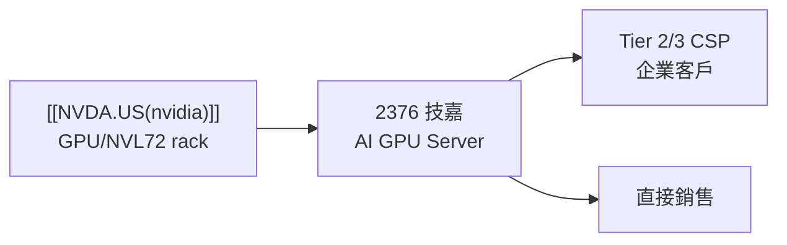

# 2376_技嘉（市）

## 基本資料

技嘉科技（2376.TW，Giga-Byte Technology）為台灣主要 AI 伺服器 OEM 廠商，同時生產主板、顯示卡、筆記型電腦等消費性產品。在 AI 伺服器浪潮中，技嘉被摩根士丹利列為台灣下游 AI 伺服器 OEM/ODM **Top Pick**，受惠 Tier 2/3 CSP 及企業 AI 伺服器需求。

**市場定位**：相對鴻海、廣達等超大型 ODM，技嘉在 AI GPU 伺服器（含高規格水冷機型）有較強定位，服務 Tier 2/3 雲端客戶與企業端。

---

## 核心技術／競爭優勢

- **AI GPU 伺服器領先品牌**：G482 等系列 AI 伺服器產品線，早期布局 NV GPU 伺服器市場
- **Tier 2/3 CSP 定位**：補位四大 Hyperscaler 以外的 AI 需求，市場較分散但技嘉相對具競爭力
- **主板 + 系統垂直整合**：主板自製能力減少外採成本，系統設計靈活度高
- **Gaming GPU + AI 伺服器雙驅動**：遊戲顯卡業務維持基本盤，AI 伺服器為高成長引擎

---

## 圖片 / 架構圖

---

## 目標價與評等

| 來源 | 日期 | 評等 | 目標價 | 備註 |
|------|------|------|--------|------|
| 摩根士丹利 | 2025-06-01 | Top Pick（OW） | — | 台灣 AI ODM/OEM 首選；GB200 需求受惠 |
| 凱基投顧 | 2026-10-15 | 增加持股 | NT$535 | 14x 2026–27 年 EPS |
| Goldman Sachs | 2026-10-20 | Neutral | NT$492（原 487） | 14.2x 2027E P/E；[[報告_GS_技嘉2376_20261020]] |

## EPS 記錄

| 季度 | MS EPS 預估（元） | 與市場差異 | 備註 |
|------|------------------|------------|------|
| 2026Q2 | 8.74 | +15% | 營收 NT$144.2bn、OPM 6.1%，營運槓桿優於市場 |

---

## 時間軸

| 時間 | 事件 | 類型 | 重要性 | 備註 |
|------|------|------|--------|------|
| 2025Q3 起 | 新 Tier 2/3 CSP 訂單（非四大 Hyperscaler）| 業務 | ⭐⭐⭐ | MS 2025-06-01 指出 GB200 rack 新訂單帶動 |
| 2025H2 | GB200 伺服器出貨 | 放量 | ⭐⭐⭐ | MS 預估全年 AI server rack shipments 25-30k |
| 4Q26 | 營收估 NT$1,604 億，年增 79%；10–12 月月營收因機種轉換月減 | 營收 | ⭐⭐ | GS 2026-10-20 estimate；[[時程_2026Q3Q4_AI網通與硬體催化劑]] |
| 2026-10-21 | NVIDIA DSX POD 貨櫃式 AI 工廠參考設計發布，GIGABYTE 列合作夥伴 | 新平台 | ⭐⭐⭐ | [[research_產業合作技術發表_2026-10-22]]；fact |
| 2027 初 | DSX POD 夥伴開始全球交付 | 放量 | ⭐⭐ | NVIDIA 新聞稿；技嘉個別份額未揭露 |

---

## 供應鏈位置

- 上游：[[NVDA.US(nvidia)]]（GPU）、電源、主板零組件
- 下游：Tier 2/3 CSP（非 AWS/Azure/GCP/Meta）、企業 IT
- 同業：[[2382_廣達（市）]]、[[2317_鴻海（市）]]、[[3231_緯創（市）]]、[[6669_緯穎（市）]]

---

## 相關公司

| 公司 | 關係 | 說明 |
|------|------|------|
| [[NVDA.US(nvidia)]] | 關鍵上游 | GPU 供應商；GB200/GB300 伺服器核心 |
| [[2317_鴻海（市）]] | 同業 AI ODM | MS 排序第二，接在技嘉之後 |
| [[2382_廣達（市）]] | 同業 AI ODM | GB200 rack assembly（L11）主力 |

---

## 凱基投顧 2026-10-15：AI 伺服器產能倍增

- 9 月營收 NT$631 億（月增 33%、年增 125%），3Q26 營收 NT$1,547 億（季增 7%，高於凱基 3%、共識 10%），主因 AI 伺服器客戶提前拉貨。消費性產品回溫，顯卡與主機板營收季增逾 20%，伺服器營收占比由 81–82% 降至 77–78%，產品組合有利；凱基上修 3Q26 毛利率至 11.2%、EPS 10.79（fact／estimate）。
- 4Q26 開始出貨 VR200 機櫃，neocloud 需求增強，凱基估 4Q26 伺服器營收季增 15%、整體營收季增 13%、EPS 8.84。
- 公司計畫 2026 年底 AI 伺服器產能較前一年倍增，訂單能見度到 1H27，已提前採購關鍵零組件。凱基估伺服器營收 2026 年 NT$4,523 億（年增 118%、占 78%）→ 2027 年 NT$6,384 億（年增 41%、占 82–83%）；EPS 2026／27F 37.36／39.07（estimate／中）。
- 評等「增加持股」，TP 由前次上調至 NT$535（14 倍 2026–27 年 EPS），股價 NT$347。

## Goldman Sachs 2026-10-20：AI 伺服器推動 2H26 成長（Neutral）

- **3 個月營收預覽**：GS 估 10–12 月營收 NT$584 億／534 億／486 億，年增 106%／74%／60%；月比各減約 8–9%，原因是 AI 伺服器機種轉換與 9 月高基期，但 4Q26 營收 NT$1,604 億仍季增 4%、年增 79%（1Q26／2Q26 年增 60%／41%）。（estimate，信心：中）
- **驅動力**：AI 支出持續、客戶加快部署、技嘉客戶群擴大與 backlog 能見度提升；客戶的基礎設施與零組件採購在 2H26 持續改善。
- **資本支出**：GS 預期 2H26 資本支出維持 1H26 的高檔，2026 年年增 148%，以支應 AI 伺服器需求與客戶的多元生產據點要求（台灣、美國、歐洲、東南亞）。
- **財測**：反映 9 月營收，2026E 營收上修 2%、淨利上修 2%；2026–28E EPS 32.09／38.60／44.92（原 31.59／38.48／44.77）；3Q26E／4Q26E EPS 7.20／7.17。毛利率 2026E 9.8%、2027E 9.1%。
- **評等**：Neutral，12 個月 TP 由 NT$487 上調至 NT$492（14.2x 2027E P/E，由同業本益比與 EPS 成長的回歸推得），股價 NT$355。
- 來源：[[報告_GS_技嘉2376_20261020]]（Goldman Sachs，2026-10-20）。

![[報告_GS_技嘉2376_20261020_002.png]]
> GS 的技嘉月營收圖（藍柱）與年增率（折線）：9 月營收 NT$631 億創高、年增 125%，10–12 月為 GS 估計值（淺色），呈月減但年增仍高。下表是 GS 對 10–12 月營收與 3Q／4Q 的預估。

> [!warning] 來源差異（並列，不裁定）
> - **3Q26 EPS**：GS 估 7.20，凱基 2026-10-15 估 10.79；2026E EPS GS 32.09 vs 凱基 37.36。兩者都是財報前預估。
> - **資本支出口徑**：GS 寫 2026 年資本支出「年增 148% 至 NT$2.9bn」，但 Citi 2026-08-14 轉述公司指引為 NT$280–300 億（約 NT$28–30bn），數量級不同，可能是 GS 原文單位或口徑問題，待財報確認。
> - GS 報告內 Exhibit 3 的 2026E「EPS (Diluted)」為 28.92，與摘要表 32.09 不同，兩個數字並列。

## NVIDIA DSX POD 合作夥伴（2026-10-21）

- NVIDIA 於 GTC Berlin 發布 DSX POD（貨櫃式 Vera Rubin AI 工廠參考設計）：運算、網路、佈線、機櫃級供電與液冷在工廠內預先整合與測試，部署時間由約 6 個月縮短到最快 14 天，2027 年初起全球交付（fact／高）。
- 技嘉以 GIGABYTE 列名；同列台系夥伴有 [[2317_鴻海（市）]]、[[2382_廣達（市）]]、[[3231_緯創（市）]]、[[4938_和碩（市）]]、[[2308_台達電（市）]]。對以 Tier 2/3 CSP 為主的技嘉而言，貨櫃式交付有利縮短中小型雲端客戶建置時間（推論）；角色與份額未揭露。
- 來源：[[research_產業合作技術發表_2026-10-22]]（NVIDIA 新聞稿，2026-10-21）。

## 來源

- [[research_產業合作技術發表_2026-10-22]] — NVIDIA 官方新聞稿彙整，2026-10-21；DSX POD 合作夥伴。
- [[報告_GS_技嘉2376_20261020]] — Goldman Sachs，2026-10-20；10–12 月營收預估、Neutral／TP NT$492。
- [[報告_凱基_電子硬體板卡廠_20261015]] — 凱基投顧，2026-10-15；3Q26 營收、AI 伺服器產能倍增、增加持股／TP NT$535。

- [[報告_Citi_技嘉_20260814]]（2026-08-14）
- [[報告_MS_GB200機櫃出貨_20250609]]（2025-06-09）
- [[報告_MS_伺服器市場_20250616]]（2025-06-16）
- [[報告_MS_硬體OEM財報前瞻_20260810]]（2026-08-10）
- [[報告_摩根士丹利_大中華科技硬體_20250601]]（2025-06-01）

## 本次 ingest 更新（Citi，2026-08-14）

- 2Q26 淨利 NT$66 億，受費用控制與匯兌收益帶動，Citi 估 2026–2028E 獲利上修 28–46%，目標價升至 NT$595，屬券商 estimate。
- 公司引導 2H26 營收增速高於 1H26，主因 neo-cloud 需求；2026 年資本支出指引升至 NT$280–300 億，並核准最多 5,000 萬股 GDR，均屬公司展望／公司決議。

新增來源：[[報告_Citi_技嘉_20260814]]。

- [[報告_MS_硬體OEM財報前瞻_20260810]]（Morgan Stanley，2026-08-10；2Q26 EPS 預估高於市場 15%）
- [[報告_摩根士丹利_大中華科技硬體_20250601]]（MS，2025-06-01；技嘉 Top Pick，Tier 2/3 CSP GB200 新訂單）
- [[報告_摩根大通_台灣ODM_20250611]]（JP Morgan，2025-06-11；AI ODM 整體看法）

## 相關頁面

- [[時程_2026-2028十月券商催化劑]]
- [[分析_2026-10-15_台積電3Q26法說與AI硬體券商更新]]
- [[時程_2026Q3Q4_AI網通與硬體催化劑]]
- [[時程_2026記憶體與AI催化劑]]
