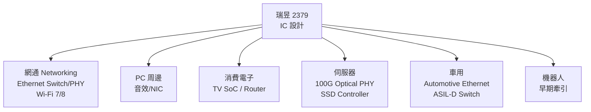

# 2379_瑞昱（市）

## CTBC 2026-07-31 更新

- 2Q26 營收 NT$375.5 億、毛利率 47%、EPS NT$7.42，低於市場共識；晶圓代工與記憶體成本上升是主要壓力。
- 公司規劃 3Q26 起調價，但未必可完全轉嫁成本。100G Optical PHY、SSD 控制器與伺服器連接產品預期 2027–2028 年才有較顯著貢獻。
- 中信投顧下修 2026E／2027E EPS 至 NT$30.0／33.7，維持中立、目標價 NT$680；均為券商 estimate。

來源：[[報告_CTBC_瑞昱_20260731]]（2026-07-31）。

## 基本資料

瑞昱半導體（2379 TT，Realtek Semiconductor）是全球前三大 IC 設計公司之一，產品線橫跨網通（Ethernet Switch、PHY、Wi-Fi）、PC 周邊（音效、網路卡）、消費電子（SoC、TV）、汽車電子（Automotive Ethernet）、儲存（SSD Controller）及伺服器應用（100G Optical PHY）。

主要資料來源：[[活動_瑞昱2379_2Q26Memo_20260805]]（2Q26 法說後 Call Memo，2026-08-05）。

## 圖解

## 2Q26 財務結果

| 指標 | 數值 | QoQ | YoY |
|------|------|-----|-----|
| 營收 | NT$37.6B | +3.1% | +17.7% |
| 毛利率 | 47.0% | -2.7ppt | -3.2ppt |
| 營業利益 | NT$3.73B | — | — |
| 稅後淨利 | NT$3.81B | — | — |
| EPS | NT$7.42 | vs NT$8.44 (1Q26) | vs NT$7.62 (2Q25) |
| 庫存天數 | 107 天 | vs 105 天 | — |

**毛利率下滑主因**：先進封裝產能瓶頸推高 ASP，帶來更高 DRAM 成本，加上嵌入記憶體 IC 組合偏移。

## 3Q26 展望

整體需求預期有韌性，但各部門能見度不同：
- **PC 市場**：高於公司平均的滑鼠及周邊受 AI 升規拉動，PC 整體仍受 DRAM/CPU 成本壓力
- **消費電子**：TV 世界盃後降溫；家電穩定；遊戲機因成本偏弱
- **網通**：企業更換週期 + Wi-Fi 7 持續帶動
- **車用**：2H 季節性強，EV 全球約 23M 台（+27-28% 總占比），Automotive Ethernet 量產支撐
- **SSD Controller**：採入頂尖 GPU AI 平台，持續進展

## 成長動能

### 100G Optical PHY（新興）
- 2026 Computex 展示
- 最早 1Q27 量產目標
- 初期聚焦 100G 收發器及 AOC 市場
- TAM 估每年數億美元

### Wi-Fi 升規
- Wi-Fi 7 筆電滲透率估今年約 30%
- Wi-Fi 8 為明年主要技術重點，互通性測試進行中
- 商業採用預期從 PC/路由器開始約 1Q28

### Automotive Ethernet
- 業界首款 ASIL-D 整合乙太網交換器，最多四個 10Gbps 連結
- 智慧座艙為快速成長應用
- EV 普及持續擴大 TAM

### AI 伺服器擴展
- 從現有 IP（10G Ethernet、I3C hub、USB hub、PON、控制平面交換機）擴展至 SmartNIC、光 PHY、高速資料交換機
- SSD Controller 已被頂尖 GPU AI 平台採用

### 機器人
- 市場仍在驗證階段
- 頂尖人形機器人品牌在參考設計採用 Realtek 連接方案（乙太交換機、USB hub、Wi-Fi）

## 毛利率壓力與對策

- DRAM/NAND 成本上升，以及先進封裝相關供應瓶頸
- 公司已自 6 月初與客戶協商新定價，新價格（適用部分）於 3Q26 生效
- 改善措施：優化供給安排、改善產品設計/成本結構、適度反映成本
- 長期期待產品組合優化、高附加值產品增加帶動毛利回升

## 關鍵觀察

| 指標 | 說明 |
|------|------|
| 100G Optical PHY 量產 | 最早 1Q27；TAM 數億美元，能見度仍低 |
| Wi-Fi 8 滲透 | 最早 2028，與 Mediatek 等同業正面競爭 |
| Managed Switch 市占 | 估計提升 ~2-3ppt；新設計勝出多在 2027-28 貢獻 |
| 受控/AI 伺服器 SSD | 已在頂尖 GPU AI 平台，進展順利 |
| 機器人早期牽引 | 廣泛市場採用要到 2030 年代後期 |

## 供應鏈位置

- **製程**：台積電成熟製程（16nm 以下含 7nm 等先進製程用於高性能 IC）
- **客戶**：全球 PC OEM/ODM、網通白牌廠、CSP（透過模組廠）、Tier-1 汽車供應商

## Morgan Stanley 2Q26 更新

- 2Q26 營收 NT$37.6bn（QoQ +3%、YoY +18%），但毛利率 47.0%、EPS NT$7.42，受記憶體漲價與封測產能緊張壓力影響而低於 MS 預期。
- MS 預期 3Q26 營收可能因中國手機需求走弱而承壓，惟部分客戶價格調整於 3Q 生效、企業基礎設施更新與 Wi‑Fi 7／multi-gig Ethernet 可支撐網通；Wi‑Fi 8 部署預估最早 1Q28。

來源：[[報告_MorganStanley_瑞昱_20260730]]（2026-07-30，券商 estimate）。

## 近期營運與研究更新

### 2026-11-03 Daiwa：需求再平衡結束，1Q27 回到季節性（Outperform，TP TWD798，原 TWD750）／MS PC 半導體 EW

- Daiwa 解讀 10-29 法說「謹慎穩健」為 4Q26 營收約季持平（逆季節），2027 預估營收年增 18%；兩年客戶提前備貨、零組件漲價與 AI 排擠造成的反季節表現告一段落（estimate）。
- 結構成長：2.5G／5G／10G Ethernet、10GPON、管理型交換器、WiFi 7／8 頻寬升級；AI 布局含 SSD、Ethernet hub、光纜、i3C 安全、SerDes 控制器；管理層稱 AI 今年占營收高個位數 %，2030 年逾 30%。
- MS PC 半導體報告（2026-11-03）：瑞昱 4Q 營收可望季增的原因為非 PC 消費性（IoT）需求、晶圓代工／封測與 KGD 漲價轉嫁（TV SoC 價格因 DDR4 KGD 漲價數倍）、大型 IC 設計供應鏈管理較佳；MS 維持 EW。
- 來源：[[報告_Daiwa_瑞昱2379_20261103]]、[[報告_MorganStanley_PC半導體_20261103]]。

### 2026-10-30 華南投顧訪談（區間持有）

- 3Q26 營收 377.3 億元（QoQ +0.5%、YoY +27.9%），毛利率 47.4%、營益率 11%、EPS 8.05 元；4Q26 PC 疲弱，產品組合與價格調整緩解淡季，估營收 349.8 億元。
- 車用乙太網路（新車滲透 >50%）；AI 產品 SSD Controller、PCIe Retimer／Redriver、100G Optical PHY 2027 放量（光收發器與 AOC）；HPC 與 Edge AI 占高個位數、2030 年目標 >30%。2027 年 Wi-Fi 7 滲透 30%→40%、Wi-Fi 8 2H27 量產爬坡；TP NT$860。Mizuho TP 770→870、元大 780→900。

來源：[[報告_華南_瑞昱2379_20261030]]、[[memo_永豐金證券_台股個股評等調整_20261102]]。

### 2026-10-29 3Q26 法說：ASP 支撐淡季不淡，AI 與 Wi-Fi 8 為 2027 主軸（Citi／Daiwa／凱基／中信／國泰／統一）

| 券商 | 日期 | 評等 | 目標價 | 來源 |
|------|------|------|--------|------|
| Citi | 2026-10-29 | Buy | NT$900（原 630；20x 2027E） | [[報告_Citi_瑞昱2379_20261029]] |
| Daiwa | 2026-10-29 | Outperform (2) | 原文未提及 | [[報告_Daiwa_瑞昱2379_20261029]] |
| 凱基 | 2026-10-29 | 持有 | NT$680（18x 2027E） | [[報告_凱基_瑞昱2379_20261029]] |
| 中信投顧 | 2026-10-30 | 中立 | NT$850 | [[報告_中信_瑞昱2379_20261030]] |
| 統一投顧 | 2026-10-30 | 中立 | 原文未提及（26／27 EPS 31.5／37.6） | [[memo_統一投顧_個股評等創意台達電日月光盛群瑞昱_20261030]] |

- **3Q26（fact）：** 營收 377.3 億元（QoQ +0.5%、YoY +27.9%），毛利率 47.4%（QoQ +0.4ppt），營益率 11.0%，稅後淨利 41.3 億元，EPS 8.05 元；業外 6.06 億元。Daiwa：營收低其預估 8%（1H26 客戶提前備貨後需求再平衡）。存貨周轉天數由 107 天升至 136 天（刻意備晶粒確保供貨），短期借款 93.7 億元。PC／非 PC 約 30%／70%。
- **4Q26／2027：** 產品組合與漲價推升 ASP，4Q26 不必然季節性下滑（Citi 引述指引 QoQ 0–5%）；2027 年營收穩定成長（Citi：至少雙位數），毛利率 2H26 逐步回升、2027 年目標維持穩定，不為拉高毛利率而漲價。自 6 月起逐案與客戶討論漲價；晶圓代工與封測產能受 AI 排擠，2027 年供應較明顯改善。
- **網通／車用：** Wi-Fi 7 在 PC 與路由器滲透率 2026 年約 30%、2027 年約 40%；Wi-Fi 8 2H27 放量（Wi-Fi 聯盟 2027-09 啟動認證）；多 Gigabit 占乙太網路營收逾 40%；網管型交換器與非網管型差距縮小。車用乙太網路新車滲透率逾 50%，ASIL 認證交換器持續 design-in。
- **AI：** HPC＋邊緣 AI（含車用、機器人）目前占營收高個位數，目標 2030 年逾 30%；伺服器產品含乙太網路、交換器、SSD 控制器、USB hub，延伸 SmartNIC、PCIe Retimer／Redriver、光通訊控制器與 AOC；100G 光學 PHY 驗證中、2027 年放量，400G／800G PAM4 DSP 2H27 推出；AI ASIC 處客戶接觸初期，3nm 為關鍵平台。
- **PC：** IDC／Gartner 3Q26 全球 PC 出貨年減約 20–22%；IDC 預估 2026 年 −11.3%、2027 年 −4.1%，4Q26 客戶調整年底庫存。

來源：[[報告_Citi_瑞昱2379_20261029]]、[[報告_Daiwa_瑞昱2379_20261029]]、[[報告_凱基_瑞昱2379_20261029]]、[[報告_中信_瑞昱2379_20261030]]、[[活動_瑞昱2379_國泰CallMemo_20261029]]、[[memo_統一投顧_個股評等創意台達電日月光盛群瑞昱_20261030]]。

## 來源

- [[報告_Daiwa_瑞昱2379_20261103]] — Daiwa，2026-11-03；Outperform TP TWD798。
- [[報告_MorganStanley_PC半導體_20261103]] — Morgan Stanley，2026-11-03；PC 半導體分化、瑞昱 EW。
- [[活動_瑞昱2379_2Q26Memo_20260805]] — 2Q26 法說後 Call Memo，2026-08-05

- [[260730_citi_realtek]]（2026-07-30）
- [[260730_daiwa_realtek]]（2026-07-30）
- [[260730_ubs_realtek]]（2026-07-30）
- [[報告_CTBC_瑞昱_20260731]]（2026-07-31）
- [[報告_MorganStanley_瑞昱_20260730]]（2026-07-30）

- [[memo_統一投顧_個股評等創意台達電日月光盛群瑞昱_20261030]]（2026-10-30）
- [[報告_Citi_瑞昱2379_20261029]]（2026-10-29）
- [[報告_Daiwa_瑞昱2379_20261029]]（2026-10-29）
- [[報告_中信_瑞昱2379_20261030]]（2026-10-30）
- [[報告_凱基_瑞昱2379_20261029]]（2026-10-29）
- [[活動_瑞昱2379_國泰CallMemo_20261029]]（2026-10-29）
- [[報告_華南_瑞昱2379_20261030]]（2026-10-30）
- [[memo_永豐金證券_台股個股評等調整_20261102]]（2026-11-02）

## 相關頁面

- [[供應鏈_AI光互聯]]（元大 2026-09-21 光通訊產業報告引用）
- [[SIMO.US(silicon_motion)]]
- [[分析_2026Q3半導體供需與AI伺服器供應鏈]]
- [[供應鏈_記憶體]]
- [[技術_NAND快閃記憶體]]
- 技術_Automotive_Ethernet
- 供應鏈_AI伺服器網路
- [[技術_光模塊]]

## UBS 2026-07-30 更新

- 2Q26 營收 NT$376 億元、毛利率 47.0%；UBS 認為記憶體與封測成本上升造成毛利率壓力，但 6 月調價可在 H2 陸續反映。
- UBS 上修 2026E／2027E 營收 3%／13%，目標價由 NT$525 上調至 NT$690，評等維持 Neutral；數字與估值屬券商 estimate。
- 網通、車用與家電需求相對穩定，但消費性需求與記憶體漲價轉嫁仍是風險。

來源：[[260730_ubs_realtek]]（UBS，2026-07-30）。

### 2026-08-23 Daiwa 更新

- [[260730_daiwa_realtek]]（2026-07-30）將晶圓代工／記憶體成本上升列為短期毛利壓力，並觀察 3Q26 起調價轉嫁程度；100G Optical PHY、SSD 控制器與伺服器連接產品的較大貢獻仍偏向 2027–2028，屬券商 estimate。
