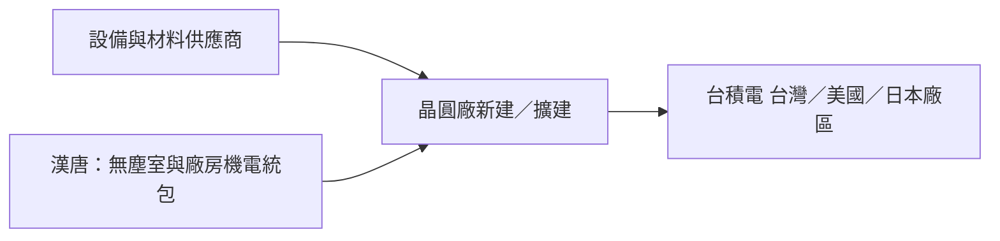

# 2404_漢唐（市）

## 基本資料

漢唐為半導體與高科技廠房的廠務工程統包商，承攬廠房機電、無塵室與跨國建廠工程管理；主要業主為 [[2330_台積電（市）]]，隨台積電在台灣、美國、日本擴建新廠而成長。2026-11 群益速報稱漢唐 3Q26 獲利優於預期、在手訂單約 1,939 億元，並於台積電 2026 年供應商表揚中首度拿下「卓越全球化支援」獎，與 ASML、科林研發、東京應化同列。資料來源：[[報告_群益_台積電供應商漢唐2404_20261118]]（2026-11-18）。

## 核心技術／競爭優勢

- 廠務整合能力：涵蓋廠房機電、無塵室與跨國工程管理，可支援晶圓廠在多國同步建廠。
- 業主黏著：長期承攬台積電廠務工程，2026 年以「全球化支援」獲獎，反映海外建廠協作角色（群益說法）。
- 訂單能見度：在手訂單約 1,939 億元，約為群益 2026F 營收的 1.8 倍（以 1,070.59 億元換算，estimate）。

## 產品與應用

| 產品／服務 | 應用 | 相關客戶／下游 |
|---|---|---|
| 無塵室與廠房機電統包 | 晶圓廠、先進封裝廠新建與擴建 | [[2330_台積電（市）]] |
| 跨國建廠工程管理 | 台積電美國、日本新廠 | [[2330_台積電（市）]] |

## 圖片 / 架構圖

圖說：漢唐位於晶圓廠建置的廠務工程環節，與設備商並列為新廠建置的上游供應商。

## EPS 預估

| 年度 | 群益（2026-11-18） |
|---|---|
| 2026F | 85.54 元（營收 1,070.59 億元，YoY +61.98%；稅後純益 163.04 億元，YoY +79.76%） |
| 2027F | 117.99 元（營收 1,487.94 億元，YoY +38.98%；稅後純益 224.89 億元，YoY +37.94%） |

## 目標價與評等

| 來源 | 日期 | 評等 | 目標價 | 評價基礎 |
|---|---|---|---|---|
| 群益投顧 | 2026-11-18 | Buy | 1,165 元 | 3Q26 獲利優於預期、在手訂單約 1,939 億元；[[報告_群益_台積電供應商漢唐2404_20261118]] |

## 時間軸

| 時間 | 事件 | 類型 | 重要性 | 備註 |
|---|---|---|---|---|
| 2026-11 | 台積電 2026 年供應商表揚，漢唐首獲「卓越全球化支援」獎 | 客戶認可 | ⭐⭐ | 群益速報；見 [[時程_2026Q3Q4_AI網通與硬體催化劑]] |

## 供應鏈位置

- 上游：無塵室設備、機電與空調系統材料。
- 下游：晶圓代工與先進封裝業主，主要為 [[2330_台積電（市）]]。
- 供應鏈主軸：wiki 尚無晶圓廠廠務工程供應鏈頁；先進封裝擴產脈絡見 [[供應鏈_先進封裝載板]]。

## 相關公司

| 公司 | 關係 | 說明 |
|---|---|---|
| [[2330_台積電（市）]] | 主要客戶 | 台積電 2026 年供應商表揚得主 |
| [[6139_亞翔（市）]] | 同業 | 廠務工程統包 |
| [[5536_聖暉（市）]] | 同業 | 廠務工程 |
| [[6196_帆宣（市）]] | 同業 | 2025 年獲台積電新廠建置安全績效獎，2026 年未再獲獎 |
| [[6909_創控（櫃）]] | 同生態 | 晶圓廠廠務環境監測設備，同受建廠驅動 |

## 風險與注意事項

> [!warning]
> - 客戶集中：營收高度依賴台積電建廠節奏，資本支出放緩直接影響接單。
> - 海外工程執行：美國、日本建廠的人力與成本控管風險。
> - 本頁目前僅一份券商速報，營收結構與毛利率資料待補。

## 來源

- [[報告_群益_台積電供應商漢唐2404_20261118]]（2026-11-18）— 群益產業速報；台積電供應商表揚、Buy、TP 1,165 元。

- [[報告_群益_AI主導科技股資料中心建置障礙_20261117]]（2026-11-17）
