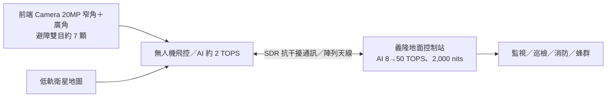

# 2458_義隆（市）

## 基本資料

義隆電子為 IC 設計公司（既有觸控等業務，本頁以 2026-10-22 法說揭露的無人機與 AI 布局為主）。法說重點：地面控制站內建 AI 可升級舊無人機、視覺導航不依賴 GPS 以防欺騙、通訊自研 RF 並以成熟製程控制成本。公司自評 AI 與飛控具領先地位，通訊仍需追趕但具成本優勢。

- 資料來源：[[活動_義隆2458_國泰CallMemo_20261022]]（國泰證期 Call Memo，2026-10-22）。法說未揭露財務數字。

## 核心技術／競爭優勢

- 地面控制站 AI：內建 AI 晶片，目前 8 TOPS、未來約 50 TOPS，演算法實際約用 2 TOPS；舊無人機可把影像回傳地面站運算以升級 AI（有延遲但多數應用可接受）；定位為 AI Agent，可一鍵切換監視、巡檢、消防等用途。帶防干擾 SDR 通訊模組的地面站售價約 NT$10 萬至 20–30 萬元。
- 視覺導航：無 GPS 環境以低軌衛星地圖比對，影像轉正向北後比對，誤差約 10 公尺，去回程皆不依賴 GPS（anti-spoofing）；同業多向國外授權，義隆已自行開發。
- 自研 AI 演算法約 2 TOPS（業界高通方案約 15 TOPS，成本與耗電較高）；以生成式 AI 合成軍用場景訓練資料（國防部目前規定約 6 種情境）。
- 通訊：沿用低軌衛星天線技術，6 公里內用 Dipole、6 公里以上用陣列天線（4x4 約 20 公里、8x8 約 40 公里）；SDR Baseband 技術來自 5G Small Cell 子公司，申請政府補助開發天線、AI、飛控、馬達控制晶片，最高約 40nm。
- 驗證：SIL＋自建 HIL（3x3 大螢幕播放影像、地球儀式固定架擺動驗證 IMU），已申請專利。
- 顯示：地面站顯示器約 2,000 nits（手機約 500 nits）、Local Dimming、抗反射、可雨天操作。

## 產品與應用

| 產品 / 服務 | 應用 | 相關客戶 / 下游 |
|---|---|---|
| 無人機地面控制站（AI＋SDR） | 監視、巡檢、消防、軍用 | 策略夥伴（未具名）、國防需求 |
| 視覺導航與避障方案 | 無 GPS 環境導航、蜂群（母機＋子機、跳頻） | 無人機業者 |
| 飛控與馬達控制晶片 | AI 直接飛控、風向風力推估 | 策略夥伴驗證中 |
| 智慧交通 | 闖紅燈預測（已於國內部分場域架設） | 地方政府 |
| 下一代架構 | CNN 偵測＋Transformer 行為模型，延伸保全監控 | 開發中 |

## 圖片 / 架構圖

圖說：義隆無人機方案由機上視覺導航與飛控、SDR 通訊與 AI 地面站組成，地面站可替舊機補上 AI 能力。

## 時間軸

| 時間 | 事件 | 類型 | 重要性 | 備註 |
|---|---|---|---|---|
| 2026-10-22 | 法說揭露無人機地面站、視覺導航與通訊布局 | 法說 | ⭐⭐ | — |
| 開發中 | 第二代顯示器方案、CNN＋Transformer 下一代架構 | 新產品 | ⭐ | 時程未揭露 |
| 1Q27 | 無人機避障方案（四 Camera＋AI Box）有機會量產 | 新產品 | ⭐⭐ | [[活動_義隆2458_國泰CallMemo_20261105]]；公司說法 |
| 2027 | 指紋產品打入五大品牌新客戶開始出貨 | 新客戶 | ⭐⭐ | [[活動_義隆2458_國泰CallMemo_20261105]] |
| 2H27 | 矽光子 TIA 送樣；無人機通訊（Wi-Fi／SDR）推出 | 新產品 | ⭐ | [[活動_義隆2458_國泰CallMemo_20261105]] |

→ 跨公司時程詳見 [[時程_2026AI軟體與軍工AIoT催化劑]]

## 供應鏈位置

- 上游：晶圓代工（成熟製程，最高約 40nm）、Camera 感測器、熱像儀（每顆約 US$1,000–2,000，僅特殊情境使用）。
- 本體：無人機 AI、飛控、通訊與地面站方案。
- 下游：國防與民用無人機、智慧交通。

## 相關公司

目前來源未揭露可直接確認的上市公司關係（夥伴與客戶未具名）。

> [!warning] 風險與注意事項
> - 無人機業務尚無營收數字揭露，商業化規模與時程不確定。
> - 通訊技術仍落後同業，需時間追趕。
> - 國防需求受政府預算與規格（國防部情境）影響。

## 近期營運與研究更新

### 2026-11-03 Morgan Stanley：PC 半導體展望分化，義隆降評 EW（TP NT$160，原 NT$250）

- 1Q～3Q26「怕買不到」（FOMP）備貨造成庫存累積，4Q 修正可能更深：客戶仍規劃 4Q 採購 QoQ -5～10%，但譜瑞 4Q 指引營收 QoQ -20～25%；Windows 啟用天數仍 200+ 天，PC 半導體客戶 2H 漲價幅度遠小於 1H，弱勢可能延續到 1Q27。
- 2027 無明確新成長動能，PC 半導體客戶初步展望持平至年減 20%；MS 預期循環底部在 2027 年某時點。
- 義隆：下修 2027／28 EPS 20%／16%，非 PC（主要為無人機）無法完全抵銷 NB 曝險；基本情境 16x 2027e EPS。MS 維持瑞昱 EW，聯詠、祥碩、譜瑞、新唐 UW。
- 來源：[[報告_MorganStanley_PC半導體_20261103]]。

### 2026-11-05 國泰 call memo／UBS：3Q26 NB 拉貨轉弱，4Q26 可能為谷底

- 3Q26 營收 NT$22.2 億（QoQ −30.7%、YoY −33.1%），毛利率 44.7%（2Q26 47.4%、3Q25 47.2%），營業利益 NT$2.96 億，業外損失 NT$1 億（金融資產評價），稅後淨利 NT$1.68 億，EPS NT$0.58（以庫藏股發放後 2.91 億股計），低於 UBS／共識 NT$1.29／1.71（fact）。
- 產品組合：AI 類 14%、觸控類 73%（觸控板模組 43%、觸控螢幕 IC 14%、指紋模組 16%）、非觸控 13%（指向裝置 9%、MCU 及關係企業 4%）。毛利率下滑主因高毛利觸控螢幕產品出貨減少，加上晶圓代工 4/1、7/1 漲價與被動元件、PCB 漲價。
- NB 需求：1H26 品牌擔心記憶體漲價提前拉貨；Agentic AI 使 CPU 轉往 AI 伺服器，消費性 CPU 缺貨漲價，加上記憶體續漲，2H26 消費機種受衝擊，ChromeBook 年減約四成；10 月營收 NT$4.61 億（MoM −23%），4Q26 仍具挑戰。因業外占比超過 10%，依規定不提供財測。UBS 估 4Q26 營收 QoQ −38%、1Q27 回補 +27%，認為 4Q26 為近期谷底。
- 新業務：Haptic 2026 年約 NT$3.5～4 億（2025 年 0.6 億）；SLOC 由 0.61 億增至接近 2 億；2026 年 AI 業績較 2025 年增加近四成；ADAS 電動巴士出貨翻倍、約五家客戶、第六家小量量產，電動物流車已有兩家客戶。
- 無人機：Camera 與 AI Box 已出貨；避障（四顆 Camera＋AI Box，單價約 US$800）有機會 1Q27 量產；Swarm、GPS、AI 視覺導航 2Q27～3Q27 量產；通訊（Wi-Fi／SDR anti-jamming）2H27；已打入雷虎（Thunder Tiger）供應鏈與另兩家客戶，政府標案兩家客戶入選；2027 年參加歐美日五個國外展覽，主打非紅供應鏈。
- 2027 年：指紋產品打入五大 NB 品牌中原未採用義隆的客戶、2027 年開始出貨；美系競爭者併購後取得部分商務機份額；新 IC 分高效能（觸控板／觸控螢幕加入 AI）與低成本方案（部分代工到中國）。
- 矽光子：與夥伴合作 EIC 中的 TIA，預期 2H27 送樣，PIC 亦洽談銷售。
- UBS 下修 2026／27／28E EPS 至 NT$6.35／6.94／11.55（原 8.19／10.82／13.28），TP 由 NT$170 下修至 NT$150（15x 2H27～1H28E PE），維持 Buy；估 AI 業務 2025～30E 營收 CAGR 45%。
- 來源：[[活動_義隆2458_國泰CallMemo_20261105]]、[[報告_UBS_義隆2458_20261105]]。

## 來源

- [[報告_MorganStanley_PC半導體_20261103]] — Morgan Stanley，2026-11-03；PC 半導體分化、義隆降評 EW。
- [[活動_義隆2458_國泰CallMemo_20261022]] — 國泰證期 Call Memo，2026-10-22
- [[活動_義隆2458_國泰CallMemo_20261105]] — 國泰證期研究部 call memo，2026-11-05；3Q26 法說
- [[報告_UBS_義隆2458_20261105]] — UBS，2026-11-05；First Read（Buy，TP NT$150）
