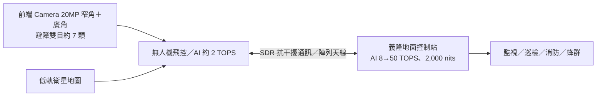

# 2458_義隆（市）

## 基本資料

義隆電子為 IC 設計公司（既有觸控等業務，本頁以 2026-10-22 法說揭露的無人機與 AI 布局為主）。法說重點：地面控制站內建 AI 可升級舊無人機、視覺導航不依賴 GPS 以防欺騙、通訊自研 RF 並以成熟製程控制成本。公司自評 AI 與飛控具領先地位，通訊仍需追趕但具成本優勢。

- 資料來源：[[活動_義隆2458_國泰CallMemo_20261022]]（國泰證期 Call Memo，2026-10-22）。法說未揭露財務數字。

## 核心技術／競爭優勢

- 地面控制站 AI：內建 AI 晶片，目前 8 TOPS、未來約 50 TOPS，演算法實際約用 2 TOPS；舊無人機可把影像回傳地面站運算以升級 AI（有延遲但多數應用可接受）；定位為 AI Agent，可一鍵切換監視、巡檢、消防等用途。帶防干擾 SDR 通訊模組的地面站售價約 NT$10 萬至 20–30 萬元。
- 視覺導航：無 GPS 環境以低軌衛星地圖比對，影像轉正向北後比對，誤差約 10 公尺，去回程皆不依賴 GPS（anti-spoofing）；同業多向國外授權，義隆已自行開發。
- 自研 AI 演算法約 2 TOPS（業界高通方案約 15 TOPS，成本與耗電較高）；以生成式 AI 合成軍用場景訓練資料（國防部目前規定約 6 種情境）。
- 通訊：沿用低軌衛星天線技術，6 公里內用 Dipole、6 公里以上用陣列天線（4x4 約 20 公里、8x8 約 40 公里）；SDR Baseband 技術來自 5G Small Cell 子公司，申請政府補助開發天線、AI、飛控、馬達控制晶片，最高約 40nm。
- 驗證：SIL＋自建 HIL（3x3 大螢幕播放影像、地球儀式固定架擺動驗證 IMU），已申請專利。
- 顯示：地面站顯示器約 2,000 nits（手機約 500 nits）、Local Dimming、抗反射、可雨天操作。

## 產品與應用

| 產品 / 服務 | 應用 | 相關客戶 / 下游 |
|---|---|---|
| 無人機地面控制站（AI＋SDR） | 監視、巡檢、消防、軍用 | 策略夥伴（未具名）、國防需求 |
| 視覺導航與避障方案 | 無 GPS 環境導航、蜂群（母機＋子機、跳頻） | 無人機業者 |
| 飛控與馬達控制晶片 | AI 直接飛控、風向風力推估 | 策略夥伴驗證中 |
| 智慧交通 | 闖紅燈預測（已於國內部分場域架設） | 地方政府 |
| 下一代架構 | CNN 偵測＋Transformer 行為模型，延伸保全監控 | 開發中 |

## 圖片 / 架構圖

圖說：義隆無人機方案由機上視覺導航與飛控、SDR 通訊與 AI 地面站組成，地面站可替舊機補上 AI 能力。

## 時間軸

| 時間 | 事件 | 類型 | 重要性 | 備註 |
|---|---|---|---|---|
| 2026-10-22 | 法說揭露無人機地面站、視覺導航與通訊布局 | 法說 | ⭐⭐ | — |
| 開發中 | 第二代顯示器方案、CNN＋Transformer 下一代架構 | 新產品 | ⭐ | 時程未揭露 |

→ 跨公司時程詳見 [[時程_2026AI軟體與軍工AIoT催化劑]]

## 供應鏈位置

- 上游：晶圓代工（成熟製程，最高約 40nm）、Camera 感測器、熱像儀（每顆約 US$1,000–2,000，僅特殊情境使用）。
- 本體：無人機 AI、飛控、通訊與地面站方案。
- 下游：國防與民用無人機、智慧交通。

## 相關公司

目前來源未揭露可直接確認的上市公司關係（夥伴與客戶未具名）。

> [!warning] 風險與注意事項
> - 無人機業務尚無營收數字揭露，商業化規模與時程不確定。
> - 通訊技術仍落後同業，需時間追趕。
> - 國防需求受政府預算與規格（國防部情境）影響。

## 來源

- [[活動_義隆2458_國泰CallMemo_20261022]] — 國泰證期 Call Memo，2026-10-22
