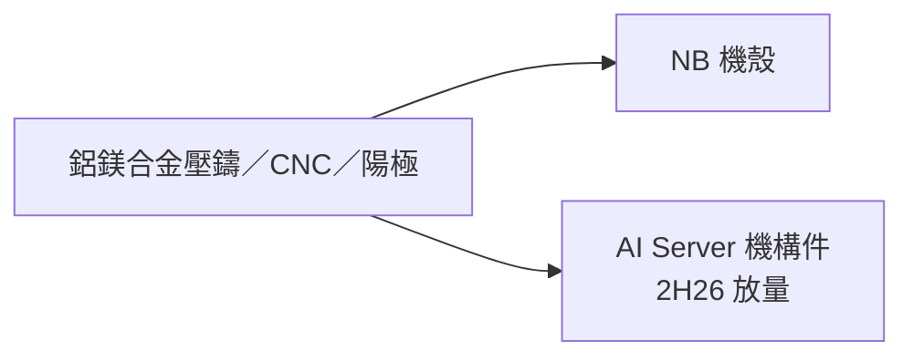

# 2474_可成（市）

> [!note] 範圍待確認：可成本業為 NB 金屬機殼，收錄理由是 AI Server 自 2H26 放量、為 2027 年成長主因。

## 基本資料

可成創立於 1984 年，以鋁合金壓鑄起家，為台灣第一家量產筆電鎂合金機構件的廠商，主要製造鋁、鎂、鋅、不鏽鋼機殼及內構件，製程涵蓋鎂鋁合金壓鑄、鋁擠型、鍛造、沖壓、CNC 加工與陽極等表面處理。3Q26 營收 30.88 億元、毛利率 22.0%、營業利益率 −6.0%，業外收益支撐稅後淨利 13.74 億元、EPS 2.45 元（來源：[[報告_合庫_可成2474_20261110]]）。

## 核心技術／競爭優勢

- 金屬機構件多製程一貫生產能力，可延伸到 AI 伺服器機構件。
- 帳上業外收益（利息、投資）占獲利比重高，稅後淨利率約 40%。

## 產品與應用

| 產品 | 應用 | 備註 |
|---|---|---|
| NB 金屬機殼 | 筆電 | 2026 年受 NB 市場逆風，營收年減 31.2%（合庫預估） |
| AI Server 機構件 | AI 伺服器 | 2H26 開始放量，帶動 2027 年營收年增 9.6% |

## 圖片 / 架構圖

圖說：可成以金屬加工製程為核心，營收結構正由 NB 機殼移往 AI 伺服器機構件。

## EPS 預估

| 年度 | 合庫 EPS（2026-11-10） | 營收 | 類型 |
|---|---:|---:|---|
| 2026E | 9.67 | 128.31 億元（−31.2%） | estimate |
| 2027E | 10.31 | 140.58 億元（+9.6%） | estimate |

## 目標價與評等

| 券商 | 報告日 | 評等 | 區間 |
|---|---|---|---|
| 合庫投顧 | 2026-11-10 | 區間操作 | 155–206 元（2027E EPS 15–20x） |

## 時間軸

| 時間 | 事件 | 類型 | 重要性 |
|---|---|---|---|
| 2H26 | AI Server 機構件開始放量出貨 | 放量 | ⭐⭐ |

## 供應鏈位置

- AI 伺服器機構件供應商；客戶名稱原文未提及。

## 相關公司

原文未揭露客戶與供應商，`related_companies` 暫留空。

## 來源

- [[報告_合庫_可成2474_20261110]]（合庫投顧，2026-11-10）
