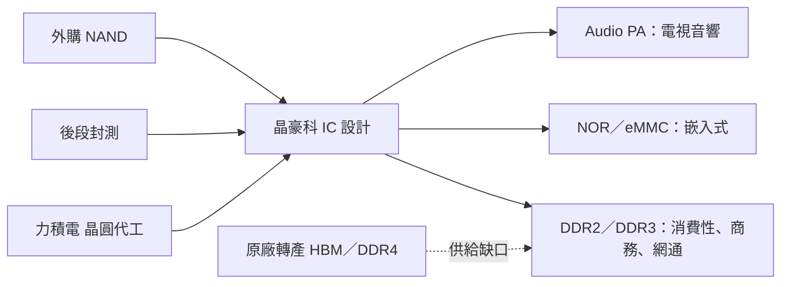

# 3006_晶豪科（市）

## 基本資料

晶豪科為利基型記憶體 IC 設計公司，主力為 DDR2、DDR3、NOR／NAND 與 eMMC／eMCP，記憶體占營收約 95%，其餘為音訊功率放大器（Audio PA）、馬達驅動、無線 SoC 與感測器 IC。晶圓主要由力積電代工。2026 年因 HBM 吸收 DRAM 產能、南亞科與華邦電轉向 DDR4，晶豪科成為 DDR2／DDR3 主要供應者，3Q26 營收 NT$221.50 億（QoQ +58.83%、YoY +519.22%）、毛利率 77.44%、EPS 36.79 元（國泰）／36.09 元（富邦，以股本 29.81 億元計）（[[活動_晶豪科3006_法說彙整_20261102]]，2026-11-02）。

- 主要產品：DDR2／DDR3 DRAM、NOR／NAND Flash、eMMC／eMCP（部分 NAND 外購）、Audio PA、馬達驅動與電源管理 IC、溫度感測器、無線 SoC。
- 應用：消費性電子、高階與商務應用、網通、電視與藍牙音響；新產品 aiPIM 瞄準邊緣 AI。
- 供應鏈位置：無晶圓廠記憶體 IC 設計，上游為力積電晶圓與後段封測。

## 核心技術／競爭優勢

- DDR2／DDR3 合計占營收超過 50%，國內同業停供或減供後承接客戶轉單。
- 多數銷售採季度合約價，營收逐季階梯式上升，現貨價反映較快。
- aiPIM（具運算功能記憶體）3Q26 完成投片，正在晶圓製程，完工後測試。

## 產品與應用

| 產品 | 應用 | 備註 |
|---|---|---|
| DDR2／DDR3 | 消費性、高階與商務、網通 | 2026 年價格大漲，2027 年預期供不應求 |
| NOR／NAND、eMMC／eMCP | 消費性與嵌入式 | eMMC／eMCP 需外購 NAND，有備貨需求 |
| Audio PA | 電視、高階音響 | 市占全球前二（富邦） |
| 電源管理 IC、馬達控制／驅動 IC | 伺服器／資料中心 | 已送客戶驗證（富邦） |
| aiPIM | 邊緣 AI 運算加速 | 3Q26 tape out |

## 圖片 / 架構圖

圖說：依 2026-11-02 國泰、富邦 call memo 整理，原廠產能轉向 HBM／DDR4 造成 DDR2／DDR3 缺口，晶豪科承接轉單（Mermaid 補位，來源無圖）。

## 財務重點

| 指標 | 4Q25 | 1Q26 | 2Q26 | 3Q26 | 來源 |
|---|---|---|---|---|---|
| 毛利率 | 32.33% | 47.52% | 68.70% | 77.44% | 國泰 |
| 營業利益率 | 20.25% | 31.03% | 51.43% | 59.37% | 國泰 |
| EPS（元） | — | — | 20.21 | 36.79（國泰）／36.09（富邦） | [[活動_晶豪科3006_法說彙整_20261102]] |

> [!warning] 3Q26 EPS 口徑差異
> 國泰 call memo 寫 36.79 元；富邦以目前股本 29.81 億元計算為 36.09 元（前三季 62.83 元）。兩者均列，待財報確認。

## 時間軸

| 時間 | 事件 | 類型 | 重要性 | 備註 |
|---|---|---|---|---|
| 2026-10-02 | 「晶豪科二」有擔保可轉債掛牌 | 籌資 | ⭐ | 10 億元短期借款 10 月清償 |
| 3Q26 | aiPIM 完成投片 | 新品 | ⭐⭐ | 邊緣 AI |
| 4Q26 | DDR2／DDR3／Flash 價格續漲，營收 QoQ 微升 | 營運 | ⭐⭐⭐ | 法說會指引，見 [[時程_2026記憶體與AI催化劑]] |
| 2027 | DDR2／DDR3 預期仍供不應求，晶圓供給難增加 | 供需 | ⭐⭐⭐ | 國泰／富邦 |

## 供應鏈位置

- 上游：[[6770_力積電（市）]] 晶圓代工（低迷期多靠晶豪科投片維持，關係緊密）、後段封測、外購 NAND。
- 競爭／供給端：[[2408_南亞科技（市）]]、[[2344_華邦電子（市）]] 轉向 DDR4，減少對外提供 DDR2／DDR3。
- 供應鏈頁：[[供應鏈_記憶體]]。

## 相關公司

| 公司 | 關係 | 說明 |
|---|---|---|
| [[6770_力積電（市）]] | 晶圓代工夥伴 | 力積電正尋求其他產能，P1／P2 原產 DRAM 後轉邏輯代工 |
| [[2408_南亞科技（市）]] | 同業／供給轉向 | 擴大 DDR4，減少 DDR2／DDR3 |
| [[2344_華邦電子（市）]] | 同業／供給轉向 | 擴大 DDR4，減少 DDR2／DDR3 |

## 近期營運與研究更新

### 2026-11-02 法說會（國泰、富邦 call memo）

- 3Q26 營收 NT$221.50 億，出貨量持平、均價 QoQ 上揚約六成；毛利率 77.4%，營業利益 131.50 億元，稅後淨利 107.59 億元。單季營收已接近 2021 年全年約 238 億元。
- 3Q26 底存貨 90.76 億元（2Q26 底 79.55 億元），增加主要來自晶圓與封測調價（fact，高信心）。
- 4Q26：出貨量大致持平、價格高於 3Q26，可抵消成本上升，毛利率可望維持；美元若續強有匯兌正面貢獻（公司指引，中信心）。
- 2027：晶圓供給量難明顯增加，大廠與南亞科、華邦電轉攻 DDR4，DDR2／DDR3 價格可望維持高檔；股利配發率約 30%–50%（管理層，待董事會）。
- 需求：AI 由訓練延伸至推理、代理與實體 AI，帶動 HBM 與 non-HBM 需求；消費性客戶因 BOM 成本上升觀望，但高階與商務拉貨暢旺。
- 富邦：全年 EPS 挑戰 90 元，股價約 2.8 倍 FY26 PER，維持正向看法（estimate）。
- 來源：[[活動_晶豪科3006_法說彙整_20261102]]。

## 風險與注意事項

> [!warning]
> - 獲利主要來自價格上漲，量增有限；原廠若回頭擴產利基型 DRAM 或長鑫等中國廠低階產品放量，價格可能反轉。
> - 晶圓與封測成本逐季上升，存貨與備料資金積壓。
> - 消費性終端受 BOM 成本壓抑。

## 來源

- [[活動_晶豪科3006_法說彙整_20261102]]（國泰證期研究部、富邦投顧，2026-11-02）

## 相關頁面

- [[供應鏈_記憶體]]
- [[時程_2026記憶體與AI催化劑]]
- [[4967_十銓（市）]]
