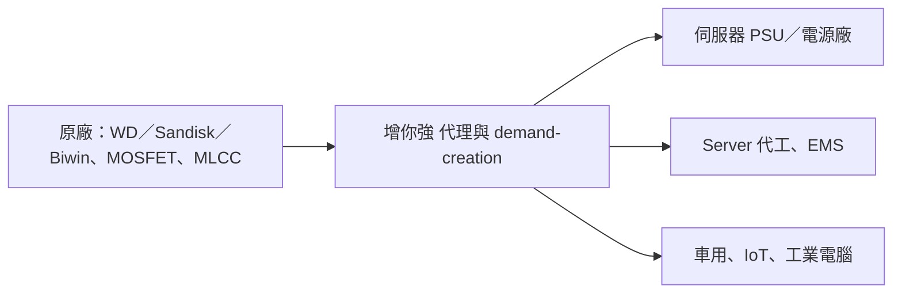

# 3028_增你強（市）

## 基本資料

增你強為電子零件代理商，以 demand-creation 業務為主（占 9 成、以小型客戶為主），毛利率高於以 fulfillment 為主的通路同業。代理產品涵蓋記憶體（WD、Sandisk、佰維 Biwin、十銓、Vcolor 等）、高低壓 MOSFET（SiC／Superjunction）、MCU、被動元件（MLCC）與硬碟。

- **3Q26（fact）**：合併營收 200.63 億元（季增 2.9%、年增 82.6%），毛利率 7.3%，營益率 3.83%，營業利益 7.69 億元，歸屬母公司稅後淨利 5.47 億元，EPS 2.10 元；前三季 EPS 6.86 元。
- **區域（3Q26 占比／年增）**：中國 82.7%／+78.8%、台灣 9.3%／+82.0%、其他（東南亞）8.0%／+137.2%。
- **應用（前三季）**：EMS 15%、手持裝置 14%、汽車電子 13%、IT 11%、消費電子 11%、電源 10%、工業電子 8%、網通 7%、零售 6%、其他 6%；十大應用全數年增，EMS 年增 234%、汽車電子 175%、網通 153%。

資料來源：[[活動_增你強3028_富邦CallMemo_20261123]]（富邦投顧法說 call memo，2026-11-23）。

## 核心技術／競爭優勢

- 記憶體自去年底至 1Q26 升格為戰略產品，占比由過去 3–4 成提高至 6 成；三大原廠占營收由 2 成多升至 5 成多（WD>Sandisk>Biwin）。
- 庫存約 1 個月；車用記憶體與安防大廠需求與原廠簽價格保護（Price Protection）或與客戶簽 Back-to-Back 合約，記憶體價格波動風險相對可控（公司說法）。

## 產品與應用

| 業務 | 應用 | 觀察 |
|------|------|------|
| 記憶體（SSD、eMMC、LPDDR、電競 DRAM） | 車用智能座艙、監控、中型企業資料中心、陸系 IoT／5G 模組 | 2027 年記憶體有機會漲價 |
| 電源（MOSFET、MCU、被動元件） | 伺服器 PSU、BBU、Hot Swap Controller、機櫃電源分配、VRM | 2026 年約 80 億元，2027 年預估成長 50% |
| 被動元件 | 打入 PSU 客戶 | 2026 年約 10 億元 |
| AI 伺服器與電源管理 | 兩岸大型 Server 代工廠、電源供應器龍頭 | 落地於 Edge AI 工業電腦、IoT、機器人 |
| 車載電子 | EV、智慧座艙、ADAS／NPU | 深耕中國與台灣車用供應鏈 |

## 圖片 / 架構圖

## 營運展望

- 4Q26 訂單預估些微修正，主因部分客戶先前怕漲價提前備貨；10 月營收拉回為公司看見市場雜音後主動控管風險（公司說法）。
- 今年營收年增逾 8 成，非記憶體年增約 15%（手機、筆電需求衰退）。
- 2027 年：記憶體有機會漲價，電源管理、車用電子、中國 EMS 客戶帶動非記憶體維持雙位數成長；電源年增 5 成（伺服器 PSU）。
- 財務目標：毛利率 7%、營益率 3% 為基準，費用率約 4%、利息支出率約 1%；長期存貨周期 70 天、營運現金周期 120 天。毛利率 1Q26–3Q26 為 9.1%、7.5%、7.3%。
- 配息：過去 10 年平均配發率 90%；2027 年依章程配發可分配盈餘 50% 以上，現金股息>20%。
- 策略：提撥部分獲利投資技術型行銷人才，布局 Physical AI 與 Edge AI；利用記憶體接觸的中國 OEM 中小客戶發展非記憶體產品線。
- 富邦觀點：法說指引 2027 年正面，股價約 FY26 5–6 倍 PER，評價偏低，對股價持正向看法。

## 時間軸

| 日期 | 事件 | 來源 |
|------|------|------|
| 2026-11-23 | 3Q26 法說：EPS 2.10 元，指引 2027 年正面 | [[活動_增你強3028_富邦CallMemo_20261123]] |

## 供應鏈位置

半導體與被動元件通路商，位於原廠與伺服器代工、電源廠、EMS 及車用客戶之間。

## 相關公司

| 公司 | 關係 | 來源 |
|------|------|------|
| [[SNDK.US(sandisk)]] | 代理原廠（三大記憶體原廠之一） | [[活動_增你強3028_富邦CallMemo_20261123]] |
| Western Digital、佰維（Biwin） | 代理原廠 | [[活動_增你強3028_富邦CallMemo_20261123]] |
| 十銓、宏碁 Predator、v-color | 代理電競品牌 | [[活動_增你強3028_富邦CallMemo_20261123]] |

## 來源

- [[活動_增你強3028_富邦CallMemo_20261123]]（富邦投顧 call memo，2026-11-23 法說）

## 相關頁面

- [[SNDK.US(sandisk)]]
