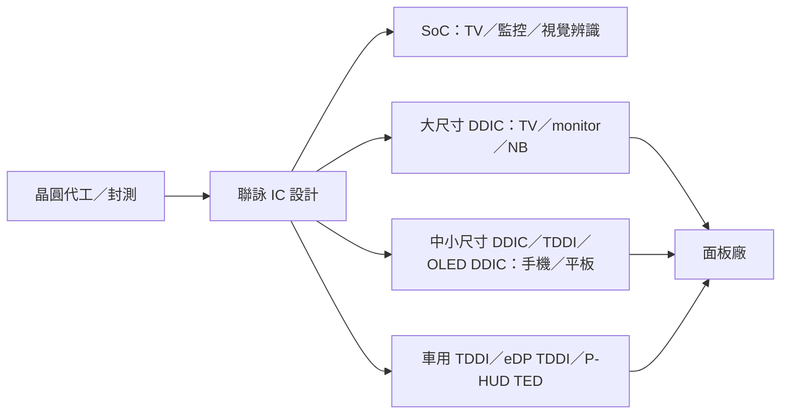

# 3034_聯詠（市）

## 基本資料

| 項目 | 內容 |
|------|------|
| 全名 | 聯詠科技股份有限公司（Novatek Microelectronics） |
| 代號 | 3034（TWSE 上市） |
| 定位 | 顯示驅動 IC（大尺寸 DDIC、中小尺寸 DDIC／TDDI／OLED DDIC）與 SoC（TV、監控等影像處理）IC 設計 |
| 3Q26 營收結構 | SoC 46%、中小尺寸驅動 IC 37%（2Q26 28%）、大尺寸驅動 IC 17%（2Q26 20%） |
| 3Q26 財務 | 營收 309.7 億元（QoQ +8.1%、YoY +26%）；毛利率 40.89%；營益率 22.87%；稅後淨利 60.8 億元；EPS 9.99 元 |
| 1～3Q26 | 營收 YoY +6%、毛利 YoY 約 +16%、營業利益 YoY +22%、稅後淨利 YoY +27.8% |
| 10 月營收 | 100.5 億元（YoY +27.6%）；1～10 月 928 億元（YoY +8.3%） |

資料來源：[[活動_聯詠3034_國泰CallMemo_20261106]]（國泰證期 call memo，2026-11-06；fact）。

## 核心技術／競爭優勢

- 大尺寸 DDIC：TV、monitor、NB 面板驅動 IC，觸控 NB 系列產品 2027 年陸續量產。
- 中小尺寸：手機 OLED DDIC 與 OLED TDDI（折疊機、高更新率高階機種），並延伸 NB、monitor、平板 OLED 方案；手機獨立 MEMC IC 以 12 奈米或以下先進製程為主，遊戲手機採用增加。
- 車用：車載 TDDI 採用車款大幅增加；eDP TDDI 為業界領先推出，4Q26 量產；全景抬頭顯示器（P-HUD）用 TED 為 2027 年新動能。
- SoC：電腦視覺辨識為核心技術，可延伸至無人載具、機器人與監控。

## 產品與應用

| 產品線 | 應用 | 2026-11 狀態 |
|--------|------|--------------|
| SoC | TV、監控、影像處理 | 4Q26 季減幅略大於中小尺寸（大尺寸面板相關出貨下滑，非面板 SoC 持平）；記憶體漲價稀釋毛利率 |
| 中小尺寸驅動 IC | 手機、平板、車用 | 4Q26 略減（平板庫存調整、非中國手機客戶備貨調整，中國手機 OLED 訂單增加） |
| 大尺寸驅動 IC | TV、monitor、NB | 4Q26 季減幅最大，NB 面板衰退最明顯 |

## 圖片 / 架構圖

圖說：聯詠位於晶圓代工與面板廠之間，以顯示驅動 IC 與 SoC 兩大產品線供應面板與終端；2026 年 AI 基建排擠記憶體與晶圓封測資源，是毛利率與終端需求的主要外部變數。本次來源無圖，暫以 Mermaid 補位。

## EPS 記錄

| 季度 | EPS（NT$） | 備註 |
|------|-----------|------|
| 3Q25 | 6.01 | 國泰 call memo |
| 2Q26 | 10.40 | 同上 |
| 3Q26 | 9.99 | 同上 |

## 財測（公司 guidance）

| 期間 | 營收 | 毛利率 | 營益率 | 假設 |
|------|------|--------|--------|------|
| 4Q26 | 280～292 億元 | 37～39% | 17～19% | USD/TWD 1:32 |
| 3Q26（實績對照） | 309.7 億元 | 40.89%（財測 38.5～41.5%） | 22.87%（財測 19～22%） | — |

- 4Q26 毛利率下滑三因：低成本庫存減少、產品組合、記憶體等關鍵零組件成本大漲稀釋 SoC 毛利率；所有 SoC 與 DDIC 產品皆已陸續調價反映成本。
- 2027 年部分晶圓與封測價格仍上漲（AI 需求資源排擠），與供應商協商中。
- 2026 年營業費用率與 2025 年約當、所得稅率 16～17% 指引不變；3Q26 存貨 180 億元（QoQ +35.7%）、存貨天數 85 天（2Q26 77 天）。

## 目標價與評等

| 券商 | 報告日 | 評等 | 目標價 | 評價基礎 | 來源 |
|------|--------|------|--------|----------|------|
| Morgan Stanley | 2026-11-08 | Underweight | NT$414 | 剩餘收益模型 | [[報告_MorganStanley_聯詠3034_20261108]] |
| 中信投顧 | 2026-11-09 | 中立 | NT$543（前次 NT$584） | 2027F EPS 36.2 元 × 15 倍 | [[報告_中信_聯詠3034_20261109]] |

## 近期營運與研究更新

### 2026-11-08～09 3Q26 法說後券商更新（MS UW／中信中立）

- **3Q26：** 營收 309.7 億元（QoQ +8%、YoY +26%），較 MS 預估高 7%，接近財測高標；手機客戶季節性備貨帶動中小尺寸 DDIC 出貨增加。毛利率 40.89%（QoQ −1.53ppt），因 SoC 占比下降、SMDDIC 占比提高及成本上漲與調價時間差；營業費用下降使營業利益 QoQ +9.6%；淨利 60.77 億元（QoQ −3.97%、YoY +66.26%），2Q26 有 NT$860mn 一次性投資利益；EPS 9.99 元。
- **4Q26：** 中信認為營收財測符合市場、毛利率財測低於市場（低價庫存減少、組合、記憶體 KGD 成本推升 SoC 成本）；大尺寸 DDIC 季減最多（TV、monitor、NB 需求弱，NB 最明顯），SoC 次之，中小尺寸小幅季減（平板與非中系手機庫存調整；MS 提及中國 OLED 手機訂單轉強）。
- **新品：** 車用 eDP TDDI 4Q26 量產，P-HUD TED 2027 年貢獻；Touch NB 2027 年量產；OLED DDIC 擴展至筆電、顯示器與平板，並開發摺疊等高階手機 OLED DDIC 與 TDDI；2026 年手機 OLED DDIC 出貨 YoY 下滑。管理層預期新品支撐 2027 年營收成長，但未給量化目標或毛利率持平保證（MS）。
- **成本：** SoC 與 DDIC 已全面調價，但記憶體價格高檔將壓抑消費需求至 2027 年；晶圓代工與封測再漲價仍在協商，獲利取決於組合與轉嫁速度。
- **券商觀點：** MS 維持 Underweight、PT NT$414（收盤價 NT$495.5）；中信維持中立，TP 由 584 元降至 543 元，2026／2027 年 EPS 估 34.75／36.2 元，風險為消費需求不如預期與 Edge AI 成長放緩。

來源：[[報告_MorganStanley_聯詠3034_20261108]]（Morgan Stanley，2026-11-08）、[[報告_中信_聯詠3034_20261109]]（中信投顧，2026-11-09）；財報 fact，展望 guidance／estimate，信心中高。

## 時間軸

| 時間 | 事件 | 類型 | 重要性 | 備註 |
|------|------|------|--------|------|
| 2026-11-06 | 3Q26 法說：EPS 9.99；4Q26 三大產品線皆季減，財測營收 280～292 億元 | 法說 | ⭐⭐⭐ | [[活動_聯詠3034_國泰CallMemo_20261106]] |
| 4Q26 | 車用 eDP TDDI 開始量產 | 量產 | ⭐⭐ | 公司說法，2027 年貢獻營收 |
| 2027 | 觸控 NB 驅動 IC 陸續量產；P-HUD 用 TED 新品 | 放量 | ⭐⭐ | 公司說法 |

## 供應鏈位置

- 上游：晶圓代工與封測（2027 年部分價格仍上漲）；記憶體為 SoC 方案關鍵零組件。
- 下游：面板廠與 TV、monitor、NB、手機、平板、車用品牌。
- 本頁不新增 `related_companies`：本次來源未點名具體客戶或供應商。
- 同業比較：[[3592_瑞鼎（市）]]（同為 DDIC／車載 TDDI）；MS 2026 年對聯詠評等 UW 見 [[2458_義隆（市）]] 與 [[分析_面板供需與成本壓力_20260922]]。

## 相關公司

| 公司 | 關係 | 說明 |
|------|------|------|
| [[3592_瑞鼎（市）]] | 同業 | DDIC、車載 TDDI、OLED DDIC 皆重疊 |

> [!warning] 風險與注意事項
> - 記憶體價格高檔導致品牌系統廠 1H26 提前拉貨，4Q26 起 NB、TV、monitor 進入庫存調整，2027 年手機、PC、NB 出貨待觀察。
> - 晶圓、封測與記憶體成本上漲壓縮 SoC 毛利率；美國期中選舉後亦被公司列為 2027 年變數。
> - 2026 年手機 OLED DDIC 出貨減少（全球手機需求衰退與中國品牌市占變化）。

## 來源

- [[活動_聯詠3034_國泰CallMemo_20261106]] — 國泰證期 call memo，2026-11-06；3Q26 法說、4Q26 財測、車用 eDP TDDI 量產。

- [[報告_MorganStanley_聯詠3034_20261108]]（2026-11-08）
- [[報告_中信_聯詠3034_20261109]]（2026-11-09）

## 相關頁面

- [[3592_瑞鼎（市）]]
- [[分析_面板供需與成本壓力_20260922]]
- [[時程_2026Q3Q4_AI網通與硬體催化劑]]
