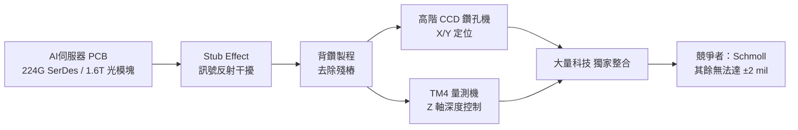

# 3167_大量科技（市）

## 基本資料

成立於 1980 年，總部位於桃園市八德區，前身為大量工業，2000 年更名為大量科技。PCB 設備與 CNC 彫銑機械製造商，兼具半導體產品檢測設備業務。2004 年登錄興櫃，2013 年轉上市。

核心競爭優勢在於**自主開發控制器**：全球能自製 PCB 鑽孔機控制器的廠商，除歐洲、日本外，台灣僅大量，中國同業多依賴外購。高階背鑽領域主要競爭者為德國 Schmoll。

## 核心技術／競爭優勢

- **CCD 高階背鑽機**：整合 CCD 視覺量測與深度控制，機台須先「看」內層漲縮位置建立靶位再鑽孔，解決 PCB 壓合變形造成的鑽偏問題。精度達 ±2 mil，為 NVIDIA Rubin 世代指定規格。
- **TM 系列量測機（TM4）**：Thickness Metrology，透過 z 軸量測內層孔洞深度並即時回饋至背鑽系統。TM4 為四軸新世代，1 台可支援 8 台背鑽機，大幅提升板廠稼動率。CCD 背鑽機 + TM4 量測機捆綁銷售，形成完整精度解決方案。
- **深度控制**：位移精度 D+4（優於業界 D+6），CPK > 1.67，業界唯一能量產殘留銅厚趨近 0 mil 的廠商。多國專利（台灣 I768701、中國 6252475、美國）。
- **半導體設備**：CMP 監控、Step-height 量測、Wafer 邊緣量測、FOPLP 翹曲量測、AOI 等。已切入 TSMC、日月光、力成、京元電子等先進封裝供應鏈。

## 產品與應用

| 產品 / 服務 | 應用 | 單價 / 毛利 |
|-------------|------|------------|
| 一般 CNC 鑽孔機 | PCB 通孔 | 約 TWD 200 萬，毛利 20–30% |
| 高階 CCD 背鑽機 | AI 伺服器、光模塊 PCB 背鑽 | USD 300K+（約 3X 一般機），毛利 50%+ |
| TM4 量測機 | 背鑽深度精度量測 | 捆綁 CCD 銷售 |
| 玻璃邊緣塗佈機（HCoater） | 玻璃基板邊緣處理 | 佔比 5%，毛利優於背鑽 |
| 半導體量測 / AOI | CoWoS / FOPLP 先進封裝 | 百萬至千萬級，毛利 35%+ |

## 圖片 / 架構圖

![[報告_統一_大量_20260922_003.png]]

圖說：統一投顧估 25–28 年在 Rack 數、PCB 面積、板層數、機鑽孔數、鑽孔時間與背鑽滲透率同步提升下，背鑽需求倍數成長，機鑽設備成為板廠擴產瓶頸；即使 26 年背鑽供應商滿載擴產，到 28 年仍將出現數倍缺口。（來源：[[報告_統一_大量_20260922]]，2026-09-22）

## EPS 記錄

| 年度 | 營收 | 毛利率 | 備註 |
|------|------|--------|------|
| 2024 | ~22.5 億 | — | 庫存去化後反彈 |
| 2025 | 50.77 億 | 39% | 前 11 月累計 45.18 億，年增 >100% |

- 2025H1 EPS：3.01 元；2025/1–7 月累計 EPS：3.81 元
- 2025Q2 EPS：1.99 元，毛利率 38.86%
- 交貨期從 2 個月拉長至 7 個月（2024 年需求爆發）

> [!info] 來源日期
> 財務數據來自 2025Q2 法說會（2025-08-11）及 2025 年 12 月優分析報導，EPS 為前期數據，非 2026 年預測。

## EPS 預估

| 年度 | 統一投顧 EPS（報告日：2026-09-22） | 備註 |
|------|------------------------------------|------|
| 2025E | 8.11 | 統一整理 |
| 2026E | 28.24 | 高階設備出貨上修至 ~1,400 台；營收 125 億（+146% YoY） |
| 2027E | 70.04 | 出貨上修至 ~2,400 台；營收 229 億（+83% YoY） |

| 年度 | 中信投顧調整後 EPS（報告日：2026-10-19） | 備註 |
|------|------------------------------------|------|
| 2026E | 31.73 | 營收 126.9 億（+150% YoY）；4Q26E EPS 12.13、毛利率 52.3% |
| 2027E | 88.07 | 營收 267.3 億（+111%）；毛利率 55.9%；TM 貢獻 27.28 元（約 31%） |
| 2028E | 126.19 | 營收 358.7 億（+34%）；TM 貢獻 42.47 元（約 34%） |

> 統一 2026-09-22 大幅上修：26-27 高階設備出貨由原估 1,000–1,500 台 → 1,400–2,400 台；EPS 由原估 27／43 元 → 28／70 元；2Q26 單季 EPS 6.10（優於預期）。
> [!note] 早期社群 memo（2026-05-24）以倍數估算 2025/2026E EPS，已由統一投顧正式報告取代。

## 目標價與評等

| 券商 | 報告發布日 | 評等 | 目標價 | 評價基礎 | 來源 |
|------|------------|------|--------|----------|------|
| 統一投顧 | 2026-09-22 | 強力買進（維持） | NT$1,540（原 NT$1,220） | 22x 2027E EPS 70.04 | [[報告_統一_大量_20260922]] |
| 中信投顧 | 2026-10-19 | 買進（首次覆蓋） | NT$2,000 | 23x 2027E 調整後 EPS 88.07 | [[報告_中信_大量3167_20261019]] |

## 產能與訂單

- 月產能約 300 台（2025 年底擴至 300 台，南京廠 2025Q4 投產，目標 +20%）
- 2025 年底在手訂單 > TWD 30 億，訂單能見度延伸至 2026H2
- 高階 CCD 背鑽機台能見度達 2026H1（2025-07 公告）
- TM4 四軸新機型：2026Q1 上海展發表，2026H2 全面放量

## 市場格局

- CCD 背鑽高精度（±2 mil）：大量 + Schmoll（德），中國大族用電測方案精度較弱
- 一般鑽孔機：中國廠月出千台，大量走差異化高階路線
- 光模塊成型機：大量全球市占率最高
- AI 伺服器帶動通孔製程也需 CCD（TAM 大幅擴增，通孔台數 > 背鑽台數）

## 時間軸

| 時間 | 事件 | 類型 | 重要性 |
|------|------|------|--------|
| 2025-05 | TM4 開始出貨 | 放量 | ⭐⭐⭐ |
| 2025Q4 | 南京廠投產，月產能 +20% | 產能 | ⭐⭐ |
| 2026Q1 | TM4 上海展正式發表 | 里程碑 | ⭐⭐ |
| 2026H2 | TM4 全面放量 | 放量 | ⭐⭐⭐ |
| 2026Q2 | 2Q26 EPS 6.10（優於預期），淨利率由 4 月 21% 升至 6 月 33% | 財報 | ⭐⭐⭐ |
| 2026 | 總月產能達 ~400 台滿載（200 高階背鑽 + 200 標準 + 50 外包），全年出貨估 >1,000 台 | 產能 | ⭐⭐⭐ |
| 2026H2 | TM4 四軸機出貨，拉貨比由 8:1 提升至 5:1（背鑽:TM4） | 放量 | ⭐⭐⭐ |
| 2026-08-01 | 半導體事業分割為 100% 子公司「大量先進智能」，為上市櫃預作準備 | 公司事件 | ⭐⭐ |
| 2027 | 高階設備出貨估 >2,000 台；外包產能由 80 擴至最高 150 台 | 放量 | ⭐⭐⭐ |
| 2027Q1 | CPO Inspection Sorting Machine 有望出現明確訂單 | 驗證 | ⭐⭐ |
| 2027 | TM4 帶動再成長高峰（預估）| 放量 | ⭐⭐⭐ |
| 1H27 | 鑽孔機營收占比回升（出貨至認列約 3 個月），外包標準機擴至 100 台／月（Nomura 轉述） | 產品組合／產能 | ⭐⭐ |
| 2026-09 | 9 月自結稅後淨利 3.5 億（+542.9% YoY）、單月 EPS 3.82，推估毛利率 54–55%（TM4 出貨） | 財報 | ⭐⭐⭐ |
| 4Q26 | 客戶於一鑽通孔段導入高階 CCD 鑽孔機（中信預期） | 製程導入 | ⭐⭐⭐ |
| 2027 | 1.6T 光模組量產帶動 CCD 成型機（精度 25µm 內） | 放量 | ⭐⭐⭐ |

## 供應鏈位置

大量科技為 PCB 設備製造商，處於 PCB 設備上游，下游為 PCB 廠（AI 伺服器板、光模塊板）。

- 設備競爭者（PCB 高階）：Schmoll（未）（德國）
- 半導體設備客戶：[[2330_台積電（市）]]、[[3711_日月光投控（市）]]

## 相關公司

| 公司 | 關係 | 說明 |
|------|------|------|
| Schmoll（未） | 競爭者 | 高階 CCD 背鑽唯二玩家 |
| [[2330_台積電（市）]] | 半導體設備客戶 | CMP、Step-height、CoWoS 量測 |
| [[3711_日月光投控（市）]] | 半導體設備客戶 | 先進封裝 AOI 量測 |
| [[3037_欣興（市）]] | PCB 設備客戶 | 中信 2026-10-19：主要台系板廠客戶，2026 capex 540 億 |
| [[4958_臻鼎（市）]] | PCB 設備客戶 | 中信 2026-10-19：2026 capex 逾 800 億 |
| [[2368_金像電（市）]] | PCB 設備客戶 | 中信 2026-10-19：2026 capex 190 億 |

## 來源
- [[memo_大量科技背鑽CCD_TM4_20260524]]
- 數位時代專訪 2026-01-15
- 鉅亨網法說會報導 2025-08-11
- 富果直送法說備忘錄 2025-08-11 / 2025-12-08
- Dcard 法說整理 2026-03-13

- [[memo_大量聯鈞_2Q26法說_20260818]]（2026-08-18）
- [[活動_大量3167_法說與TakeAway_20260818]] — 國泰證期 Call Memo（2026-08-18）＋券商 Take away（2026-09-04）；2026-10-04 LINE 法說彙整收錄
- [[報告_統一_大量_20260922]]（統一投顧，2026-09-22；強力買進、TP NT$1,540、機鑽結構性擴張、TM4、半導體切入、EPS 28/70）
- [[Nomura tech tour]]（Nomura Asia Tech Tour，2026-08-20；產能／外包、成型與鑽孔組合、TLSmart 分割；未評等）
- [[報告_中信_大量3167_20261019]]（中信投顧，2026-10-19；首次覆蓋買進、TP NT$2,000、TM4／一鑽 CCD／1.6T 成型）

## 相關頁面

- [[分析_2026-10-19_OCP後AI硬體與PCB設備券商更新]]
- [[供應鏈_AI伺服器PCB]]
- [[技術_背鑽]]
- [[技術_PCB]]
- [[分析_大量與聯鈞_2Q26法說_20260818]]
- [[技術_CPO]]
- [[時程_2026Q3Q4_AI網通與硬體催化劑]]
- [[時程_2026記憶體與AI催化劑]]
- [[技術_PTFE]]

### 2026-08-18 2Q26 法說整理

- 使用者轉述月產能由 300 台提升至 400 台，高階與標準設備各 200 台，4Q26 另可能外包 50 台標準型；屬公司展望，待法說原始資料核對。
- 高階 CCD 成型／鑽孔設備開始切入 CPO 與 1.6T 光模組市場；TM4 每台可能帶動 5–6 台高階鑽孔機，延伸既有 224G SerDes 背鑽需求。
- 高階 CCD ASP 約為標準型 2 倍、TM4 超過 3 倍，2026 高階產品占比目標 60%；設備 mix 比單純台數更值得追蹤。
- 半導體設備業務規劃申請上櫃，長期營收占比約 5–8%；屬公司規劃，非已完成掛牌。

來源：[[memo_大量聯鈞_2Q26法說_20260818]]（使用者提供法說整理，2026-08-18）。

### 2026-09-22 統一：機鑽與量測需求提升，產能滿載

- 統一維持強力買進、目標價由 NT$1,220 上修至 NT$1,540（22x 2027E EPS 70.04）；2Q26 營收 28.6 億（+47% QoQ、+125% YoY）、毛利率 44.2%、EPS 6.10（皆優於預期），淨利率由 4 月 21% 升至 6 月 33%。
- **結構性擴張（統一供應鏈觀察）**：25–27 年 NV AI Server 機櫃出貨由 2.5 萬櫃 → 8 萬櫃（CAGR +79%），PCB 由 GB300 22–24 層 → VR 26–44 層 → Rubin Ultra 26–78 層；SerDes 由 112G→224G，殘銅精度要求由 ±3mil→±2mil，推升 CCD 背鑽與 TM 量測滲透率。
- **TM 量測護城河**：TM 只能與大量高階背鑽機搭配，同業無法兼容；拉貨比由 8:1 提升至 5:1（背鑽:TM4），並反向提升高階背鑽市占。合約負債由 25 年底 7.5 億升至 2Q26 15 億，在手訂單估 >75 億（超過 25 年全年營收）。
- **產能與半導體**：總月產能 ~400 台滿載（200 高階 + 200 標準 + 50 外包），2026 出貨估 >1,000 台、2027 >2,000 台；半導體事業（CoWoS/FOPLP/SoIC/CPO 量測）2026-08-01 分割為子公司「大量先進智能」，26-27 翻倍成長、營收占比 5–10%。
- 上修後預估 26/27 年營收 125／229 億（+146%／+83% YoY）、EPS 28／70 元。來源：[[報告_統一_大量_20260922]]（統一投顧，2026-09-22；信心中）。

### 2026-08-18 國泰 Call Memo 與 2026-09-04 券商 Take away 補充

- **國泰（2026-08-18）：** 1H26 營收 48.05 億元（YoY +127.3%）、EPS 約 9 元；2025 年中國、東南亞、台灣營收占比 68.7%／21.7%／9.6%；高階 CCD 成型機切入 CPO 與 1.6T 光模組（接合墊至板邊精度 25μm，800G 為 50μm）；玻璃板邊塗布機可用於玻璃中介層與 AR 眼鏡，2026 年貢獻有限；大量先進智能上市後母公司持股維持 60% 以上、中長期占合併營收 5–8%；半導體設備聚焦 CoW、SoIC、FOPLP、CoPoS 與 CPO 的 AOI 與量測。
- **券商 Take away（2026-09-04，estimate）：** 預估 2027 年營收 256.9 億元、EPS 88.45 元（買進）；產能以標準型計 400 台／月、全做高階約 300 台；4Q26 起外包標準機約 50 台／月，1Q27 第二家外包廠約 80 台、年底希望 150 台，高階機不外包；在手訂單接到 1Q27，高階機交期 4 個月起；TM4 今年雙位數台出貨、明年數倍成長；TM4：CCD Driller 約 1：5–6；標準機市占約 30%；ASP 比 Commodity：Premium：TM4＝1：2：>3。
- **半導體（券商筆記）：** 在手約 100 台、能見度至 1H27，有機會上看 200 台以上，2026 年半導體營收估 14.4 億元；2025 年客戶 Foundry 46%／OSAT 49%／ODM 5%，應用 CoWoS 75%、FOPLP 14%、SoIC 11%；CPO 預估 1Q27 需求大幅成長；TL Smart（大量先進智能）一年內申請上櫃。
- 以上 EPS 與營收預估與統一（2026-09-22，2027E EPS 70.04 元）口徑不同，並列保留。

### 2026-08-18～19 Nomura Asia Tech Tour

- **市場地位（公司自述）**：全球前三大 PCB 機械鑽孔／背鑽設備商，CCD 精密對位能力強；全球最大 PCB 成型機（router）廠，光模組 PCB 成型居領先地位。Nomura 未評等（Not rated）。
- **產能與外包**：目前管理 300–400 台／月鑽孔＋成型產能；2026 年初啟動外包，今年經外包夥伴增加 50 台／月標準機，2027E 擴至 100 台／月，再往上可能需更多夥伴。
- **產品組合**：1H26 高階機（premium）占營收 >60%，其中鑽孔與成型各半；成型機受光模組需求帶動，2H26 成型機營收預期高於鑽孔。鑽孔動能 2H26 回升，因出貨至認列約 3 個月落差，1H27 鑽孔營收占比將提高。
- **半導體子公司**：8 月將半導體設備事業分割為子公司 TLSmart（大量先進智能，未上市），產品涵蓋先進封裝量測、檢測與自動化；領先晶圓代工與 OSAT 各占約一半量，另有 SoIC、CoPoS／FOPLP 與 CPO 用機台。

> [!warning] 外包產能口徑
> Nomura（2026-08-20）：2026 年外包 +50 台／月、2027E 100 台／月。2026-09-04 券商 Take away：1Q27 第二家外包約 80 台、年底希望 150 台。統一（2026-09-22）時間軸寫外包由 80 擴至最高 150 台。三者時點與是否含第二家外包廠不同，並列保留；屬公司說法轉述，信心中。

來源：[[Nomura tech tour]]（Nomura Asia Tech Tour，2026-08-18～19 會議、2026-08-20 發布）。

### 2026-10-19 中信投顧首次覆蓋：獲利大量，前途無量

- **評等**：買進、目標價 NT$2,000（23x 2027E 調整後 EPS 88.07），潛在漲幅約 90%；風險為 TM 拉貨不如預期、同業競爭加劇。
- **9 月自結**：稅後淨利 3.5 億元（+542.9% YoY）、單月 EPS 3.82，推估毛利率 54–55%，主因高毛利 TM4 開始出貨與 CCD 機種組合上升；4Q26E 營收 42.1 億（+14.6% QoQ）、毛利率 52.3%（estimate）。
- **TM4 經濟性**：四軸 TM4 throughput 為前代 4 倍、單價 1.5–2 倍、毛利率逾 70%；CCD 背鑽機：TM 採購比由 8:1 升至 5–6:1，長期可望往 2:1；TM 只能搭配自家 CCD 背鑽機，大族與 Schmoll 目前無對應 Z 軸量測方案。
- **規格驅動**：NVIDIA Blackwell→Rubin 訊號頻率 28→56GHz，背鑽殘銅精度由 ±3 mil 收斂至 ±2 mil；對位度業界仍為 D+6 mil，尚未要求 D+4 mil。詳見 [[技術_背鑽]]。
- **一鑽導入 CCD**：SerDes 112G→224G 使孔環縮小，一鑽 XY 精度要求比照背鑽，已有客戶導入；1.6T 光模組成型精度需 25µm 內（800G 為 50µm），大量 CCD 成型機市占逾 40%。
- **產能**：自有月產能由 3M26 的 300–350 台升至 400 台（全做高階約 300 台）；外包 4Q26 50 台、1H27 80 台、2H27 150 台（中信 estimate），已啟用第二家外包廠。訂單排至 2Q27，部分客戶預約 2H27 出機；高階 CCD／標準機交期約 4／3 個月。
- **客戶資本支出**：主要客戶欣興、臻鼎、金像電 2026 年 capex 分別 540 億、逾 800 億、190 億元，合計逾 1,530 億，占 TPCA 估全年 PCB capex 2,300 億元逾 6 成。
- **大量先進智能**：2026-08-01 分拆完成，母公司掛牌後持股約 60%；半導體營收 2022→2025 由 0.3 億增至 3.1 億（CAGR 117%），2025 年 CoWoS 約 75%；CPO 檢測分選設備驗證中，2027 年需求逐步顯現。

![[報告_中信_大量3167_20261019_012.png]]
*中信 2026-10-19：CCD 背鑽：TM 出貨比例（9:1 至 1:1）與 TM 月產能情境下的大量 2027E EPS 敏感度；TM 比重越高，EPS 越高。*

> [!warning] 來源口徑差異
> - TM4 出貨起點：本頁時間軸（早期 memo）記 2025-05 開始出貨；中信 2026-10-19 寫「2026 年開始出貨四軸 TM4」。
> - TM4 帶動台數：早期 memo 寫 1 台 TM4 支援 8 台背鑽機；中信與 2Q26 法說寫 1 台約帶動 5–6 台 CCD 鑽孔機。
> - 2027E EPS：統一 70.04、券商 Take away 88.45、中信 88.07，口徑不同並列保留。

來源：[[報告_中信_大量3167_20261019]]（中信投顧，2026-10-19；estimate 信心：中）。
