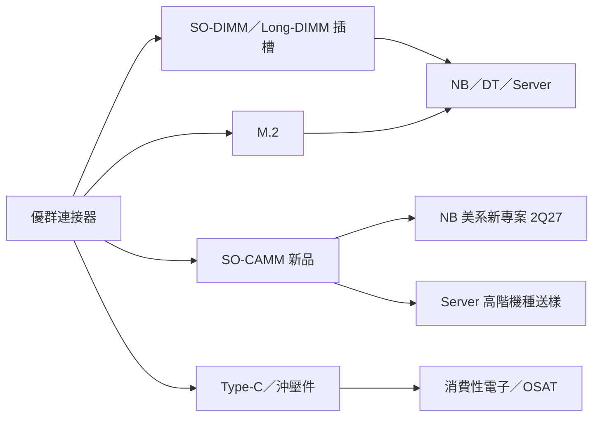

# 3217_優群（櫃）

## 基本資料

優群位於連接器產業鏈中游，產品為電腦、通訊與消費性電子用連接器與零組件，終端以 NB 為主，客戶包括 Intel、Apple、Lenovo、HP。生產基地為新竹（10%）、中國昆山（50%）、遂寧（40%）與越南。

- **2025 年產品結構**：SO-DIMM 36%、Long-DIMM 11%、M.2 27%、精密微型沖壓件（Micro stamping）8%、Type-C 10%、其他 8%。
- **3Q26（fact）**：營收 9.75 億元（QoQ +3%、YoY −14%），毛利率 46.06%（QoQ −1.4ppt，產品組合與 UTR 影響），EPS 2.83 元（台新預估 3.21 元，達成率 88%），業外收益挹注。
- **3Q26 產品比重**：SO-DIMM 27%（QoQ −25%）、M.2 24%（QoQ −6%）、Long-DIMM 11%（QoQ +12%）、Type-C 12%（QoQ −4%）、Metal Bar 11%（QoQ −9%）、其他 15%（QoQ +53%）。

資料來源：[[報告_台新_優群3217_20261119]]（台新投顧公司拜訪快報，2026-11-19）。

## 產品與應用

| 產品 | 應用 | 觀察 |
|------|------|------|
| SO-DIMM／Long-DIMM 插槽 | NB、DT、Server 記憶體 | 記憶體漲價、缺料與部分 NB 改 on-board 減少插槽用量，SO-DIMM 3Q26 大減 |
| M.2 連接器 | NB SSD 等 | 隨 NB 需求下滑 |
| SO-CAMM | NB（美系新專案 2Q27 放量）、Server 高階機種（試產／送樣） | Server SO-CAMM 可能是新成長動能（estimate／中） |
| Type-C、精密沖壓件、Metal Bar | 消費性電子、OSAT | — |

## 營運展望

- 管理層預估 2026 年終端營收占比：NB 60%、DT／Server 14%、OSAT 12%、Telecom 5%、其他 9%；2027 年在 Server 與 Telecom 成長下轉為 NB 50%、DT／Server 20%、OSAT 12%、Telecom 10%、其他 7.5%。
- 即使加入 SO-CAMM 美系 NB 新專案 2Q27 放量，NB 營收仍偏弱；公司目標 2027 年營收年增雙位數，毛利率希望與 2H26 相當。
- 台新預估 2026 年營收 36.99 億元（YoY −10.8%）、毛利率 46.9%、EPS 10.07 元；依過往配息率 78% 試算 2027 年配息 7.8 元，以股價 104.5 元計殖利率 7.4%，定位殖利率標的（estimate／中）。

## 目標價與評等

| 券商 | 日期 | 評等 | 目標價 | 依據 | 來源 |
|------|------|------|--------|------|------|
| 台新投顧 | 2026-11-19 | 買進（維持） | 130 元（原 180） | 2027F EPS 10.10 元（原 15.02） | [[報告_台新_優群3217_20261119]] |

## 圖片 / 架構圖

圖說：優群營收仍以 NB 記憶體與儲存插槽為主；2027 年成長寄望 Server（含 SO-CAMM）與 Telecom，NB 比重由 60% 降至 50%。

## 時間軸

| 時間 | 事件 | 類型 | 重要性 | 備註 |
|------|------|------|--------|------|
| 2Q27 | SO-CAMM 美系 NB 新專案放量 | 放量 | ⭐⭐ | [[報告_台新_優群3217_20261119]] 公司說法／中 |
| 2027 | 營收目標年增雙位數，Server 與 Telecom 為動能 | 營運目標 | ⭐⭐ | 公司目標，非財測 |

## 供應鏈位置

- 上游：銅材、塑膠與電鍍；下游：NB／PC 品牌與 ODM、伺服器、電信設備、OSAT。
- 同業參考：[[3533_嘉澤（市）]]（CPU／記憶體插槽，AI 伺服器比重較高）。

## 相關公司

| 公司 | 關係 | 說明 |
|------|------|------|
| [[INTC.US(intel)]] | 終端客戶 | 台新列為終端客戶 |
| [[AAPL.US(apple)]] | 終端客戶 | 台新列為終端客戶 |
| [[3533_嘉澤（市）]] | 同業 | 記憶體與 CPU 插槽；本頁僅作產品比較，來源未提及 |

## 風險與注意事項

> [!warning] 風險
> - 記憶體漲價與缺料延續，壓抑 NB 出貨與插槽用量；NB 改 on-board 設計減少 SO-DIMM 需求。
> - SO-CAMM Server 高階機種仍在試產／送樣，放量時點未確認。

## 2026-11-23 國票：消費電子偏弱，靜待伺服器新品放量（區間操作，TP NT$234→114）

- 3Q26：營收 9.75 億元（季增 2.9%、年減 13.8%）；DRAM 缺貨漲價使筆電改採板載設計，SO-DIMM／M.2 銷售年減 36%／20%，CAMM 出貨季增 10 倍仍不足以彌補；毛利率 46.06%，EPS 2.84 元，低於預期（fact）。來源 [[報告_國票_優群3217_20261123]]。
- 4Q26：10 月營收 2.58 億元（年減 25.9%）；預估 4Q26 營收 8.25 億元、EPS 2.31 元，Long-DIMM、Type-C、微型沖壓件與電信通訊產品（2026 年 9 月起出貨）延續成長（estimate）。
- 2027 年：Google 伺服器新專案 2026 年 11 月試產、1Q27 越南廠量產；筆電營收占比 60%→50%、伺服器＋桌機 14%→20%、電信通訊 5%→10%；CAMM2 隨 HP 新機 1H27 導入，SOCAMM2（694-pin）送樣測試中（thesis／中）。
- 新品：CAMM2 666p、SOCAMM2、M.2 Gen 6、DDR6 426p DIMM Socket、7A×48V（336W）Type-C、模組化 Type-C。
- 預估：2026/27 年 EPS 10.35/11.47 元（下修約 26%）。

## 來源

- [[報告_國票_優群3217_20261123]]（國票，2026-11-23；區間操作，TP NT$234→114，Google 伺服器新案 1Q27 量產）
- [[報告_台新_優群3217_20261119]] — 台新投顧，2026-11-19；3Q26 EPS 2.83 元、2027 年營收目標雙位數，買進 TP 130 元（原 180）。

## 相關頁面

- [[3533_嘉澤（市）]]
