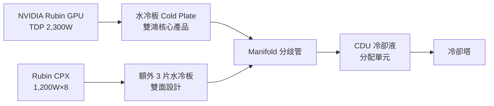

# 3324_雙鴻（市）

## 基本資料

雙鴻科技（3324 TT）成立於 1998 年，是台灣前二大筆電散熱模組廠，近年積極轉型為 AI 伺服器液冷解決方案供應商。主要產品：散熱器/散熱模組（NB/DT/VGA/Server）、水冷板（Cold Plate）、Manifold（分歧管）、CDU（冷卻液分配單元）、VC Lid。

2Q25 產品組合：Server 45%（液冷 23% + 氣冷 22%）、NB 31%、VGA 21%、Others 3%。

成長驅動：GB300/Vera Rubin AI 伺服器水冷板需求增加（Rubin CPX 全水冷）、每機櫃水冷用量提升（QD 從 6+2 增至 10+2）、泰國二廠 2026H1 開出。

主要客戶品牌：Apple、Dell、Samsung、HP、宏碁、華碩、聯想；代工廠：廣達、仁寶、[[3231_緯創（市）]]、英業達。

資料來源：[[報告_中信_雙鴻3324_20250917]]（2025-09-17，中信投顧，鄭子凡）

## 核心技術／競爭優勢

- **水冷板技術規模**：月產能約 30 萬片水冷板，Rack Manifold 4,000 套；泰國廠為非中國產能，符合地緣政治分散需求
- **液冷比重快速提升**：從 4Q24 低點 8% 回升至 2Q25 的 23%，3Q25 望升至 34%，4Q25 逼近 40%
- **VC Lid + MCL 技術佈局**：VC Lid 送樣中；MCL 1H25 開始研發；中期 MCL 若採用可推升 ASP，但目前水冷板仍為主力
- **CDU 自製**：台灣廠專責生產 CDU，月產能 500–1,000 台，隨新案導入成長
- **QD 自設計**：GB300 QD 由雙鴻自行設計、委外生產，強化系統整合能力

## 產品與應用

| 產品 / 服務 | 應用 | 相關客戶 / 下游 |
|-------------|------|-----------------|
| AI 伺服器水冷板（Compute/Switch Tray） | GB300/Rubin GPU 伺服器液冷 | ODM 廠（廣達/仁寶/[[3231_緯創（市）]]/英業達）|
| Rubin CPX 水冷板（3片額外，雙面散熱） | AI 推理加速器液冷 | [[NVDA.US(nvidia)]] 生態系 |
| CDU（冷卻液分配單元） | 機架級液冷系統 | 資料中心建設商 |
| NB / DT 散熱模組 | 筆電/桌電散熱 | Apple、Dell、Samsung 等 |
| VC Lid | GPU 均熱蓋板（Rubin 世代） | [[NVDA.US(nvidia)]] 封裝供應鏈 |

## 圖片 / 架構圖

![[報告_JPM_雙鴻2Q26_20260810_001.png]]

圖說：J.P. Morgan 2026-08-10 報告的股價與相對市場走勢，對照 GB300 出貨、液冷比重與毛利率變化。

`[待補來源圖]` 需官方 IR 或型錄熱管散熱模組產品實拍佐證；上方為自製散熱架構示意圖。

> Rubin CPX 架構讓水冷板用量從 GB300 的 6+2 增至 10+2，大幅提升雙鴻單機櫃受惠程度。

## EPS 記錄

| 季度 | EPS (元) | YoY | 備註 |
|------|---------|-----|------|
| 1Q25 | 5.54 | +29.2% | |
| 2Q25 | 1.75 | -75.0% | 認列 4.4 億匯損，非業務因素 |
| 3Q25(F) | 7.83 | +81.5% | GB300 + S客戶回溫 |
| 4Q25(F) | 9.16 | +81.1% | 液冷比重逼近 40% |

## EPS 預估

| 年度 | 中信投顧 EPS（報告日：2025-09-17） | 備註 |
|------|-----------------------------------|------|
| 2025F | 24.28 | +17.6% YoY（匯損壓抑 2Q25） |
| 2026F | 45.00 | +85.3% YoY（水冷放量 + 新廠）|

J.P. Morgan（2026-08-10）預估 2026E/2027E EPS 為 NT$54.2/67.2，分別較前估上修 4%/16%；estimate／中信心。

## 目標價與評等

| 券商 | 報告發布日 | 評等 | 目標價 | 評價基礎 | 來源 |
|------|------------|------|--------|----------|------|
| 中信投顧 | 2026-11-19 | 買進（維持） | 1,755 元（原 1,630） | 18x 2027F 完全稀釋 EPS 97.45 元 | [[報告_中信_雙鴻3324_20261119]] |
| 元大投顧 | 2026-11-19 | 買進（維持） | 1,325 元（原 2,000） | 18x 2027F EPS 73.68 元（前次 22x） | [[報告_元大_雙鴻3324_20261119]] |
| 台新投顧 | 2026-11-19 | 買進（維持） | 1,200 元（原 1,800） | 2027F EPS 76.62 元（原 90.36） | [[報告_台新_雙鴻3324_20261119]] |
| 統一投顧 | 2026-11-19 | 買進（維持） | 1,370 元 | 14x 2027F EPS 97.78 元 | [[報告_統一_雙鴻3324_20261119]] |
| Macquarie | 2026-11-18 | Outperform（維持） | TWD1,950 | PER（評價區間 1,600–1,950） | [[報告_Macquarie_雙鴻3324_20261118]] |
| Daiwa | 2026-10-28 | Buy (1) | TWD2,180（原 1,600） | 22x 2027E EPS（0.4x PEG） | [[報告_Daiwa_雙鴻3324_20261028]] |
| 中信投顧 | 2025-09-17 | 買進（首次） | 990 元 | 22x 2026F EPS | [[報告_中信_雙鴻3324_20250917]] |
| 凱基投顧 | 2026-06-16 | 增加持股 | 1,450 元 | — | [[凱基-電子硬體產業-20260616]] |
| J.P. Morgan | 2026-08-10 | Neutral | 1,200 元 | 18x 2027E P/E | [[報告_JPM_雙鴻2Q26_20260810]] |
| Nomura | 2026-08-20 | Buy（重申） | 1,840 元 | 23x 2027F EPS 80.01 元 | [[Nomura tech tour]] |

凱基 2026F EPS：59.27 元（YoY +109.7%）；2027F EPS：81.87 元

## 時間軸

| 時間 | 事件 | 類型 | 重要性 | 備註 |
|------|------|------|--------|------|
| 2025Q3 | GB300 水冷板出貨至 ODM 廠，S 客戶回溫 | 放量 | ⭐⭐⭐ | 液冷比重升至 34% |
| 2025Q4 | 液冷出貨比重逼近 40% | 放量 | ⭐⭐⭐ | |
| 2026H1 | 泰國二廠開出產能 | 擴產 | ⭐⭐ | 分散地緣風險 + 增量 |
| 2026-06（Computex） | **展示 Water-to-Water in-row CDU**（解熱 2MW、可支援 10+ IT 機櫃）及 Sidecar 液冷解決方案；業界已全面備妥 200kW+ 機架需求 | 里程碑 | ⭐⭐⭐ | 雙鴻 in-row CDU 已可支援 AI 機櫃全面轉液冷 |
| 2026 | Rubin CPX 系統量產 | 放量 | ⭐⭐⭐ | QD 10+2，水冷用量大增 |
| 2H26 | MCL（Micro-Channel Lid）潛在導入評估 | 技術升級 | ⭐⭐ | 若採用 ASP 大幅提升，但時程存疑 |
| 2026Q3 | GB300 延遲訂單回補 | 放量 | ⭐⭐⭐ | 7 月營收月增 39%；報告估 3Q26 營收季增 18% |
| 2026Q4 | AWS Trainium 3 水冷板、inner/rack manifold 初期貢獻 | 放量 | ⭐⭐⭐ | estimate／中信心；同期含 VR200 manifold 需求 |
| 2026Q4 | Vera Rubin 初期營收開始（公司預期） | 放量 | ⭐⭐⭐ | Nomura Tech Tour 2026-08-20；Citi 稱 VR 冷板最早 1Q27，見 warning |
| 1Q27 | Blackwell 急單（neocloud）可能延續至此 | 訂單 | ⭐⭐ | Nomura 轉述公司能見度 |
| 2027 | CDU 占液冷營收由約 5% 升至約 10%（sidecar 專案） | 產品組合 | ⭐⭐ | 公司預期／中 |
| 2027 | ASIC 液冷出貨可能超過 GPU，Server 占營收 90%、液冷約 80% | 放量 | ⭐⭐⭐ | 2026-11-18 法說公司指引 |
| 2Q27–3Q27 | 公司評估 2028 年 CSP 需求方向 | 觀察點 | ⭐⭐ | 2026-11-18 法說 |
| 2026-12 | VR200 與 AWS T3 水冷零組件放量，12 月單月 ASIC 營收占比可能 15–25% | 放量 | ⭐⭐⭐ | [[報告_元大_雙鴻3324_20261119]]、[[報告_台新_雙鴻3324_20261119]]；公司說法／中 |

## 供應鏈位置

- 上游：銅管、鋁板、冷媒材料廠商
- 下游：[[3231_緯創（市）]]、廣達、仁寶、英業達（AI 伺服器 ODM）
- 品牌客戶：Apple、Dell、HP 等（NB/DT 段）
- 競爭對手：奇鋐、建準等台灣散熱廠
- 所屬供應鏈：[[供應鏈_AI伺服器散熱]]

## 相關公司

| 公司 | 關係 | 說明 |
|------|------|------|
| [[NVDA.US(nvidia)]] | 終端需求來源 | GB300/Rubin GPU 水冷板需求驅動方 |
| [[3231_緯創（市）]] | 直接客戶 / 系統代工 | AI 伺服器 ODM，採購雙鴻水冷板 |

> [!warning] 風險與注意事項
> - **MCL 不確定性**：市場擔憂 MCL 於 2H26 導入，短期壓制估值；但中信評估 MCL 量產門檻仍高，水冷板短期主流地位不變
> - **S 客戶平台轉換依賴**：主要美系 S 客戶平台切換期間曾大幅拉低液冷比重，2H26 若再有平台轉換將重演
> - **地緣政治**：四個中國廠產能面臨關稅與供應鏈重組壓力
> - **匯率**：台幣升值產生巨額匯損（2Q25 達 4.4 億），財務波動較大

## 近期營運與研究更新

### 2026-11-18 年度法說（元大／中信／富邦 call memo）與中信 11-19 報告（買進，TP 1,755 元，原 1,630 元）

- 3Q26 營收 97.87 億元（QoQ +12.5%、YoY +64.3%），因客戶加單 GB300；毛利率 25.6%（QoQ -2.8ppts、YoY -4.2ppts），主因消費性（VGA、商用機種）需求放緩、產能利用率下降，以及 AWS T3、VR200 等多項新專案試產成本高；GB300 出貨價格亦較初期下滑（中信）。營益率 13.9%，EPS 11.59 元；1-3Q26 營收 270.39 億元（YoY +72.5%）、EPS 34.59 元（fact）。
- 產品組合：3Q26 Server 81%（水冷 62%、氣冷 19%）、PC 14%、VGA 4%、其他 1%；2026 預估 Server 80%／Consumer 20%，2027 Server 90%（液冷約 80%）／Consumer 10%，2027 起改以 Server／Consumer 兩類揭露（公司指引）。
- 2027 展望：營收年增幅不低於 2026（前三季 YoY +72.5%），富邦稱高於市場預期的年增 4–5 成；ASIC 為最大增量，ASIC 營收可望占 Server 營收逾半、出貨量有機會超過 GPU；ASIC 毛利率高於 NVIDIA 產品，2027 毛利率優於 2026；CDU 占 2027 營收約 5–10%（公司指引／中）。
- 4Q26：VR200 與 AWS ASIC 因設計變更與缺料遞延至 11–12 月出貨、9 月泰國水災遞延訂單也回補；10 月營收 33.72 億元（MoM +16.9%、YoY +44.8%）；中信上調 4Q26 營收預估 7.5% 至 118.02 億元，伺服器水冷占比由 62% 升至約 70%（estimate）。
- 雙面水冷：兩家 ASIC 客戶皆採上下雙面散熱（一種上下皆水冷板，另一種上方水冷板＋下方 VC／熱管底座），已量產出貨，ASP 約為單面 1.5–2 倍。
- Rubin Ultra：QD 升級 ZQD（中信估 ZQD 單價約 MQD／UQD 兩倍，VRU 世代 QD 產值較 VR200 增加約 69%）；Skived fin 由 H100 0.15mm、Rubin 0.10mm 縮至 0.08–0.06mm；流道潔淨度粒徑由早期約 150µm、VR200 約 80µm 往 50µm（中信寫 Microchannel pitch 往 50µm 甚至 25µm）推進。
- 高功耗路線：晶片功耗由約 3,000W 往 6,000W（中信：Rubin Ultra 3,600W → Feynman Ultra 6,000W 以上）；現行水冷板解熱最高約 8,000W（VC＋冷板）；6,000W 以上方案為 MCL 與兩相流（冷媒，10kW 等級）；製程由 Brazing 延伸至 400°C 以上高溫擴散接合、低溫擴散接合與雷射焊接；材料由純銅延伸至鑽石銅（已完成 POC，NVIDIA 與 ASIC 客戶皆詢問，需克服高溫焊接後材料衰退與可靠性）與矽微流道。
- 機櫃級：Manifold 分 Inner／Rack／Building 三層，Rack Manifold 已有客戶導入閥門控流與防漏；In-Rack CDU 250／300／400kW，In-Row 朝 4.6MW、9MW；整合 IT Rack、Manifold、QD、一次／二次側管路成模組化方案。另有 3D VC 氣冷約 2,000W、OSFP 光模組冷板、Server CPU 改閉迴路液冷。
- 太空散熱仍在技術討論：微重力流體控制與低溫結冰，PG25 不適用，需改冷媒 Close-loop。
- 2028 需求：主要客戶 2027 CAPEX 已大致底定；2028 取決於客戶投資回收，約 2Q27–3Q27 再評估（公司說法）。
- 中信 11-19：維持買進，目標本益比由 24 倍降至 18 倍，TP 1,755 元（前次 1,630 元）；同日永豐評等彙整：凱基 TP 1,950→1,725（Outperform）、元大 2,000→1,325（Buy）、Nomura 1,840→1,360（Buy）；永豐晨訊評中立（estimate，未取得報告全文）。
- 來源：[[活動_雙鴻3324_法說彙整_20261118]]、[[報告_中信_雙鴻3324_20261119]]。

### 2026-11-02 Citi 3Q26 預覽：GB300 遞延與泰國水災，ASIC 液冷撐 4Q26／2027（Buy，TP NT$2,000，原 NT$1,800）

- 3Q26 營收 NT$9.8bn（QoQ +13%、YoY +64%），低於管理層至少 +15% QoQ 指引，主因客戶將 GB300 需求遞延至 4Q26 及泰國水災（fact）。
- Citi 預估 3Q26 毛利率 28.2%（原預估 30.6%）、淨利 NT$1.24bn、EPS NT$13.32，低於市場共識 13%（estimate）；公司 11 月中公布財報，之後數週舉行年度法說。
- 4Q26：管理層指引營收 QoQ +20%，來自 3Q 遞延需求與 ASIC 專案液冷版本 11 月起量產；Citi 預估毛利率回升至 31.1%。
- VR cold plate 認證進行中；第二個 ASIC 專案可望 2H27 貢獻；Citi 預估 2027 營收年增 45%（首頁另寫 +50%，原文兩處不一）、毛利率 32.2%。
- 來源：[[報告_Citi_雙鴻3324_20261102]]。

### 2026-10-28 Daiwa 3Q26 預覽：泰國水災遞延，4Q26 美系 ASIC 液冷放量

- 3Q26 營收 TWD9,791m（QoQ +12.5%、YoY +64.3%，已公告），為 Daiwa 原估與共識的 94.5%／95.5%；9 月部分出貨遞延至 4Q26，並受泰國水災影響。
- Daiwa 估 3Q26 毛利率 28.5%（原 30.0%；2Q26 28.4%），VGA 與 PC 毛利偏低；營益 TWD1.63bn（OPM 16.7%，低共識 14%）、淨利 TWD1.24bn（低共識 16%）。（estimate）
- 3Q26 組合：伺服器 81%（YoY +122%）、PC 14%（−15%）、VGA 4%（−40%）、其他 1%；液冷占營收 62%（1Q26、2Q26 55%）。
- 4Q26 營收估 QoQ +17.1%（原 +5.1%），美系 ASIC 專案開始採用液冷零組件；2H27 有機會取得新美系 ASIC 專案，液冷占比續升有利毛利率。上修 2027–28E EPS 30–33%，高於共識 25–29%。

來源：[[報告_Daiwa_雙鴻3324_20261028]]。

### 2026-09-17 Citi 熱管理產業更新

- Citi 估 3324 3Q26／4Q26 營收季增 17%／16%，2027 年營收年增約 35%；液冷營收占比由 2026 年約 61% 升至 2027 年約 70%，VR 冷板仍在認證，最早 1Q27 導入。
- Citi 將目標價由 NT$1,550 上調至 NT$1,800，維持買進；2026／2027／2028 EPS 估 58.8／89.09／109.88，均屬券商 estimate。

來源：[[報告_Citi_AI伺服器散熱_20260917]]（Citigroup，2026-09-17）。

### 2026-09-17 散熱結構更新

中信投顧認為 VPD 把功率元件配置至載板背面後，將提升雙面水冷板的需求；其供應鏈調查估此類方案目前可支援 4kW 以上熱負載、朝 6kW 演進，ASP 約為傳統單面冷板 1.5–2 倍。報告點名雙鴻為具精密微流道、真空焊接與水冷模組整合能力的可能受惠者；實際採用平台、份額與時程均待客戶驗證。

來源：[[報告_CTBC_AI散熱架構與材料_20260917]]（中信投顧，2026-09-17；信心中）。

### 2026-11-18～19 Macquarie 法說快評與統一新聞評析

- Macquarie（2026-11-18，Outperform、TP TWD1,950）：法說指引與預期一致，預期共識上修；VA 共識 2027 營收年增 49%，Macquarie 估 68%（2026E 年增 66–68%）。ASIC 專案自 4Q26 放量，2027 ASIC 液冷營收將大於 NVIDIA；液冷占營收由 2026E 約 60% 升至 2027 約 80%。冷板設計持續在結構（微流道、兩相、雙面）、材料（銅→鑽石銅）、接合方式與鰭片間距演進，Macquarie 認為冷板未商品化、具進入門檻；11–12 月 ASIC 與 Rubin 伺服器放量、4Q 毛利率回升將逐步建立市場對 2027 指引的信心（estimate／中）。
- 統一（2026-11-19，買進、TP 1,370 元）：3Q26 營收 98 億元高於原估 91 億元，主因 GB300 加單；毛利率 25.6% 低於原估 29.3%，因消費性氣冷稼動率偏低、多項水冷新設計集中 3Q26 試產；預估 4Q26 營收季增 18.8%（VR、ASIC 量產）、2027 營收 605 億元（YoY +56.5%）、EPS 97.78 元（estimate／中）。
- 來源：[[報告_Macquarie_雙鴻3324_20261118]]、[[報告_統一_雙鴻3324_20261119]]。

### 2026-08-18～19 Nomura Asia Tech Tour

- **2H26 動能**：營收來自 GB300 與 ASIC；以 opex 控制使營業利益率改善幅度大於毛利率。GB300 需求 3Q26 強於 4Q26，Blackwell 需求多為急單（可能來自 neocloud），可延續至 1Q27。
- **Vera Rubin 與 ASIC 內容值（公司估）**：VR 初期營收自 **4Q26** 開始；即將放量的 ASIC 專案每 tray 液冷內容值約 GB300 的 **3 倍**，VR200 tray 介於兩者之間。Rubin HGX（2 CPU＋8 GPU）液冷亦將成主流，內部記憶體也可能採液冷。
- **液冷營收結構（1H26）**：rack manifold 30–35%、inner manifold＋QD 合計 55–60%、CDU 約 5%；CDU 因 AI 伺服器 sidecar 專案，2027E 可能升至約 10%。
- **毛利率**：目標每年提升 2–3 個百分點；1H26 毛利率 29.0%（1H25 26.7%、2025 全年 27.4%），Nomura 認為 2H26 毛利率可能更高。
- 評等：Nomura 重申 Buy、TP NT$1,840（23x 2027F EPS NT$80.01），報告時約 12x 2027F EPS。
- 來源：[[Nomura tech tour]]（Nomura，2026-08-20；公司說法轉述與券商 estimate，信心中）。

> [!warning] VR 營收起點口徑
> Nomura（2026-08-20）轉述公司預期 VR 初期營收自 4Q26 開始；Citi（2026-09-17）則稱 VR 冷板仍在認證、最早 1Q27 導入。前者可能包含 manifold 等非冷板品項，後者專指冷板；產品範圍與時點不同，並列保留，以 4Q26–1Q27 月營收與產品別揭露驗證。

## 2026-11-11 Citi 3Q26 更新

- 3Q26 淨利 10.8 億元，低於 Citi／共識 13%／22%；毛利率 25.6%（季減 2.8ppts），消費與氣冷規模下滑、新液冷試產成本拖累，部分閒置產能轉液冷。
- 預估 4Q26 營收季增 20%（3Q26 遞延營收與 ASIC 液冷版量產）。11/18 投資人會議關注 ASIC 放量、Vera Rubin、2027 年展望與 CDU／DIMM 冷板。
- Buy，TP NT$2,000。（[[報告_Citi_雙鴻3324_20261111]]）

## 2026-11-19 元大／台新：法說後下修獲利、維持買進

- **3Q26 毛利率低於預期（fact）**：營收 97.87 億元（QoQ +12.5%、YoY +64.3%），毛利率 25.6%（QoQ −2.8ppt），EPS 11.59 元；元大預估差異 −28.5%、台新達成率 82%。原因：元大歸於規模因素與多個新專案試產投入；台新歸於報廢品打消，並指出七月營收遞延認列、實際拉貨未如預期。泰國淹水使部分出貨遞延至 10 月（元大）。10 月營收 33.72 億元（MoM +17%、YoY +45%）（台新）。
- **4Q26**：管理層預期 VR200 與 AWS Trainium 3 水冷零組件放量，12 月出貨明顯提升；元大認為 NV 新舊世代轉換使 10–11 月水冷出貨較低，估 4Q26 營收 100 億元（QoQ +3%）、毛利率 27.2%、EPS 13.68 元；台新估營收 110.37 億元（QoQ +12.8%）、毛利率 28%、EPS 14.79 元（estimate／中）。
- **ASIC**：已取得數家 CSP ASIC 水冷訂單，manifold 皆有取得，4Q26 起量產出貨；除 AWS T3 外，AMD 也將採雙面式水冷板，單價明顯提升（元大）。台新：TR3 9 月起量，compute tray、switch tray 與 rack manifold 皆有出貨，12 月單月 ASIC 營收占比可能達 15–25%；ASIC 水冷產值高於 GPU 客戶，其中 Meta > AWS；公司預期 2027 年 ASIC 營收超過 GPU。
- **氣冷／水冷結構（台新）**：水冷營收占比 2025 年 35%→1Q26 55%→3Q26 62%→2027 年 80%；氣冷月營收 2024 年 2–2.5 億元、2025 年 4–4.5 億元、2026 年平均 6–7 億元。AWS TR3 氣冷／水冷比重至少 70–80% 比 20–30%，TR4 為 100% 全水冷；2026 年為 CDU 元年。
- **元大下修理由**：分歧管（manifold）價格壓力浮現、泰國廠良率與折舊影響保留，下修 2026／27 年獲利 17%／19%；2028 年起鑽石銅等新規格有機會導入、帶動單價。元大估 2027 年營收 471 億元（YoY +27%）、EPS 73.68 元；台新估 2027 年 EPS 76.62 元（estimate／中）。
- **元大產業假設**：美系 CSP 資本支出 2026／2027 年 YoY +95%／+46%；ASIC 出貨 2025 年 380 萬顆→2026 年 725 萬顆→2027 年 1,360 萬顆（Google 2027 年 800 萬顆、AWS 320 萬顆），NVIDIA GPU 2026／27 年 650 萬／850 萬顆；4 大 CSP AI 資料中心營運中電力 15.18GW，加計在建 15.71GW 與已宣布 16.08GW 可達約 46.97GW（estimate）。
- 公司回應 AI 放緩疑慮：AI 趨勢不變，2026、2027 年維持高資本支出（台新）。

> [!warning] 3Q26 毛利率下滑原因與 4Q26 預估並列
> 元大：新專案試產與規模因素；台新：報廢品打消。4Q26 營收：元大 100 億元（QoQ +3%）、台新 110.37 億元（QoQ +12.8%），先前 Citi 估季增 20%。均為券商 estimate，不裁定。

來源：[[報告_元大_雙鴻3324_20261119]]、[[報告_台新_雙鴻3324_20261119]]。

## 來源

- [[報告_元大_雙鴻3324_20261119]] — 元大投顧，2026-11-19；下修 2026／27 獲利 17%／19%，買進 TP 1,325 元（原 2,000）。
- [[報告_台新_雙鴻3324_20261119]] — 台新投顧速報，2026-11-19；3Q26 毛利率報廢品打消、12 月 ASIC 占比 15–25%，買進 TP 1,200 元（原 1,800）。

- [[活動_雙鴻3324_法說彙整_20261118]] — 元大／中信／富邦 call memo，2026-11-18 法說。
- [[報告_中信_雙鴻3324_20261119]] — 中信投顧，2026-11-19；買進 TP 1,755 元。
- [[報告_統一_雙鴻3324_20261119]] — 統一投顧新聞評析，2026-11-19；買進 TP 1,370 元。
- [[報告_Macquarie_雙鴻3324_20261118]] — Macquarie Flashnote，2026-11-18；Outperform TP TWD1,950。
- [[報告_Citi_雙鴻3324_20261102]] — Citi，2026-11-02；3Q26 預覽、Buy TP NT$2,000、ASIC 液冷 11 月量產。
- [[報告_中信_雙鴻3324_20250917]]（2025-09-17，中信投顧，鄭子凡）
- [[凱基-電子硬體產業-20260616]]（2026-06-16，凱基投顧；Computex in-row CDU 2MW 展示）
- [[報告_JPM_雙鴻2Q26_20260810]]（2026-08-10，J.P. Morgan；2Q26 與 GB300/Trainium 3 展望）
- [[Nomura tech tour]]（Nomura Asia Tech Tour，2026-08-20；VR／ASIC 內容值、液冷營收結構、毛利率目標、Buy TP 1,840 元）

- [[報告_CTBC_AI散熱架構與材料_20260917]]（2026-09-17）
- [[報告_Citi_AI伺服器散熱_20260917]]（2026-09-17）
- [[報告_GoldmanSachs_雙鴻_20260815]]（2026-08-15）
- [[報告_中資_液冷行業_氟化液需求_20250905]]（2025-09-05）

- [[261018_gs_global-server]]（2026-10-18）

- [[261019_ms_OCP-MGX]]（2026-10-19）

- [[memo_永豐金證券_台股個股評等調整_20261029]]（2026-10-29）
- [[報告_Daiwa_雙鴻3324_20261028]]（2026-10-28）

- [[報告_MorganStanley_美國CSP3Q26財報與台灣硬體供應鏈_20261102]]（2026-11-02）

- [[報告_中信_散熱機殼滑軌10月營收_20261111]]（2026-11-11）

- [[報告_Citi_雙鴻3324_20261111]]（2026-11-11）

## 相關頁面

- [[時程_2026Q3Q4_AI網通與硬體催化劑]]
- [[6230_尼得科超眾（市）]]
- [[時程_2026記憶體與AI催化劑]]
- [[3017_奇鋐（市）]]

## 本次 ingest 更新（Goldman Sachs，2026-08-15）

- 7 月營收年增 117%、月增 39%；Goldman Sachs 維持 Buy，估 3Q26／4Q26 營收季增 19%／6%，受 GPU／ASIC AI 伺服器液冷零組件出貨與單機價值提升帶動，屬公司數據與券商 estimate。
- 2Q26 新一代 GPU／ASIC 液冷零組件試產造成毛利壓力；2H26 產品組合改善與產能擴張是毛利修復驗證點。

新增來源：[[報告_GoldmanSachs_雙鴻_20260815]]。

### 2026-10-18 Goldman Sachs 全球伺服器 TAM 更新

- GS 2026E 營收曝險：NVIDIA 40–50%、AWS Trainium <20%，AMD、Google TPU、Meta MTIA、Oracle 各 <10%；產品為冷板、CDU、Manifold 與 QD。GS 對雙鴻維持 Buy。

來源：[[261018_gs_global-server]]（Goldman Sachs，2026-10-18；estimate，信心：中）。

### 2026-10-19 OCP：ZQD 展示

- NVIDIA 在 OCP 展示新一代 ZQD 液冷快接頭（追求更高單位面積流量）共 14 家供應商，展示牆可見 Auras（雙鴻）；MS 預期 ZQD ASP 高於現行 QD 每組 US$20–30，但量產時程與份額未定（channel_check／中）。

來源：[[261019_ms_OCP-MGX]]（Morgan Stanley，2026-10-19）。
