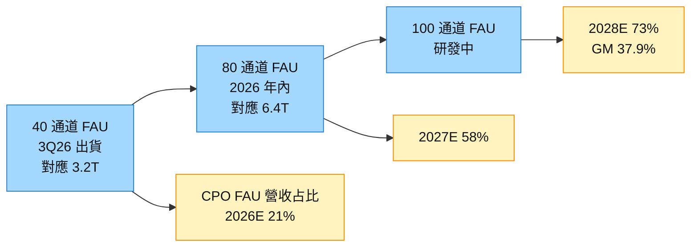

# 3363_上詮（櫃）

## 基本資料

上詮（FOCI）是台灣光纖被動元件與光纖模組廠，營收以光纖跳接線（約 77%）、其他光纖被動元件與光纖耦合產品為主。在 CPO 題材中的角色是 **FAU（Fiber Attach Unit）/ 光纖耦合**供應商之一。供應鏈位置：CPO 光引擎的光纖耦合被動件。掛牌：TPEX 上櫃（櫃）。資料來源：SemiAnalysis CPO Book（2026-01-02）。

## 核心技術／競爭優勢

- 光纖被動元件與光纖耦合：FAU 負責把光纖與光引擎精準耦合，是 CPO 光性能的關鍵被動件。
- SemiAnalysis 指 FOCI 可能較聚焦 Nvidia 的 scale-up CPO 方案；亦具 MT ferrule 自製（多為自家 FAU/shuffle box 垂直整合用）。

## 產品與應用

| 產品 / 服務 | 應用 | 相關客戶 / 下游 |
|-------------|------|-----------------|
| 光纖跳接線 / 被動元件 | 光通訊 | 光模組 / 系統廠 |
| FAU / 光纖耦合 | CPO 光引擎耦合 | CPO 系統（含 Nvidia scale-up） |
| MT ferrule（自製） | FAU / shuffle box | 垂直整合自用 |

## 供應鏈位置

- 下游：CPO 系統 / [[NVDA.US(nvidia)]]（scale-up CPO 方向）
- 所屬供應鏈：[[供應鏈_CPO]]（FAU / 光纖耦合環節）
- 同環節（未建頁）：TFC Optical（300394.SH，Q3450 FAU 主供）、Senko（9069.JP，SEAT 可拆式 FAU）、Sumitomo、AFR

## 相關公司

| 公司 | 關係 | 說明 |
|------|------|------|
| [[NVDA.US(nvidia)]] | 下游 | CPO（scale-up 方向）FAU 需求 |
| [[GLW.US(corning)]] | Shuffle Box 競爭者 | 2026-10-30 收錄訪談：Corning 約 70% 份額，上詮與波若威為其他供應商；低信心 |
| [[6706_惠特（市）]] | CPO 耦光設備供應商 | 2026-04-22 惠特私訪：上詮 CPO 試產（PP）前段耦光對位設備急單，2Q26 開始建量產設備，可能 3Q26 小量、2027 年較大量；上詮 PIC-FAU 貼合用 UV 膠；FAU 決選有 Sumitomo、Senko、上詮（[[活動_惠特私訪_20260422]]；惠特方說法、中信心） |
| [[4573_高明鐵（櫃）]] | 對位設備供應商（市場觀點，待確認） | [[研究_大立光3008_上詮3363_FAU觀點_珩石Jason_20261009]] 稱上詮曾為高明鐵最大客戶之一（低信心） |
| [[HIMX.US(himax)]] | 上游微光學夥伴 | KGI 2026-09-16、智璞 2026-09-21 與 MS 2026-11-20 均指 Himax 供微光學／超穎透鏡組件予上詮組裝 FAU |
| [[3008_大立光（市）]] | 台積陣營 FAU 潛在競爭者 | [[研究_大立光3008_上詮3363_FAU觀點_珩石Jason_20261009]] 認為台積電轉向具規模製造能力的大立光，對上詮領先優勢構成壓力（thesis／低至中低信心） |
| [[2330_台積電（市）]] | FAU 生態核心客戶／合作方 | 2020 年初起合作 FAU 開發（市場觀點與多份券商整理）；實際量產份額待驗證 |

## 2026-10-09 珩石 Jason 負面觀點與 2026-09-21 智璞整理

- **珩石 Jason 觀點（2026-10-09，thesis／低至中低信心）**：認為上詮自 2020 年初配合 [[2330_台積電（市）]] 開發 FAU、技術論述起步早，且曾為 [[4573_高明鐵（櫃）]] 最大客戶之一，但在 [[NVDA.US(nvidia)]] 推動 CPO 上線、台積電重視良率與產能之際，上詮未能積極拉設備並交出量產產出；隨高明鐵其他客戶 2026 年起貢獻營收、台積電找上具光學與規模製造優勢的 [[3008_大立光（市）]]，作者質疑上詮先行優勢是否猶存（[[研究_大立光3008_上詮3363_FAU觀點_珩石Jason_20261009]]）。
- **智璞專家分享會（2026-09-21，產業整理／中）**：[[報告_永豐_智璞專家分享會_矽光子與CPO趨勢_20260921]]（p43–44、p52）將「奇景＋上詮」列為超穎透鏡 FAU 台廠路線（目標 2026 就緒），並將上詮列為 NVIDIA CPO 陣營 FAU／耦合環節台廠之一。

> [!warning] 資訊衝突：上詮 CPO FAU 量產進度與競爭地位
> - [[報告_GoldmanSachs_上詮3363_20260908]]／[[報告_GoldmanSachs_上詮3363_20261106]]（2026-09-08／2026-11-06）：指 40 通道 CPO FAU 已於 3Q26 出貨，估 4Q26E 營收 QoQ +106% 至 NT$1.2bn、2026E／2027E CPO FAU 占營收 21%／58%，維持 Buy（TP NT$866）。
> - [[研究_大立光3008_上詮3363_FAU觀點_珩石Jason_20261009]]（2026-10-09）：買方觀點認為上詮多年量產與良率推進緩慢，台積電轉向大立光、大立光可拿台積陣營約 70% FAU 市占。
> - 狀態：多空觀點並存；後續應以月營收跳升幅度、毛利率是否走出 3Q26（10.6%）測試成本低谷，以及 2027 年實質 FAU 交付量驗證。

## 2026-11-06 Goldman Sachs：CPO FAU 逐步放量、獲利改善（Buy，TP NT$866）

- 3Q26 毛利率回升至 10.6%（2Q26 0.2%），但低於 GS／市場預估的 16.8%／22.2%，主因為 CPO FAU 量產準備的測試成本；營收已預先公布、符合預期；營業費用率 15.1%（2Q26 21.4%）；淨損收斂至 NT$10m（2Q26 NT$28m），與市場預估淨損 NT$5m 相近。
- 3 個月預覽：GS 估 10／11 月營收 NT$258m／NT$309m（MoM +15%／+20%），動能來自擴產、效率提升與機櫃級 AI 伺服器放量；4Q26E 營收 NT$1.2bn（QoQ +106%），CPO FAU 貢獻上升。
- AI 機櫃持續放量、CPO 交換器由 scale-out 延伸至 scale-up（上詮主要著力點），GS 預期 CPO FAU 營收在 2H27／2028 加速，帶動毛利率擴張。
- GS 反映 CPO FAU 量產準備成本，下修 2026–30E 獲利 49%／2%／1%／1%／1%；TP 由 NT$900 降至 NT$866（16.4x 2030E P/E 以 12.6% COE 折現至 2027E），維持 Buy。

來源：[[報告_GoldmanSachs_上詮3363_20261106]]（Goldman Sachs，2026-11-06；財報 fact，展望 estimate，信心中）。相關技術見 [[技術_FAU]]、[[供應鏈_CPO]]。

## 2026-10-30 專家訪談：Shuffle Box 第二梯隊

[[memo_CPO無源器件_ELS_FAU_Shuffle專家觀點_日期不詳]]（匿名，日期不詳；channel estimate，信心低）把上詮列為 CPO Shuffle Box 供應商之一：Shuffle Box 每台 US$3,000–3,500、未來約 US$2,500，[[GLW.US(corning)]] 約 70% 份額（全交太辰光代工），其他供應商為波若威與上詮，天孚也計畫切入、Molex 表現不佳。訪談未提上詮客戶或份額。

同訪談稱 [[AVGO.US(broadcom)]] CPO 的 FAU 為 40 芯、方案約 3.6T，與主流 36 芯不同；上方時間軸 GS 2026-09-08 所述「40 通道 CPO FAU 開始出貨」芯數相同，但客戶未具名，不能據此推定上詮供應 Broadcom。判讀見 [[分析_CPO無源器件ELS_FAU與Shuffle專家訪談_20261030]]。

## 2026-10-13 招商證券：台系高通道 FAU 切入者

[[報告_招商證券_FAU與MPO在ScaleUp時代的價值通脹_20261013]]（招商證券，2026-10；券商整理，信心中）在「海外主要高通道 FAU 廠商」表中，把上詮（FOCI）與連訊 AOPT、日本 Orbray 並列為「從傳統 FAU 與被動光件切入 CPO／NPO 高通道客製 FAU」的其他廠商；NVIDIA CPO 矽光生態官方 FAU 夥伴則列 Corning、SENKO、波若威與天孚，未列上詮。這與上方 GS 2026-09-08「40 通道 CPO FAU 已出貨」不衝突，但代表招商未把上詮放在第一梯隊。招商同時估 CPO 配套 FAU 市場 2027E 12 億、2028E 51 億、2030E 213 億元人民幣，36 通道 hybrid FAU 製造精度要求由 5 µm 收緊到 3 µm（見 [[技術_FAU]]）。判讀見 [[分析_FAU與MPO在ScaleUp時代的價值通脹_招商證券_20261030]]。

## EPS 記錄

| 年度 | EPS（NT$）| 備註 |
|------|----------|------|
| 2026F | **27.34**（+1,245% YoY）| 凱基 2025-11 估，FAU 放量 |

## EPS 預估

| 年度 | Goldman Sachs EPS（報告日：2026-09-08） | GS 營收（NT$ 百萬） | 備註 |
|------|----------------------------------------|---------------------|------|
| 2025A | 0.16 | 1,892 | 實績 |
| 2026E | 0.82 | 2,704 | CPO FAU 占營收 21%；季度 2Q26 −0.23、3Q26E 0.17、4Q26E 1.85 |
| 2027E | 17.49 | 9,745 | CPO FAU 占營收 58% |
| 2028E | 49.80 | 25,477 | CPO FAU 占營收 73%；毛利率 37.9%（2025A 18.8%） |

> 高盛 2026E EPS 0.82 與凱基 2025-11 估 2026F 27.34 差距極大：前者反映 FAU 3Q26 才開始出貨，後者為 2025 年底的早期假設。兩者發布時點相差約 10 個月，以較新的高盛口徑追蹤，凱基數字保留作歷史紀錄。

## 目標價與評等

| 券商 | 報告發布日 | 評等 | 目標價 | 評價基礎 | 來源 |
|------|------------|------|--------|----------|------|
| Goldman Sachs | 2026-09-08 | Buy | NT$833（2026-08-06 由 NT$864 下調後維持） | 15.4x 2030E P/E，以 COE 12.6% 折現回 2027E；報告時股價 NT$723 | [[報告_GoldmanSachs_上詮3363_20260908]] |

## 2026-09-08 SEMICON Taiwan CFO 會議（Goldman Sachs）

- **FAU 開始出貨：** 上詮 CPO FAU 於 3Q26 開始出貨，帶動 8 月營收月增率加速至 +20%（7 月 +9%），高盛解讀為高階 FAU 放量。（fact／券商解讀，中高）
- **規格路線：** 2026 年以 40 通道 FAU（3Q26 起，對應 3.2T）為主，年內接續 80 通道（對應 6.4T），100 通道研發中。傳輸速率提高使 FAU 通道數增加、進入門檻提高，管理層認為反映上詮的研發與高精度製造能力。（公司說法，中）
- **客戶結構：** FAU 客戶橫跨 fabless、晶圓代工與雷射供應商等多類型，但報告未具名。管理層看好 AIDC 光網路由 scale-out 延伸至 scale-up 帶動 CPO 交換器需求，FAU 營收貢獻提高後毛利率也將回升。
- **高盛預估：** CPO FAU 營收成長於 2H27 再加速，營收占比 2026E 21% → 2027E 58% → 2028E 73%，毛利率 2028E 達 37.9%（2025A 18.8%）。下行風險為競爭加劇、光網路技術路線轉移與產能爬坡放緩。（estimate，中）
- 同日 GS SEMICON 綜合報告將 FAU 與雷射規格升級列為六大重點之一，詳見 [[技術_CPO]]、[[技術_FAU]]。
- 來源：[[報告_GoldmanSachs_上詮3363_20260908]]、[[報告_GoldmanSachs_SEMICON台灣光子測試_20260908]]（Goldman Sachs，2026-09-08）。

## 業務補充（CTBC 2025-11）

- **Americas 82%**：北美為最大市場，SiPh/CPO FAU 客戶多在矽谷
- **泰國子公司**：2026 年 1Q 設立，配合供應鏈分散要求
- **2027 年量產**：FAU 主力產品從樣品/NPI 進入量產
- **2026 Capex NT$17.5 億**：積極擴充 FAU 產能
- **產品路線**：FAU for 1.6T / 3.2T / 6.4T CPO（已布局超高速路線）

## 券商觀點與催化劑

- [[報告_Semianalysis_CPO_20260102]]（2026-01）：FOCI 列為 FAU 領先廠商之一（與 TFC、Senko 並列），較可能聚焦 Nvidia 大型 scale-up CPO 解決方案。
- 報告_CTBC_上詮3363_NR_20251125（CTBC，2025-11-25）：NR；FAU 技術地位、泰國子公司 1Q26、2027 量產、2026 Capex NT$17.5 億；EPS 凱基估 2026F 27.34（+1,245%）
- 催化劑：CPO 放量帶動 FAU/光纖耦合需求；惟須留意 CPO 整體時程下修（[[技術_CPO]] 衝突 callout）對短期節奏的影響。

## 圖片/架構圖

`[待補來源圖]` 需官方 IR 光模塊或光收發器產品圖佐證，現有研究筆記不足以支撐產品示意圖。

圖說：依高盛 2026-09-08 CFO 會議整理的上詮 FAU 通道數路線（上排）與 CPO FAU 營收占比預估（下排，estimate）；通道數愈多、對位精度要求愈高，是上詮毛利率回升的主要依據。GS 報告無可用產品圖，故以 Mermaid 補位。

## 時間軸

| 時間 | 事件 | 類型 | 重要性 | 備註 |
|------|------|------|--------|------|
| 2026-1Q | 泰國子公司成立 | 組織 | ⭐⭐ | 供應鏈分散，配合客戶要求 |
| 2026 | Capex NT$17.5 億（FAU 擴產）| 資本支出 | ⭐⭐⭐ | 積極備貨 2027 量產 |
| 2027 | FAU 1.6T / 3.2T / 6.4T 量產 | 產品 | ⭐⭐⭐ | 主力量產年 |
| 2026Q3 | 40 通道 CPO FAU 開始出貨，8 月營收 MoM +20% | 放量 | ⭐⭐⭐ | GS 2026-09-08；對應 3.2T |
| 2026 年內 | 80 通道 FAU（6.4T）接續 | 規格升級 | ⭐⭐ | 100 通道研發中 |
| 2H27 | CPO FAU 營收成長再加速（GS 估 2027E 占營收 58%） | 放量 | ⭐⭐⭐ | estimate |

→ 跨公司時程詳見 [[時程_2026Q3Q4_AI網通與硬體催化劑]]

> [!warning] 風險與注意事項
> - CPO 商業化時程仍有不確定性；高盛列出光網路技術路線轉移、競爭加劇與產能爬坡放緩為下行風險。
> - 2026E EPS 僅 0.82（GS），獲利大幅仰賴 2027–2028 年 FAU 放量假設，估值以 2030E P/E 折現，對時程延後敏感。
> - FAU 客戶未具名，客戶集中度與單一平台依賴程度無法從現有來源判斷。

## 來源

- [[研究_大立光3008_上詮3363_FAU觀點_珩石Jason_20261009]] — 珩石資本 Jason，2026-10-09（上詮 vs 大立光 FAU 良率／產能與高明鐵客戶關係觀點，thesis／低至中低信心）
- [[報告_永豐_智璞專家分享會_矽光子與CPO趨勢_20260921]] — 永豐證券／智璞產業趨勢研究所，2026-09-21（奇景＋上詮超穎透鏡 FAU 與 NVIDIA CPO 陣營整理）
- [[報告_招商證券_FAU與MPO在ScaleUp時代的價值通脹_20261013]]（招商證券，2026-10-13；高通道 FAU 廠商分級與市場規模，券商整理，信心中）
- [[memo_CPO無源器件_ELS_FAU_Shuffle專家觀點_日期不詳]]（匿名專家訪談，日期不詳，2026-10-30 收錄；Shuffle Box 供應商名單，低信心）
- [[報告_Semianalysis_CPO_20260102]]（CPO Book，2026-01-02）
- 報告_CTBC_上詮3363_NR_20251125（中信投顧，2025-11-25；NR，FAU for SiPh/CPO，Americas 82%，泰國 1Q26，2027 量產）

- [[(付費內容) SemiAnalysis Co-Packaged Optics (CPO) Book – Scaling with Light for the Next Wave of Interconnect]]（2026-01-03）
- [[research_simpletechtrend_CPO矽光子ECTC2026_20260629]]（2026-06-29）
- [[上詮(3363,NR_未評等)-CTBC251125]]（2025-11-25）
- [[報告_GoldmanSachs_SEMICON台灣光子測試_20260908]]（2026-09-08）
- [[報告_GoldmanSachs_上詮3363_20260908]]（2026-09-08）
- [[報告_申万宏源_光通信光電集成深度_20260630]]（2026-06-30）

- [[memo_KGI_HimaxCallMemo_20260916]]（2026-09-16）

- [[memo_國泰_AI投資熱台股震盪_20261027]]（2026-10-27）

- [[活動_惠特私訪_20260422]]（2026-04-22）

- [[報告_GoldmanSachs_上詮3363_20261106]]（2026-11-06）

## 相關頁面

- [[時程_2026-2027高速互連與分散式算力]]
- [[分析_FAU與MPO在ScaleUp時代的價值通脹_招商證券_20261030]]
- [[HIMX.US(himax)]]
- [[分析_Himax車用顯示_CPO微光學與AI眼鏡_20260916]]
- [[時程_2026Q3Q4_AI網通與硬體催化劑]]
- [[供應鏈_AI光互聯]]
- [[技術_FAU]]
- [[技術_MPO]]
- [[技術_光互連]]
- [[技術_光模塊]]
- [[分析_MS_AI供應鏈_HBM降規與Kyber延遲_20260810]]
- [[時程_2026記憶體與AI催化劑]]
- [[分析_VeraRubin規格下修_NVLink與HBM4頻寬的產業影響_20261031]]
