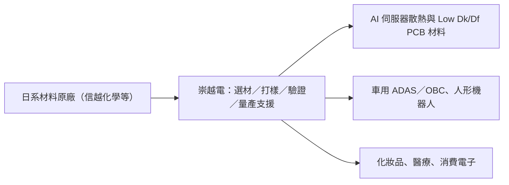

# 3388_崇越電（櫃）

## 基本資料

崇越電通為材料通路與技術服務商，客戶逾 1 萬家，橫跨電子、散熱、車用、醫療、化妝品、運動休閒與傳統產業；技術服務涵蓋選材、打樣、驗證與量產製程支援。台灣設營運總部與技術服務中心，海外據點涵蓋中國、香港、泰國、越南、印尼、美國（德州 El Paso）與墨西哥。光通訊材料為日本信越化學產品。

- 1–3Q26（fact）：營收 63.89 億元（YoY +15.6%），營業利益 5.19 億元（YoY +52.0%），歸屬母公司淨利 3.71 億元（YoY +63.3%），EPS 4.81 元（去年同期 3.06 元）；毛利率 20.0%、營益率 8.1%、淨利率 5.8%，分別年增 2.5ppt、1.9ppt、1.7ppt。
- 3Q26（fact）：營收 20.03 億元（YoY +9.3%），毛利 3.89 億元（YoY +20.5%），稅後淨利 1.16 億元（YoY +33.2%），EPS 1.42 元（2Q26 為 2.21 元）；部分高毛利客戶與專案集中於 2Q26 出貨，3Q26 起記憶體缺貨與漲價影響 NB、手機與消費電子出貨。
- 產業別（1–3Q26）：電子 36.6%、散熱 16.9%（NB 應用衰退）、化妝品 5.6%、車用 5.2%；AI 相關材料約占營收 9–10%。
- 應收帳款收現天數 82 天、存貨週轉天數 55 天；2025 年度現金股利 3.34 元、配息率 80.5%，近三年配息率均逾 80%。

資料來源：[[活動_崇越電3388_國泰CallMemo_20261124]]（國泰證期 call memo，2026-11-24）。

## 核心技術／競爭優勢

- 以新材料、新應用、新區域推動成長：Green Silicone 聚焦循環型、節能減碳與可回收材料；特殊添加劑與粉體聚焦 Low Dk、Low Df、CTE 控制、阻燃與強度提升。
- 散熱與複合材料應用於 AI 伺服器、AI PC、ADAS、車載充電器（OBC）與人形機器人，均已供貨並認證下一代材料。
- Low Dk／Low Df 屬利基型材料，毛利率高於一般產品。

## 產品與應用

| 產品 | 應用 | 觀察 |
|------|------|------|
| Low Dk／Low Df 特殊添加劑與粉體 | 高頻高速 PCB／CCL 材料 | 終端機型多、認證需時間；受 T-glass 玻纖布缺貨影響 |
| 散熱與複合材料 | AI 伺服器、AI PC、ADAS、OBC、人形機器人 | 供應正常、無缺貨 |
| 光通訊材料（信越化學） | 客戶認證中 | 2H27 再說明進度，涉保密協議 |
| 矽膠（Green Silicone） | 電子、車用、化妝品、醫療 | 化妝品受惠網紅直播帶貨與網路新品牌 |

## 圖片 / 架構圖

## 營運展望

- 4Q26 與 2027 年較看好人形機器人、下一代 ADAS 與儲能需求；AI 相關材料營收占比朝雙位數以上推進，公司看法樂觀。
- Low Dk／Low Df 2027–2028 年預期持續成長，出貨量取決於客戶認證進度與 T-glass 玻纖布缺貨緩解（尚未緩解）。
- 海外：菲律賓分公司設立中（日系車用客戶與當地網路化妝品品牌），2Q27 進一步說明；美國布局約三年，將於 El Paso 備庫存，服務當地伺服器與網通裝置後段組裝需求。

## 時間軸

| 日期 | 事件 | 來源 |
|------|------|------|
| 2026-11-24 | 3Q26 法說：前三季獲利年增 63% | [[活動_崇越電3388_國泰CallMemo_20261124]] |
| 2Q27 | 菲律賓分公司進度說明 | [[活動_崇越電3388_國泰CallMemo_20261124]] |
| 2H27 | 光通訊材料（信越化學）認證進度說明 | [[活動_崇越電3388_國泰CallMemo_20261124]] |

## 供應鏈位置

材料通路與技術服務商，位於日系材料原廠與 PCB／CCL、散熱模組、車用電子、品牌組裝廠之間；AI 曝險來自 Low Dk／Low Df 添加劑與伺服器散熱材料。

## 相關公司

| 公司 | 關係 | 來源 |
|------|------|------|
| [[5434_崇越（市）]] | 同屬崇越集團（名稱相近，業務為半導體材料與工程，非本次來源揭露） | 一般資訊，待查證 |
| 信越化學（4063.JP，無公司頁） | 光通訊材料原廠 | [[活動_崇越電3388_國泰CallMemo_20261124]] |

## 來源

- [[活動_崇越電3388_國泰CallMemo_20261124]]（國泰證期 call memo，2026-11-24）

## 相關頁面

- [[2383_台光電（市）]]（T-glass／Low Dk 玻纖布短缺同一題材）
