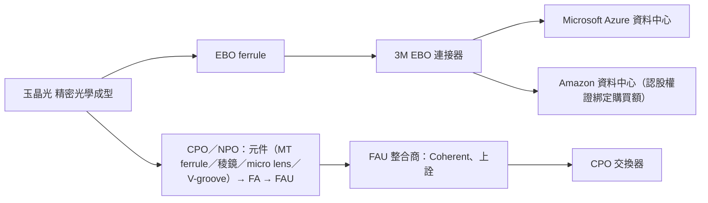

# 3406_玉晶光（市）

## 基本資料

玉晶光（Genius Electronic Optical）1989 年成立，是全球主要手機鏡頭廠，提供手機、車用與 AR/VR 光學方案，主要客戶為 [[AAPL.US(apple)]]（iPhone、iPad 鏡頭）。生產基地在台中（一廠，主做 VR 鏡頭）與廈門（兩廠，消費電子小型鏡頭）。UBS 指出玉晶光自 2025 年中起成長快於 [[3008_大立光（市）]]，股價已高於歷史區間上緣，部分反映光通訊（CPO）題材。

新動能是光通訊精密元件：玉晶光正對 FAU 整合商（如 [[COHR.US(coherent)]]、FOCI 上詮）送樣 FAU 內的三種精密零件（MT ferrule、稜鏡、V-groove），UBS 估 CPO 時代有機會取得 10% TAM。2026-10-15 董事會通過私募 3M UK Limited，並與 [[MMM.US(3m)]] 結盟開發 AI 資料中心與 HPC 光通訊。3M 在 2026-10-19 自家新聞稿確認：預計取得約 4.7% 股權、2026Q4 交割，玉晶光的精密光學製造支援 3M EBO ferrule、CPO 方案與相關光互連應用的量產準備；同日 3M 與 [[AMZN.US(amazon)]] 擴大合作，Amazon 認股權證依其購買光連接等資料中心產品的金額既得（累計 60 億美元全數既得）。

資料來源：[[261015_ubs_genius]]（UBS，2026-10-15）、[[research_產業合作技術發表_2026-10-24]]（3M 新聞稿與 8-K，2026-10-19）。

## 核心技術／競爭優勢

- **精密光學成型**：手機鏡頭量產能力延伸到微透鏡陣列、塑膠成型光學零件。
- **大客戶黏著**：長期供應 Apple 鏡頭。
- **光通訊結盟**：與 3M 合作 EBO（expanded beam optical）擴束光學連接器，3M 透過 [[MSFT.US(microsoft)]] Azure 已有部署，可能把營收貢獻提前到 2027 年（早於玉晶光 CPO 量產的 2028E）。

## 產品與應用

| 產品／服務 | 應用 | 相關客戶／下游 |
|---|---|---|
| 手機鏡頭 | iPhone、iPad 相機；1–3Q26 營收 10M 以上及 TOF 鏡頭占 54%、10M 以下占 13% | [[AAPL.US(apple)]]、中系客戶（可變光圈已出貨） |
| 潛望式鏡頭用稜鏡模組 | 高階手機長焦；成像用稜鏡單月出貨數百萬顆 | 「其他」類主體，1–3Q26 占 33%、比重較去年提高 |
| VR／車用鏡頭 | AR/VR 裝置、車載 | 品牌客戶 |
| AR／AI 眼鏡鏡頭 | AR 需玻塑混合極小鏡頭；AI 眼鏡另需 sensing，部分鏡頭須可擺動 | 相關產品陸續準備出貨（2026-11-19 法說） |
| EBO ferrule（微透鏡＋抗反射鍍膜塑膠件） | 資料中心光纖連接器 | [[MMM.US(3m)]]（EBO 已部署於 Microsoft Azure；終端需求含 [[AMZN.US(amazon)]]） |
| MT ferrule、稜鏡、micro lens、V-groove；FA、FAU | CPO／NPO 光學耦合（元件、FA、FAU 三層布局） | [[COHR.US(coherent)]]、上詮等 FAU 整合商（送樣中）；切入路徑分晶圓廠與終端品牌兩類，目前少量交貨 |

## 圖片 / 架構圖

> 依 UBS 2026-10-15 First Read 整理的光通訊產品路徑；UBS PDF 圖表多為本益比與營收比較圖，故以 Mermaid 表達供應鏈位置。

## EPS 預估

| 年度 | UBS（報告日：2026-10-15） | 共識 | 備註 |
|---|---:|---:|---|
| 2026E | 38.27 | 38.31 | 營收 NT$269.8 億 |
| 2027E | 43.93 | 42.43 | |
| 2028E | 49.22 | 49.77 | |

## 目標價與評等

| 券商 | 報告日 | 評等 | 目標價 | 評價基礎 | 來源 |
|---|---|---|---:|---|---|
| UBS | 2026-10-15 | Buy（重申） | NT$1,250 | P/E SOTP；股價 NT$1,115（先前已由 NT$700 上調） | [[261015_ubs_genius]] |

## 時間軸

| 時間 | 事件 | 類型 | 重要性 | 備註 |
|---|---|---|---|---|
| 2026-10-15 | 董事會通過私募 3M UK 5.54M 股、每股 NT$869.6（較 10-14 收盤 NT$1,065 折價 18.3%），金額 NT$48 億、持股 4.68% | 策略結盟 | ⭐⭐⭐ | 資金用於技術開發、營運資金與還款 |
| 2026-10-19 | 3M 新聞稿確認入股約 4.7%、合作 EBO ferrule／CPO 量產準備；同日 3M 發給 Amazon 最多 3,162,015 股認股權證（行使價 US$164.89、7 年，85% 依購買光連接等產品金額既得，累計 US$60 億全數既得） | 策略結盟 | ⭐⭐⭐ | 官方 fact；3M 新聞稿未揭露 EBO 規格與產能 |
| 2026Q4 | 3M 私募交割 | 策略結盟 | ⭐⭐ | 3M 新聞稿，待交割公告 |
| 2026-11-19 | 3Q26 法說：營收 78.1 億元、毛利率 33.0%、1–3Q26 EPS 23.68 元；2027 營收成長 20% 為營業目標、資本支出約倍增 | 法說 | ⭐⭐⭐ | [[活動_玉晶光3406_富邦CallMemo_20261119]]（富邦轉述公司說法） |
| 4Q26 | EBO 少量出貨（可靠度驗證中） | 放量 | ⭐⭐⭐ | 公司說法／中高 |
| 1Q27 | EBO 爬量 | 放量 | ⭐⭐⭐ | 公司說法／中高 |
| 2Q27 | EBO 全速生產；2027 年新產品營收以 EBO 為主 | 放量 | ⭐⭐⭐ | 公司說法／中高；光通訊營收占比不揭露 |
| 3Q27–4Q27 | CPO／NPO scale-up 端開始放量，NPO 先於 CPO；玉晶光元件 2H27 跑量 | 放量 | ⭐⭐ | 公司說法／中；早於 UBS 的 CPO 2028E |
| 2027 | EBO ferrule 透過 3M／Microsoft 可能開始貢獻營收 | 放量 | ⭐⭐ | UBS thesis／中 |
| 2028E | CPO 相關精密零件量產 | 放量 | ⭐⭐ | UBS estimate／中低 |

## 供應鏈位置

- 上游：光學塑料、模具。
- 下游：Apple（手機鏡頭）；光通訊端為 3M、FAU 整合商與 CPO 交換器。
- 所屬主線：[[供應鏈_CPO]]、[[供應鏈_AI光互聯]]。

## 相關公司

| 公司 | 關係 | 說明 |
|---|---|---|
| [[AAPL.US(apple)]] | 客戶 | 主要鏡頭客戶 |
| [[3008_大立光（市）]] | 同業／競爭 | 手機鏡頭主要競爭者，UBS 比較成長速度 |
| [[COHR.US(coherent)]] | 潛在客戶 | FAU 整合商，送樣中 |
| [[MSFT.US(microsoft)]] | 終端使用者 | 3M EBO 已部署於 Azure，非玉晶光直接客戶 |
| [[MMM.US(3m)]] | 客戶／策略股東 | EBO 連接器品牌商；私募入股約 4.7%，玉晶光為其 EBO ferrule 製造夥伴 |
| [[AMZN.US(amazon)]] | 終端使用者 | 與 3M 擴大光連接採購，認股權證綁定累計 US$60 億購買額；非玉晶光直接客戶 |

> [!warning] 風險與注意事項
> - 手機業務仍是營收主體，iPhone 需求與相機升規節奏影響大。
> - 光通訊 TAM（UBS 估 EBO 約 US$1 億：每顆 GPU 4–12 個 ferrule × 2,000 萬顆加速器 × US$1）與 CPO 份額皆為券商推估，尚未有營收驗證。
> - 私募折價 18.3%，對既有股東有稀釋。
> - 3M 的 EBO MSA 於 2026 年 5 月成立，由 Oracle 共同主持，成員含 Meta、Senko、Molex；標準普及速度仍待觀察。
> - SemiAnalysis（2026-10-23）認為 EBO 插入損耗高於 MMC、目前也較貴，會依密度、可維修性與光預算和 MMC 並存；EBO ferrule 需求較可能隨維運密集位置逐步滲透，而非一次換代（thesis／中，見 [[技術_EBO擴束連接器]]、[[技術_MPO]]）。

## 2026-10-28 Citi：EBO 光學連接成為成長動能

- Citi Buy，TP NT$1,050→NT$1,380（本益比由 25x 提高至 33x）；EPS 2026–2028E 33.26／38.13／46.67。3Q26 初步獲利低於預期，受人民幣升值匯損與新專案量產初期毛利率下滑拖累；4Q26 營收季節性下滑，1Q27 標準款新機支撐淡季。
- EBO（Expanded Beam Optical）透過透鏡陣列在光纖間非接觸式傳輸與準直光線，降低灰塵敏感度與清潔需求、提升安裝效率與密度；憑相機鏡頭精密光學與 3M 早期合作切入，估 2027 年營收占比 8%–10%。CPO 與 FAU 的 PMLA 仍需時間。外電：EBO 除部署於 Microsoft 外，接下來還有 AWS，2028 年 TAM 約 US$2bn。（estimate）

## 2026-11-02 UBS PQ 反推與自建損益模型

> [!note] 已更新
> 本段為 11-02 版本（EBO 2028E 起 100% 滲透）；最新版見下方「2026-11-20 模型依法說更新」。

模型：[[memo_玉晶光PQ模型反推_UBS_20261102]]（Excel：假設、本業、CPO、EBO、年度損益、評價、UBS季度，全公式連動，可切換三情境與私募稀釋）。全部屬本庫反推與自建 estimate；基準 CPO 反推信心中高，其餘信心低至中低。

**UBS 目標價拆解**：NT$1,250＝本業 2028E EPS 49.25 × 15 倍（實算 739，UBS 表上寫 745）＋CPO 2028E EPS 12.70 × 40 倍（508）。UBS 封面財測不含 CPO 與 EBO，CPO 只在評價時加上；目標價 10/12 已定，未計入 10/15 的 3M EBO 合作。

**CPO 反推**：沿用同一位分析師 2026-09-06 大立光模型的 OpM 42.5%、匯率 30，配玉晶光稅率 25%，基準 CPO 營收約 **US$1.5 億＝10% × US$15 億零件 TAM**（為大立光框架 2027 年 FAU TAM US$10.8 億的 1.39 倍）。樂觀／悲觀只能還原營收約 US$4.35 億／US$0.034 億，模型以 20% × US$21.75 億、1% × US$3.42 億表示，拆法不唯一。

**EBO 反推**：UBS 的 US$1 億＝2,000 萬顆加速器 × 每顆 5 個 ferrule × US$1，低於 UBS 自己範圍（4–12 個，US$0.8–2.4 億）的中位數，且隱含 100% 滲透、ferrule 全由玉晶光供應。

**EBO 假設更新（2026-11-02 使用者指引）**：[[memo_玉晶光PQ模型_EBO假設更新_20261102]] 改用 ASP US$1.5（區間 1–2）、毛利率 45%（區間 40%–50%）、**2028E EBO 占總營收 20%**。以 20% 回推，基準每顆 GPU 約 10.2 個 ferrule（在 UBS 4–12 個區間內；樂觀情境 13.0 個超出上限）。之後模型改為逐年輸入用量（[[memo_玉晶光PQ模型_EBO逐年用量_20261102]]），預設各年 10.2 個，換情境時 EBO 占比不再固定為 20%；2028E EBO 營收約 US$3.06 億，約為 UBS ferrule TAM 的 3 倍。2027E 滲透率設 30%，當年占營收約 8.5%，與 Citi 8%–10% 一致。

**基準情境結果（EBO 更新後）**

| 項目 | 2026E | 2027E | 2028E | 2029E | 2030E |
|---|---:|---:|---:|---:|---:|
| 營收（NT$ 百萬） | 26,977 | 32,341 | 45,958 | 48,454 | 51,168 |
| 　EBO 占比 | 0% | 8.5% | 20.0% | 19.0% | 18.0% |
| 　CPO 占比 | 0% | 0% | 9.8% | 9.3% | 8.8% |
| EPS（NT$） | 36.73 | 50.38 | 83.39 | 86.96 | 90.83 |
| 　本業／EBO／CPO | 36.73／0／0 | 43.95／6.42／0 | 49.25／21.41／12.73 | 52.81／21.41／12.73 | 56.68／21.41／12.73 |
| UBS EPS | 36.72 | 43.96 | 49.25 | 52.79 | 56.66 |

- **EBO 敏感度（2028E）**：毛利率 40%／45%／50% 對應 EBO EPS 18.36／21.41／24.47；ASP US$1／1.5／2 不影響營收（占比固定），只改變每顆 GPU 用量需求 15.3／10.2／7.7 個。
- **評價**：複製 UBS SOTP 得 NT$542／1,248／2,369（悲觀／基準／樂觀），與 UBS 公布值誤差 0.5% 以內。加上 EBO（2028E EPS 21.41 × 33 倍，約 NT$707）後，基準約 **NT$1,955**，較 UBS 目標價高 56%；悲觀／樂觀約 NT$1,134／3,261。前版（ASP US$1、每顆 GPU 5 個）基準為 NT$1,446。
- **現價隱含**：NT$1,115 − 本業 739＝376，以 40 倍換算 CPO EPS 9.4，約為 US$15 億 TAM 的 7.4% 市占，等於已計入 UBS 基準 CPO 的約四分之三。
- **私募稀釋**：新增 5.54 百萬股使 EPS 稀釋 4.7%，加回 NT$48.2 億現金後，UBS 目標價等值約 NT$1,232。

> [!warning] 模型與其他來源的差異
> - Citi 估 EBO 2027 年占營收 8%–10%：更新後模型 2027E 為 8.5%，口徑一致；但 Citi 2027E EPS 38.13 低於 UBS 不含 EBO 的 43.96，差異主要在手機本業假設。
> - 2028E 占比 20% 為使用者指引（來源未註明），對應 EBO 營收約 US$3.06 億，是 UBS ferrule TAM US$1 億的 3 倍、外電 2028 年 EBO 整體市場 US$20 億的 15%；每顆 GPU 用量、ASP 與玉晶光市占均無公司或 3M 揭露。
> - CPO 2029E 以後 TAM 持平為預設，UBS 未提供。

## 2026-11-19 3Q26 法說（富邦投顧 call memo）

來源：[[活動_玉晶光3406_富邦CallMemo_20261119]]（富邦投顧轉述公司說法，2026-11-19；財報數字 fact／高，展望與時程為公司說法／中高）。

**3Q26 財報**

| 項目 | 3Q26 | QoQ／YoY | 1–3Q26 | YoY |
|---|---:|---|---:|---|
| 營收（億元） | 78.1 | +37%／+1% | 196.4 | +10% |
| 毛利率 | 33.0% | −0.1ppts | 33.2% | +1.4ppts |
| 營益率 | 19.8% | +2.9ppts（費用率 16.3%→13.2%） | 18.9% | +0.3ppts |
| 業外 | 淨損 0.7 億元 | | 淨損 1.7 億元（去年同期淨收益 0.8 億元） | |
| 稅後淨利（億元） | 11.0 | QoQ +58% | 26.8 | +6% |
| EPS（元） | 9.69（10-23 自結） | | 23.68 | 去年同期 22.41 |

- **營運目標與資本支出**：2027 年營收成長 20% 為營業目標，動能來自光通訊新產品與手機鏡頭升規。資本支出 2025、2026 年各約 20 億元（1–3Q26 約 15 億元），2027 年約倍增、主要投入光通訊，其餘用於潛望式、可變光圈設備與自動化；公司稱不影響股利政策。不打價格戰，靠高難度產品良率、自動化與高單價產品比重守毛利率。
- **EBO**：3M 提供專利與材料，玉晶光負責精密模具與大量製造，規劃產能為 3M 自有產能的數倍；目前是 3M EBO 的主要供應來源，未來可能由 ferrule、lens 延伸到組裝，雙方另有多項新產品開發。放量關鍵是資料中心要求的 15–20 年可靠度，以及 EBO 三種規格 100% 互配；客戶需求已到位。公司稱 EBO 讓資料中心建置速度提升 85%，主要用在新建資料中心，一座資料中心光纖 300–500 萬根、EBO 用量上百萬顆；目前屬選配，但已有大型資料中心採用。
- **CPO／NPO**：switch 端已有大量 pilot run，scale-up 端 3Q27–4Q27 開始放量，NPO 先於 CPO。目前少量交貨、規格仍在調整。檢測設備除 laser tester 外大多已具備，射出機與模具可沿用，FAU 則需較大資本支出。CPO／NPO 產能集中在台灣，其餘光通訊產能以中國、台灣為主。
- **光通訊毛利率**：公司稱方向上優於既有產品，幅度取決於良率與效率，現階段難以估算，不切入低毛利領域。
- **手機鏡頭**：高階鏡頭由旗艦往次旗艦滲透。美系客戶 2027 年市佔以持平規劃，目前 forecast 與今年相當；可變光圈中系已出貨、美系仍在認證。長距離潛望式（倍率切換間連續對焦）是下一階段升規。
- **AR／AI 眼鏡**：AR 需玻塑混合極小鏡頭，AI 眼鏡另需 sensing，部分鏡頭要求本身可擺動，難度高於手機鏡頭，相關產品陸續準備出貨。

> [!warning] 法說與既有券商口徑的差異
> - **CPO 時點**：公司稱 CPO／NPO scale-up 端 3Q27–4Q27 放量、玉晶光元件 2H27 跑量；UBS（2026-10-15）把 CPO 精密零件量產放在 2028E。公司時點較早約 2 季，但「跑量」不等於占營收顯著比重。
> - **2026E EPS**：1–3Q26 EPS 23.68 元，要達 UBS 2026E 38.27 元，4Q26 需 14.59 元；要達 Citi 33.26 元，4Q26 需 9.58 元，接近 3Q26 的 9.69 元。Citi 預期 4Q26 季節性下滑，口徑較貼近（本庫推算）。
> - **85% 口徑**：法說說的是「建置速度提升 85%」，UBS 轉述的是「清潔與檢查時間節省 85%」，Molex 說的是「安裝比 MPO 快最多 85%」。三者量測對象不同，不宜互換。

## 2026-11-20 模型依法說更新

模型：[[memo_玉晶光PQ模型_EBO滲透率50_20261120]]（最新版，以 [[memo_玉晶光PQ模型_法說更新_20261120]] 為底；工作檔在 `元皓\coverage\3008 & 3406`，就地更新；全部屬本庫自建 estimate，信心低至中低）。

**改了什麼**：2026E 本業改為 1–3Q26 實際＋4Q26 假設（營收 7,340、毛利率 33.0%、業外 0）；2027E 起業外由 UBS 每年 +520 百萬改為 0；EBO 滲透率 2026E 0.5%、2027E 30%、2028E 起 50%（使用者指示「至少抓五成」；前一版 30%，11-02 版 100%）；CPO 提前到 2027E、首年 20%；計入 3M 私募稀釋（2027E 起 118.21 百萬股）；現價改為 NT$720（11-19 收盤）。

| 基準情境 | 2026E | 2027E | 2028E |
|---|---:|---:|---:|
| 營收（NT$ 百萬） | 27,019 | 33,238 | 41,356 |
| EBO＋CPO 占營收 | 0.2% | 11.0% | 22.0% |
| EPS（NT$） | 33.28 | 47.14 | 65.97 |
| 　本業／EBO／CPO | 33.18／0.11／0 | 38.59／6.12／2.43 | 43.64／10.19／12.13 |
| 券商 EPS（UBS／Citi／Aletheia） | 38.27／33.26／29.30 | 43.93／38.13／39.36 | 49.22／46.67／65.93 |

- 3Q26 營收與 UBS 預估一致，但毛利率低 1.8ppts、業外由正轉負，EPS 9.69 較 UBS 11.86 低 18%；2026E 下修主要來自這兩項。
- 2027E 總營收成長 23.0%，略高於公司營業目標 20%；2027E EBO 占營收 8.3%，落在 Citi 8%–10%。
- 2028E EBO 滲透率 30%／50%／70%／100% 對應 EBO EPS 6.12／10.19／14.27／20.39 元；基準 50% 時 EBO 占 2028E 營收 11.1%、ferrule 出貨 1.02 億顆。
- 自建 SOTP 基準約 NT$1,517（本業 655＋CPO 485＋EBO 336＋私募現金 41），較現價 720 高 111%；滲透率 30% 時約 NT$1,383。現價已低於 UBS 基準本業價值 739。
- 2028E EPS 65.97 與 Aletheia 65.93 接近，但 Aletheia 本業營收較低、新產品占比較高，口徑不同。
- 未納入 2027 年資本支出倍增的折舊、FA／FAU 單價提高與分規格 ASP。

## 2026-11-20 富邦：2027 智慧型手機展望（中立，TP 834 元）

- 富邦估 2027 年全球手機出貨 10.4 億台（YoY −5%）、iPhone 2.53 億台（YoY +4.3%）（estimate／中）。
- 富邦預期 2027 年可變光圈鏡頭滲透率提升，[[3008_大立光（市）]] 為主要供應商，玉晶光 2027 年取得小部分市占；iPhone 19 Pro 潛望式鏡頭 3Q27 再升規，現有供應商大立光與玉晶光受惠。
- 富邦估 FY27／28 EPS 41.7／45.5 元（股價 648 元，2026-11-20）（estimate／中）。
- 來源：[[報告_富邦_2027智慧型手機展望_20261120]]（範圍待確認：消費電子手機題材）。

## 2026-11-23 福邦：光互連為中長期動能（中立，TP NT$663）

- 3Q26：營收 78.12 億元（季增 37.5%、年增 0.9%），毛利率 33.03%，研發費用年增 29.4%、匯損 1.68 億元，EPS 9.69 元（年減 22.7%）；前三季鏡頭製品占營收 67%，其他（主要為潛望式稜鏡模組）33%（fact）。來源 [[報告_福邦_玉晶光3406_20261123]]。
- 4Q26：預估營收 69 億元（季減 11.7%）、EPS 8.31 元；客戶部分機種延至 2Q27 上市，VR 出貨年減，EBO 連接器仍在驗證（estimate）。
- 光互連：2026 年與 3M 策略合作推進擴束光學（EBO）連接器量產，開發 NPO／CPO 用 V-groove、稜鏡、微透鏡與光纖陣列，長期朝 FAU 發展；EBO 預期 1Q27 起貢獻、2Q27 放量，NPO 元件 2H27 挹注（公司／福邦說法）。
- 2027 年：公司目標營收年增 20%，福邦保守預估年增 14.4% 至 303.58 億元；資本支出可能倍增至 40 億元，私募增資稀釋，EPS 33.15 元（年增 3.6%）（estimate）。

## 來源

- [[報告_福邦_玉晶光3406_20261123]]（福邦，2026-11-23；中立，TP NT$663，EBO／NPO 光互連）
- [[報告_富邦_2027智慧型手機展望_20261120]] — 富邦投顧，2026-11-20；2027 智慧型手機展望，玉晶光中立／TP 834 元。
- [[活動_玉晶光3406_富邦CallMemo_20261119]] — 富邦投顧 3Q26 法說 call memo（LINE 轉傳），2026-11-19；3Q26 財報、EBO 4Q26 少量出貨／2Q27 全速生產、CPO／NPO 2H27、2027 營收 +20% 目標與資本支出倍增（公司說法／中高）。
- [[261015_ubs_genius]] — UBS，2026-10-15；3M 私募與 EBO 合作、CPO 精密零件、Buy／TP NT$1,250。
- [[research_產業合作技術發表_2026-10-24]] — 3M 新聞稿與 Form 8-K，2026-10-19；入股約 4.7%、Q4 交割、Amazon 認股權證條款（官方 fact）。
- [[memo_SemiAnalysis_EBO擴束連接器_20261024]] — SemiAnalysis X 串文，2026-10-23；EBO 原理與 vs MMC 取捨（分析機構觀點；未點名玉晶光）。
- [[memo_Citi_玉晶光3406_EBO成長動能_20261028]]
- [[memo_外電整理_台表科欣興玉晶光旺宏_20261028]]
- [[memo_玉晶光PQ模型反推_UBS_20261102]] — 本庫反推 UBS CPO／EBO P×Q 與自建損益模型（Excel），2026-11-02；estimate／低至中高
- [[memo_玉晶光PQ模型_EBO假設更新_20261102]] — 使用者 EBO 指引（ASP US$1–2、毛利率 40%–50%、2028 年占營收 20%）與更新後模型（Excel），2026-11-02；estimate／低至中低
- [[memo_玉晶光PQ模型_EBO逐年用量_20261102]] — 每顆 GPU EBO ferrule 用量改逐年輸入（預設 10.2 個）的模型（Excel），2026-11-02；estimate／低至中低
- [[memo_玉晶光PQ模型_法說更新_20261120]] — 依 2026-11-19 法說更新的模型（Excel）：2026E 改實際＋4Q 假設、業外歸零、CPO 提前、私募稀釋、EBO 滲透率 30%，2026-11-20；estimate／低至中低
- [[memo_玉晶光PQ模型_EBO滲透率50_20261120]] — 最新版模型（Excel）：EBO 2028E 起滲透率改 50%，2028E EPS 65.97、自建 SOTP 約 NT$1,517，2026-11-20；estimate／低至中低
- [[活動_高明鐵4573_技術論壇Memo_20261021]] — [[4573_高明鐵（櫃）]] 技術論壇 memo，2026-10-21（設備商口述：台灣鏡頭廠做 FA／FAU 多為高明鐵六軸對位模組客戶，但中部光學廠為競爭多自建設備團隊，點名玉晶光、先進光；thesis／中低）

## 相關頁面

- [[分析_2026-10-15_台積電3Q26法說與AI硬體券商更新]]
- [[時程_2026Q3Q4_AI網通與硬體催化劑]]
- [[技術_EBO擴束連接器]] — 3M EBO ferrule 技術原理、TAM 假設與風險
