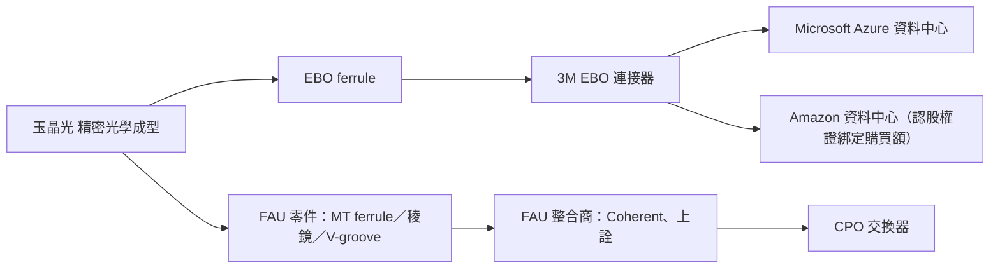

# 3406_玉晶光（市）

## 基本資料

玉晶光（Genius Electronic Optical）1989 年成立，是全球主要手機鏡頭廠，提供手機、車用與 AR/VR 光學方案，主要客戶為 [[AAPL.US(apple)]]（iPhone、iPad 鏡頭）。生產基地在台中（一廠，主做 VR 鏡頭）與廈門（兩廠，消費電子小型鏡頭）。UBS 指出玉晶光自 2025 年中起成長快於 [[3008_大立光（市）]]，股價已高於歷史區間上緣，部分反映光通訊（CPO）題材。

新動能是光通訊精密元件：玉晶光正對 FAU 整合商（如 [[COHR.US(coherent)]]、FOCI 上詮）送樣 FAU 內的三種精密零件（MT ferrule、稜鏡、V-groove），UBS 估 CPO 時代有機會取得 10% TAM。2026-10-15 董事會通過私募 3M UK Limited，並與 [[MMM.US(3m)]] 結盟開發 AI 資料中心與 HPC 光通訊。3M 在 2026-10-19 自家新聞稿確認：預計取得約 4.7% 股權、2026Q4 交割，玉晶光的精密光學製造支援 3M EBO ferrule、CPO 方案與相關光互連應用的量產準備；同日 3M 與 [[AMZN.US(amazon)]] 擴大合作，Amazon 認股權證依其購買光連接等資料中心產品的金額既得（累計 60 億美元全數既得）。

資料來源：[[261015_ubs_genius]]（UBS，2026-10-15）、[[research_產業合作技術發表_2026-10-24]]（3M 新聞稿與 8-K，2026-10-19）。

## 核心技術／競爭優勢

- **精密光學成型**：手機鏡頭量產能力延伸到微透鏡陣列、塑膠成型光學零件。
- **大客戶黏著**：長期供應 Apple 鏡頭。
- **光通訊結盟**：與 3M 合作 EBO（expanded beam optical）擴束光學連接器，3M 透過 [[MSFT.US(microsoft)]] Azure 已有部署，可能把營收貢獻提前到 2027 年（早於玉晶光 CPO 量產的 2028E）。

## 產品與應用

| 產品／服務 | 應用 | 相關客戶／下游 |
|---|---|---|
| 手機鏡頭 | iPhone、iPad 相機 | [[AAPL.US(apple)]] |
| VR／車用鏡頭 | AR/VR 裝置、車載 | 品牌客戶 |
| EBO ferrule（微透鏡＋抗反射鍍膜塑膠件） | 資料中心光纖連接器 | [[MMM.US(3m)]]（EBO 已部署於 Microsoft Azure；終端需求含 [[AMZN.US(amazon)]]） |
| MT ferrule、稜鏡、V-groove | CPO 的 FAU | [[COHR.US(coherent)]]、上詮等 FAU 整合商（送樣中） |

## 圖片 / 架構圖

> 依 UBS 2026-10-15 First Read 整理的光通訊產品路徑；UBS PDF 圖表多為本益比與營收比較圖，故以 Mermaid 表達供應鏈位置。

## EPS 預估

| 年度 | UBS（報告日：2026-10-15） | 共識 | 備註 |
|---|---:|---:|---|
| 2026E | 38.27 | 38.31 | 營收 NT$269.8 億 |
| 2027E | 43.93 | 42.43 | |
| 2028E | 49.22 | 49.77 | |

## 目標價與評等

| 券商 | 報告日 | 評等 | 目標價 | 評價基礎 | 來源 |
|---|---|---|---:|---|---|
| UBS | 2026-10-15 | Buy（重申） | NT$1,250 | P/E SOTP；股價 NT$1,115（先前已由 NT$700 上調） | [[261015_ubs_genius]] |

## 時間軸

| 時間 | 事件 | 類型 | 重要性 | 備註 |
|---|---|---|---|---|
| 2026-10-15 | 董事會通過私募 3M UK 5.54M 股、每股 NT$869.6（較 10-14 收盤 NT$1,065 折價 18.3%），金額 NT$48 億、持股 4.68% | 策略結盟 | ⭐⭐⭐ | 資金用於技術開發、營運資金與還款 |
| 2026-10-19 | 3M 新聞稿確認入股約 4.7%、合作 EBO ferrule／CPO 量產準備；同日 3M 發給 Amazon 最多 3,162,015 股認股權證（行使價 US$164.89、7 年，85% 依購買光連接等產品金額既得，累計 US$60 億全數既得） | 策略結盟 | ⭐⭐⭐ | 官方 fact；3M 新聞稿未揭露 EBO 規格與產能 |
| 2026Q4 | 3M 私募交割 | 策略結盟 | ⭐⭐ | 3M 新聞稿，待交割公告 |
| 2027 | EBO ferrule 透過 3M／Microsoft 可能開始貢獻營收 | 放量 | ⭐⭐ | UBS thesis／中 |
| 2028E | CPO 相關精密零件量產 | 放量 | ⭐⭐ | UBS estimate／中低 |

## 供應鏈位置

- 上游：光學塑料、模具。
- 下游：Apple（手機鏡頭）；光通訊端為 3M、FAU 整合商與 CPO 交換器。
- 所屬主線：[[供應鏈_CPO]]、[[供應鏈_AI光互聯]]。

## 相關公司

| 公司 | 關係 | 說明 |
|---|---|---|
| [[AAPL.US(apple)]] | 客戶 | 主要鏡頭客戶 |
| [[3008_大立光（市）]] | 同業／競爭 | 手機鏡頭主要競爭者，UBS 比較成長速度 |
| [[COHR.US(coherent)]] | 潛在客戶 | FAU 整合商，送樣中 |
| [[MSFT.US(microsoft)]] | 終端使用者 | 3M EBO 已部署於 Azure，非玉晶光直接客戶 |
| [[MMM.US(3m)]] | 客戶／策略股東 | EBO 連接器品牌商；私募入股約 4.7%，玉晶光為其 EBO ferrule 製造夥伴 |
| [[AMZN.US(amazon)]] | 終端使用者 | 與 3M 擴大光連接採購，認股權證綁定累計 US$60 億購買額；非玉晶光直接客戶 |

> [!warning] 風險與注意事項
> - 手機業務仍是營收主體，iPhone 需求與相機升規節奏影響大。
> - 光通訊 TAM（UBS 估 EBO 約 US$1 億：每顆 GPU 4–12 個 ferrule × 2,000 萬顆加速器 × US$1）與 CPO 份額皆為券商推估，尚未有營收驗證。
> - 私募折價 18.3%，對既有股東有稀釋。
> - 3M 的 EBO MSA 於 2026 年 5 月成立，由 Oracle 共同主持，成員含 Meta、Senko、Molex；標準普及速度仍待觀察。
> - SemiAnalysis（2026-10-23）認為 EBO 插入損耗高於 MMC、目前也較貴，會依密度、可維修性與光預算和 MMC 並存；EBO ferrule 需求較可能隨維運密集位置逐步滲透，而非一次換代（thesis／中，見 [[技術_EBO擴束連接器]]、[[技術_MPO]]）。

## 2026-10-28 Citi：EBO 光學連接成為成長動能

- Citi Buy，TP NT$1,050→NT$1,380（本益比由 25x 提高至 33x）；EPS 2026–2028E 33.26／38.13／46.67。3Q26 初步獲利低於預期，受人民幣升值匯損與新專案量產初期毛利率下滑拖累；4Q26 營收季節性下滑，1Q27 標準款新機支撐淡季。
- EBO（Expanded Beam Optical）透過透鏡陣列在光纖間非接觸式傳輸與準直光線，降低灰塵敏感度與清潔需求、提升安裝效率與密度；憑相機鏡頭精密光學與 3M 早期合作切入，估 2027 年營收占比 8%–10%。CPO 與 FAU 的 PMLA 仍需時間。外電：EBO 除部署於 Microsoft 外，接下來還有 AWS，2028 年 TAM 約 US$2bn。（estimate）

## 2026-11-02 UBS PQ 反推與自建損益模型

模型：[[memo_玉晶光PQ模型反推_UBS_20261102]]（Excel：假設、本業、CPO、EBO、年度損益、評價、UBS季度，全公式連動，可切換三情境與私募稀釋）。全部屬本庫反推與自建 estimate；基準 CPO 反推信心中高，其餘信心低至中低。

**UBS 目標價拆解**：NT$1,250＝本業 2028E EPS 49.25 × 15 倍（實算 739，UBS 表上寫 745）＋CPO 2028E EPS 12.70 × 40 倍（508）。UBS 封面財測不含 CPO 與 EBO，CPO 只在評價時加上；目標價 10/12 已定，未計入 10/15 的 3M EBO 合作。

**CPO 反推**：沿用同一位分析師 2026-09-06 大立光模型的 OpM 42.5%、匯率 30，配玉晶光稅率 25%，基準 CPO 營收約 **US$1.5 億＝10% × US$15 億零件 TAM**（為大立光框架 2027 年 FAU TAM US$10.8 億的 1.39 倍）。樂觀／悲觀只能還原營收約 US$4.35 億／US$0.034 億，模型以 20% × US$21.75 億、1% × US$3.42 億表示，拆法不唯一。

**EBO 反推**：UBS 的 US$1 億＝2,000 萬顆加速器 × 每顆 5 個 ferrule × US$1，低於 UBS 自己範圍（4–12 個，US$0.8–2.4 億）的中位數，且隱含 100% 滲透、ferrule 全由玉晶光供應。

**EBO 假設更新（2026-11-02 使用者指引）**：[[memo_玉晶光PQ模型_EBO假設更新_20261102]] 改用 ASP US$1.5（區間 1–2）、毛利率 45%（區間 40%–50%）、**2028E EBO 占總營收 20%**。以 20% 回推，基準每顆 GPU 約 10.2 個 ferrule（在 UBS 4–12 個區間內；樂觀情境 13.0 個超出上限）。之後模型改為逐年輸入用量（[[memo_玉晶光PQ模型_EBO逐年用量_20261102]]），預設各年 10.2 個，換情境時 EBO 占比不再固定為 20%；2028E EBO 營收約 US$3.06 億，約為 UBS ferrule TAM 的 3 倍。2027E 滲透率設 30%，當年占營收約 8.5%，與 Citi 8%–10% 一致。

**基準情境結果（EBO 更新後）**

| 項目 | 2026E | 2027E | 2028E | 2029E | 2030E |
|---|---:|---:|---:|---:|---:|
| 營收（NT$ 百萬） | 26,977 | 32,341 | 45,958 | 48,454 | 51,168 |
| 　EBO 占比 | 0% | 8.5% | 20.0% | 19.0% | 18.0% |
| 　CPO 占比 | 0% | 0% | 9.8% | 9.3% | 8.8% |
| EPS（NT$） | 36.73 | 50.38 | 83.39 | 86.96 | 90.83 |
| 　本業／EBO／CPO | 36.73／0／0 | 43.95／6.42／0 | 49.25／21.41／12.73 | 52.81／21.41／12.73 | 56.68／21.41／12.73 |
| UBS EPS | 36.72 | 43.96 | 49.25 | 52.79 | 56.66 |

- **EBO 敏感度（2028E）**：毛利率 40%／45%／50% 對應 EBO EPS 18.36／21.41／24.47；ASP US$1／1.5／2 不影響營收（占比固定），只改變每顆 GPU 用量需求 15.3／10.2／7.7 個。
- **評價**：複製 UBS SOTP 得 NT$542／1,248／2,369（悲觀／基準／樂觀），與 UBS 公布值誤差 0.5% 以內。加上 EBO（2028E EPS 21.41 × 33 倍，約 NT$707）後，基準約 **NT$1,955**，較 UBS 目標價高 56%；悲觀／樂觀約 NT$1,134／3,261。前版（ASP US$1、每顆 GPU 5 個）基準為 NT$1,446。
- **現價隱含**：NT$1,115 − 本業 739＝376，以 40 倍換算 CPO EPS 9.4，約為 US$15 億 TAM 的 7.4% 市占，等於已計入 UBS 基準 CPO 的約四分之三。
- **私募稀釋**：新增 5.54 百萬股使 EPS 稀釋 4.7%，加回 NT$48.2 億現金後，UBS 目標價等值約 NT$1,232。

> [!warning] 模型與其他來源的差異
> - Citi 估 EBO 2027 年占營收 8%–10%：更新後模型 2027E 為 8.5%，口徑一致；但 Citi 2027E EPS 38.13 低於 UBS 不含 EBO 的 43.96，差異主要在手機本業假設。
> - 2028E 占比 20% 為使用者指引（來源未註明），對應 EBO 營收約 US$3.06 億，是 UBS ferrule TAM US$1 億的 3 倍、外電 2028 年 EBO 整體市場 US$20 億的 15%；每顆 GPU 用量、ASP 與玉晶光市占均無公司或 3M 揭露。
> - CPO 2029E 以後 TAM 持平為預設，UBS 未提供。

## 來源

- [[261015_ubs_genius]] — UBS，2026-10-15；3M 私募與 EBO 合作、CPO 精密零件、Buy／TP NT$1,250。
- [[research_產業合作技術發表_2026-10-24]] — 3M 新聞稿與 Form 8-K，2026-10-19；入股約 4.7%、Q4 交割、Amazon 認股權證條款（官方 fact）。
- [[memo_SemiAnalysis_EBO擴束連接器_20261024]] — SemiAnalysis X 串文，2026-10-23；EBO 原理與 vs MMC 取捨（分析機構觀點；未點名玉晶光）。
- [[memo_Citi_玉晶光3406_EBO成長動能_20261028]]
- [[memo_外電整理_台表科欣興玉晶光旺宏_20261028]]
- [[memo_玉晶光PQ模型反推_UBS_20261102]] — 本庫反推 UBS CPO／EBO P×Q 與自建損益模型（Excel），2026-11-02；estimate／低至中高
- [[memo_玉晶光PQ模型_EBO假設更新_20261102]] — 使用者 EBO 指引（ASP US$1–2、毛利率 40%–50%、2028 年占營收 20%）與更新後模型（Excel），2026-11-02；estimate／低至中低
- [[memo_玉晶光PQ模型_EBO逐年用量_20261102]] — 每顆 GPU EBO ferrule 用量改逐年輸入（預設 10.2 個）的最新版模型（Excel），2026-11-02；estimate／低至中低

## 相關頁面

- [[分析_2026-10-15_台積電3Q26法說與AI硬體券商更新]]
- [[時程_2026Q3Q4_AI網通與硬體催化劑]]
- [[技術_EBO擴束連接器]] — 3M EBO ferrule 技術原理、TAM 假設與風險
