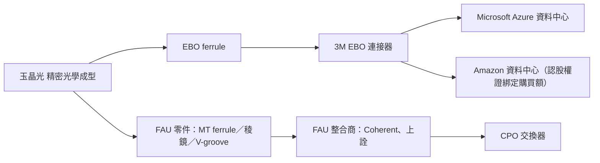

# 3406_玉晶光（市）

## 基本資料

玉晶光（Genius Electronic Optical）1989 年成立，是全球主要手機鏡頭廠，提供手機、車用與 AR/VR 光學方案，主要客戶為 [[AAPL.US(apple)]]（iPhone、iPad 鏡頭）。生產基地在台中（一廠，主做 VR 鏡頭）與廈門（兩廠，消費電子小型鏡頭）。UBS 指出玉晶光自 2025 年中起成長快於 [[3008_大立光（市）]]，股價已高於歷史區間上緣，部分反映光通訊（CPO）題材。

新動能是光通訊精密元件：玉晶光正對 FAU 整合商（如 [[COHR.US(coherent)]]、FOCI 上詮）送樣 FAU 內的三種精密零件（MT ferrule、稜鏡、V-groove），UBS 估 CPO 時代有機會取得 10% TAM。2026-10-15 董事會通過私募 3M UK Limited，並與 [[MMM.US(3m)]] 結盟開發 AI 資料中心與 HPC 光通訊。3M 在 2026-10-19 自家新聞稿確認：預計取得約 4.7% 股權、2026Q4 交割，玉晶光的精密光學製造支援 3M EBO ferrule、CPO 方案與相關光互連應用的量產準備；同日 3M 與 [[AMZN.US(amazon)]] 擴大合作，Amazon 認股權證依其購買光連接等資料中心產品的金額既得（累計 60 億美元全數既得）。

資料來源：[[261015_ubs_genius]]（UBS，2026-10-15）、[[research_產業合作技術發表_2026-10-24]]（3M 新聞稿與 8-K，2026-10-19）。

## 核心技術／競爭優勢

- **精密光學成型**：手機鏡頭量產能力延伸到微透鏡陣列、塑膠成型光學零件。
- **大客戶黏著**：長期供應 Apple 鏡頭。
- **光通訊結盟**：與 3M 合作 EBO（expanded beam optical）擴束光學連接器，3M 透過 [[MSFT.US(microsoft)]] Azure 已有部署，可能把營收貢獻提前到 2027 年（早於玉晶光 CPO 量產的 2028E）。

## 產品與應用

| 產品／服務 | 應用 | 相關客戶／下游 |
|---|---|---|
| 手機鏡頭 | iPhone、iPad 相機 | [[AAPL.US(apple)]] |
| VR／車用鏡頭 | AR/VR 裝置、車載 | 品牌客戶 |
| EBO ferrule（微透鏡＋抗反射鍍膜塑膠件） | 資料中心光纖連接器 | [[MMM.US(3m)]]（EBO 已部署於 Microsoft Azure；終端需求含 [[AMZN.US(amazon)]]） |
| MT ferrule、稜鏡、V-groove | CPO 的 FAU | [[COHR.US(coherent)]]、上詮等 FAU 整合商（送樣中） |

## 圖片 / 架構圖

> 依 UBS 2026-10-15 First Read 整理的光通訊產品路徑；UBS PDF 圖表多為本益比與營收比較圖，故以 Mermaid 表達供應鏈位置。

## EPS 預估

| 年度 | UBS（報告日：2026-10-15） | 共識 | 備註 |
|---|---:|---:|---|
| 2026E | 38.27 | 38.31 | 營收 NT$269.8 億 |
| 2027E | 43.93 | 42.43 | |
| 2028E | 49.22 | 49.77 | |

## 目標價與評等

| 券商 | 報告日 | 評等 | 目標價 | 評價基礎 | 來源 |
|---|---|---|---:|---|---|
| UBS | 2026-10-15 | Buy（重申） | NT$1,250 | P/E SOTP；股價 NT$1,115（先前已由 NT$700 上調） | [[261015_ubs_genius]] |

## 時間軸

| 時間 | 事件 | 類型 | 重要性 | 備註 |
|---|---|---|---|---|
| 2026-10-15 | 董事會通過私募 3M UK 5.54M 股、每股 NT$869.6（較 10-14 收盤 NT$1,065 折價 18.3%），金額 NT$48 億、持股 4.68% | 策略結盟 | ⭐⭐⭐ | 資金用於技術開發、營運資金與還款 |
| 2026-10-19 | 3M 新聞稿確認入股約 4.7%、合作 EBO ferrule／CPO 量產準備；同日 3M 發給 Amazon 最多 3,162,015 股認股權證（行使價 US$164.89、7 年，85% 依購買光連接等產品金額既得，累計 US$60 億全數既得） | 策略結盟 | ⭐⭐⭐ | 官方 fact；3M 新聞稿未揭露 EBO 規格與產能 |
| 2026Q4 | 3M 私募交割 | 策略結盟 | ⭐⭐ | 3M 新聞稿，待交割公告 |
| 2027 | EBO ferrule 透過 3M／Microsoft 可能開始貢獻營收 | 放量 | ⭐⭐ | UBS thesis／中 |
| 2028E | CPO 相關精密零件量產 | 放量 | ⭐⭐ | UBS estimate／中低 |

## 供應鏈位置

- 上游：光學塑料、模具。
- 下游：Apple（手機鏡頭）；光通訊端為 3M、FAU 整合商與 CPO 交換器。
- 所屬主線：[[供應鏈_CPO]]、[[供應鏈_AI光互聯]]。

## 相關公司

| 公司 | 關係 | 說明 |
|---|---|---|
| [[AAPL.US(apple)]] | 客戶 | 主要鏡頭客戶 |
| [[3008_大立光（市）]] | 同業／競爭 | 手機鏡頭主要競爭者，UBS 比較成長速度 |
| [[COHR.US(coherent)]] | 潛在客戶 | FAU 整合商，送樣中 |
| [[MSFT.US(microsoft)]] | 終端使用者 | 3M EBO 已部署於 Azure，非玉晶光直接客戶 |
| [[MMM.US(3m)]] | 客戶／策略股東 | EBO 連接器品牌商；私募入股約 4.7%，玉晶光為其 EBO ferrule 製造夥伴 |
| [[AMZN.US(amazon)]] | 終端使用者 | 與 3M 擴大光連接採購，認股權證綁定累計 US$60 億購買額；非玉晶光直接客戶 |

> [!warning] 風險與注意事項
> - 手機業務仍是營收主體，iPhone 需求與相機升規節奏影響大。
> - 光通訊 TAM（UBS 估 EBO 約 US$1 億：每顆 GPU 4–12 個 ferrule × 2,000 萬顆加速器 × US$1）與 CPO 份額皆為券商推估，尚未有營收驗證。
> - 私募折價 18.3%，對既有股東有稀釋。
> - 3M 的 EBO MSA 於 2026 年 5 月成立，由 Oracle 共同主持，成員含 Meta、Senko、Molex；標準普及速度仍待觀察。
> - SemiAnalysis（2026-10-23）認為 EBO 插入損耗高於 MMC、目前也較貴，會依密度、可維修性與光預算和 MMC 並存；EBO ferrule 需求較可能隨維運密集位置逐步滲透，而非一次換代（thesis／中，見 [[技術_EBO擴束連接器]]、[[技術_MPO]]）。

## 來源

- [[261015_ubs_genius]] — UBS，2026-10-15；3M 私募與 EBO 合作、CPO 精密零件、Buy／TP NT$1,250。
- [[research_產業合作技術發表_2026-10-24]] — 3M 新聞稿與 Form 8-K，2026-10-19；入股約 4.7%、Q4 交割、Amazon 認股權證條款（官方 fact）。
- [[memo_SemiAnalysis_EBO擴束連接器_20261024]] — SemiAnalysis X 串文，2026-10-23；EBO 原理與 vs MMC 取捨（分析機構觀點；未點名玉晶光）。

## 相關頁面

- [[分析_2026-10-15_台積電3Q26法說與AI硬體券商更新]]
- [[時程_2026Q3Q4_AI網通與硬體催化劑]]
- [[技術_EBO擴束連接器]] — 3M EBO ferrule 技術原理、TAM 假設與風險
