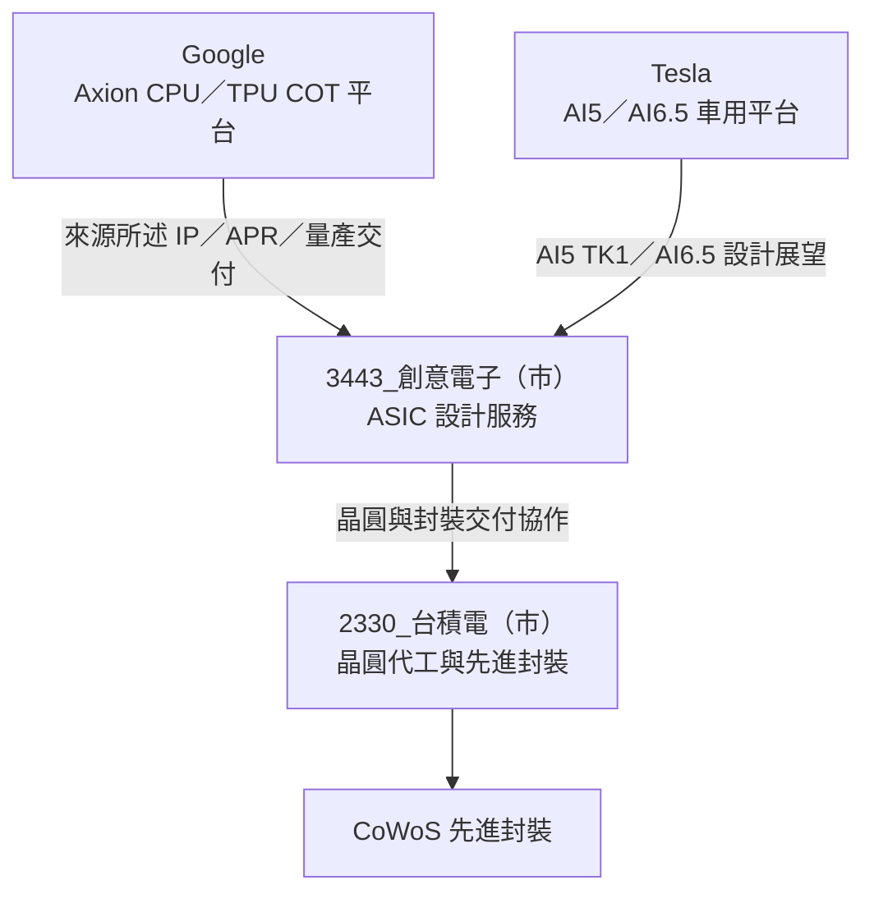

# 3443_創意電子（市）

## 基本資料

> [!info] 客戶歸屬修正（2026-10-12）
> 使用者確認 AI5／AI6.5 應屬 Tesla，與 [[報告_Aletheia_創意電子首次覆蓋_20260922]]（2026-09-22，p2、5–6）一致。本頁既有編譯將車用 AI 系列誤歸 Google，現修正正文與架構圖；原始 memo／Call Memo 保留唯讀。Google 的 Axion CPU／TPU 另列，歷史 350 萬套與 Aletheia 80 萬套估計仍依來源並存，不視為同一模型修正。

創意電子（3443 TT，GUC，Global Unichip Corp）是台積電旗下 ASIC 設計服務公司，提供 ASIC 設計、IP、後段實作與量產交付服務。Google Axion CPU／TPU、Tesla 車用 AI5／AI6.5 分屬不同平台；客戶與服務範圍依各來源的專案假設追蹤。

成長驅動：
1. **Tesla AI5 量產放量**：既有 2026-07-31 Call Memo 估 2Q27 量產、2027 約 350 萬套（原估 200 萬套）；Aletheia 9/22 另估 80 萬套、2H27–2028 收入，量與時點仍待驗證。
2. **Tesla AI6.5 新世代接棒**：既有來源估 4Q26-1Q27 tape-out（TO），使用 TSMC 製程；為來源展望，非已完成節點。
3. **TSMC 深度整合**：GUC 作為 TSMC 子公司，在先進製程（N3/N2）切入深度有先天優勢
4. **Hyperscaler ASIC 定制化趨勢**：Google 持續加碼自研 AI 晶片以降低對 NVIDIA GPU 依賴，GUC 直接受惠

資料來源：[[memo_AI半導體_top_picks_UMC_ABF_MLCC_ASIC_20260601]]（2026-06-01）；[[活動_創意電子3443_CallMemo_20260731]]（法說後 Call Memo，2026-07-31）

## 2Q26 財務結果

| 指標 | 數值 | QoQ |
|------|------|-----|
| 營收 | NT$139億 | +20% |
| 稅後淨利 | NT$15.5億 | — |
| EPS | NT$1.6 | — |
| 1H26 累積營收 | NT$250億 | — |

**毛利率說明**：1Q26 因 NRE 佔比高（早期設計費毛利佳）而較高；2Q26 NRE 金額雖大但進入 Tape-out 階段（光罩費 + 測試 wafer 費推低毛利率），量產毛利率已回升至理想水準。全年毛利率信心維持，惟 NRE「黑豹案」（大型客戶新專案）若延至 2027 年將小幅拖累毛利。

**2Q26 營收組成**：雲端（運算/訓練/連接性）~80%；消費性/加密貨幣/其他 ~20%。下半年組成比例大致不變，但加密貨幣將逐季遞減趨近於零，車用應用逐步填補。

## 重大人事

- **張麗絲**（新任董事長）：台積電 29 年資歷，擁有 DTCO（設計與製程協同優化）深厚背景，是 GUC 與 TSMC 供應鏈深度整合的最強背書。

## 核心技術／競爭優勢

### Daiwa 2026-10-05：量產收入超預期，留意提前出貨

- 9 月營收約 71 億元（MoM +22%、YoY +98%），3Q26 營收約 188 億元（QoQ +35%、YoY +118%），高於 Daiwa／市場預估各約 19%；Turnkey 約 167 億元、占比 89%。營收為報告引用公司實績（fact／中高信心）；晶圓代工產能配置改善、部分 4Q 出貨提前至 3Q 是 Daiwa thesis（中信心），不能把營收超預期直接等同毛利率上升。
- Daiwa 暫未更新獲利模型：3Q26E 淨利 17.13 億元、調整後 EPS 12.78 元；4Q26E 營收 219.71 億元、淨利 29.04 億元、EPS 21.67 元。這些為既有 estimate（中信心），3Q 實際營收超標不代表其獲利預測已同步上修。來源：[[報告_Daiwa_創意電子_20261005]]，2026-10-05。

### 國泰 2026-09-24：量產收入與 NRE 組合

國泰將 3nm 量產、2nm 設計案與 HBM3e／HBM4 IP 列為自研 ASIC 接單動能；其轉述 Turnkey 比重已升至約 83%，外包晶圓與封測成本使營收高速成長、獲利增幅落後。高毛利 NRE 是否同步增加，應與量產規模一起追蹤；上述為 [[報告_國泰_創意_20260924]] 的轉述／thesis，信心中，未新增未具名 CSP 身分。

- **Tesla 車用 ASIC**：AI5／AI6.5 採 TSMC 路線；AI4／AI6 的 Samsung 路線不代表創意承接其全部設計或製造服務。Google 的 Axion／TPU COT 分工另見下方專案表。
- **TSMC 子公司優勢**：能最早取得 N3/N2 先進製程工程資源與產能承諾
- **超大規模 ASIC 能力**：具備 Hyperscaler 等級 AI 加速器全晶片設計（die-level）能力
- **歷史 AI4 訂單敘述**：既有來源記錄訂單上修；屬車用 AI 系列，不能作為 Google TPU 需求證據，創意服務範圍仍待核對。

## AI ASIC 數據

### Tesla 車用 AI 晶片歷史路線圖（來源口徑）

| 世代 | 製程 | 狀態（截至 2026-07） | 出貨量（2027E） | 備註 |
|------|------|---------------------|----------------|------|
| AI4 | Samsung | 量產中 | — | 訂單上調 |
| AI5 | TSMC | MP 2Q27 | ~350 萬套 | 原估 200 萬，大幅上修 |
| AI6 | Samsung | — | — | — |
| AI6.5 | TSMC | TO 4Q26-1Q27 | — | — |

> 歷史時程／350 萬套估計沿 2026-07-31 Call Memo 保留；AI5／AI6.5 的 Tesla 歸屬已由使用者於 2026-10-12 確認。Samsung 路線與 GUC 是否參與須另行核對，不與 Google TPU 版本對應。

## Aletheia 2026-09-22：COT、Turnkey 與獲利模型

創意提供 ASIC 設計服務與量產交付，價值涵蓋 physical implementation、IP 整合、封裝、測試、資格驗證及供應鏈管理。Customer-Owned Tooling（COT）讓 CSP 保有架構／RTL／核心 compute 控制，另向服務商採購後段工程；這與完整 SoC 前端設計、單純 IP 授權的收入／成本結構不同。來源：[[報告_Aletheia_創意電子首次覆蓋_20260922]]（p2、10–13，券商 thesis／中）。

| 專案（來源模型） | TK／製程／封裝 | 2026E／2027E 晶片量 | 判讀／信心 |
|---|---|---|---|
| [[GOOGL.US(alphabet)]] Axion 2 | TK3／N3／SoIC | p15：110 萬／500 萬；p2：116 萬／500 萬 | estimate／中低；正文 p3 另稱 Axion 2 約 400–450 萬、Axion 3 逾 50 萬，不能把系列與單一型號相加 |
| Google Axion 3 | TK3＋IP／N3／SoIC | —／30 萬（p2、15） | estimate／中低；p2 列 4Q27 launch、p3 稱 early-2027 收入／2H27 有意義放量，里程碑待查 |
| [[MSFT.US(microsoft)]] Maia 200／Cobalt 200 | TK3／N3／CoWoS-S、Flip Chip | Maia：—／120 萬；Cobalt：24 萬／20 萬（p2、15） | estimate／中低；p7 Cobalt 2027E 另稱 60 萬，保留分歧；Maia 400 engagement 非已獲單 |
| Tesla AI5（未建公司頁） | TK1／N3（p15 N3P）／Flip Chip | —／80 萬 | channel_check／中低；p5 基板 70–80 萬、前段晶粒逾 100 萬，單位與交付階段不同；2H27–2028 收入情境 |
| [[5274_信驊（市）]] AST2600／AST2700 | TK1／N28、N12／Flip Chip | 合計 2,800 萬／4,800 萬 | estimate／中；p15 拆為 2,400／400 萬及 3,900／900 萬，不是創意自主品牌銷量 |
| 中國匿名車用／網路客戶 | TK1／N5；網路 p2 N5/6 | 車用 24／240 萬；網路 —／120 萬 | estimate／中低；毛利 30% 為券商專案假設，不猜客戶身分 |
| 匿名美國推論／網路新創 | N5 推論 TK1；N3 網路 TK2 | 推論 40／70 萬；網路 —／50 萬 | estimate／中低；p15 的 2026 推論另列 TK3、40.6 萬，與正文服務類型不一致 |

以上是 Aletheia 專案假設，非公司已確認客戶清單或採購承諾；詳見 [[分析_創意COT獲利與營運資金驗證_20260922]]、[[技術_AI推論與ASIC平台]]。

### 規模、毛利與資金門檻

| Aletheia FY 模型（12 月年結） | 2026E | 2027E | 2028E |
|---|---:|---:|---:|
| 營收（億元） | 739.26 | 3,375.30 | 4,817.01 |
| 毛利率 | 21.9% | 20.5% | 19.4% |
| 營業利益率 | 12.8% | 14.9% | 14.9% |
| 淨利（億元） | 85.83 | 449.69 | 640.14 |
| 稀釋 EPS（元） | 63.94 | 332.14 | 472.21 |
| 營運現金流（億元，p18 四捨五入） | -16 | -390 | 562 |
| 自由現金流（億元） | -44 | -426 | 497 |

3Q26／4Q26E 營收 170.30／315.51 億元、EPS 13.90／26.20 元是 **9 月 22 日模型**；不代表在 Daiwa 10 月 5 日披露 3Q 營收 188 億後已重算。各家全年與季度口徑分開比較。p14 正文全年年增 112%、p17／18 表格約 117%／116.5%，保留來源差異。

Aletheia 渠道估計 2027 年度晶圓配置 N3 18 萬片＋N5 5 萬片，對比 2026 N3／N5 合計約 3.5 萬片；p2 的 3 萬片只指 N3。這是創意專案的**全年配置**，不是台積電月產能，也非已完成投片。融資規劃 **NT$65.5bn＝655 億元**：400 億聯貸（可 ±25%，上限 500 億）＋255 億 ECB，用於營運資金／外幣材料採購；8 月 19 日董事會決議為報告轉述（中信心），並不代表全部融資已到位。

報告估 TK1 mix 從 2026 約 20% 到 2027 約 50%，但未完整定義 mix 分母；TK1 毛利 15%–20%、特定案 30%+，TK2 mid-teens、TK3 約 10% 是其轉述管理層範圍。Tesla AI5 模型採 22%、中國車用 30%；TK3 從高個位數提高至低 teens 是券商 thesis，不能把這些範圍平均後當合併毛利。p18 2027 庫存 1,172 億、應收 442 億、營運資金變動 -906 億與淨負債／權益 81.9%，顯示帳面增利仍可能伴隨負現金流（estimate／中低）。

### 未納基準模型的選擇權

Google TPU v10 Icefish 的 GLink3D／APR、[[META.US(meta)]] MTIA600 Phoebe、[[AMZN.US(amazon)]] Graviton6、[[SNDK.US(sandisk)]]／[[000660.KR(sk_hynix)]] HBF 與 CPO 均未納報告基準模型。Meta 30 萬顆 TK3 約加 25 元 EPS、AWS 100 萬顆 TK3 約加 40 元是有條件敏感度，不能直接加到 332.14／472.21 元。Maia 300 為 [[MRVL.US(marvell)]] 得標的說法來自券商，創意 Maia 400 仍是 engagement／勝率判斷。Lightmatter、Ayar Labs 等尚未建頁公司只保留來源與分析。

> [!warning] 來源內部不一致
> p15 專案表 2027 總 EPS 印 322.82，A＋B＝276.40＋55.74＝332.14；正文財測 p14／17 均 332.14。本頁以財測表記錄，同時保留錯列值。p15 分項 revenue mix 合計逾 100%，Revenue (US$ k) 的標示與數值尺度亦待核對，不用該欄重新加總收入。p15 同頁先稱以 FY27／28 平均 EPS 估值，末段又稱不採 FY28 作基準；p1 股價 7,615 與 P/E 列的隱含價格不符。另 p5 圖6 的 v8t／v8i compute、變體名稱及 I/O 分工與 p2／4 正文對不上，不採該表作設計得標證明。

來源：[[報告_Aletheia_創意電子首次覆蓋_20260922]]（2026-09-22，p1–18）；模型 estimate／中低、公司資訊轉述／中，未另行外部查證。

## 圖片 / 架構圖

![[報告_Aletheia_創意電子首次覆蓋_20260922_p010.png]]
圖說：p10 圖13 依 Spec／Netlist／GDS／Mask／Logistics 顯示服務交付範圍；TK 數字是接手成熟度，不是晶片世代或必經順序。

![[報告_Aletheia_創意電子首次覆蓋_20260922_p014.png]]
圖說：p14 財測表以 NT$mn 與稀釋 EPS 列示；2027／28E 332.14／472.21 元為券商估計，並與同頁正文不同的成長率分開。

![[報告_Aletheia_創意電子首次覆蓋_20260922_p015.png]]
圖說：p15 專案模型原表保存 322.82 總 EPS、收入單位與 mix 的疑義，不據此修正來源；財測引用以 p14／17 口徑並註分歧。

![[報告_Aletheia_創意電子首次覆蓋_20260922_p018.png]]
圖說：p18 財務表以 NT$bn 呈現；2027 營運現金流 -39.0bn、FCF -42.6bn，均是營運資金先墊付下的券商模型。

![[報告_Daiwa_創意電子_20261005_月營收.png]]
圖說：Daiwa 2026-10-05 的公司月營收與年增率圖，呈現 Turnkey 放量帶來的營收躍升；圖表不揭露 NRE／Turnkey 各自毛利率。

![[報告_國泰_創意_20260924_營收與毛利.png]]
圖說：國泰 2026-09-24 的月營收與季度 EPS／毛利率圖，說明營收成長與毛利率可能不同步；左圖橫軸實為月份。

![[ubs 3443_001.png]]
*圖（UBS，2026-07-30）：創意電子股價與券商歷史目標價軌跡。目標價屬券商估值，不代表公司營運指引。*

圖說：Google 與 Tesla 為不同客戶平台；服務範圍依 Aletheia 2026-09-22 與歷史 Call Memo，歸屬修正於 2026-10-12。平台合作不表示每個世代均已獲單，亦不表示所有專案均用 CoWoS。

## EPS 預估

| 季度 | Daiwa EPS（元，2026-10-05） | 淨利（億元） | 分類／信心 |
|------|---------------------------|--------------|-----------|
| 3Q26E | 12.78 | 17.13 | estimate／中；營收超標後尚未改模型 |
| 4Q26E | 21.67 | 29.04 | estimate／中；維持原預估 |

來源：[[報告_Daiwa_創意電子_20261005]]。季度調整後 EPS 不直接與下方各券商全年 EPS 相加或混用。

| 年度 | 國泰 EPS（2026-09-24） | UBS EPS（2026-09-22） | Aletheia 稀釋 EPS（2026-09-22） | Morgan Stanley EPS（2026-07-31） |
|---|---:|---:|---:|---:|
| 2026E | 48.01 | 58.23 | 63.94 | 44.04 |
| 2027E | 105.91 | 139.12 | 332.14 | 124.37 |
| 2028E | — | 194.34 | 472.21 | 189.50 |

來源：[[報告_國泰_創意_20260924]]、[[報告_UBS_創意電子CPU專案與CSP成長_20260922]]；均為 estimate／中信心，模型差異並存。國泰單頁未揭露目標價或明確評等，不以當時本益比推算目標價。

Aletheia：[[報告_Aletheia_創意電子首次覆蓋_20260922]] p14／17（estimate／中低，內部專案表另列 322.82）；MS：[[報告_MorganStanley_創意電子_20260731]]。Aletheia 對比其報告所引 Bloomberg 共識 2027／28E 120.74／191.57，約高 175%／146%；不是最新市場共識。

## 目標價與評等

| 分析來源 | 報告日 | 評等 | 目標價 | 評價基礎 | 來源 |
|---------|--------|------|--------|----------|------|
| Aletheia | 2026-09-22 | Buy／首次覆蓋 | NT$12,000 | 30x FY27–28E 平均 EPS（p1、15）；同頁末段又稱不採 FY28，估值口徑保留疑義 | [[報告_Aletheia_創意電子首次覆蓋_20260922]] |
| UBS | 2026-09-22 | Buy | NT$8,660 | 52x FY27–28E 平均 EPS | [[報告_UBS_創意電子CPU專案與CSP成長_20260922]] |
| Morgan Stanley | 2026-07-31 | Overweight | NT$5,688 | 原來源估值；與較新券商並列 | [[報告_MorganStanley_創意電子_20260731]] |
| Daiwa | 2026-10-05 | Buy (1) | NT$5,125 | 63x 未來四季 EPS；維持原模型 | [[報告_Daiwa_創意電子_20261005]] |
| 買方研究員 | 2026-06-01 | 推薦（ASIC picks） | NT$10,000 | — | [[memo_AI半導體_top_picks_UMC_ABF_MLCC_ASIC_20260601]] |

## 時間軸

| 時間／窗口 | 事件 | 類型 | 重要性 | 來源與驗證 |
|---|---|---|---|---|
| 2026Q4 | Axion2／中國車用收入加速，4Q營收估 315.51 億元 | 放量／財測 | ⭐⭐⭐ | Aletheia 9-22 estimate／中低；與後續 Daiwa 提前出貨模型並列；[[時程_2026-2028十月券商催化劑]] |
| 2027 | N3／N5 全年配置估 18／5 萬片、10+ TK1 案貢獻 | 配置／量產 | ⭐⭐⭐ | channel_check／中低，非月產能／已投片；同時驗證現金循環；[[時程_2026-2028十月券商催化劑]] |
| 2027（內部分歧） | Axion3：p2 4Q27 launch；p3 early-year 收入、2H27 放量 | 驗證 | ⭐⭐⭐ | 不合併成確定時點；[[時程_2026-2028十月券商催化劑]] |
| 2027H2–2028 | Tesla AI5 Turnkey 收入、2027 約80萬套模型 | 放量／驗證 | ⭐⭐⭐ | estimate／中低；Tesla歸屬已確認，與舊來源350萬套估計並存；[[時程_2026-2028十月券商催化劑]] |
| 2028 起（情境） | Meta開發、AWS可能GA、HBF／CPO量產條件 | 設計／選擇權 | ⭐⭐ | 未納基準，逐案驗證；[[時程_2026-2028十月券商催化劑]] |

| 時間 | 事件 | 類型 | 重要性 | 備註 |
|---|---|---|---|---|
| 2026Q4（預估） | AI CPU／加速器量產延續，追蹤 3Q 提前出貨後的營收與毛利組合 | 放量／驗證 | ⭐⭐⭐ | Daiwa 維持季營收 219.71 億元模型；estimate／中信心；[[時程_2026Q3Q4_AI網通與硬體催化劑]] |

| 時間 | 事件 | 類型 | 重要性 | 備註 |
|---|---|---|---|---|
| 2026Q4（預估） | 北美 AI ASIC／CPU 擴大量產，單季營收估 192 億元 | 放量／驗證 | ⭐⭐⭐ | 國泰 2026-09-24 轉述市場預期；Turnkey 約 83%，NRE 成長為毛利率關鍵；[[時程_2026Q3Q4_AI網通與硬體催化劑]] |

| 時間 | 事件 | 類型 | 重要性 | 備註 |
|------|------|------|--------|------|
| 2026-Q2 | AI4 訂單增加；Turnkey 雲端大量出貨 | 訂單/量產 | ⭐⭐⭐ | 2Q26 營收 NT$139億（+20% QoQ），超預期 |
| 2026-Q2 | 圖靈中心試營運 | 研發基礎建設 | ⭐⭐ | 執行中小型專案；2H26 全面啟用 |
| 2026-H2 | 北美 CPU 下一代案量產 | 量產 | ⭐⭐⭐ | 今年底或明年初 MP |
| 2026-Q4 ～ 2027-Q1 | AI6.5 tape-out（TO） | 設計里程碑 | ⭐⭐⭐ | 下一世代設計確認，使用 TSMC 製程 |
| 2027 | 中國座艙合一客戶貢獻 | 量產 | ⭐⭐ | DRAM 64GB→40GB 精簡設計；明年起看到貢獻 |
| 2027-Q2 | Tesla AI5 進入量產（MP） | 量產 | ⭐⭐⭐ | 歷史來源預估；200萬→350萬套，原表200M／350M為單位誤植；與Aletheia時點並列 |
| 2027 全年 | AI5 出貨 ~3.5M 套 | 放量 | ⭐⭐⭐ | vs 原估 2M，大幅上修 |
| 2026-10（OCP，緯穎 10-20 回顧） | 與緯穎、Ayar Labs 展示機櫃級 CPO 實機光鏈路（創意多晶片封裝＋TeraPHY） | 技術展示 | ⭐⭐ | [[research_產業合作技術發表_2026-10-22]]；夥伴新聞稿 fact，未揭露客戶與量產時程 |

## 業務策略定位

### TK 分層（Turnkey 服務等級）

2026-09-22 Aletheia p10–13 用交付成熟度細分如下。低 TK 數字代表較早接手，並非三個連續世代；晶片核心 architecture／RTL 可由客戶保有，不宜把 TK1 一概叫「前端設計」。

| 層級 | 客戶交付 | 創意執行範圍 | 商業限制 |
|---|---|---|---|
| TK1 Netlist-in | 已完成邏輯設計／合成的 netlist | Floorplan、APR、時脈／電源、DFT、STA、DRC/LVS、GDSII、封裝測試與量產 | PPA／良率／時序收斂是工程門檻；契約可能有額外 IP／整合責任 |
| TK2 GDS-in | 已 sign-off 的 GDSII | 光罩／tape-out 協調、封裝／基板／RDL、SI/PI/thermal、CP/FT、qualification、量產 | 主體晶粒 placement／routing 已定，問題可能需客戶改版；先進封裝仍有大量工程 |
| TK3 Production transfer | 已建立設計、封裝、測試與生產流程 | 測試相關性、良率與品質追蹤、供應商驗證、產能／採購及物流 | NRE 較少但有營運資金與交付風險；不是只接一份 GDSII |

來源：[[報告_Aletheia_創意電子首次覆蓋_20260922]]（服務定義轉述／中），流程詳 [[技術_AI推論與ASIC平台]]；以下保留 7 月法說既有較粗口徑供對照，與新定義不能直接混用。

GUC 明確以 TK1/TK2/TK3 區分服務深度，成本結構與收費標準各異，**不以低價搶進 TK1**：

| 層級 | 聚焦 | 特點 |
|------|------|------|
| TK1 | 前端設計（RTL → Physical） | 技術含量最高；不低價競爭 |
| TK2 | 封裝設計（Advanced Packaging） | CoWoS、先進封裝整合 |
| TK3 | 定位差異化，不屬上述 | 多元 NRE/Turnkey 組合 |

**與 Broadcom 的差異化策略**：不與產品公司正面競爭（Broadcom 毛利率 50%+，GUC 設計服務 30-40%），採「從 RTL 往下走 + 從封裝設計往上整合」策略，以 Physical Synthesis / Physical Implementation + Advanced Packaging 優勢卡位。

### 主要客戶驅動力（2Q26 法說更新）

| 客戶類型 | 現況 | 展望 |
|---------|------|------|
| 北美 CSP（主力）| Turnkey 雲端出貨大增，是 2Q26 超預期主因 | 下一代 CPU 案已取得，MP 今年底或明年初 |
| 北美車用 + 機器人 | 車用案延伸至機器人應用 | 成長時點取決客戶機器人工廠轉型進度 |
| 中國車用（座艙合一） | DRAM 用量由 64GB 降至 40GB，技術快速成熟 | 看好 2027 年起貢獻 |
| 加密貨幣客戶 | 約 20% 但逐季遞減 | 趨近於零；車用填補 |
| CPO 客戶 | 目前多為小型新創 | 已與大型客戶接觸中，戰略卡位優先 |

### 圖靈中心（Turing Center）

- 2Q26 起試營運，執行中小型專案
- 2H26 全面啟用，支援 N3/N2 及先進封裝研發
- 費用結構：圖靈中心本身費用穩定（主要為固定折舊），額外費用增量來自 CPO / IVR / UCIe / N2 新製程開發

→ 跨公司 ASIC 比較詳見 供應鏈_ASIC設計服務

## 供應鏈位置

- 所屬集團：台積電（TSMC）子公司（GUC = TSMC 旗下 ASIC 設計服務）
- 上游製程：[[2330_台積電（市）]]（AI5/AI6.5 TSMC N3 代工）、Samsung Foundry（AI4/AI6）
- 來源所述客戶：Google（Axion CPU／TPU COT）、Tesla（車用 AI5／AI6.5）；專案範圍與量產量依來源驗證
- 對標公司：[[3661_世芯-KY（市）]]（Alchip，Amazon Trainium 設計）、[[2454_聯發科（市）]]（MTK，xAI Dojo 3 潛在設計服務）

## 相關公司

[[GOOGL.US(alphabet)]] Axion CPU、[[MSFT.US(microsoft)]] Maia／Cobalt、[[5274_信驊（市）]] AST 系列為 Aletheia 專案模型中的客戶；[[2330_台積電（市）]] 提供晶圓與先進封裝。[[2454_聯發科（市）]] 的 I/O 與創意 APR／IP 在 COT 路線可能互補，亦有服務範圍競爭；[[MRVL.US(marvell)]] 是 Maia 設計方／同業比較，未確認 Maia400 轉單。[[META.US(meta)]]／[[AMZN.US(amazon)]] 為未納基準的潛在專案，[[SNDK.US(sandisk)]]／[[000660.KR(sk_hynix)]] 的 HBF／控制器合作為渠道研判，未經對手公司確認。上述均保留 2026-09-22、estimate／channel_check／中低信心；新公司只留來源／分析，不建公司頁。

| 公司 | 關係 | 說明 |
|------|------|------|
| [[2330_台積電（市）]] | 母公司 / 代工廠 | TSMC 持有 GUC 多數股份；AI5/AI6.5 採 TSMC N3/N2 製程 |
| [[3661_世芯-KY（市）]] | 同業 / 比較 | Alchip，Amazon Trainium 設計，不同 Hyperscaler 服務 |
| [[2454_聯發科（市）]] | 同業 / 比較 | Google ASIC 的 I/O／APR 分工可能互補或競爭；GUC 另有 Tesla 車用平台 |
| [[6669_緯穎（市）]] | CPO 系統合作 | OCP 2026 機櫃級 CPO 展示的系統整合方 |
| [[Ayar_Labs（未）]] | CPO 合作（光引擎） | TeraPHY 光引擎與創意多晶片封裝整合 |

> [!note] 觀察事項
> - AI5 出貨量由 2M 上調至 3.5M，為近期最大正面修正
> - AI6.5 TO 時間（4Q26-1Q27）提供 2028 年後持續成長能見度
> - AI4 訂單上調為歷史車用平台敘述，不能推導 Google TPU 需求

> [!warning] 風險與注意事項
> - **Google 集中度風險**：客戶過度集中在 Google，若 Google 削減 AI 資本支出或轉向其他設計服務商，GUC 衝擊大
> - **客戶平台與服務範圍**：Tesla AI4／AI6 的 Samsung 路線不直接表示 GUC 訂單；須核對實際設計、IP 或交付責任
> - **競爭壓力**：MediaTek 亦積極搶攻 Hyperscaler ASIC 設計服務市場（如 Google ZebraFish/v8t、xAI Dojo 3）

## OCP 2026 CPO 實機展示（緯穎新聞稿 2026-10-20）

- [[6669_緯穎（市）]] 2026-10-20 OCP 回顧新聞稿：緯穎、[[Ayar_Labs（未）]] 與創意展示機櫃級 CPO 架構，由創意的多晶片封裝整合 Ayar Labs TeraPHY 光引擎，即時遙測確認光鏈路運作，熱與波長漂移下訊號穩定（fact／高）。
- 對照本頁「CPO 客戶目前多為小型新創、已與大型客戶接觸中」：本次仍是展示，未揭露客戶或量產時程，不推定為 CPO 營收開始貢獻。
- 來源：[[research_產業合作技術發表_2026-10-22]]（緯穎新聞稿，2026-10-20）。

## 來源

- [[research_產業合作技術發表_2026-10-22]] — 緯穎 OCP 2026 回顧新聞稿，2026-10-20；創意參與機櫃級 CPO 展示。
- [[報告_Aletheia_創意電子首次覆蓋_20260922]] — Aletheia Capital，2026-09-22；Buy 首次覆蓋、TP／稀釋 EPS、COT／TK分工、晶圓配置、專案與現金流；內部歧異詳本頁及分析。

- [[報告_Daiwa_創意電子_20261005]] — Daiwa，2026-10-05；9 月／3Q 營收、Turnkey 組合與未更新的 4Q 模型。

- [[報告_國泰_創意_20260924]] — 國泰證期研究部，2026-09-24；EPS、Q4 營收與 NRE／Turnkey 組合。

- [[memo_AI半導體_top_picks_UMC_ABF_MLCC_ASIC_20260601]]（2026-06-01）
- [[memo_AI半導體_top_picks_update_UMC_Kaori_ABF_20260615v2]]（2026-06-15）
- [[活動_創意電子3443_CallMemo_20260731]]（2Q26 法說後 Call Memo，2026-07-31）

- [[260731_daiwa_guc]]（2026-07-31）
- [[260824_3443_3661_2454_ms_AI-supply-chain]]（2026-08-24）
- [[Daiwa-3443 20260805]]（2026-08-05）
- [[memo_AI半導體供應鏈更新_20260521]]（2026-05-21）
- [[memo_AI半導體周更_20260601]]（2026-06-01）
- [[memo_AI半導體周更_20260615a]]（2026-06-15）
- [[memo_AI半導體周更_20260615b]]（2026-06-15）
- [[memo_AI半導體周更_20260727]]（2026-07-27）
- [[ubs 3443]]（2026-07-30）
- [[創意(3443,B_買進)-CTBC260803]]（2026-08-03）
- [[報告_MorganStanley_創意電子_20260731]]（2026-07-31）
- [[報告_UBS_創意_20260915]]（2026-09-15）
- [[報告_UBS_創意電子_20260915]]（2026-09-15）
- [[活動_創意電子3443_法說逐字稿_20260731]]（2026-07-31）

- [[報告_Citi_US市場回饋_AI硬體_20260920]]（2026-09-20）

- [[報告_Aletheia_2027AI加速器產能_20260812]]（2026-08-12）
- [[報告_BofA_OCPAPAC峰會_20260813]]（2026-08-13）

- [[報告_UBS_ASIC_CPU驅動CoWoS擴產_20260922]]（2026-09-22）
- [[報告_UBS_創意電子CPU專案與CSP成長_20260922]]（2026-09-22）

- [[月營收評析-ASIC與PMIC產業-CTBC260914]]（2026-09-14）

- [[報告_富邦_北京上海路演ASIC_20261019]]（2026-10-19）

## 相關頁面

- [[供應鏈_CPO]]
- [[技術_CPO]]
- [[分析_2026-10-15_台積電3Q26法說與AI硬體券商更新]]
- [[分析_創意COT獲利與營運資金驗證_20260922]]
- [[技術_CoWoS與先進封裝]]
- [[技術_NAND快閃記憶體]]
- [[時程_2026-2028十月券商催化劑]]

- [[技術_AI推論與ASIC平台]]
- [[分析_半導體AI供應鏈與NPO轉折_20260824]]
- [[AMZN.US(amazon)]]
- [[分析_2026-08記憶體_AI需求與液冷ASIC更新]]
- [[時程_2026記憶體與AI催化劑]]
- [[時程_2026Q3Q4_AI網通與硬體催化劑]]
- [[分析_聯發科AI_ASIC]]

## UBS 2026-07-30 更新

- 2Q26 EPS NT$11.61，高於 UBS 上修後預估；毛利率 21.5%，反映先進製程 NRE 與 turnkey 銷售組合。
- UBS 維持 Buy、目標價 NT$6,500，2026E／2027E EPS 分別為 NT$52.96／104.14，均屬券商 estimate。

來源：[[報告_MorganStanley_創意電子_20260731]]（Morgan Stanley，2026-07-31）。

### 2026-07-31 Daiwa 更新

- 2Q26 營收高於預期但毛利率 21.5% 受產品組合拖累；Daiwa 認為 TSMC 產能配置改善有助 2H26 AI CPU 與 NRE 專案出貨。
- 估值與 AI ASIC／車用專案仍屬券商 estimate；來源：[[260731_daiwa_guc]]（Daiwa，2026-07-31）。

## Daiwa 2026-08-05 更新

- Daiwa 因晶圓代工夥伴釋出更多產能及費用控制，上修 2026–2028E EPS 9–19%；Turnkey 2026 年營收估年增逾一倍至 NT$54bn，均屬券商 estimate。
- AI 專案量增但毛利率稀釋，Daiwa 仍估營業利益率改善至 14–15%；12 個月目標價由 NT$4,525 上調至 NT$5,125，評等升至 Buy。
- 關鍵驗證為晶圓代工產能支持、AI CPU／accelerator 量產與 advanced packaging 執行，不能將預估營收視為已確認訂單。

來源：[[Daiwa-3443 20260805]]（Daiwa，2026-08-05；券商 estimate）。

## UBS 台灣高峰會更新（2026-09-15）

- 管理層將 2026 年營收成長展望由年增 36% 上調至約 100%，主因取得較佳晶圓支援；當前北美 CSP CPU turnkey 案為 2026H2 主力，下一代 dual-die CPU 預計 2026 年底開始貢獻、2027 年更顯著。
- 中國 ADAS 專案預計 2026 年底起有收入，美國 3nm ADAS 案則目標 2027H2；其他 CSP CPU／ASIC 及 CPO 仍是設計導入階段。時程、客戶與營收均屬管理層／券商展望，不視為已確認訂單。

來源：[[報告_UBS_創意電子_20260915]]。

## Morgan Stanley 2026-07-31 更新

- 2Q26 營收 NT$13.897bn、EPS NT$11.61，高於 MS／市場預估；毛利率 21.5% 受 NRE／turnkey 組合影響。
- 管理層確認取得「下一代美國車用客戶 AI 晶片」design win；Morgan Stanley 推測為 Tesla AI6，但客戶身分屬券商 thesis，未寫成公司已確認事實。
- 下一代 Google CPU 預計 2026 年底至 2027 年初 tape-out；管理層表示可支援其他封裝技術，MS 推測意指 Intel EMIB-T。
- MS 對 2027 年 CoWoS 大客戶為 Meta ASIC 與歐洲 AI 新創的說法同屬券商推測；TSMC 產能配置預計兩個月內更明朗。
- MS 維持 Overweight、目標價 NT$5,688；2026E／2027E／2028E EPS NT$44.04／124.37／189.50，均屬 estimate。

來源：[[報告_MorganStanley_創意電子_20260731]]（Morgan Stanley，2026-07-31）。

## UBS 2026-09-15 台灣高峰會更新

- 8 月營收 NT$5.84bn，年增 111%；受較佳晶圓支援，管理層將 FY26 營收成長展望由年增 36% 上調至約 100%，並維持全年毛利率 20% 以上。
- 北美 CSP CPU turnkey 案為 2026H2 主力；下一代 dual-die CPU 案預計 2026 年底開始貢獻、2027 年放大。其他 CSP 的 CPU／ASIC 收入預計 2026H2 起逐步出現，但有意義的 turnkey 收入仍可能要到 2028 年。
- 中國 ADAS turnkey 預計 2026 年底開始，美國 3nm ADAS 案目標 2027H2；GUC 與夥伴計畫於 2026 年底前完成 TSMC COUPE tape-out。客戶、時程與收入均屬管理層／券商展望。
- UBS 維持買進、目標價 NT$6,700；2026E／2027E EPS 為 NT$58.01／108.09，屬券商 estimate。

來源：[[報告_UBS_創意電子_20260915]]（UBS，2026-09-15）。

## Citi 2026-09-20 更新

- Citi 將 Google TPU 生態的執行重點放在 MediaTek 與 GUC 的分工：聯發科擴大 I/O／SerDes 及部分 compute implementation，GUC 則承接 Google CPU 的 COT、backend-only service；個別世代、客戶與量產份額仍屬券商觀點。
- Google／MediaTek 採 Intel EMIB-T 的封裝路線可能面臨初期良率與高量產爬坡限制；Citi 認為複雜整合工作會分散至基板與 OSAT 夥伴，不能直接把此路線等同於已確認的 GUC 訂單。

來源：[[報告_Citi_US市場回饋_AI硬體_20260920]]（Citi，2026-09-20；券商觀點／信心中）。

## 2026-09-22 UBS 更新

- UBS 將 2026／2027／2028E EPS 上調至 NT$58.23／139.12／194.34，維持 Buy、目標價由 NT$6,700 調升至 NT$8,660（52 倍 2027–28E 平均 EPS）。上述均為券商 estimate，不代表公司財測。
- UBS 預估 Google CPU 出貨由 2026E 130 萬套升至 2027E 約 400 萬套，Google CPU 約占 2027E 營收 67%；晶圓配置、TPU 出貨與 CPU/TPU 比例是此假設的主要驗證點。
- 報告另將 [[MSFT.US(microsoft)]] Maia 200、[[META.US(meta)]] 2nm ASIC（最快 2028 年中）與車用案列為中期選擇權；客戶、得標與收入時程均屬 UBS 判斷，未視為已確認訂單。

來源：[[報告_UBS_創意電子CPU專案與CSP成長_20260922]]（UBS，2026-09-22；券商 estimate／中信心）。

## 2026-10-19 富邦北京／上海路演回饋

- 富邦投顧在北京／上海路演中維持 ASIC 產業「優於大盤」，並表示長期最看好創意，理由是其在 AI XPU、CPU 與車用領域的市占提升幅度最大（thesis／中）。
- 富邦產業調查稱至 2029 年量產的主要 ASIC 專案分配已大致確定，哪些專案能量產、設計服務廠間的機會分配已有較高能見度；短期 ASIC 首選則為 [[AVGO.US(broadcom)]]。

來源：[[報告_富邦_北京上海路演ASIC_20261019]]（富邦投顧，2026-10-19）。
