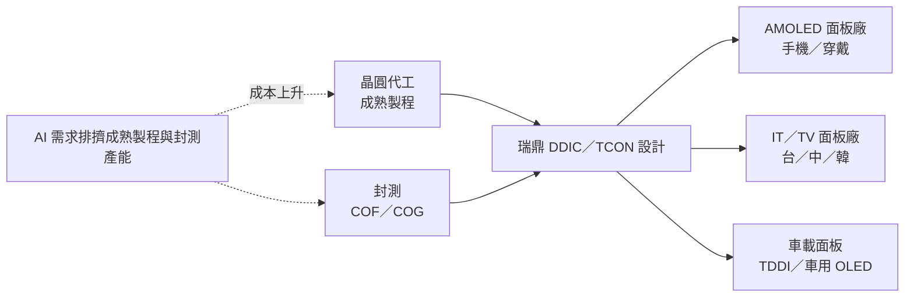

# 3592_瑞鼎（市）

## 基本資料

| 項目 | 內容 |
|------|------|
| 全名 | 瑞鼎科技股份有限公司（Raydium Semiconductor） |
| 代號 | 3592（TWSE 上市） |
| 定位 | 顯示驅動 IC（DDIC）IC 設計：中小尺寸 AMOLED（手機、穿戴）、大尺寸（IT／TV）、車載工控（TDDI、車用 OLED） |
| 3Q26 營收結構 | 大尺寸 31%、中小尺寸 46%、車載工控 23%（車載工控連兩季創新高，首度突破兩成） |
| 3Q26 財務 | 營收 65.65 億元（QoQ −3.8%、YoY +21%）；毛利率 26.4%（QoQ +0.7ppt）；營益率 4.7%；EPS 4.11 元 |
| 1～3Q26 | 營收 188.24 億元（YoY +10.1%）；毛利率 26.8%；EPS 12.46 元 |

資料來源：[[活動_瑞鼎3592_國泰CallMemo_20261105]]（國泰證期 call memo，2026-11-05；fact）。

## 核心技術／競爭優勢

- AMOLED DDIC：手機（折疊、高解析度、高更新率高階機種）、穿戴（長期大幅領先）；推出適用維修市場的產品，客戶接受度高。
- 大尺寸：monitor／notebook 高更新率 driver＋TCON 整體配套方案已量產；TCON 已通過數個面板客戶認證，品牌客戶驗證中，2026 年底有機會取得品牌導入專案。
- 車載工控：車用 TDDI 導入持續增加；車用 OLED 已在少數車廠小量量產，2027 年逐步放大。
- 新顯示技術：Micro LED 已有客戶採用、2027 年新客戶量產；膽固醇液晶驅動 IC 第二代即將量產。
- 供應鏈：台灣晶圓廠與封測產能傾向 AI，逐步增加中國與其他地區晶圓與封測供應，滿足中國客戶在地化需求。

## 產品與應用

| 產品線 | 3Q26 占比 | 3Q26 狀況 | 4Q26 展望 |
|--------|-----------|-----------|-----------|
| 中小尺寸 AMOLED | 46% | 手機備貨結束、拉貨減弱；高階穿戴強勁 | 消費性需求減弱，動能走緩 |
| 大尺寸（IT／TV） | 31% | IT、TV 需求轉弱，出貨下滑 | 筆電受庫存調整與記憶體漲價影響，拉貨明顯減弱；TV 平穩 |
| 車載工控 | 23% | 客戶備貨＋旺季，超出預期 | 季節性淡季，小幅衰退 |

## 圖片 / 架構圖

圖說：瑞鼎為 fabless DDIC 設計公司，上游為成熟製程晶圓與封測，下游為面板廠；2026～2027 年 AI 需求排擠成熟製程與後段封測產能，使晶圓與封測成本上升，公司擬於 2027 年調升 ASP 轉嫁。本頁暫無來源圖，以 Mermaid 補位。

## EPS 記錄

| 季度 | EPS（元） | 備註 |
|------|-----------|------|
| 3Q26 | 4.11 | 稅後淨利 3.12 億元（QoQ −9.4%、YoY −9.3%） |
| 1～3Q26 | 12.46 | 稅後淨利 9.45 億元（YoY −11.6%） |

## 時間軸

| 時間 | 事件 | 類型 | 重要性 | 備註 |
|------|------|------|--------|------|
| 4Q26 | 備貨淡季＋記憶體漲價，營運動能較 3Q26 放緩；筆電大幅庫存調整 | 營運 | ⭐⭐ | 公司說法 |
| 2026 年底 | TCON 有機會取得品牌客戶導入專案 | 新產品 | ⭐⭐ | 公司說法／中 |
| 2027 | 晶圓代工與封測成本上調，擬調升 ASP；OLED 手機與 IT 滲透率提升 | 漲價 | ⭐⭐⭐ | 公司說法；同業同步調價 |
| 2027 | 車用 OLED 擴大量產；Micro LED 新客戶量產 | 放量 | ⭐⭐ | 公司說法 |

## 供應鏈位置

- 環節：顯示驅動 IC 設計（fabless）。
- 上游：成熟製程晶圓代工與 COF／COG 封測；台灣產能受 AI 排擠，逐步分散至中國與其他地區。
- 下游：AMOLED、IT／TV、車載面板廠（中國、台灣、韓國），主流手機品牌皆有合作。

## 相關公司

原文未點名具體客戶或供應商，暫不填 `related_companies`。

## 近期營運與研究更新

### 2026-11-05 國泰證期 call memo（3Q26 法說）

- 3Q26 營收 65.65 億元（QoQ −3.8%、YoY +21%），毛利 17.36 億元，毛利率 26.4%（QoQ +0.7ppt、YoY −2.2ppt）；營業利益 3.08 億元，營益率 4.7%；稅後淨利 3.12 億元，EPS 4.11 元。季底現金 37.78 億元、應收帳款 46.11 億元、總資產 210.3 億元。3Q26 整體結果略優於內部預期，主因車載工控穩健與 AMOLED 手機需求降幅小於預期。
- 毛利率：成本於 2Q26 季初即上升，部分 ASP 調漲於 2Q26 底才生效，3Q26 開始反映；未回答何時回到 2025 年約 28.5%。
- 2027 年：內部期望營收持續成長，出貨量增加加上成本上升轉嫁，ASP 應會上升；手機整體需求可能衰退，但記憶體漲價對 LCD 手機衝擊最大，OLED 滲透率可能快速提升，對公司有利；IT 需求保守但 OLED 滲透率提升；車載工控穩健成長。
- 手機 DDIC：2026 年手機 DDIC 出貨可能略高於 2025 年、穿戴略減，兩者合計持平；RAM-less 比例提高使 ASP 下滑，以高階機種提升單價。
- 庫存：經 3Q26 調整後大致正常，但筆電正進入大幅調整；TV、車載工控調整較緩。
- 產能：台灣晶圓廠未來幾年持續緊缺，請客戶提供半年至兩年需求預估以提前爭取產能。
- 其他：首度取得 ISO 27001 與 TIPS A 級認證；目前出貨全為驅動 IC，非驅動 IC 仍在開發。
- 來源：[[活動_瑞鼎3592_國泰CallMemo_20261105]]。

## 來源

- [[活動_瑞鼎3592_國泰CallMemo_20261105]] — 國泰證期研究部 call memo，2026-11-05；3Q26 法說

## 相關頁面

- [[時程_2026Q3Q4_AI網通與硬體催化劑]]
- [[3034_聯詠（市）]]（DDIC／車載 TDDI 同業）
